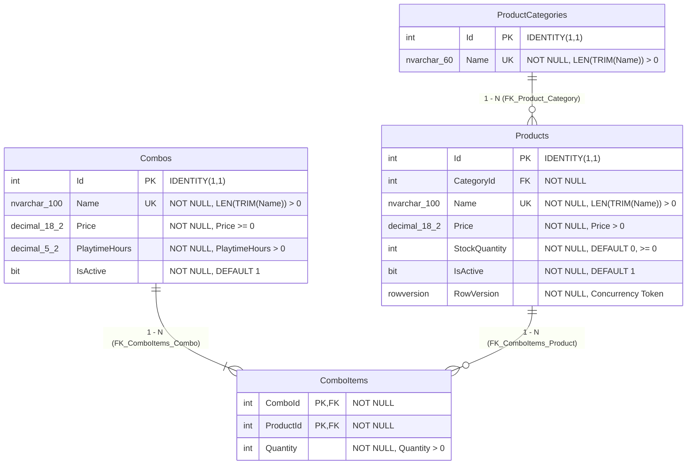

# Phase 1 Data Model: Quản lý Menu, Kho hàng & Combo (`01-menu-inventory`)

**Date**: 2026-10-11  
**Database**: SQL Server (`BilliardDB`)  
**ORM**: Entity Framework Core 8 (`Bms.Web.Data.ApplicationDbContext`)

---

## 1. Sơ đồ Quan hệ Thực thể (Entity Relationship Diagram)



---

## 2. Định nghĩa Domain Entities (`src/Bms.Web/Entities/` hoặc `src/Bms.Web/Data/`)

### 2.1 `ProductCategory.cs`
| Thuộc tính | Kiểu C# | Kiểu SQL Server | Ràng buộc & Annotations |
|---|---|---|---|
| `Id` | `int` | `int IDENTITY` | `[Key]` |
| `Name` | `string` | `nvarchar(60)` | `[Required]`, `[MaxLength(60)]`, Unique (`UQ_ProductCategories_Name`) |
| `Products` | `ICollection<Product>` | Navigation | `new List<Product>()` |

### 2.2 `Product.cs`
| Thuộc tính | Kiểu C# | Kiểu SQL Server | Ràng buộc & Annotations |
|---|---|---|---|
| `Id` | `int` | `int IDENTITY` | `[Key]` |
| `CategoryId` | `int` | `int` | `[Required]`, FK tới `ProductCategories(Id)` |
| `Name` | `string` | `nvarchar(100)` | `[Required]`, `[MaxLength(100)]`, Unique (`UQ_Products_Name`) |
| `Price` | `decimal` | `decimal(18,2)` | `[Required]`, `Price > 0` (`CK_Product_Price`) |
| `StockQuantity` | `int` | `int` | `[Required]`, `StockQuantity >= 0` (`CK_Product_Stock`), Default `0` |
| `IsActive` | `bool` | `bit` | `[Required]`, Default `true` |
| `RowVersion` | `byte[]` | `rowversion` | `[Timestamp]`, Optimistic Concurrency Token |
| `Category` | `ProductCategory` | Navigation | Many-to-One |
| `ComboItems` | `ICollection<ComboItem>` | Navigation | One-to-Many |

### 2.3 `Combo.cs`
| Thuộc tính | Kiểu C# | Kiểu SQL Server | Ràng buộc & Annotations |
|---|---|---|---|
| `Id` | `int` | `int IDENTITY` | `[Key]` |
| `Name` | `string` | `nvarchar(100)` | `[Required]`, `[MaxLength(100)]`, Unique (`UQ_Combos_Name`) |
| `Price` | `decimal` | `decimal(18,2)` | `[Required]`, `Price >= 0` (`CK_Combo_Price`) |
| `PlaytimeHours` | `decimal` | `decimal(5,2)` | `[Required]`, `PlaytimeHours > 0` (`CK_Combo_Playtime`) |
| `IsActive` | `bool` | `bit` | `[Required]`, Default `true` |
| `ComboItems` | `ICollection<ComboItem>` | Navigation | One-to-Many |

### 2.4 `ComboItem.cs`
| Thuộc tính | Kiểu C# | Kiểu SQL Server | Ràng buộc & Annotations |
|---|---|---|---|
| `ComboId` | `int` | `int` | Composite PK `(ComboId, ProductId)`, FK tới `Combos(Id)` |
| `ProductId` | `int` | `int` | Composite PK `(ComboId, ProductId)`, FK tới `Products(Id)` |
| `Quantity` | `int` | `int` | `[Required]`, `Quantity > 0` (`CK_ComboItems_Quantity`) |
| `Combo` | `Combo` | Navigation | Many-to-One |
| `Product` | `Product` | Navigation | Many-to-One |

---

## 3. Cấu hình EF Core Fluent API (`ApplicationDbContext.cs`)

```csharp
// ProductCategories
builder.Entity<ProductCategory>(e =>
{
    e.ToTable("ProductCategories", "dbo");
    e.HasKey(x => x.Id);
    e.Property(x => x.Name).HasMaxLength(60).IsRequired();
    e.HasIndex(x => x.Name).HasDatabaseName("UQ_ProductCategories_Name").IsUnique();
});

// Products
builder.Entity<Product>(e =>
{
    e.ToTable("Products", "dbo");
    e.HasKey(x => x.Id);
    e.Property(x => x.Name).HasMaxLength(100).IsRequired();
    e.Property(x => x.Price).HasColumnType("decimal(18,2)").IsRequired();
    e.Property(x => x.StockQuantity).HasDefaultValue(0).IsRequired();
    e.Property(x => x.IsActive).HasDefaultValue(true).IsRequired();
    e.Property(x => x.RowVersion).IsRowVersion().IsConcurrencyToken();

    e.HasIndex(x => x.Name).HasDatabaseName("UQ_Products_Name").IsUnique();
    e.HasIndex(x => new { x.CategoryId, x.IsActive }).HasDatabaseName("IX_Products_Category_Active");

    e.HasOne(x => x.Category)
     .WithMany(c => c.Products)
     .HasForeignKey(x => x.CategoryId)
     .OnDelete(DeleteBehavior.Restrict);
});

// Combos
builder.Entity<Combo>(e =>
{
    e.ToTable("Combos", "dbo");
    e.HasKey(x => x.Id);
    e.Property(x => x.Name).HasMaxLength(100).IsRequired();
    e.Property(x => x.Price).HasColumnType("decimal(18,2)").IsRequired();
    e.Property(x => x.PlaytimeHours).HasColumnType("decimal(5,2)").IsRequired();
    e.Property(x => x.IsActive).HasDefaultValue(true).IsRequired();
    e.HasIndex(x => x.Name).HasDatabaseName("UQ_Combos_Name").IsUnique();
});

// ComboItems (Composite Key)
builder.Entity<ComboItem>(e =>
{
    e.ToTable("ComboItems", "dbo");
    e.HasKey(x => new { x.ComboId, x.ProductId });
    e.Property(x => x.Quantity).IsRequired();
    e.HasIndex(x => x.ProductId).HasDatabaseName("IX_ComboItems_ProductId");

    e.HasOne(x => x.Combo)
     .WithMany(c => c.ComboItems)
     .HasForeignKey(x => x.ComboId)
     .OnDelete(DeleteBehavior.Restrict);

    e.HasOne(x => x.Product)
     .WithMany(p => p.ComboItems)
     .HasForeignKey(x => x.ProductId)
     .OnDelete(DeleteBehavior.Restrict);
});
```

---

## 4. ViewModels & DTOs (`src/Bms.Web/Models/MenuViewModels.cs`)

### 4.1 ViewModels cho giao diện MVC (`MenuController` & `ComboController`)
- **`MenuIndexViewModel`**:
  - Danh sách `Categories` (`List<CategoryItemViewModel>`)
  - Danh sách `Products` phân trang (`List<ProductRowViewModel>`)
  - Bộ lọc: `Search`, `CategoryId`, `StatusFilter` (`all`, `active`, `inactive`, `low-stock`), `Page`, `TotalPages`, `TotalCount`
- **`CreateProductViewModel` / `EditProductViewModel`**:
  - `Id` (cho Edit), `CategoryId`, `Name`, `Price`, `StockQuantity` (khi tạo), `IsActive`, `RowVersionBase64` (cho Edit)
- **`AdjustStockViewModel`**:
  - `ProductId`, `ProductName`, `CurrentStock`, `AdjustmentType` (`Import` cộng thêm / `Set` đặt lại / `Deduct` xuất hủy), `Quantity`, `Reason`, `RowVersionBase64`
- **`ComboListViewModel`**:
  - Danh sách `Combos` kèm chi tiết các món `ComboItemSummaryViewModel` (`ProductName`, `Quantity`, `UnitPrice`, `IsProductActive`)
- **`ComboFormViewModel`** (Create / Edit Combo):
  - `Id`, `Name`, `Price`, `PlaytimeHours`, `IsActive`
  - `Items`: `List<ComboItemInputViewModel>` (`ProductId`, `Quantity`)

---

## 5. Quy tắc Chuyển đổi Trạng thái & Validation

1. **Vòng đời Sản phẩm (`Product.IsActive`)**:
   - `Active (1)` $\leftrightarrow$ `Inactive (0)`
   - Khi `IsActive == false`: Sản phẩm vẫn hiển thị trong trang quản trị của Admin (với badge "Ngừng bán"), nhưng bị ẩn khỏi danh sách gọi món của Staff (UC30) và không thể thêm vào gói Combo mới.
2. **Kiểm tra Tồn kho khi Điều chỉnh (`AdjustStock`)**:
   - Công thức: `NewStock = CurrentStock + QuantityDelta`.
   - Nếu `NewStock < 0`: Chặn thao tác trước khi xuống DB và báo lỗi `"Số lượng tồn kho sau điều chỉnh không được nhỏ hơn 0"`.
3. **Kiểm tra Gói Combo**:
   - Không cho phép lưu gói Combo nếu `Items` rỗng hoặc có bất kỳ `Quantity <= 0`.
   - Nếu người dùng chọn cùng một `ProductId` trên nhiều dòng trong form Combo, hệ thống tự động cộng dồn `Quantity` hoặc báo lỗi trùng dòng để tránh vi phạm khóa chính ghép `PK_ComboItems (ComboId, ProductId)`.
