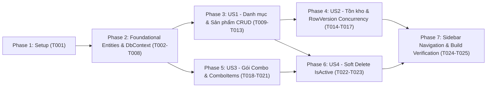

# Tasks: Quản lý Menu, Kho hàng & Combo (`01-menu-inventory`)

**Input**: Design documents từ `.specs/tung/01-menu-inventory/` (`plan.md`, `spec.md`, `research.md`, `data-model.md`, `contracts/interfaces.md`, `quickstart.md`)  
**Target Use Cases**: UC41 (Quản lý Menu & Kho hàng CRUD) & UC42 (Quản lý Combo)  
**Prerequisites**: Đã hoàn thành `plan.md`, `spec.md`, `research.md`, `data-model.md`, `contracts/interfaces.md`

**Organization**: Các task được chia nhỏ trực tiếp từ 5 quyết định kỹ thuật trong `research.md` (Phase 0 Research) và ánh xạ theo từng User Story (`US1` $\rightarrow$ `US4`) trong `spec.md` để có thể triển khai và kiểm thử độc lập từng phần.

## Format: `[ID] [P?] [Story] Description`

- **[P]**: Có thể thực hiện song song (khác file, không phụ thuộc vào task chưa hoàn thành)
- **[Story]**: Ánh xạ tới User Story tương ứng (`[US1]`, `[US2]`, `[US3]`, `[US4]`)
- Mọi task đều chỉ rõ đường dẫn file tuyệt đối/tương đối trong `src/Bms.Web/`

---

## Phase 1: Setup (Khởi tạo Cấu trúc Module F&B Catalog)

**Purpose**: Tạo cấu trúc thư mục cho Entities, Services, Controllers và Views theo Mục 1 của `research.md` (Kiến trúc MVC + API Hybrid).

- [X] T001 Tạo các thư mục chứa code cho module Menu & Combo gồm `src/Bms.Web/Data/Entities/`, `src/Bms.Web/Services/`, `src/Bms.Web/Controllers/Api/`, `src/Bms.Web/Views/Menu/`, và `src/Bms.Web/Views/Combo/`

---

## Phase 2: Foundational (SQL-First Entity Mapping & DbContext — Mục 2 `research.md`)

**Purpose**: Ánh xạ 4 bảng đã có trong SQL Server `BilliardDB` (`dbo.ProductCategories`, `dbo.Products`, `dbo.Combos`, `dbo.ComboItems`) vào EF Core 8 mà không chạy Migration ghi đè DB.

**⚠️ CRITICAL**: Phase này phải hoàn thành trước khi bắt đầu các User Story.

- [X] T002 [P] Tạo entity `ProductCategory` ánh xạ bảng `dbo.ProductCategories` (`Id` int IDENTITY PK, `Name` nvarchar(60) NOT NULL `[Required] [MaxLength(60)]`, navigation `ICollection<Product> Products`) trong `src/Bms.Web/Data/Entities/ProductCategory.cs`
- [X] T003 [P] Tạo entity `Product` ánh xạ bảng `dbo.Products` (`Id` int IDENTITY PK, `CategoryId` int FK, `Name` nvarchar(100) NOT NULL `[Required] [MaxLength(100)]`, `Price` decimal(18,2) `Price > 0`, `StockQuantity` int `StockQuantity >= 0` default 0, `IsActive` bit default true, `RowVersion` byte[] `[Timestamp]` Concurrency Token) trong `src/Bms.Web/Data/Entities/Product.cs`
- [X] T004 [P] Tạo entity `Combo` ánh xạ bảng `dbo.Combos` (`Id` int IDENTITY PK, `Name` nvarchar(100) NOT NULL `[Required] [MaxLength(100)]`, `Price` decimal(18,2) `Price >= 0`, `PlaytimeHours` decimal(5,2) `PlaytimeHours > 0`, `IsActive` bit default true, navigation `ICollection<ComboItem> ComboItems`) trong `src/Bms.Web/Data/Entities/Combo.cs`
- [X] T005 [P] Tạo entity `ComboItem` ánh xạ bảng `dbo.ComboItems` (`ComboId` int PK/FK, `ProductId` int PK/FK, `Quantity` int NOT NULL `Quantity > 0`, navigation `Combo` và `Product`) trong `src/Bms.Web/Data/Entities/ComboItem.cs`
- [X] T006 Cập nhật `ApplicationDbContext` bổ sung `DbSet<ProductCategory>`, `DbSet<Product>`, `DbSet<Combo>`, `DbSet<ComboItem>` và cấu hình Fluent API (`UQ_ProductCategories_Name`, `UQ_Products_Name`, `IX_Products_Category_Active`, `UQ_Combos_Name`, Composite PK `(ComboId, ProductId)`, `IsRowVersion()`, `DeleteBehavior.Restrict`) trong `src/Bms.Web/Data/ApplicationDbContext.cs`
- [X] T007 Khởi tạo interface `IMenuService` định nghĩa các phương thức CRUD Danh mục, Sản phẩm, Điều chỉnh tồn kho (kèm `RowVersionBase64`), Chuyển đổi trạng thái `IsActive` và Quản lý gói Combo trong `src/Bms.Web/Services/IMenuService.cs`
- [X] T008 Đăng ký Dependency Injection `builder.Services.AddScoped<IMenuService, MenuService>()` trong `src/Bms.Web/Program.cs`

**Checkpoint**: Hoàn tất ánh xạ SQL-First — `dotnet build` thành công và EF Core kết nối đúng 4 bảng trong `BilliardDB`.

---

## Phase 3: User Story 1 - Quản lý Danh mục & Sản phẩm F&B (Priority: P1) 🎯 MVP

**Goal**: Cho phép Admin thêm, sửa, xem, tìm kiếm/lọc Danh mục (`ProductCategories`) và Sản phẩm (`Products`) với kiểm tra trùng tên và ràng buộc giá/tồn kho (Mục 1 & Mục 2 `research.md`).

**Independent Test**: Đăng nhập quyền Admin, vào `/Menu`, tạo danh mục mới, thêm sản phẩm mới, lọc theo danh mục và kiểm tra bắt lỗi khi nhập trùng tên hoặc `Price <= 0`.

### Implementation for User Story 1

- [X] T009 [P] [US1] Tạo các ViewModels và DTOs cho Danh mục & Sản phẩm (`CategoryItemViewModel`, `CreateCategoryViewModel`, `EditCategoryViewModel`, `ProductRowViewModel`, `MenuIndexViewModel`, `CreateProductViewModel`, `EditProductViewModel` với `[Range(0.01, double.MaxValue)]` cho `Price` và `[Range(0, int.MaxValue)]` cho `StockQuantity`) trong `src/Bms.Web/Models/MenuViewModels.cs`
- [X] T010 [US1] Triển khai các hàm quản lý Category & Product trong `MenuService` (lấy danh sách phân trang/lọc, kiểm tra `Name.Trim()` unique case-insensitive, tạo mới và cập nhật `ProductCategory` & `Product`) trong `src/Bms.Web/Services/MenuService.cs`
- [X] T011 [US1] Tạo `MenuController` (`[Authorize(Roles = "Admin")]`) với các actions `Index`, `CreateCategory`, `EditCategory`, `Create` (GET/POST), `Edit` (GET/POST) trong `src/Bms.Web/Controllers/MenuController.cs`
- [X] T012 [P] [US1] Tạo giao diện danh sách Thực đơn & Quản lý Danh mục (bảng sản phẩm, thanh tìm kiếm, bộ lọc Category/Status, modal thêm/sửa Danh mục) trong `src/Bms.Web/Views/Menu/Index.cshtml`
- [X] T013 [P] [US1] Tạo giao diện thêm mới và chỉnh sửa sản phẩm F&B trong `src/Bms.Web/Views/Menu/Create.cshtml` và `src/Bms.Web/Views/Menu/Edit.cshtml`

**Checkpoint**: User Story 1 hoàn tất — Admin có thể quản lý trọn vẹn Danh mục và Sản phẩm trên giao diện web.

---

## Phase 4: User Story 2 - Quản lý Tồn kho & Kiểm soát Concurrency `RowVersion` (Priority: P1)

**Goal**: Cho phép Admin nhập hàng / điều chỉnh tồn kho và bảo vệ dữ liệu bằng Optimistic Concurrency Control `RowVersion` (Mục 3 `research.md`).

**Independent Test**: Mở 2 tab cùng sửa 1 sản phẩm hoặc điều chỉnh tồn kho; tab lưu sau bị chặn với thông báo xung đột dữ liệu (`409 Conflict` / ModelState Error); chặn điều chỉnh làm tồn kho `< 0`.

### Implementation for User Story 2

- [ ] T014 [P] [US2] Bổ sung `AdjustStockViewModel` và API DTOs (`AdjustStockDto`, `ProductDetailDto` chứa `RowVersionBase64`) vào `src/Bms.Web/Models/MenuViewModels.cs`
- [ ] T015 [US2] Triển khai logic kiểm soát `RowVersion` (`Convert.FromBase64String`, gán `OriginalValue`, bắt `DbUpdateConcurrencyException`) và hàm `AdjustStockAsync` (kiểm tra `NewStock = CurrentStock + QuantityDelta >= 0`) trong `src/Bms.Web/Services/MenuService.cs`
- [ ] T016 [US2] Bổ sung action `POST /Menu/AdjustStock` vào `src/Bms.Web/Controllers/MenuController.cs` và tích hợp Modal Điều chỉnh tồn kho kèm hidden field `RowVersionBase64` vào `src/Bms.Web/Views/Menu/Index.cshtml`
- [ ] T017 [P] [US2] Tạo `FnbCatalogApiController` cung cấp REST endpoints `GET /api/v1/fnb/categories`, `GET /api/v1/fnb/products`, `POST /api/v1/fnb/products`, `PUT /api/v1/fnb/products/{id}`, và `PATCH /api/v1/fnb/products/{id}/adjust-stock` (trả về `409 Conflict` khi lệch `RowVersion`) trong `src/Bms.Web/Controllers/Api/FnbCatalogApiController.cs`

**Checkpoint**: User Story 2 hoàn tất — Cập nhật sản phẩm và điều chỉnh tồn kho an toàn tuyệt đối trước tranh chấp đồng thời.

---

## Phase 5: User Story 3 - Quản lý Gói Combo Giờ chơi & F&B (Priority: P2)

**Goal**: Cho phép Admin tạo và cập nhật gói `Combo` kèm danh sách món `ComboItems` trong một Transaction nguyên tử (Mục 5 `research.md`).

**Independent Test**: Tạo gói Combo mới với `PlaytimeHours > 0`, `Price >= 0` và ít nhất 1 món F&B đang hoạt động; sửa danh sách món trong Combo và kiểm tra bảng `dbo.Combos` & `dbo.ComboItems`.

### Implementation for User Story 3

- [ ] T018 [P] [US3] Tạo các ViewModels và DTOs cho Combo (`ComboListViewModel`, `ComboRowViewModel`, `ComboItemSummaryViewModel`, `ComboFormViewModel`, `ComboItemInputViewModel` với `[Range(0, double.MaxValue)]` cho `Price`, `[Range(0.1, 24.0)]` cho `PlaytimeHours`, `[Range(1, int.MaxValue)]` cho `Quantity`) trong `src/Bms.Web/Models/ComboViewModels.cs`
- [ ] T019 [US3] Triển khai các hàm quản lý Combo trong `MenuService` (kiểm tra `Items.Count >= 1`, gộp các dòng trùng `ProductId`, xác minh mọi sản phẩm đều `IsActive == true`, bọc Transaction khi thêm/thay thế `ComboItems`) trong `src/Bms.Web/Services/MenuService.cs`
- [ ] T020 [US3] Tạo `ComboController` (`[Authorize(Roles = "Admin")]`) với các actions `Index`, `Create` (GET/POST), `Edit` (GET/POST) trong `src/Bms.Web/Controllers/ComboController.cs` và bổ sung API `GET/POST /api/v1/fnb/combos` vào `src/Bms.Web/Controllers/Api/FnbCatalogApiController.cs`
- [ ] T021 [P] [US3] Tạo các Razor Views quản lý gói Combo (gồm bảng danh sách Combo kèm món đi kèm và form động thêm/xóa dòng món ăn bằng JavaScript) trong `src/Bms.Web/Views/Combo/Index.cshtml`, `src/Bms.Web/Views/Combo/Create.cshtml`, và `src/Bms.Web/Views/Combo/Edit.cshtml`

**Checkpoint**: User Story 3 hoàn tất — Admin có thể thiết lập và chỉnh sửa các gói Combo Giờ chơi + F&B.

---

## Phase 6: User Story 4 - Vô hiệu hóa (Soft Delete) Sản phẩm & Combo (Priority: P2)

**Goal**: Cho phép Admin ngừng kinh doanh hoặc mở bán lại Sản phẩm/Combo bằng cờ `IsActive` mà không làm hỏng dữ liệu lịch sử hóa đơn (Mục 4 `research.md`).

**Independent Test**: Bấm nút "Ngừng bán" trên một Sản phẩm hoặc Combo, xác nhận trạng thái chuyển sang `IsActive = false` và bị ẩn khỏi API menu đang bán (`activeOnly = true`).

### Implementation for User Story 4

- [ ] T022 [US4] Triển khai hàm `ToggleProductStatusAsync` (có kiểm tra `RowVersion`), `ToggleComboStatusAsync`, và `DeleteCategoryIfEmptyAsync` (chặn xóa Category nếu `Products.Any(p => p.CategoryId == id)`) trong `src/Bms.Web/Services/MenuService.cs`
- [ ] T023 [US4] Bổ sung action `POST /Menu/ToggleStatus/{id}` vào `src/Bms.Web/Controllers/MenuController.cs`, `POST /Combo/ToggleStatus/{id}` vào `src/Bms.Web/Controllers/ComboController.cs`, và nút bấm bật/tắt trạng thái trên `src/Bms.Web/Views/Menu/Index.cshtml` & `src/Bms.Web/Views/Combo/Index.cshtml`

**Checkpoint**: User Story 4 hoàn tất — Bảo toàn 100% tính toàn vẹn khóa ngoại và lịch sử giao dịch.

---

## Phase 7: Polish & Cross-Cutting Concerns

**Purpose**: Kết nối điều hướng trên Sidebar Admin và kiểm tra nghiệm thu toàn trình.

- [ ] T024 Cập nhật liên kết điều hướng `<i class="bi bi-cup-straw"></i> Thực đơn` (`asp-controller="Menu" asp-action="Index"`) và bổ sung link `Combo` (`asp-controller="Combo" asp-action="Index"`) trên thanh Sidebar trong `src/Bms.Web/Views/Shared/_AdminLayout.cshtml`
- [ ] T025 Chạy kiểm tra biên dịch `dotnet build src/Bms.Web/Bms.Web.csproj` (đảm bảo 0 error, 0 warning mới) và rà soát toàn bộ kịch bản trong `.specs/tung/01-menu-inventory/quickstart.md`

---

## Dependencies & Execution Order

### 1. Thứ tự Phụ thuộc giữa các Phase

### 2. Cơ hội Thực thi Song song (Parallel Opportunities)
- **Trong Phase 2**: Các task tạo Entity `T002`, `T003`, `T004`, `T005` nằm ở 4 file độc lập nên có thể tạo song song `[P]`.
- **Trong Phase 3 & 5**: Việc tạo ViewModels (`T009`, `T018`) và các Razor Views (`T012`, `T013`, `T021`) có thể thực hiện song song `[P]`.

---

## Implementation Strategy

1. **Bước 1 (Foundation)**: Hoàn thành `T001` $\rightarrow$ `T008` để dựng xong tầng dữ liệu SQL-First.
2. **Bước 2 (MVP - UC41)**: Hoàn thành `T009` $\rightarrow$ `T017` để chạy hoàn chỉnh CRUD Danh mục, Sản phẩm, Nhập kho và Concurrency `RowVersion`.
3. **Bước 3 (UC42 & Soft Delete)**: Hoàn thành `T018` $\rightarrow$ `T025` để bổ sung Quản lý Gói Combo, bật/tắt trạng thái bán và gắn vào Sidebar Admin.
