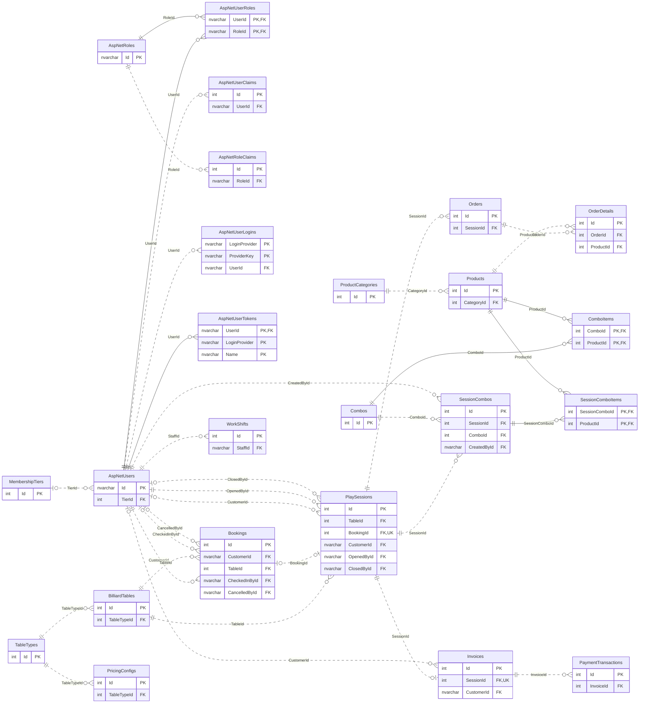

# BMS — Database Design đầy đủ

## 3. Database Design — Toàn bộ BilliardDB

**Ngày cập nhật:** 01/10/2026. **Nguồn:** `BMS_Database_Starter/BilliardDB_Full.sql` tại commit database `4448bb2`. **Phạm vi:** 24 bảng nghiệp vụ, 150 cột và 33 khóa ngoại.

Phần này thay thế mục Database Design bốn bảng trước đây để dùng trong báo cáo SDS chung của nhóm. Nội dung phản ánh DDL hiện có; không tự bổ sung các cột/ràng buộc chưa có. Bộ schema và seed đã được thực thi trên SQL Server; script nâng cấp combo đã áp dụng trên localhost / BilliardDB. Có bảng không có nghĩa mọi luồng nghiệp vụ đã được code.

### 3.0 Sơ đồ database tổng thể

Sơ đồ có đủ 24 bảng và toàn bộ FK. Mỗi hộp rút gọn chỉ hiện các cột khóa để dễ đọc; các bảng bên dưới mô tả đầy đủ mọi cột. `dbo.sysdiagrams` do SSMS tạo để lưu sơ đồ, không thuộc 24 bảng nghiệp vụ và không đưa vào SDS.

**Hình I.3 — Database Diagram toàn hệ thống BMS (24 bảng).** PK là khóa chính; FK là khóa ngoại; UK là tính duy nhất ở cột. Đầu quan hệ 0..1 thể hiện FK có thể NULL hoặc phía con có FK duy nhất; 0..n thể hiện nhiều bản ghi. Nét liền là quan hệ định danh (FK thuộc PK), nét đứt là quan hệ không định danh. Điều kiện chỉ một phiên Active/bàn là unique index có lọc, không biến toàn bộ lịch sử phiên thành quan hệ một–một.

**Danh mục bảng:**

| No | Table | Description |
|---|---|---|
| 1 | [AspNetUsers](#3-1-aspnetusers) | Nguồn tài khoản chung cho Admin, Staff, Customer; thông tin nhân viên, bảo mật và hạng thành viên. |
| 2 | [AspNetRoles](#3-2-aspnetroles) | Danh mục vai trò và quyền ở mức role: Admin, Staff, Customer. |
| 3 | [AspNetUserRoles](#3-3-aspnetuserroles) | Bảng nối nhiều–nhiều giữa tài khoản và vai trò. |
| 4 | [AspNetUserClaims](#3-4-aspnetuserclaims) | Các claim bổ sung gắn với từng tài khoản theo cơ chế Identity. |
| 5 | [AspNetRoleClaims](#3-5-aspnetroleclaims) | Các claim được cấp thông qua vai trò theo cơ chế Identity. |
| 6 | [AspNetUserLogins](#3-6-aspnetuserlogins) | Liên kết tài khoản BMS với định danh của nhà cung cấp đăng nhập ngoài. |
| 7 | [AspNetUserTokens](#3-7-aspnetusertokens) | Lưu token theo tài khoản, nhà cung cấp và tên token; không phải bảng phiên chơi. |
| 8 | [MembershipTiers](#3-8-membershiptiers) | Danh mục hạng thành viên và phần trăm ưu đãi. |
| 9 | [TableTypes](#3-9-tabletypes) | Danh mục loại bàn và đơn giá giờ cơ sở. |
| 10 | [BilliardTables](#3-10-billiardtables) | Thông tin bàn bida vật lý, vị trí và trạng thái hiện tại. |
| 11 | [PricingConfigs](#3-11-pricingconfigs) | Cấu hình đơn giá theo khoảng giờ cho từng loại bàn. |
| 12 | [Bookings](#3-12-bookings) | Lượt đặt bàn, khách đặt, khoảng thời gian, check-in và hủy đặt. |
| 13 | [PlaySessions](#3-13-playsessions) | Phiên chơi thực tế, người mở/đóng và giá giờ được ghi nhận lúc mở. |
| 14 | [ProductCategories](#3-14-productcategories) | Danh mục nhóm đồ ăn và nước uống. |
| 15 | [Products](#3-15-products) | Món đang bán, giá, tồn kho và trạng thái kinh doanh. |
| 16 | [Orders](#3-16-orders) | Lượt gọi món F&B gắn với phiên chơi. |
| 17 | [OrderDetails](#3-17-orderdetails) | Chi tiết món, số lượng và giá tại thời điểm gọi trong một đơn F&B. |
| 18 | [Combos](#3-18-combos) | Danh mục gói gồm giờ chơi và các món đi kèm. |
| 19 | [ComboItems](#3-19-comboitems) | Các món và số lượng cho mỗi đơn vị combo trong danh mục hiện tại. |
| 20 | [SessionCombos](#3-20-sessioncombos) | Lượt mua combo của phiên chơi, số gói, tên/giá/giờ tại thời điểm mua. |
| 21 | [SessionComboItems](#3-21-sessioncomboitems) | Thành phần món được lưu tại thời điểm mua combo để giữ lịch sử. |
| 22 | [Invoices](#3-22-invoices) | Hóa đơn của phiên chơi: tiền giờ, F&B, giảm giá và trạng thái thanh toán. |
| 23 | [PaymentTransactions](#3-23-paymenttransactions) | Các giao dịch thanh toán của hóa đơn, phương thức và mã tham chiếu. |
| 24 | [WorkShifts](#3-24-workshifts) | Ca làm của nhân viên, thời điểm và số tiền đầu/cuối ca. |

Sơ đồ lớn: kéo thanh cuộn để xem từng vùng, hoặc mở [ảnh SVG riêng](sds-hung/03-database.svg) để phóng to. Bấm tên bảng trong danh sách để đến bảng mô tả.

**Quy ước đọc các bảng:**

- `NULL`/`NOT NULL`, `DEFAULT`, `CHECK`, PK, FK và UNIQUE dưới đây lấy từ SQL. Một cột NULL ở SQL vẫn có thể bắt buộc ở form theo nghiệp vụ.
- PK ghép yêu cầu duy nhất cả nhóm cột, không phải từng cột riêng. Unique filtered index chỉ áp dụng các dòng thỏa WHERE.
- Cột `rowversion` do SQL Server sinh, phục vụ kiểm soát đồng thời; không lưu ngày giờ. Các cột có hậu tố Utc lưu UTC; khi hiển thị đổi sang giờ Việt Nam. `HireDate` là ngày, không đổi múi giờ.
- Các số tiền dùng decimal; đơn vị nghiệp vụ hiện là VND. `DiscountPercent` là phần trăm; `DiscountAmount` là số tiền.
- Cột `AS (...) PERSISTED` do SQL Server tính và lưu; DDL không khai báo riêng kiểu dữ liệu hoặc NOT NULL cho các cột tính toán này.
- FK không ghi ON DELETE CASCADE có hành vi NO ACTION. FK không tự xác minh role, phiên đang mở, tồn kho hoặc chống xử lý yêu cầu lặp.

### 3.1 AspNetUsers

**Mục đích:** Nguồn tài khoản chung cho Admin, Staff, Customer; thông tin nhân viên, bảo mật và hạng thành viên. **Primary key:** `(Id)`.

| Column | Constraints | Notes |
|---|---|---|
| `Id` | `nvarchar(450)`; `NOT NULL`; `PK` | Khóa chuỗi Identity; không phải số tự tăng. |
| `UserName` | `nvarchar(256)`; `NULL` | Tên đăng nhập gốc. |
| `NormalizedUserName` | `nvarchar(256)`; `NULL`; `UNIQUE INDEX UserNameIndex(NormalizedUserName) WHERE NormalizedUserName IS NOT NULL` | Tên đăng nhập chuẩn hóa do Identity quản lý. |
| `Email` | `nvarchar(256)`; `NULL` | Địa chỉ email gốc. |
| `NormalizedEmail` | `nvarchar(256)`; `NULL`; `UNIQUE INDEX EmailIndex(NormalizedEmail) WHERE NormalizedEmail IS NOT NULL` | Email chuẩn hóa; schema BMS yêu cầu không trùng khi có giá trị. |
| `EmailConfirmed` | `bit`; `NOT NULL`; `DEFAULT 0` | Cờ xác nhận email. |
| `PasswordHash` | `nvarchar(max)`; `NULL` | Hash mật khẩu do Identity tạo; seed NULL, chưa có mật khẩu để đăng nhập. |
| `SecurityStamp` | `nvarchar(max)`; `NULL` | Dấu thay đổi bảo mật phục vụ kiểm tra phiên đăng nhập. |
| `ConcurrencyStamp` | `nvarchar(max)`; `NULL` | Token kiểm soát cập nhật đồng thời của Identity; không phải rowversion. |
| `PhoneNumber` | `nvarchar(20)`; `NULL`; CHECK `PhoneNumber IS NULL OR LEN(LTRIM(RTRIM(PhoneNumber))) > 0`; `UNIQUE INDEX UX_User_Phone(PhoneNumber) WHERE PhoneNumber IS NOT NULL` | Số điện thoại; cần chuẩn hóa nhất quán ở ứng dụng. |
| `PhoneNumberConfirmed` | `bit`; `NOT NULL`; `DEFAULT 0` | Cờ xác nhận số điện thoại. |
| `TwoFactorEnabled` | `bit`; `NOT NULL`; `DEFAULT 0` | Cờ sử dụng xác thực hai yếu tố; không tự chứng minh đã có luồng 2FA. |
| `LockoutEnd` | `datetimeoffset(7)`; `NULL` | Thời điểm kết thúc khóa tạm; khác khóa quản trị IsActive. |
| `LockoutEnabled` | `bit`; `NOT NULL`; `DEFAULT 1` | Cho phép áp dụng khóa tạm. |
| `AccessFailedCount` | `int`; `NOT NULL`; `DEFAULT 0`; CHECK `AccessFailedCount >= 0` | Số lần đăng nhập thất bại. |
| `FullName` | `nvarchar(100)`; `NOT NULL`; CHECK `LEN(LTRIM(RTRIM(FullName))) > 0` | Họ tên hiển thị. |
| `IsActive` | `bit`; `NOT NULL`; `DEFAULT 1` | Trạng thái cho phép sử dụng tài khoản; backend/cookie phải kiểm tra. |
| `CreatedAtUtc` | `datetime2(0)`; `NOT NULL`; `DEFAULT SYSUTCDATETIME()` | Thời điểm tạo tài khoản, lưu UTC. |
| `EmployeeCode` | `nvarchar(20)`; `NULL`; CHECK `EmployeeCode IS NULL OR LEN(LTRIM(RTRIM(EmployeeCode))) > 0`; `UNIQUE INDEX UX_User_EmployeeCode(EmployeeCode) WHERE EmployeeCode IS NOT NULL` | Mã nhân viên; tính duy nhất áp dụng toàn bảng. |
| `RewardPoints` | `int`; `NOT NULL`; `DEFAULT 0` | Điểm tích lũy; chưa có CHECK >= 0 hoặc lịch sử điểm. |
| `TierId` | `int`; `NULL`; FK → `MembershipTiers.Id`; ON DELETE NO ACTION | Hạng thành viên; NULL nghĩa chưa gán hạng. |
| `HireDate` | `date`; `NULL` | Ngày vào làm; là date, không đổi múi giờ. |

**Indexes khai báo riêng:**

- `UserNameIndex`: `UNIQUE (NormalizedUserName) WHERE NormalizedUserName IS NOT NULL`.
- `EmailIndex`: `UNIQUE (NormalizedEmail) WHERE NormalizedEmail IS NOT NULL`.
- `UX_User_Phone`: `UNIQUE (PhoneNumber) WHERE PhoneNumber IS NOT NULL`.
- `UX_User_EmployeeCode`: `UNIQUE (EmployeeCode) WHERE EmployeeCode IS NOT NULL`.

**Lưu ý nghiệp vụ:** Không có bảng Employee tách riêng. Staff được xác định qua role Staff. UserManager quản lý password/normalized fields/security stamp. SQL-first: không áp dụng migration khởi tạo lên bảng đã có. FK đến tier không cấp quyền quản trị.

### 3.2 AspNetRoles

**Mục đích:** Danh mục vai trò và quyền ở mức role: Admin, Staff, Customer. **Primary key:** `(Id)`.

| Column | Constraints | Notes |
|---|---|---|
| `Id` | `nvarchar(450)`; `NOT NULL`; `PK` | Khóa chuỗi vai trò. |
| `Name` | `nvarchar(256)`; `NULL` | Tên vai trò, ví dụ Admin, Staff, Customer. |
| `NormalizedName` | `nvarchar(256)`; `NULL`; `UNIQUE INDEX RoleNameIndex(NormalizedName) WHERE NormalizedName IS NOT NULL` | Tên vai trò chuẩn hóa, ví dụ ADMIN. |
| `ConcurrencyStamp` | `nvarchar(max)`; `NULL` | Token kiểm soát sửa role đồng thời. |

**Indexes khai báo riêng:**

- `RoleNameIndex`: `UNIQUE (NormalizedName) WHERE NormalizedName IS NOT NULL`.

**Lưu ý nghiệp vụ:** Vai trò là phân quyền, khác với MembershipTiers. NULL ở DDL không có nghĩa ứng dụng nên tạo role không tên.

### 3.3 AspNetUserRoles

**Mục đích:** Bảng nối nhiều–nhiều giữa tài khoản và vai trò. **Primary key:** `(UserId, RoleId)`.

| Column | Constraints | Notes |
|---|---|---|
| `UserId` | `nvarchar(450)`; `NOT NULL`; `thuộc PK ghép`; FK → `AspNetUsers.Id`; ON DELETE CASCADE | Tài khoản được gán vai trò. |
| `RoleId` | `nvarchar(450)`; `NOT NULL`; `thuộc PK ghép`; FK → `AspNetRoles.Id`; ON DELETE CASCADE | Vai trò được cấp; PK ghép ngăn trùng một cặp user–role. |

**Indexes khai báo riêng:**

- `IX_AspNetUserRoles_RoleId`: `(RoleId)`.

**Lưu ý nghiệp vụ:** SQL hỗ trợ nhiều role/user. Quy tắc một role khi tạo tài khoản là quy tắc ứng dụng, không phải UNIQUE(UserId).

### 3.4 AspNetUserClaims

**Mục đích:** Các claim bổ sung gắn với từng tài khoản theo cơ chế Identity. **Primary key:** `(Id)`.

| Column | Constraints | Notes |
|---|---|---|
| `Id` | `int`; `NOT NULL`; `IDENTITY`; `PK` | Khóa của claim. |
| `UserId` | `nvarchar(450)`; `NOT NULL`; FK → `AspNetUsers.Id`; ON DELETE CASCADE | Tài khoản sở hữu claim. |
| `ClaimType` | `nvarchar(max)`; `NULL` | Loại claim. |
| `ClaimValue` | `nvarchar(max)`; `NULL` | Giá trị claim; Identity quản lý. |

**Indexes khai báo riêng:**

- `IX_AspNetUserClaims_UserId`: `(UserId)`.

**Lưu ý nghiệp vụ:** Claim không thay thế xác thực danh tính. Cascade chỉ mô tả DDL; không cho phép xóa tài khoản có lịch sử nghiệp vụ.

### 3.5 AspNetRoleClaims

**Mục đích:** Các claim được cấp thông qua vai trò theo cơ chế Identity. **Primary key:** `(Id)`.

| Column | Constraints | Notes |
|---|---|---|
| `Id` | `int`; `NOT NULL`; `IDENTITY`; `PK` | Khóa của claim vai trò. |
| `RoleId` | `nvarchar(450)`; `NOT NULL`; FK → `AspNetRoles.Id`; ON DELETE CASCADE | Vai trò sở hữu claim. |
| `ClaimType` | `nvarchar(max)`; `NULL` | Loại claim của role. |
| `ClaimValue` | `nvarchar(max)`; `NULL` | Giá trị claim được cấp qua role. |

**Indexes khai báo riêng:**

- `IX_AspNetRoleClaims_RoleId`: `(RoleId)`.

**Lưu ý nghiệp vụ:** Bảng này có trong schema nhưng chưa được giao rõ trong phân công 20 bảng ban đầu; cần nhóm chốt người phụ trách.

### 3.6 AspNetUserLogins

**Mục đích:** Liên kết tài khoản BMS với định danh của nhà cung cấp đăng nhập ngoài. **Primary key:** `(LoginProvider, ProviderKey)`.

| Column | Constraints | Notes |
|---|---|---|
| `LoginProvider` | `nvarchar(128)`; `NOT NULL`; `thuộc PK ghép` | Tên nhà cung cấp đăng nhập ngoài. |
| `ProviderKey` | `nvarchar(128)`; `NOT NULL`; `thuộc PK ghép` | Định danh user tại nhà cung cấp; cùng LoginProvider tạo PK. |
| `ProviderDisplayName` | `nvarchar(max)`; `NULL` | Tên nhà cung cấp để hiển thị. |
| `UserId` | `nvarchar(450)`; `NOT NULL`; FK → `AspNetUsers.Id`; ON DELETE CASCADE | Tài khoản BMS được liên kết; có bảng không có nghĩa đã tích hợp Google/Facebook. |

**Indexes khai báo riêng:**

- `IX_AspNetUserLogins_UserId`: `(UserId)`.

**Lưu ý nghiệp vụ:** BMS hiện dùng đăng nhập Identity; cần triển khai cấu hình provider trước khi hỗ trợ đăng nhập ngoài.

### 3.7 AspNetUserTokens

**Mục đích:** Lưu token theo tài khoản, nhà cung cấp và tên token; không phải bảng phiên chơi. **Primary key:** `(UserId, LoginProvider, Name)`.

| Column | Constraints | Notes |
|---|---|---|
| `UserId` | `nvarchar(450)`; `NOT NULL`; `thuộc PK ghép`; FK → `AspNetUsers.Id`; ON DELETE CASCADE | Tài khoản sở hữu token. |
| `LoginProvider` | `nvarchar(128)`; `NOT NULL`; `thuộc PK ghép` | Nhà cung cấp của token. |
| `Name` | `nvarchar(128)`; `NOT NULL`; `thuộc PK ghép` | Tên/loại token; cùng UserId và LoginProvider tạo PK. |
| `Value` | `nvarchar(max)`; `NULL` | Giá trị token; không đưa vào giao diện hoặc log công khai. |

**Lưu ý nghiệp vụ:** Không lưu mật khẩu rõ vào Value. Quy trình phát hành/thu hồi token thuộc Identity và ứng dụng.

### 3.8 MembershipTiers

**Mục đích:** Danh mục hạng thành viên và phần trăm ưu đãi. **Primary key:** `(Id)`.

| Column | Constraints | Notes |
|---|---|---|
| `Id` | `int`; `NOT NULL`; `IDENTITY`; `PK` | Khóa hạng thành viên tự tăng. |
| `TierName` | `nvarchar(50)`; `NOT NULL`; `UNIQUE`; CHECK `LEN(LTRIM(RTRIM(TierName))) > 0` | Tên hạng; seed hiện chưa định nghĩa các hạng cụ thể. |
| `DiscountPercent` | `decimal(5,2)`; `NOT NULL`; `DEFAULT 0`; CHECK `DiscountPercent >= 0 AND DiscountPercent <= 100` | Phần trăm ưu đãi; 10.00 nghĩa là 10%, không phải hệ số 0.10. |

**Lưu ý nghiệp vụ:** Chưa có MinPoints, thứ tự hạng hoặc lịch sử điểm. Ngưỡng nâng hạng và phạm vi ưu đãi cần TV3/TV4 thống nhất; không tự ghi các cột chưa có vào SDS.

### 3.9 TableTypes

**Mục đích:** Danh mục loại bàn và đơn giá giờ cơ sở. **Primary key:** `(Id)`.

| Column | Constraints | Notes |
|---|---|---|
| `Id` | `int`; `NOT NULL`; `IDENTITY`; `PK` | Khóa loại bàn. |
| `Name` | `nvarchar(50)`; `NOT NULL`; `UNIQUE`; CHECK `LEN(LTRIM(RTRIM(Name))) > 0` | Tên loại bàn, ví dụ Pool hoặc Carom. |
| `HourlyRate` | `decimal(18,2)`; `NOT NULL`; CHECK `HourlyRate > 0` | Đơn giá cơ sở cho một giờ; số tiền theo VND. |

### 3.10 BilliardTables

**Mục đích:** Thông tin bàn bida vật lý, vị trí và trạng thái hiện tại. **Primary key:** `(Id)`.

| Column | Constraints | Notes |
|---|---|---|
| `Id` | `int`; `NOT NULL`; `IDENTITY`; `PK` | Khóa bàn. |
| `TableCode` | `nvarchar(20)`; `NOT NULL`; `UNIQUE`; CHECK `LEN(LTRIM(RTRIM(TableCode))) > 0` | Mã bàn duy nhất, ví dụ B01. |
| `TableTypeId` | `int`; `NOT NULL`; FK → `TableTypes.Id`; ON DELETE NO ACTION | Loại bàn tương ứng. |
| `FloorNumber` | `int`; `NOT NULL`; `DEFAULT 1`; CHECK `FloorNumber >= 0` | Tầng/khu vực bàn; schema cho phép 0. |
| `Status` | `varchar(20)`; `NOT NULL`; `DEFAULT 'Available'`; CHECK `Status IN ('Available','InUse','AwaitingPayment','Maintenance','Inactive')` | Trạng thái vật lý; đặt lịch tương lai không tự biến bàn thành Reserved. |
| `RowVersion` | `rowversion`; `NOT NULL` | Token SQL Server tự sinh để phát hiện cập nhật đồng thời; không phải ngày giờ. |

**Indexes khai báo riêng:**

- `IX_BilliardTables_Type_Status`: `(TableTypeId, Status)`.

**Lưu ý nghiệp vụ:** Chỉ cập nhật trạng thái theo vòng đời nghiệp vụ. Đặt bàn theo lịch và trạng thái vật lý là hai thông tin khác nhau.

### 3.11 PricingConfigs

**Mục đích:** Cấu hình đơn giá theo khoảng giờ cho từng loại bàn. **Primary key:** `(Id)`.

| Column | Constraints | Notes |
|---|---|---|
| `Id` | `int`; `NOT NULL`; `IDENTITY`; `PK` | Khóa cấu hình giá. |
| `TableTypeId` | `int`; `NOT NULL`; FK → `TableTypes.Id`; ON DELETE NO ACTION | Loại bàn áp dụng. |
| `HourlyRate` | `decimal(18,2)`; `NOT NULL`; CHECK `HourlyRate > 0` | Giá giờ cho khoảng thời gian này. |
| `StartHour` | `time`; `NOT NULL`; tham gia `CK_PricingConfig_Hours` (xem dưới) | Giờ bắt đầu trong ngày; chưa có quy tắc ngày trong tuần. |
| `EndHour` | `time`; `NOT NULL`; tham gia `CK_PricingConfig_Hours` (xem dưới) | Giờ kết thúc; CHECK hiện không cho khoảng qua nửa đêm. |

**CHECK phối hợp nhiều cột:**

- `CK_PricingConfig_Hours`: `StartHour < EndHour`.

**Lưu ý nghiệp vụ:** Chưa có constraint chặn các khoảng cấu hình giá chồng nhau. usp_OpenSession hiện đọc TableTypes.HourlyRate, chưa áp dụng PricingConfigs; không mô tả giá theo khung giờ là đã chạy.

### 3.12 Bookings

**Mục đích:** Lượt đặt bàn, khách đặt, khoảng thời gian, check-in và hủy đặt. **Primary key:** `(Id)`.

| Column | Constraints | Notes |
|---|---|---|
| `Id` | `int`; `NOT NULL`; `IDENTITY`; `PK` | Khóa lượt đặt. |
| `CustomerId` | `nvarchar(450)`; `NOT NULL`; FK → `AspNetUsers.Id`; ON DELETE NO ACTION | Khách đặt; FK chỉ kiểm tra tồn tại, role Customer do procedure/backend kiểm tra. |
| `TableId` | `int`; `NOT NULL`; FK → `BilliardTables.Id`; ON DELETE NO ACTION | Bàn được đặt. |
| `StartAtUtc` | `datetime2(0)`; `NOT NULL`; tham gia `CK_Booking_Times` (xem dưới) | Thời điểm bắt đầu dự kiến, UTC. |
| `EndAtUtc` | `datetime2(0)`; `NOT NULL`; tham gia `CK_Booking_Times` (xem dưới) | Thời điểm kết thúc dự kiến, UTC; phải sau giờ bắt đầu. |
| `Status` | `varchar(20)`; `NOT NULL`; `DEFAULT 'Confirmed'`; CHECK `Status IN ('Confirmed','CheckedIn','Completed','Cancelled','NoShow')`; tham gia `CK_Booking_Cancel` (xem dưới) | Trạng thái lượt đặt theo danh sách CHECK. |
| `CreatedAtUtc` | `datetime2(0)`; `NOT NULL`; `DEFAULT SYSUTCDATETIME()` | Thời điểm tạo lượt đặt, UTC. |
| `CheckedInAtUtc` | `datetime2(0)`; `NULL`; tham gia `CK_Booking_Checkin` (xem dưới) | Thời điểm xác nhận khách đến; phải có cùng CheckedInById. |
| `CheckedInById` | `nvarchar(450)`; `NULL`; FK → `AspNetUsers.Id`; ON DELETE NO ACTION; tham gia `CK_Booking_Checkin` (xem dưới) | Người xác nhận check-in; quyền Staff/Admin do nghiệp vụ kiểm tra. |
| `CancelledAtUtc` | `datetime2(0)`; `NULL`; tham gia `CK_Booking_Cancel` (xem dưới) | Thời điểm hủy; phải có khi Status=Cancelled. |
| `CancelledById` | `nvarchar(450)`; `NULL`; FK → `AspNetUsers.Id`; ON DELETE NO ACTION; tham gia `CK_Booking_Cancel` (xem dưới) | Người hủy; phải có khi Status=Cancelled. |
| `CancellationReason` | `nvarchar(300)`; `NULL` | Lý do hủy, có thể NULL theo DDL. |
| `Notes` | `nvarchar(300)`; `NULL` | Ghi chú lượt đặt. |
| `RowVersion` | `rowversion`; `NOT NULL` | Token phát hiện cập nhật đồng thời. |

**CHECK phối hợp nhiều cột:**

- `CK_Booking_Times`: `EndAtUtc > StartAtUtc`.
- `CK_Booking_Checkin`: ` (CheckedInAtUtc IS NULL AND CheckedInById IS NULL) OR (CheckedInAtUtc IS NOT NULL AND CheckedInById IS NOT NULL)`.
- `CK_Booking_Cancel`: ` (Status = 'Cancelled' AND CancelledAtUtc IS NOT NULL AND CancelledById IS NOT NULL) OR (Status <> 'Cancelled' AND CancelledAtUtc IS NULL AND CancelledById IS NULL)`.

**Indexes khai báo riêng:**

- `IX_Bookings_Table_Time`: `(TableId, StartAtUtc, EndAtUtc) INCLUDE (Status)`.
- `IX_Bookings_Customer`: `(CustomerId, StartAtUtc)`.

**Lưu ý nghiệp vụ:** CHECK thời gian không chặn các booking trùng lịch. Procedure serialize theo bàn và kiểm tra khoảng [StartAtUtc, EndAtUtc); không bỏ qua bằng cách ghi EF trực tiếp mà thiếu kiểm tra tương đương. Check-in chưa tự mở phiên.

### 3.13 PlaySessions

**Mục đích:** Phiên chơi thực tế, người mở/đóng và giá giờ được ghi nhận lúc mở. **Primary key:** `(Id)`.

| Column | Constraints | Notes |
|---|---|---|
| `Id` | `int`; `NOT NULL`; `IDENTITY`; `PK` | Khóa phiên chơi. |
| `TableId` | `int`; `NOT NULL`; FK → `BilliardTables.Id`; ON DELETE NO ACTION; `UNIQUE INDEX UX_PlaySessions_ActiveTable(TableId) WHERE Status = 'Active'` | Bàn được sử dụng; mỗi bàn tối đa một phiên Active. |
| `BookingId` | `int`; `NULL`; FK → `Bookings.Id`; ON DELETE NO ACTION; `UNIQUE INDEX UX_PlaySessions_Booking(BookingId) WHERE BookingId IS NOT NULL` | Lượt đặt tương ứng, có thể NULL cho walk-in; một booking tối đa một phiên. |
| `CustomerId` | `nvarchar(450)`; `NULL`; FK → `AspNetUsers.Id`; ON DELETE NO ACTION | Khách chơi; schema cho phép khách vãng lai chưa gắn tài khoản. |
| `OpenedById` | `nvarchar(450)`; `NOT NULL`; FK → `AspNetUsers.Id`; ON DELETE NO ACTION | Người mở phiên; lấy định danh đã xác thực. |
| `ClosedById` | `nvarchar(450)`; `NULL`; FK → `AspNetUsers.Id`; ON DELETE NO ACTION; tham gia `CK_Session_Lifecycle` (xem dưới) | Người đóng phiên; NULL khi Active, bắt buộc khi Closed. |
| `StartAtUtc` | `datetime2(0)`; `NOT NULL`; tham gia `CK_Session_Lifecycle` (xem dưới) | Thời điểm bắt đầu thực tế, UTC. |
| `EndAtUtc` | `datetime2(0)`; `NULL`; tham gia `CK_Session_Lifecycle` (xem dưới) | Thời điểm kết thúc thực tế, UTC; trạng thái Closed mới có. |
| `HourlyRateSnapshot` | `decimal(18,2)`; `NOT NULL`; CHECK `HourlyRateSnapshot > 0` | Giá giờ tại lúc mở; đổi giá danh mục không làm đổi phiên cũ. |
| `PlaytimeAmount` | `decimal(18,2)`; `NULL`; tham gia `CK_Session_Lifecycle` (xem dưới) | Tiền giờ khi đóng phiên; Active để NULL. |
| `Status` | `varchar(20)`; `NOT NULL`; `DEFAULT 'Active'`; CHECK `Status IN ('Active','Closed')`; tham gia `CK_Session_Lifecycle` (xem dưới) | Active hoặc Closed; phải khớp điều kiện vòng đời. |
| `RowVersion` | `rowversion`; `NOT NULL` | Token phát hiện cập nhật đồng thời. |

**CHECK phối hợp nhiều cột:**

- `CK_Session_Lifecycle`: ` (Status = 'Active' AND EndAtUtc IS NULL AND ClosedById IS NULL AND PlaytimeAmount IS NULL) OR (Status = 'Closed' AND EndAtUtc IS NOT NULL AND EndAtUtc >= StartAtUtc AND ClosedById IS NOT NULL AND PlaytimeAmount IS NOT NULL AND PlaytimeAmount >= 0)`.

**Indexes khai báo riêng:**

- `UX_PlaySessions_ActiveTable`: `UNIQUE (TableId) WHERE Status = 'Active'`.
- `UX_PlaySessions_Booking`: `UNIQUE (BookingId) WHERE BookingId IS NOT NULL`.
- `IX_PlaySessions_Table_Start`: `(TableId, StartAtUtc)`.

**Lưu ý nghiệp vụ:** usp_CloseSession hiện tính toàn bộ giờ theo giá snapshot và chuyển bàn sang AwaitingPayment. Chưa trừ giờ combo, thanh toán hoặc trả bàn về Available.

### 3.14 ProductCategories

**Mục đích:** Danh mục nhóm đồ ăn và nước uống. **Primary key:** `(Id)`.

| Column | Constraints | Notes |
|---|---|---|
| `Id` | `int`; `NOT NULL`; `IDENTITY`; `PK` | Khóa danh mục món. |
| `Name` | `nvarchar(60)`; `NOT NULL`; `UNIQUE`; CHECK `LEN(LTRIM(RTRIM(Name))) > 0` | Tên nhóm, ví dụ Đồ uống hoặc Đồ ăn. |

### 3.15 Products

**Mục đích:** Món đang bán, giá, tồn kho và trạng thái kinh doanh. **Primary key:** `(Id)`.

| Column | Constraints | Notes |
|---|---|---|
| `Id` | `int`; `NOT NULL`; `IDENTITY`; `PK` | Khóa sản phẩm. |
| `CategoryId` | `int`; `NOT NULL`; FK → `ProductCategories.Id`; ON DELETE NO ACTION | Danh mục sản phẩm. |
| `Name` | `nvarchar(100)`; `NOT NULL`; `UNIQUE`; CHECK `LEN(LTRIM(RTRIM(Name))) > 0` | Tên món duy nhất. |
| `Price` | `decimal(18,2)`; `NOT NULL`; CHECK `Price > 0` | Giá món lẻ theo VND; phải lớn hơn 0. |
| `StockQuantity` | `int`; `NOT NULL`; `DEFAULT 0`; CHECK `StockQuantity >= 0` | Tồn kho không âm; thao tác bán cần transaction để chống bán vượt tồn. |
| `IsActive` | `bit`; `NOT NULL`; `DEFAULT 1` | Còn kinh doanh hay đã ngừng bán; khác với còn/hết hàng. |
| `RowVersion` | `rowversion`; `NOT NULL` | Token phát hiện cập nhật đồng thời. |

**Indexes khai báo riêng:**

- `IX_Products_Category_Active`: `(CategoryId, IsActive)`.

**Lưu ý nghiệp vụ:** Món đã có lịch sử nên ngừng bán bằng IsActive. Phân quyền và đồng bộ trừ tồn không được FK/CHECK này tự thực hiện.

### 3.16 Orders

**Mục đích:** Lượt gọi món F&B gắn với phiên chơi. **Primary key:** `(Id)`.

| Column | Constraints | Notes |
|---|---|---|
| `Id` | `int`; `NOT NULL`; `IDENTITY`; `PK` | Khóa đơn gọi món. |
| `SessionId` | `int`; `NOT NULL`; FK → `PlaySessions.Id`; ON DELETE NO ACTION | Phiên chơi phát sinh đơn. |
| `OrderTimeUtc` | `datetime2(0)`; `NOT NULL`; `DEFAULT SYSUTCDATETIME()` | Thời điểm gọi món, UTC. |
| `Status` | `varchar(20)`; `NOT NULL`; `DEFAULT 'Pending'`; CHECK `Status IN ('Pending', 'Preparing', 'Served', 'Cancelled')` | Pending, Preparing, Served hoặc Cancelled. |

**Indexes khai báo riêng:**

- `IX_Orders_Session`: `(SessionId)`.

**Lưu ý nghiệp vụ:** Chưa có nhân viên ghi nhận hoặc liên kết nguồn combo trong bảng Orders hiện tại. Chưa có constraint bắt buộc phiên đang Active khi gọi món.

### 3.17 OrderDetails

**Mục đích:** Chi tiết món, số lượng và giá tại thời điểm gọi trong một đơn F&B. **Primary key:** `(Id)`.

| Column | Constraints | Notes |
|---|---|---|
| `Id` | `int`; `NOT NULL`; `IDENTITY`; `PK` | Khóa dòng món. |
| `OrderId` | `int`; `NOT NULL`; FK → `Orders.Id`; ON DELETE CASCADE | Đơn chứa dòng món; FK hiện có cascade khi xóa đơn. |
| `ProductId` | `int`; `NOT NULL`; FK → `Products.Id`; ON DELETE NO ACTION | Sản phẩm được gọi; không cascade xóa sản phẩm. |
| `Quantity` | `int`; `NOT NULL`; CHECK `Quantity > 0` | Số lượng món, phải lớn hơn 0. |
| `UnitPrice` | `decimal(18,2)`; `NOT NULL`; CHECK `UnitPrice >= 0` | Giá một món tại thời điểm gọi; DDL cho phép 0. |
| `Subtotal` | `AS (Quantity * UnitPrice) PERSISTED`; cột tính toán, không nhập trực tiếp | Thành tiền SQL tự tính bằng Quantity × UnitPrice; không nhập trực tiếp. |

**Lưu ý nghiệp vụ:** DDL chưa UNIQUE(OrderId, ProductId), nên có thể có nhiều dòng cùng món. Dòng món combo chưa có liên kết nguồn; không tính các quyền lợi combo như món lẻ để thu tiền/trừ tồn hai lần.

### 3.18 Combos

**Mục đích:** Danh mục gói gồm giờ chơi và các món đi kèm. **Primary key:** `(Id)`.

| Column | Constraints | Notes |
|---|---|---|
| `Id` | `int`; `NOT NULL`; `IDENTITY`; `PK` | Khóa combo. |
| `Name` | `nvarchar(100)`; `NOT NULL`; `UNIQUE`; CHECK `LEN(LTRIM(RTRIM(Name))) > 0` | Tên gói duy nhất. |
| `Price` | `decimal(18,2)`; `NOT NULL`; CHECK `Price >= 0` | Giá một gói; DDL cho phép 0. |
| `PlaytimeHours` | `decimal(5,2)`; `NOT NULL`; CHECK `PlaytimeHours > 0` | Số giờ chơi trong một gói. |
| `IsActive` | `bit`; `NOT NULL`; `DEFAULT 1` | Gói đang bán hay đã ngừng bán. |

**Lưu ý nghiệp vụ:** Một gói gồm giờ và các món tại ComboItems. Schema không tự bắt buộc gói có ít nhất một món; chưa có loại bàn/khung giờ áp dụng.

### 3.19 ComboItems

**Mục đích:** Các món và số lượng cho mỗi đơn vị combo trong danh mục hiện tại. **Primary key:** `(ComboId, ProductId)`.

| Column | Constraints | Notes |
|---|---|---|
| `ComboId` | `int`; `NOT NULL`; `thuộc PK ghép`; FK → `Combos.Id`; ON DELETE NO ACTION | Combo trong danh mục. |
| `ProductId` | `int`; `NOT NULL`; `thuộc PK ghép`; FK → `Products.Id`; ON DELETE NO ACTION | Món đi kèm; PK ghép ngăn lặp một món trong cùng combo. |
| `Quantity` | `int`; `NOT NULL`; CHECK `Quantity > 0` | Số lượng món cho MỘT gói; chưa phải tổng số lượng phiên mua. |

**Indexes khai báo riêng:**

- `IX_ComboItems_ProductId`: `(ProductId)`.

**Lưu ý nghiệp vụ:** Danh mục có thể thay đổi; thông tin đã mua phải đọc từ SessionCombos/SessionComboItems. FK đều NO ACTION khi xóa.

### 3.20 SessionCombos

**Mục đích:** Lượt mua combo của phiên chơi, số gói, tên/giá/giờ tại thời điểm mua. **Primary key:** `(Id)`.

| Column | Constraints | Notes |
|---|---|---|
| `Id` | `int`; `NOT NULL`; `IDENTITY`; `PK` | Khóa lượt mua combo. |
| `SessionId` | `int`; `NOT NULL`; FK → `PlaySessions.Id`; ON DELETE NO ACTION | Phiên mua gói; schema cho phép nhiều lượt mua trong một phiên. |
| `ComboId` | `int`; `NOT NULL`; FK → `Combos.Id`; ON DELETE NO ACTION | Combo nguồn; không tự cập nhật thông tin đã mua theo danh mục mới. |
| `Quantity` | `int`; `NOT NULL`; CHECK `Quantity > 0` | Số gói trong lượt mua. |
| `ComboNameSnapshot` | `nvarchar(100)`; `NOT NULL`; CHECK `LEN(LTRIM(RTRIM(ComboNameSnapshot))) > 0` | Tên combo tại lúc mua. |
| `UnitPriceSnapshot` | `decimal(18,2)`; `NOT NULL`; CHECK `UnitPriceSnapshot >= 0` | Giá MỘT gói tại lúc mua; tổng giá gói = Quantity × UnitPriceSnapshot. |
| `PlaytimeHoursSnapshot` | `decimal(5,2)`; `NOT NULL`; CHECK `PlaytimeHoursSnapshot > 0` | Giờ chơi MỘT gói tại lúc mua; tổng giờ = Quantity × PlaytimeHoursSnapshot. |
| `PurchasedAtUtc` | `datetime2(0)`; `NOT NULL`; `DEFAULT SYSUTCDATETIME()` | Thời điểm ghi nhận mua, UTC. |
| `CreatedById` | `nvarchar(450)`; `NOT NULL`; FK → `AspNetUsers.Id`; ON DELETE NO ACTION | Người ghi nhận; backend kiểm tra quyền và lấy ID từ phiên đăng nhập. |

**Indexes khai báo riêng:**

- `IX_SessionCombos_SessionId`: `(SessionId)`.
- `IX_SessionCombos_ComboId`: `(ComboId)`.
- `IX_SessionCombos_CreatedById`: `(CreatedById)`.

**Lưu ý nghiệp vụ:** Backend sao chép giá/tên/giờ từ database trong cùng transaction với các món; không tin giá từ form. Schema chưa có idempotency key, hủy/hoàn hoặc trạng thái giao món.

### 3.21 SessionComboItems

**Mục đích:** Thành phần món được lưu tại thời điểm mua combo để giữ lịch sử. **Primary key:** `(SessionComboId, ProductId)`.

| Column | Constraints | Notes |
|---|---|---|
| `SessionComboId` | `int`; `NOT NULL`; `thuộc PK ghép`; FK → `SessionCombos.Id`; ON DELETE NO ACTION | Lượt mua combo chứa quyền lợi món. |
| `ProductId` | `int`; `NOT NULL`; `thuộc PK ghép`; FK → `Products.Id`; ON DELETE NO ACTION | Sản phẩm đi kèm. |
| `ProductNameSnapshot` | `nvarchar(100)`; `NOT NULL`; CHECK `LEN(LTRIM(RTRIM(ProductNameSnapshot))) > 0` | Tên món tại lúc mua, giữ nguyên khi đổi tên danh mục. |
| `QuantityPerCombo` | `int`; `NOT NULL`; CHECK `QuantityPerCombo > 0` | Số món cho MỘT gói tại lúc mua; tổng món = QuantityPerCombo × SessionCombos.Quantity. |

**Indexes khai báo riêng:**

- `IX_SessionComboItems_ProductId`: `(ProductId)`.

**Lưu ý nghiệp vụ:** Lưu quyền lợi đã mua, chưa mô tả món đã giao. Snapshot còn cần service bảo vệ khỏi UPDATE trực tiếp. FK đều NO ACTION khi xóa.

### 3.22 Invoices

**Mục đích:** Hóa đơn của phiên chơi: tiền giờ, F&B, giảm giá và trạng thái thanh toán. **Primary key:** `(Id)`.

| Column | Constraints | Notes |
|---|---|---|
| `Id` | `int`; `NOT NULL`; `IDENTITY`; `PK` | Khóa hóa đơn. |
| `SessionId` | `int`; `NOT NULL`; `UNIQUE`; FK → `PlaySessions.Id`; ON DELETE NO ACTION | Phiên được lập hóa đơn; UNIQUE quy định tối đa một hóa đơn/phiên. |
| `CustomerId` | `nvarchar(450)`; `NULL`; FK → `AspNetUsers.Id`; ON DELETE NO ACTION | Khách gắn với hóa đơn; có thể NULL. |
| `TotalPlaytime` | `decimal(18,2)`; `NOT NULL`; `DEFAULT 0` | Tổng tiền giờ; DDL chưa CHECK không âm. |
| `TotalFandB` | `decimal(18,2)`; `NOT NULL`; `DEFAULT 0` | Tổng tiền món; DDL chưa CHECK không âm. |
| `DiscountAmount` | `decimal(18,2)`; `NOT NULL`; `DEFAULT 0` | Số tiền giảm, không phải phần trăm; chưa có CHECK giới hạn mức giảm. |
| `FinalAmount` | `AS (TotalPlaytime + TotalFandB - DiscountAmount) PERSISTED`; cột tính toán, không nhập trực tiếp | SQL tự tính TotalPlaytime + TotalFandB − DiscountAmount; schema chưa chặn kết quả âm. |
| `Status` | `varchar(20)`; `NOT NULL`; `DEFAULT 'Unpaid'`; CHECK `Status IN ('Unpaid', 'Paid')` | Unpaid hoặc Paid; nghiệp vụ phải đối chiếu giao dịch để cập nhật. |
| `CreatedAtUtc` | `datetime2(0)`; `NOT NULL`; `DEFAULT SYSUTCDATETIME()` | Thời điểm tạo hóa đơn, UTC. |

**Lưu ý nghiệp vụ:** Chưa có thành phần tiền combo riêng, hóa đơn âm chưa bị CHECK chặn. Công thức kết hợp combo/giờ vượt/F&B cần thống nhất trước khi bán; không suy ra tổng đúng từ việc schema có bảng.

### 3.23 PaymentTransactions

**Mục đích:** Các giao dịch thanh toán của hóa đơn, phương thức và mã tham chiếu. **Primary key:** `(Id)`.

| Column | Constraints | Notes |
|---|---|---|
| `Id` | `int`; `NOT NULL`; `IDENTITY`; `PK` | Khóa giao dịch. |
| `InvoiceId` | `int`; `NOT NULL`; FK → `Invoices.Id`; ON DELETE CASCADE | Hóa đơn nhận thanh toán; FK hiện có cascade khi xóa hóa đơn. |
| `PaymentMethod` | `varchar(20)`; `NOT NULL`; CHECK `PaymentMethod IN ('Cash', 'VNPay', 'SePay', 'Transfer')` | Cash, VNPay, SePay hoặc Transfer theo CHECK; enum không có nghĩa đã tích hợp các cổng. |
| `AmountPaid` | `decimal(18,2)`; `NOT NULL`; CHECK `AmountPaid > 0` | Số tiền giao dịch theo VND, lớn hơn 0. |
| `GatewayRefCode` | `nvarchar(100)`; `NULL` | Mã tham chiếu cổng/ngân hàng; có thể NULL và chưa có UNIQUE. |
| `TransactionTimeUtc` | `datetime2(0)`; `NOT NULL`; `DEFAULT SYSUTCDATETIME()` | Thời điểm ghi nhận giao dịch, UTC. |

**Lưu ý nghiệp vụ:** Chưa có UNIQUE cho mã cổng hoặc xử lý IPN lặp trong schema. DDL có cascade nhưng nghiệp vụ cần giữ lịch sử thanh toán, không xóa hóa đơn đã thanh toán tùy ý.

### 3.24 WorkShifts

**Mục đích:** Ca làm của nhân viên, thời điểm và số tiền đầu/cuối ca. **Primary key:** `(Id)`.

| Column | Constraints | Notes |
|---|---|---|
| `Id` | `int`; `NOT NULL`; `IDENTITY`; `PK` | Khóa ca làm. |
| `StaffId` | `nvarchar(450)`; `NOT NULL`; FK → `AspNetUsers.Id`; ON DELETE NO ACTION | Tài khoản nhân viên; FK không tự kiểm tra role Staff. |
| `StartTimeUtc` | `datetime2(0)`; `NOT NULL`; `DEFAULT SYSUTCDATETIME()`; tham gia `CK_Shift_Time` (xem dưới) | Thời điểm mở ca, UTC. |
| `EndTimeUtc` | `datetime2(0)`; `NULL`; tham gia `CK_Shift_Time` (xem dưới) | Thời điểm đóng ca, UTC; có thể NULL. |
| `StartingCash` | `decimal(18,2)`; `NOT NULL`; `DEFAULT 0` | Tiền đầu ca; chưa có CHECK không âm. |
| `EndingCash` | `decimal(18,2)`; `NULL` | Tiền cuối ca; NULL nếu chưa ghi nhận, chưa có CHECK không âm. |
| `Status` | `varchar(20)`; `NOT NULL`; `DEFAULT 'Active'`; CHECK `Status IN ('Active', 'Closed')` | Active hoặc Closed; DDL chưa bắt buộc Closed có EndTimeUtc. |
| `Notes` | `nvarchar(500)`; `NULL` | Ghi chú ca làm. |

**CHECK phối hợp nhiều cột:**

- `CK_Shift_Time`: `EndTimeUtc IS NULL OR EndTimeUtc >= StartTimeUtc`.

**Lưu ý nghiệp vụ:** Chưa có unique filtered index giới hạn một ca Active/nhân viên, chưa có liên kết ca với Orders/Invoices/PaymentTransactions; chưa có CHECK ràng buộc trạng thái với thời điểm đóng.

### 3.25 Các quan hệ và giới hạn cần thống nhất

- Tài khoản → role là nhiều–nhiều qua AspNetUserRoles. MembershipTiers là hạng ưu đãi, không phải role bảo mật.
- Một bàn có nhiều lượt đặt và nhiều phiên trong lịch sử. Mỗi booking tối đa một phiên; mỗi phiên tối đa một hóa đơn. Phiên walk-in có thể không có booking/tài khoản khách.
- Một phiên có nhiều đơn F&B, nhiều lượt mua combo; một hóa đơn có nhiều giao dịch. Những quan hệ này lấy từ FK/UNIQUE, không tự xác nhận luồng thanh toán đã triển khai.
- ComboItems là danh mục hiện tại; SessionCombos và SessionComboItems là thông tin lúc mua. Tổng giá gói = số gói × giá một gói; tổng giờ/món nhân theo số gói. Chưa có liên kết nguồn giao món combo trong OrderDetails hoặc thành phần tiền combo riêng trong Invoices.
- Những điểm chưa có ràng buộc SQL: tiền hóa đơn/tiền ca không âm, GatewayRefCode duy nhất, một ca Active/nhân viên, khoảng cấu hình giá không trùng, ngưỡng nâng hạng và lịch sử điểm. Đây là phần cần thiết kế tiếp, không mô tả là đã tồn tại.
- Tổng hợp CASCADE hiện có: AspNetUserRoles từ User/Role; AspNetUserClaims, AspNetUserLogins, AspNetUserTokens từ User; AspNetRoleClaims từ Role; OrderDetails từ Orders; PaymentTransactions từ Invoices. Các FK còn lại dùng NO ACTION. Không dùng khả năng cascade để xóa lịch sử nhân viên/hóa đơn trái quy tắc ứng dụng.

**Cài đặt/kiểm tra:** xem `BMS_Database_Starter/README_VI.md`. Không chạy Full hoặc seed lại trên database đang có dữ liệu. Phần này là tài liệu thiết kế, không phải script thay đổi database.
