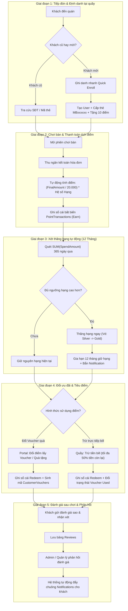

# PHÂN TÍCH CHI TIẾT VÒNG ĐỜI CHĂM SÓC KHÁCH HÀNG: CƠ SỞ DỮ LIỆU, TRUY VẤN VÀ MÃ NGUỒN (TV2)

> **Mục đích tài liệu:** Phân tích kỹ thuật chi tiết toàn bộ chu trình chăm sóc khách hàng (Customer Care Lifecycle) trong hệ thống Billiard Management System (BMS TV2). Tài liệu cung cấp đầy đủ: **Bảng dữ liệu lưu trữ**, **câu lệnh truy vấn (LINQ & SQL)**, **nguồn dữ liệu đầu vào** và **vị trí thực thi chính xác trong source code**.

---

## 1. SƠ ĐỒ TỔNG QUAN VÒNG ĐỜI NGHIỆP VỤ (WORKFLOW & DATA FLOW)



---

## 2. CHI TIẾT TỪNG GIAI ĐOẠN TRONG VÒNG ĐỜI

---

### GIAI ĐOẠN 1: TIẾP ĐÓN, TRA CỨU & GHI DANH TẠI QUẦY

#### 1.1. Tra cứu khách cũ qua Số điện thoại / Mã thẻ / Họ tên
- **Bảng dữ liệu:** 
  - `dbo.AspNetUsers`: Chứa hồ sơ cá nhân, số dư điểm `RewardPoints`, trạng thái `IsActive`.
  - `dbo.MembershipTiers`: Chứa tên hạng và đặc quyền của khách.
  - `dbo.AspNetUserRoles` & `dbo.AspNetRoles`: Lọc người dùng có vai trò `Customer`.
- **Dữ liệu lấy từ đâu:** 
  - Query String AJAX từ ô tìm kiếm tại quầy thu ngân: `GET /CustomerManagement/Search?q=0912...`
- **Câu lệnh truy vấn:**
  - **LINQ (C#):**
    ```csharp
    var query = _context.Users.Include(u => u.Tier)
        .Where(u => (u.PhoneNumber != null && u.PhoneNumber.Contains(term))
                 || (u.EmployeeCode != null && u.EmployeeCode.ToLower().Contains(lower))
                 || u.FullName.ToLower().Contains(lower))
        .OrderByDescending(u => u.IsActive)
        .ThenBy(u => u.FullName)
        .Take(8);
    ```
  - **SQL thực thi:**
    ```sql
    SELECT TOP(8) 
        u.Id, u.FullName, u.PhoneNumber, u.EmployeeCode, 
        u.RewardPoints, u.IsActive, t.TierName
    FROM dbo.AspNetUsers u
    LEFT JOIN dbo.MembershipTiers t ON u.TierId = t.Id
    WHERE u.PhoneNumber LIKE '%' + @term + '%' 
       OR LOWER(u.EmployeeCode) LIKE '%' + @lower + '%' 
       OR LOWER(u.FullName) LIKE '%' + @lower + '%';
    ```
- **Vị trí trong mã nguồn:**
  - File: `src/Bms.Web/Controllers/CustomerManagementController.cs`
  - Method: `Search(string? q)` (Dòng 58 – 88)
  - Giao diện: `src/Bms.Web/Views/CustomerManagement/Lookup.cshtml`

---

#### 1.2. Ghi danh nhanh khách mới tại quầy (Quick Enroll < 10 giây)
- **Bảng dữ liệu tác động:**
  - `dbo.AspNetUsers`: Tạo tài khoản mới có `AccountSource = 'Counter'`, sinh mã thẻ `MBxxxxxx`.
  - `dbo.AspNetUserRoles`: Gán Role `Customer`.
  - `dbo.CustomerAuditLogs`: Ghi lại nhật ký nhân viên thu ngân nào tạo khách.
  - `dbo.PointTransactions`: Tự động cộng 10 điểm thưởng chào mừng qua Sổ cái.
- **Dữ liệu lấy từ đâu:**
  - Form POST modal tại quầy: `FullName`, `PhoneNumber`, `DateOfBirth`, `MarketingOptIn`.
- **Câu lệnh truy vấn:**
  - **LINQ / EF Core:**
    ```csharp
    var user = new ApplicationUser {
        UserName = input.PhoneNumber,
        Email = $"{input.PhoneNumber}@noemail.bms.local",
        FullName = input.FullName,
        PhoneNumber = input.PhoneNumber,
        EmployeeCode = cardCode, // MB + 6 số ngẫu nhiên
        AccountSource = ApplicationUser.SourceCounter,
        IsActive = true,
        TierId = defaultTier?.Id,
        CreatedAtUtc = now,
        TierAchievedAtUtc = now,
        TierReviewAtUtc = now.AddMonths(12),
        RewardPoints = 0,
        TotalSpend = 0
    };
    await _userManager.CreateAsync(user);
    await _userManager.AddToRoleAsync(user, "Customer");

    // Ghi Audit Log & Tặng 10 điểm chào mừng
    _context.CustomerAuditLogs.Add(new CustomerAuditLog {
        CustomerId = user.Id, Action = "Create",
        Detail = JsonSerializer.Serialize(new { source = "Counter", card = cardCode }),
        ActorId = CurrentActorId, CreatedAtUtc = now
    });
    await _ledger.PostAsync(user.Id, 10, PointTransaction.Bonus, $"WELCOME-{user.Id}", ...);
    ```
  - **SQL thực thi:**
    ```sql
    INSERT INTO dbo.AspNetUsers (
        Id, UserName, NormalizedUserName, FullName, PhoneNumber, EmployeeCode, 
        AccountSource, IsActive, TierId, RewardPoints, TotalSpend, CreatedAtUtc, TierReviewAtUtc
    ) VALUES (
        @Uid, @Phone, UPPER(@Phone), @FullName, @Phone, @CardCode, 
        'Counter', 1, @DefaultTierId, 10, 0, SYSUTCDATETIME(), DATEADD(month, 12, SYSUTCDATETIME())
    );

    INSERT INTO dbo.AspNetUserRoles (UserId, RoleId) VALUES (@Uid, @CustomerRoleId);

    INSERT INTO dbo.CustomerAuditLogs (CustomerId, Action, Detail, ActorId, CreatedAtUtc)
    VALUES (@Uid, 'Create', '{"source":"Counter"}', @CashierId, SYSUTCDATETIME());

    INSERT INTO dbo.PointTransactions (CustomerId, Amount, TransactionType, ReferenceCode, BalanceAfter, CreatedAt)
    VALUES (@Uid, 10, 'Bonus', @WelcomeRef, 10, SYSUTCDATETIME());
    ```
- **Vị trí trong mã nguồn:**
  - File: `src/Bms.Web/Controllers/CustomerManagementController.cs`
  - Method: `QuickEnroll(QuickEnrollInputModel input)` (Dòng 93 – 175)

---

### GIAI ĐOẠN 2: CHƠI BÀN, THANH TOÁN & TỰ ĐỘNG TÍCH ĐIỂM HÓA ĐƠN

#### 2.1. Nghiệp vụ tính toán thanh toán (Checkout Loyalty Calculation)
- **Bảng dữ liệu:** 
  - `dbo.PointTransactions`: Bảng sổ cái bất biến (Immutable Ledger).
  - `dbo.AspNetUsers`: Cập nhật `RewardPoints`, `TotalSpend`, `LastPaidDate`.
- **Dữ liệu lấy từ đâu:** 
  - Module tính tiền bàn gửi sang: `req.CustomerId`, `req.PlaytimeAmount`, `req.FandBAmount`, `req.InvoiceId`, `req.CashierId`, `req.ReferenceCode`.
- **Công thức tính toán:**
  1. $\text{Tổng gốc} = \text{Tiền giờ chơi} + \text{Tiền ăn uống (F&B)}$.
  2. $\text{Giảm hạng} = \text{Tiền giờ chơi} \times \text{DiscountPercent của Hạng}$.
  3. $\text{Giảm Voucher} = \text{Giá trị Voucher áp dụng (nếu có)}$.
  4. $\text{Giảm Điểm} = \text{Số điểm tiêu} \times 1.000 \text{ VNĐ (tối đa 50\% số tiền còn lại)}$.
  5. $\text{Số tiền thực trả (FinalAmount)} = \text{Tổng gốc} - \text{Tổng các khoản giảm trừ}$.
  6. **Công thức tích điểm thưởng:**
     $$\text{PointsToEarn} = \left\lfloor \frac{\text{FinalAmount}}{20.000} \right\rfloor \times \text{PointMultiplier của Hạng}$$
- **Câu lệnh truy vấn:**
  - **LINQ / Service:**
    ```csharp
    var earnLedger = await _ledger.PostAsync(
        customerId: req.CustomerId,
        delta: preview.PointsToEarn,
        type: PointTransaction.Earn,
        referenceCode: refCode,
        invoiceId: req.InvoiceId,
        reason: $"Tích điểm thanh toán hóa đơn {refCode}",
        actorId: req.CashierId,
        spendAmount: preview.FinalAmount);
    ```
  - **SQL thực thi:**
    ```sql
    -- 1. Thêm bút toán Earn vào Sổ cái bất biến (Chống trùng lặp tuyệt đối bằng UX_PointTxn_Earn_Ref)
    INSERT INTO dbo.PointTransactions (
        CustomerId, Amount, TransactionType, ReferenceCode, 
        InvoiceId, SpendAmount, BalanceAfter, CreatedAt
    ) VALUES (
        @CustomerId, @PointsToEarn, 'Earn', @InvoiceRef, 
        @InvoiceId, @FinalAmount, @NewBalance, SYSUTCDATETIME()
    );

    -- 2. Cập nhật số dư điểm và doanh thu tích lũy của khách hàng
    UPDATE dbo.AspNetUsers 
    SET RewardPoints = @NewBalance,
        TotalSpend = TotalSpend + @FinalAmount,
        LastPaidDate = SYSUTCDATETIME()
    WHERE Id = @CustomerId;
    ```
- **Vị trí trong mã nguồn:**
  - Nghiệp vụ tích điểm: `src/Bms.Web/Services/LoyaltyService.cs` -> `CommitCheckoutAsync` (Dòng 155 – 285)
  - Quản lý Sổ cái: `src/Bms.Web/Services/PointLedgerService.cs` -> `PostAsync` (Dòng 22 – 85)

---

### GIAI ĐOẠN 3: TỰ ĐỘNG ĐÁNH GIÁ & THĂNG HẠNG (VÍ DỤ: SILVER LÊN GOLD)

#### 3.1. Thuật toán quét chi tiêu 12 tháng và thăng hạng tức thì
- **Bảng dữ liệu:** 
  - `dbo.PointTransactions`: Đọc dữ liệu chi tiêu thực tế trong 365 ngày qua.
  - `dbo.MembershipTiers`: Đọc các mốc ngưỡng thăng hạng `SpendThreshold`.
  - `dbo.AspNetUsers`: Cập nhật `TierId`, `TierAchievedAtUtc`, `TierReviewAtUtc`.
  - `dbo.Notifications`: Gửi tin thông báo chúc mừng thăng hạng.
- **Dữ liệu lấy từ đâu:** 
  - Tự động chạy ngay trong hàm thanh toán `CommitCheckoutAsync` sau khi bút toán `Earn` hoàn tất.
- **Câu lệnh truy vấn:**
  - **LINQ (C#):**
    ```csharp
    // 1. Tính tổng chi tiêu 12 tháng gần nhất từ các bút toán Earn thực tế
    var spend12M = await _context.PointTransactions.AsNoTracking()
        .Where(t => t.CustomerId == customerId && t.TransactionType == PointTransaction.Earn && t.CreatedAt >= now.AddDays(-365))
        .SumAsync(t => (decimal?)t.SpendAmount) ?? 0m;

    // 2. Tìm hạng cao nhất thỏa mãn điều kiện
    var targetTier = tiers.Where(t => t.SpendThreshold <= spend12M).OrderByDescending(t => t.SpendThreshold).FirstOrDefault();

    // 3. Nếu vượt ngưỡng hạng hiện tại -> Nâng hạng ngay lập tức
    if (targetTier != null && targetTier.SpendThreshold > (user.Tier?.SpendThreshold ?? 0m)) {
        user.TierId = targetTier.Id;
        user.TierAchievedAtUtc = now;
        user.TierReviewAtUtc = now.AddMonths(12); // Thiết lập chu kỳ 12 tháng mới
        user.TierGraceUntilUtc = null; // Xóa ân hạn nếu có
    }
    ```
  - **SQL thực thi:**
    ```sql
    -- 1. Quét chi tiêu 12 tháng từ sổ cái
    SELECT ISNULL(SUM(SpendAmount), 0)
    FROM dbo.PointTransactions
    WHERE CustomerId = @CustomerId 
      AND TransactionType = 'Earn' 
      AND CreatedAt >= DATEADD(day, -365, SYSUTCDATETIME());

    -- 2. Cập nhật hạng mới và gia hạn chu kỳ xét hạng 12 tháng
    UPDATE dbo.AspNetUsers 
    SET TierId = @GoldTierId,
        TierAchievedAtUtc = SYSUTCDATETIME(),
        TierReviewAtUtc = DATEADD(month, 12, SYSUTCDATETIME()),
        TierGraceUntilUtc = NULL
    WHERE Id = @CustomerId;

    -- 3. Tạo thông báo chúc mừng thăng hạng
    INSERT INTO dbo.Notifications (UserId, Title, Content, Type, IsRead, CreatedAt)
    VALUES (
        @CustomerId, 
        N'Chúc mừng thăng hạng!', 
        N'Chúc mừng bạn đã đạt hạng Gold! Hạn duy trì đến ' + CONVERT(nvarchar(20), DATEADD(month, 12, SYSUTCDATETIME()), 103), 
        'TierUpgrade', 0, SYSUTCDATETIME()
    );
    ```
- **Vị trí trong mã nguồn:**
  - File: `src/Bms.Web/Services/TierEvaluationService.cs`
  - Method: `GetSpendLast12MonthsAsync` (Dòng 28 – 55) & `EvaluateUpgradeOnCheckoutAsync` (Dòng 58 – 115)
  - Được kích hoạt tự động từ: `LoyaltyService.cs` (Dòng 292 – 294)

---

### GIAI ĐOẠN 4: DÙNG ĐIỂM TÍCH LŨY ĐỂ ĐỔI VOUCHER HOẶC TRỪ TRỰC TIẾP HÓA ĐƠN

---

#### 4.1. Nhánh A: Nhân viên đổi điểm cấp Voucher / Quà cho khách trên Hồ sơ hội viên
- **Bảng dữ liệu:** 
  - `dbo.RewardItems`: Kiểm tra giá điểm `PointCost`, hạng tối thiểu `MinTierId`, số lượng tồn kho.
  - `dbo.PointTransactions`: Trừ điểm qua Sổ cái (`TransactionType = 'Redeem'`).
  - `dbo.CustomerVouchers`: Thêm bản ghi voucher mới (`Status = 'Active'`).
- **Dữ liệu lấy từ đâu:** 
  - Request POST của nhân viên thu ngân trên màn hình Hồ sơ 360: `POST /CustomerManagement/RedeemReward` (`customerId`, `rewardCode`).
- **Câu lệnh truy vấn:**
  - **LINQ / EF Core:**
    ```csharp
    // 1. Kiểm tra điểm hợp lệ và trừ điểm sổ cái
    var ledgerRes = await _ledger.PostAsync(
        customerId, -item.PointCost, PointTransaction.Redeem,
        $"REDEEM-{item.Code}", null, $"Đổi quà: {item.Name}", customerId);

    // 2. Tạo Voucher mới với mã ngẫu nhiên duy nhất
    var voucher = new CustomerVoucher {
        Code = await GenerateUniqueVoucherCodeAsync(),
        CustomerId = customerId,
        RewardItemId = item.Id,
        Title = item.Name,
        VoucherType = item.RewardType,
        DiscountValue = item.DiscountValue,
        Status = CustomerVoucher.StatusActive,
        IssuedAtUtc = now,
        ExpiresAtUtc = now.AddDays(30),
        PointTransactionId = ledgerRes.TransactionId
    };
    _db.CustomerVouchers.Add(voucher);
    ```
  - **SQL thực thi:**
    ```sql
    -- 1. Ghi nhận trừ điểm trong sổ cái
    INSERT INTO dbo.PointTransactions (CustomerId, Amount, TransactionType, ReferenceCode, Reason, BalanceAfter, CreatedAt)
    VALUES (@CustomerId, -@PointCost, 'Redeem', @RefCode, @Reason, @NewBalance, SYSUTCDATETIME());

    UPDATE dbo.AspNetUsers SET RewardPoints = @NewBalance WHERE Id = @CustomerId;

    -- 2. Thêm voucher mới có hạn dùng 30 ngày vào kho của khách
    INSERT INTO dbo.CustomerVouchers (
        Code, CustomerId, RewardItemId, Title, VoucherType, 
        DiscountValue, Status, IssuedAtUtc, ExpiresAtUtc, PointTransactionId
    ) VALUES (
        @VoucherCode, @CustomerId, @ItemId, @Title, @RewardType, 
        @DiscountValue, 'Active', SYSUTCDATETIME(), DATEADD(day, 30, SYSUTCDATETIME()), @TxnId
    );
    ```
- **Vị trí trong mã nguồn:**
  - Controller: `src/Bms.Web/Controllers/CustomerManagementController.cs` -> Method `RedeemReward` (Dòng 385 – 395)
  - Service: `src/Bms.Web/Services/VoucherService.cs` -> Method `RedeemRewardForVoucherAsync` (Dòng 40 – 105)

---

#### 4.2. Nhánh B: Áp dụng Voucher & Trừ điểm trực tiếp vào hóa đơn tại quầy
- **Bảng dữ liệu:** 
  - `dbo.CustomerVouchers`: Cập nhật trạng thái `Status = 'Used'`.
  - `dbo.PointTransactions`: Ghi nhận bút toán trừ điểm `Redeem`.
- **Dữ liệu lấy từ đâu:** 
  - Thu ngân nhập `VoucherCode` và `PointsToRedeem` trên giao diện thanh toán.
- **Quy tắc kiểm soát nghiệp vụ:**
  - Điểm muốn trừ bắt buộc: $\text{PointsToRedeem} \le \text{RewardPoints hiện có}$.
  - Trừ tối đa 50% số tiền còn lại sau khi đã giảm trừ hạng và voucher:
    $$\text{Giới hạn tiêu điểm tối đa} = \left\lfloor \frac{\text{Tiền còn lại sau voucher} \times 50\%}{1.000} \right\rfloor$$
- **Câu lệnh truy vấn SQL:**
  ```sql
  -- 1. Đánh dấu voucher đã dùng (Chống sử dụng lại)
  UPDATE dbo.CustomerVouchers 
  SET Status = 'Used',
      UsedAtUtc = SYSUTCDATETIME(),
      UsedById = @CashierId,
      UsedReferenceCode = @InvoiceRef
  WHERE Code = @VoucherCode 
    AND CustomerId = @CustomerId 
    AND Status = 'Active';

  -- 2. Ghi bút toán Redeem trừ điểm vào sổ cái
  INSERT INTO dbo.PointTransactions (
      CustomerId, Amount, TransactionType, ReferenceCode, 
      InvoiceId, BalanceAfter, CreatedAt
  ) VALUES (
      @CustomerId, -@PointsToRedeem, 'Redeem', @InvoiceRef, 
      @InvoiceId, @NewBalance, SYSUTCDATETIME()
  );

  UPDATE dbo.AspNetUsers SET RewardPoints = @NewBalance WHERE Id = @CustomerId;
  ```
- **Vị trí trong mã nguồn:**
  - File: `src/Bms.Web/Services/LoyaltyService.cs`
  - Method: `CommitCheckoutAsync` (Dòng 222 – 260)

---

### GIAI ĐOẠN 5: ĐÁNH GIÁ PHIÊN CHƠI, ADMIN PHẢN HỒI & ĐẨY THÔNG BÁO

---

#### 5.1. Khách hàng gửi đánh giá chất lượng sau khi kết thúc phiên chơi
- **Bảng dữ liệu:** 
  - `dbo.Reviews`: Lưu số sao `Rating` (1 – 5 sao), `Comment`, `CustomerId`, `SessionId`.
- **Dữ liệu lấy từ đâu:** 
  - Form POST khách hàng gửi: `POST /Review/Create` (`Rating`, `Comment`, `SessionId`).
- **Câu lệnh truy vấn:**
  - **LINQ (C#):**
    ```csharp
    var review = new Review {
        CustomerId = CurrentUserId,
        SessionId = model.SessionId,
        Rating = model.Rating,
        Comment = string.IsNullOrWhiteSpace(model.Comment) ? null : model.Comment.Trim(),
        CreatedAtUtc = DateTime.UtcNow
    };
    _context.Reviews.Add(review);
    await _context.SaveChangesAsync();
    ```
  - **SQL thực thi:**
    ```sql
    INSERT INTO dbo.Reviews (CustomerId, SessionId, Rating, Comment, CreatedAtUtc)
    VALUES (@CustomerId, @SessionId, @Rating, @Comment, SYSUTCDATETIME());
    ```
- **Vị trí trong mã nguồn:**
  - File: `src/Bms.Web/Controllers/ReviewController.cs`
  - Method: `Create(CreateReviewViewModel model)` (Dòng 144 – 195)
  - Giao diện: `src/Bms.Web/Views/Review/Create.cshtml`

---

#### 5.2. Admin phản hồi đánh giá & Hệ thống tự động đẩy chuông thông báo (Notification)
- **Bảng dữ liệu:** 
  - `dbo.Reviews`: Cập nhật nội dung câu trả lời `AdminReply`.
  - `dbo.Notifications`: Tạo chuông thông báo mới (`IsRead = false`) gửi đích danh đến `UserId` của khách.
- **Dữ liệu lấy từ đâu:** 
  - Form POST của Admin/Quản lý: `POST /Review/Reply` (`ReviewId`, `Reply`).
- **Câu lệnh truy vấn:**
  - **LINQ / EF Core:**
    ```csharp
    var review = await _context.Reviews.Include(r => r.Customer).FirstOrDefaultAsync(r => r.Id == model.ReviewId);
    review.AdminReply = model.Reply.Trim();

    // Tự động đẩy chuông thông báo cho Khách hàng
    var notification = new Notification {
        UserId = review.CustomerId,
        Title = "Phản hồi đánh giá phiên chơi",
        Content = $"Quản lý đã phản hồi đánh giá của bạn (Phiên #{review.SessionId}): \"{review.AdminReply}\"",
        Type = "ReviewReply",
        IsRead = false,
        CreatedAt = DateTime.UtcNow
    };
    _context.Notifications.Add(notification);
    await _context.SaveChangesAsync();
    ```
  - **SQL thực thi:**
    ```sql
    -- 1. Cập nhật câu phản hồi của Admin vào bảng Reviews
    UPDATE dbo.Reviews 
    SET AdminReply = @AdminReply 
    WHERE Id = @ReviewId;

    -- 2. Tự động sinh bản ghi thông báo trong bảng Notifications
    INSERT INTO dbo.Notifications (UserId, Title, Content, Type, IsRead, CreatedAt)
    VALUES (
        @CustomerId, 
        N'Phản hồi đánh giá phiên chơi', 
        @NotificationContent, 
        'ReviewReply', 
        0, 
        SYSUTCDATETIME()
    );
    ```
- **Vị trí trong mã nguồn:**
  - Xử lý phản hồi & sinh thông báo: `src/Bms.Web/Controllers/ReviewController.cs` -> Method `Reply` (Dòng 73 – 109)
  - Khách đọc thông báo & cập nhật số tin chưa đọc trên Topbar: `src/Bms.Web/Controllers/NotificationController.cs` (Dòng 23 – 85)

---

## 3. BẢNG TỔNG HỢP MATRIX KỸ THUẬT VÒNG ĐỜI KHÁCH HÀNG (HỆ THỐNG NỘI BỘ STAFF / ADMIN)

| Giai đoạn trong vòng đời | Bảng CSDL chính | Dữ liệu đầu vào (Source) | Method C# xử lý | Câu lệnh SQL / LINQ cốt lõi |
| :--- | :--- | :--- | :--- | :--- |
| **1. Tra cứu khách cũ** | `AspNetUsers`, `MembershipTiers` | AJAX Query `q` tại quầy | `CustomerManagementController.Search` | `SELECT TOP 8 ... WHERE Phone LIKE %q% OR Code LIKE %q%` |
| **1. Ghi danh mới (Quick Enroll)** | `AspNetUsers`, `PointTransactions`, `CustomerAuditLogs` | Modal POST SĐT & Họ tên | `CustomerManagementController.QuickEnroll` | `INSERT AspNetUsers (AccountSource='Counter')` + Tặng 10 điểm Bonus |
| **2. Tích điểm hóa đơn** | `PointTransactions`, `AspNetUsers` | Request thanh toán hóa đơn | `LoyaltyService.CommitCheckoutAsync`, `PointLedgerService.PostAsync` | `INSERT PointTransactions (Type='Earn')` + Khóa Idempotent `UX_PointTxn_Earn_Ref` |
| **3. Thăng hạng tự động (Silver $\rightarrow$ Gold)** | `PointTransactions`, `MembershipTiers`, `AspNetUsers`, `Notifications` | Lịch sử chi tiêu 12 tháng từ Sổ cái | `TierEvaluationService.EvaluateUpgradeOnCheckoutAsync` | `SUM(SpendAmount)` 365 ngày $\rightarrow$ `UPDATE AspNetUsers SET TierId = Gold` |
| **4. Nhân viên đổi điểm cấp Voucher tại quầy** | `RewardItems`, `CustomerVouchers`, `PointTransactions` | POST `customerId`, `rewardCode` trên Hồ sơ 360 | `CustomerManagementController.RedeemReward`, `VoucherService.RedeemRewardForVoucherAsync` | Trừ điểm `Redeem` $\rightarrow$ `INSERT CustomerVouchers (Status='Active', Hạn 30 ngày)` |
| **4. Trừ điểm & Voucher vào bill** | `CustomerVouchers`, `PointTransactions`, `AspNetUsers` | Thu ngân nhập mã voucher & số điểm | `LoyaltyService.CommitCheckoutAsync` | `UPDATE CustomerVouchers SET Status='Used'` + Ghi sổ cái trừ điểm `Redeem` |
| **5. Quản lý đánh giá & Phản hồi** | `Reviews`, `Notifications` | Form POST phản hồi của Admin/Staff | `ReviewController.Index`, `ReviewController.Reply` | `UPDATE Reviews SET AdminReply` + `INSERT Notifications (Type='ReviewReply')` |

