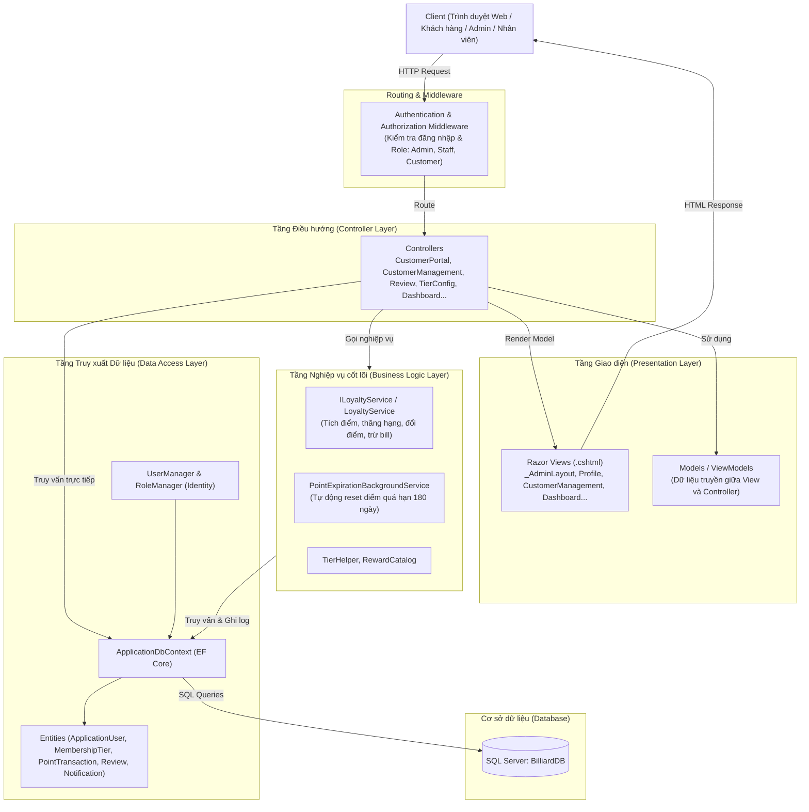
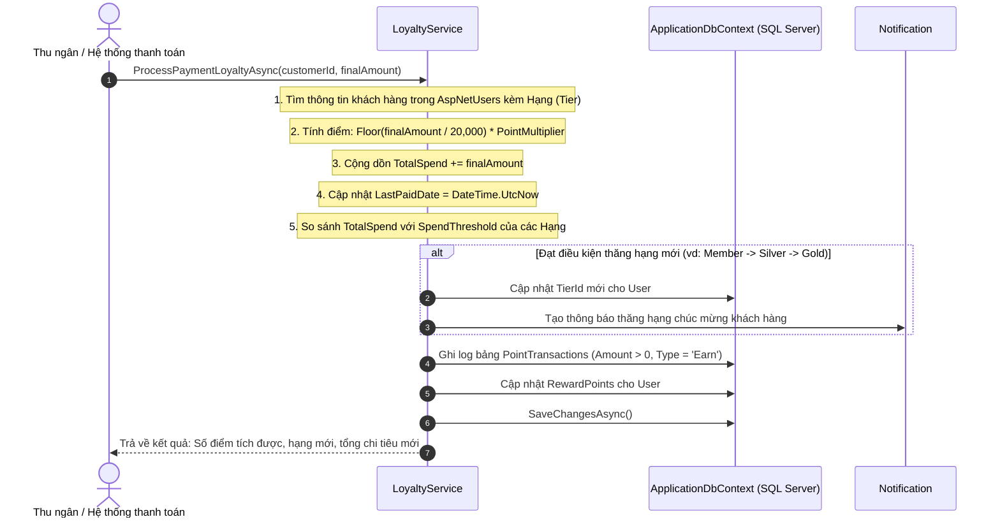
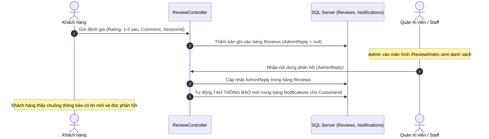
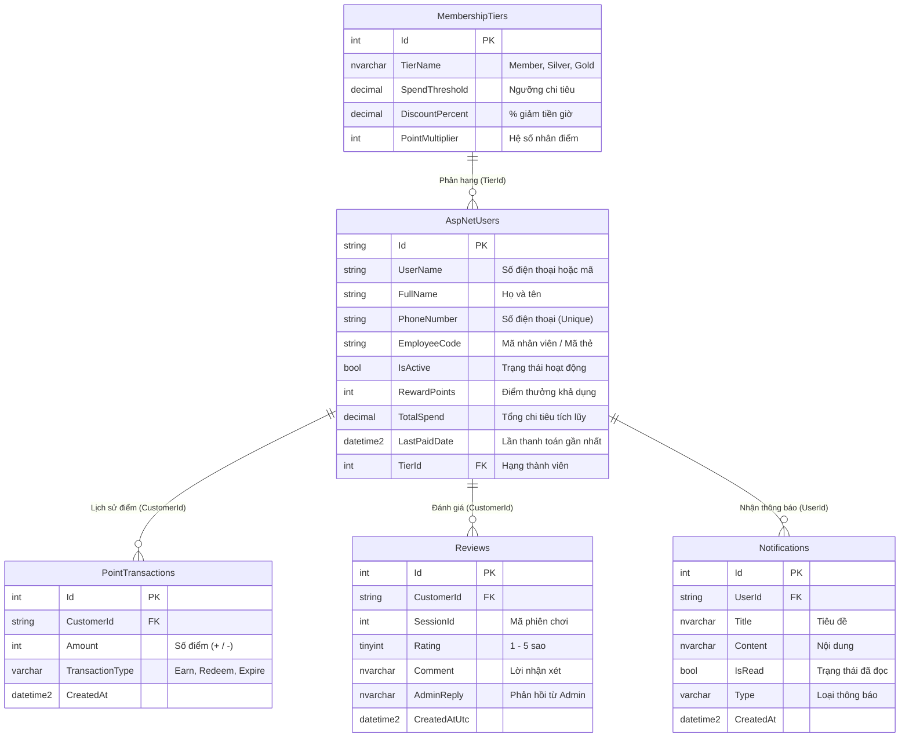

# TÀI LIỆU KIẾN TRÚC, LUỒNG HOẠT ĐỘNG VÀ CHI TIẾT CÁC CLASS
## DỰ ÁN: BILLIARD MANAGEMENT SYSTEM (BMS) - PHÂN HỆ THÀNH VIÊN 2 (TV2)

> **Mục đích tài liệu:** Giúp sinh viên/lập trình viên hiểu rõ toàn bộ kiến trúc dự án, luồng dữ liệu (flow) từ khi Client gửi Request đến Database, vai trò của từng thư mục (package/namespace) và mục đích cụ thể của từng Class trong hệ thống.

---

## PHẦN 1: TỔNG QUAN KIẾN TRÚC HỆ THỐNG

### 1.1. Công nghệ sử dụng (Tech Stack)
* **Framework:** ASP.NET Core 8.0 MVC (Model - View - Controller).
* **ORM:** Entity Framework Core 8.0 (Code-first mapping to existing SQL Database).
* **Authentication & Authorization:** ASP.NET Core Identity (Role-based: `Admin`, `Staff`, `Customer`).
* **Database:** Microsoft SQL Server (`BilliardDB` trên `localhost\SQLEXPRESS`).
* **Frontend:** Razor Views (.cshtml), Bootstrap 5, Bootstrap Icons, Chart.js (CDN), Custom BMS Design System.

### 1.2. Sơ đồ kiến trúc tầng (Layered Architecture)

---

## PHẦN 2: CÁC LUỒNG NGHIỆP VỤ CHÍNH (END-TO-END FLOWS)

### 2.1. Luồng Xác thực & Phân quyền (Authentication & RBAC Flow)
1. **Đăng nhập (`/Account/Login`):** Người dùng nhập UserName (Số điện thoại / mã nhân viên) và Mật khẩu.
2. `AccountController.Login()` xác thực qua `SignInManager<ApplicationUser>`.
3. Hệ thống kiểm tra:
   - Nếu `IsActive == false`: Báo tài khoản bị khóa.
   - Nếu đăng nhập thành công: Phân quyền theo Role:
     - **Admin:** Chuyển hướng tới `/Dashboard/Index` (hoặc `/CustomerManagement/Index`).
     - **Staff:** Chuyển hướng tới `/CustomerManagement/Index`.
     - **Customer:** Chuyển hướng tới `/CustomerPortal/Profile` (Cổng cá nhân của khách).

---

### 2.2. Luồng Tích điểm & Nâng hạng (Loyalty Earning & Tier Upgrade Flow)

**Quy tắc:**
* Tích điểm: `20.000 VNĐ = 1 Điểm` $\times$ Hệ số nhân của hạng (`PointMultiplier`).
* Phân hạng:
  * **Member (Mặc định):** $0 \rightarrow 1.999.000$ VNĐ (Hệ số x1, giảm 0%).
  * **Silver:** $2.000.000 \rightarrow 4.999.000$ VNĐ (Hệ số x1, giảm 5% tiền giờ).
  * **Gold:** $\ge 5.000.000$ VNĐ (Hệ số x2, giảm 10% tiền giờ).
* `TotalSpend` bảo lưu vĩnh viễn (không bao giờ giảm khi đổi điểm).

---

### 2.3. Luồng Đổi điểm thưởng (Point Redemption Flow)

Có 2 hình thức đổi điểm:
1. **Đổi trừ tiền trực tiếp trên hóa đơn (`RedeemPointsForBillAsync`):**
   - Tỷ lệ quy đổi: `1 Điểm = 1.000 VNĐ`.
   - **Giới hạn an toàn:** Số tiền giảm tối đa **không vượt quá 50%** tổng hóa đơn.
   - Ghi log `PointTransactions` với `Amount = -points`, `TransactionType = 'Redeem'`.
2. **Đổi quà / đồ uống / giờ chơi (`RedeemRewardAsync`):**
   - Khách hàng xem danh mục quà (`RewardCatalog`):
     - `RW_WATER_20` (20 điểm): Nước ngọt / bò húc / nước suối.
     - `RW_SNACK_50` (50 điểm): Đĩa trái cây / khô gà / hướng dương.
     - `RW_HOUR_80` (80 điểm): Free 1 giờ chơi bida.
   - Trừ điểm trong `RewardPoints`, ghi log `PointTransactions`, tạo thông báo xác nhận.

---

### 2.4. Luồng Đánh giá & Phản hồi & Bắn thông báo (Review & Feedback Flow)

---

### 2.5. Luồng Hết hạn điểm tự động (Point Expiration Background Job)
* Class: `PointExpirationBackgroundService` kế thừa `BackgroundService`.
* Chạy ngầm định kỳ (mỗi ngày 1 lần).
* Thuật toán:
  1. Quét toàn bộ khách hàng có `RewardPoints > 0` và `LastPaidDate < DateTime.UtcNow.AddDays(-180)` (không phát sinh chi tiêu trong 180 ngày qua).
  2. Reset `RewardPoints = 0`.
  3. Ghi log `PointTransactions` (`TransactionType = 'Expire'`, `Amount = -cũ`).
  4. Bắn thông báo gửi khách hàng: "Điểm thưởng của bạn đã hết hạn do không phát sinh chi tiêu trong 180 ngày".
  5. Hạng thành viên và `TotalSpend` vẫn được giữ nguyên.

---

## PHẦN 3: CẤU TRÚC THƯ MỤC DỰ ÁN (PACKAGE BREAKDOWN)

Thư mục chính: `src/Bms.Web/`

| Thư mục | Namespace | Mục đích & Trách nhiệm |
|---|---|---|
| `Controllers/` | `Bms.Web.Controllers` | Nhận HTTP Request từ client, gọi tầng Service/Data, chuẩn bị ViewModel và trả về View (HTML) hoặc JSON. |
| `Data/` | `Bms.Web.Data` | Quản lý kết nối Database (`ApplicationDbContext`), khai báo Entity (Bảng dữ liệu), khởi tạo dữ liệu mẫu (`DbInitializer`). |
| `Models/` | `Bms.Web.Models` | Chứa các ViewModels (DTO) chuyên biệt dùng để truyền nhận dữ liệu giữa Controller và View, hỗ trợ Data Validation (`[Required]`, `[Phone]`,...). |
| `Services/` | `Bms.Web.Services` | Chứa logic nghiệp vụ cốt lõi (Business Logic): Tích điểm, tính thăng hạng, đổi thưởng, Background Service hết hạn điểm. |
| `Views/` | — | Chứa các giao diện Razor Views (.cshtml). Tổ chức theo tên Controller (vd: `Views/CustomerPortal/`, `Views/CustomerManagement/`). |
| `wwwroot/` | — | Chứa các tài nguyên tĩnh: CSS, JavaScript, thư viện bên thứ 3 (Bootstrap, Icons, Chart.js). |

---

## PHẦN 4: CHI TIẾT TỪNG CLASS TRONG DỰ ÁN

### 4.1. Tầng Dữ liệu (`src/Bms.Web/Data/`)

#### 1. `ApplicationUser.cs`
* **Mục đích:** Kế thừa từ `IdentityUser`, đại diện cho người dùng đăng nhập hệ thống (Bao gồm cả Admin, Nhân viên Staff và Khách hàng Customer).
* **Các thuộc tính quan trọng:**
  * `FullName` (string): Họ và tên đầy đủ.
  * `PhoneNumber` (string): Số điện thoại (10 chữ số, dùng làm tên đăng nhập cho khách hàng).
  * `EmployeeCode` (string): Mã nhân viên (hoặc mã thẻ thành viên gắn cho khách hàng).
  * `IsActive` (bool): Trạng thái tài khoản (true: hoạt động, false: bị khóa).
  * `TierId` (int?): Khóa ngoại trỏ đến hạng thành viên hiện tại trong bảng `MembershipTiers`.
  * `RewardPoints` (int): Số điểm thưởng tích lũy hiện có khả dụng.
  * `TotalSpend` (decimal): Tổng tiền chi tiêu tích lũy qua các hóa đơn (dùng để xét thăng hạng).
  * `LastPaidDate` (DateTime?): Ngày thanh toán hóa đơn gần nhất (dùng để tính mốc 180 ngày hết hạn điểm).
  * `PointTransactions`, `Reviews`, `Notifications`: Các navigation collection kết nối quan hệ 1-N.

#### 2. `MembershipTier.cs`
* **Mục đích:** Entity ánh xạ vào bảng `MembershipTiers` trên SQL Server, lưu thông tin cấu hình các hạng thẻ khách hàng.
* **Các thuộc tính:**
  * `Id` (int): Khóa chính (1: Member, 2: Silver, 3: Gold).
  * `TierName` (string): Tên hạng ("Member", "Silver", "Gold").
  * `SpendThreshold` (decimal): Ngưỡng chi tiêu tối thiểu để đạt hạng này (vd: Silver = 2.000.000, Gold = 5.000.000).
  * `DiscountPercent` (decimal): Tỷ lệ phần trăm giảm giá tiền giờ chơi (vd: 5%, 10%).
  * `PointMultiplier` (int): Hệ số nhân điểm thưởng khi tích điểm (vd: Hạng Gold x2 điểm).

#### 3. `PointTransaction.cs`
* **Mục đích:** Entity lưu lịch sử biến động điểm thưởng của khách hàng (Bảng `PointTransactions`).
* **Các thuộc tính:**
  * `Id` (int): Khóa chính.
  * `CustomerId` (string): ID khách hàng (FK -> `AspNetUsers.Id`).
  * `Amount` (int): Số điểm thay đổi (+25 điểm khi Earn, -20 điểm khi Redeem, -100 điểm khi Expire).
  * `TransactionType` (string): Loại giao dịch (`"Earn"`: tích điểm, `"Redeem"`: đổi điểm, `"Expire"`: hết hạn).
  * `CreatedAt` (DateTime): Thời điểm ghi nhận giao dịch.

#### 4. `Review.cs`
* **Mục đích:** Entity lưu đánh giá chất lượng dịch vụ của khách sau phiên chơi (Bảng `Reviews`).
* **Các thuộc tính:**
  * `Id` (int): Khóa chính.
  * `CustomerId` (string): ID khách hàng gửi đánh giá.
  * `SessionId` (int): ID phiên chơi bida tương ứng.
  * `Rating` (int): Số sao đánh giá từ 1 đến 5 sao.
  * `Comment` (string): Lời nhận xét hoặc góp ý của khách.
  * `AdminReply` (string): Phản hồi từ phía quản lý / quán bida.
  * `CreatedAtUtc` (DateTime): Ngày giờ khách gửi đánh giá.

#### 5. `Notification.cs`
* **Mục đích:** Entity lưu thông báo gửi tới từng tài khoản người dùng (Bảng `Notifications`).
* **Các thuộc tính:**
  * `Id` (int): Khóa chính.
  * `UserId` (string): ID người nhận thông báo.
  * `Title` (string): Tiêu đề thông báo (vd: "Chúc mừng thăng hạng Silver", "Phản hồi đánh giá").
  * `Content` (string): Nội dung chi tiết.
  * `IsRead` (bool): Đã đọc hay chưa (false: chưa đọc - hiển thị nổi bật, true: đã đọc).
  * `Type` (string): Loại thông báo (`"Promotion"`, `"TierUpgrade"`, `"ReviewReply"`, `"PointExpiration"`).
  * `CreatedAt` (DateTime): Thời điểm tạo.

#### 6. `ApplicationDbContext.cs`
* **Mục đích:** Lớp DbContext trung tâm của Entity Framework Core, kế thừa `IdentityDbContext<ApplicationUser>`.
* **Vai trò:**
  * Khai báo các `DbSet`: `MembershipTiers`, `PointTransactions`, `Reviews`, `Notifications`.
  * Cấu hình Fluent API trong `OnModelCreating`: Đặt độ dài cột, ràng buộc duy nhất (Unique Index trên Phone, Email, EmployeeCode), cấu hình quan hệ khóa ngoại (One-to-Many, Cascade/Restrict/SetNull) khớp chính xác với database có sẵn `BilliardDB`.

#### 7. `DbInitializer.cs`
* **Mục đích:** Khởi tạo dữ liệu mẫu và đặt mật khẩu khởi đầu cho các tài khoản demo trong môi trường Development (khi chạy ứng dụng).
* **Nhiệm vụ:**
  * Kích hoạt và đặt mật khẩu cho `admin.demo` (`Admin@123`).
  * Kích hoạt và đặt mật khẩu cho các tài khoản khách hàng demo: `customer.demo01`, `customer.demo02` (`Customer@123`).

---

### 4.2. Tầng Nghiệp vụ cốt lõi (`src/Bms.Web/Services/`)

#### 1. `ILoyaltyService.cs` (Interface) & `LoyaltyService.cs` (Implementation)
* **Mục đích:** Trái tim nghiệp vụ của Phân hệ Khách hàng & Loyalty (TV2). Đăng ký Scoped trong `Program.cs`.
* **Các phương thức chính:**
  * `ProcessPaymentLoyaltyAsync(customerId, finalAmount)`: 
    * Tính điểm theo công thức: $\lfloor \frac{\text{finalAmount}}{20000} \rfloor \times \text{Multiplier}$.
    * Tăng `TotalSpend`, kiểm tra thăng hạng, cập nhật `TierId`, cập nhật `LastPaidDate`.
    * Ghi log `PointTransactions` và bắn thông báo chúc mừng thăng hạng.
  * `RedeemPointsForBillAsync(customerId, pointsToRedeem, currentBillAmount)`:
    * Kiểm tra số điểm khả dụng của khách.
    * Kiểm tra điều kiện giảm tối đa không vượt quá 50% hóa đơn.
    * Quy đổi `1 Điểm = 1.000 VNĐ`.
    * Trừ `RewardPoints`, ghi log `PointTransactions` (`'Redeem'`).
  * `RedeemRewardAsync(customerId, rewardCode)`:
    * Đổi điểm lấy nước ngọt, đồ ăn hoặc giờ chơi theo `RewardCatalog`.
  * `ProcessPointExpirationsAsync()`:
    * Quét và reset điểm của các tài khoản quá hạn 180 ngày không chi tiêu.

#### 2. `PointExpirationBackgroundService.cs`
* **Mục đích:** Kế thừa `BackgroundService` của ASP.NET Core, chạy như một Hosted Service chạy nền độc lập.
* **Cách hoạt động:** Sử dụng `PeriodicTimer` (hoặc vòng lặp định kỳ mỗi 24 giờ), tự động mở một `IServiceScope` để lấy `ILoyaltyService` và thực thi hàm `ProcessPointExpirationsAsync()`.

#### 3. `RewardCatalog.cs`
* **Mục đích:** Chứa danh mục quà tặng / dịch vụ cố định có thể đổi bằng điểm thưởng.
* **Dữ liệu cấu hình:**
  * `RW_WATER_20`: Nước ngọt / Nước suối / Bò húc (20 điểm).
  * `RW_SNACK_50`: Đĩa trái cây / Khô gà / Hướng dương (50 điểm).
  * `RW_HOUR_80`: Miễn phí 1 giờ chơi bida (80 điểm).

#### 4. `TierHelper.cs`
* **Mục đích:** Lớp tiện ích tĩnh (Utility / Helper) hỗ trợ xác định tên hạng, nhãn CSS badge (`badge-gold`, `badge-silver`, `badge-member`), và tính toán tiến trình (progress percentage) để khách đạt đến mốc chi tiêu của hạng tiếp theo.

---

### 4.3. Tầng Điều hướng (`src/Bms.Web/Controllers/`)

#### 1. `AccountController.cs`
* **Mục đích:** Quản lý quy trình đăng nhập, đăng xuất và đăng ký thành viên mới.
* **Actions:**
  * `Login()`: Hiển thị form và xử lý đăng nhập qua `SignInManager`.
  * `Register()`: Cho phép khách hàng tự đăng ký tài khoản thành viên. Tự động kiểm tra trùng số điện thoại/email, mã hóa mật khẩu, gán Role `Customer` và hạng khởi đầu `Member`.
  * `Logout()`: Đăng xuất người dùng.
  * `AccessDenied()`: Trang thông báo khi người dùng không đủ quyền truy cập.

#### 2. `CustomerPortalController.cs` (`[Authorize(Roles = "Customer")]`)
* **Mục đích:** Cổng thông tin cá nhân dành riêng cho khách hàng đã đăng nhập.
* **Actions:**
  * `Profile()`: Xem thẻ thành viên điện tử, số điểm hiện tại, tổng chi tiêu, thanh tiến trình lên hạng, và lịch sử giao dịch tích/đổi điểm.
  * `History()`: Xem lịch sử các lượt chơi và hóa đơn thanh toán (kèm phân trang).
  * `Promotions()`: Xem các ưu đãi hiện hành và danh mục đổi quà.
  * `RedeemReward(code)`: Xử lý khi khách bấm nút "Đổi quà" (gọi xuống `ILoyaltyService`).

#### 3. `CustomerManagementController.cs` (`[Authorize(Roles = "Admin,Staff")]`)
* **Mục đích:** Màn hình quản lý khách hàng theo chuẩn SRS mục 2 (Giao diện 2 cột).
* **Actions:**
  * `Index(search, tierId, status, page, selectedId)`: 
    * Cột trái: Danh sách khách hàng với bộ lọc tìm kiếm (Tên/SĐT), lọc theo Hạng (All/Member/Silver/Gold), lọc Trạng thái (Active/Locked), phân trang.
    * Cột phải: Panel xem chi tiết hoặc form thêm mới khách hàng.
  * `Save(form)`: Thêm mới khách hàng hoặc cập nhật thông tin (Họ tên, SĐT, Email).
  * `ToggleStatus(id)`: Khóa hoặc mở khóa tài khoản khách hàng.
  * `AssignCard(id, cardCode)`: Gắn mã thẻ thành viên (lưu vào `EmployeeCode`).

#### 4. `TierConfigController.cs` (`[Authorize(Roles = "Admin")]`)
* **Mục đích:** Dành cho Admin cấu hình các chính sách và quyền lợi của từng Hạng thẻ thành viên.
* **Actions:**
  * `Index()`: Xem bảng danh sách các hạng (`Member`, `Silver`, `Gold`).
  * `Update(model)`: Chỉnh sửa ngưỡng chi tiêu (`SpendThreshold`), phần trăm giảm giá (`DiscountPercent`), và hệ số nhân điểm (`PointMultiplier`).
  * `RecalculateAllTiers()`: Tự động duyệt qua toàn bộ khách hàng và cập nhật lại `TierId` chính xác theo mức `TotalSpend` sau khi ngưỡng chi tiêu thay đổi.

#### 5. `ReviewController.cs`
* **Mục đích:** Quản lý luồng đánh giá chất lượng dịch vụ của khách và phản hồi từ quản trị.
* **Actions:**
  * `Index(ratingFilter)` (`Admin, Staff`): Xem danh sách toàn bộ đánh giá của khách hàng, lọc theo số sao (1-5 sao).
  * `Reply(reviewId, replyText)` (`Admin, Staff`): Lưu phản hồi của Admin và tự động tạo thông báo gửi tới khách hàng.
  * `Create()` (`Customer`): Khách hàng gửi đánh giá kèm số sao và lời bình luận cho phiên chơi.

#### 6. `NotificationController.cs` (`[Authorize]`)
* **Mục đích:** Hộp thư thông báo của người dùng.
* **Actions:**
  * `Index()`: Hiển thị danh sách thông báo gửi riêng cho User hiện tại, phân biệt trạng thái chưa đọc (in đậm) và đã đọc.
  * `MarkAsRead(id)`: Đánh dấu một thông báo đã đọc.
  * `MarkAllAsRead()`: Đánh dấu tất cả thông báo là đã đọc.

#### 7. `DashboardController.cs` (`[Authorize(Roles = "Admin")]`)
* **Mục đích:** Bảng điều khiển quản trị tổng quan của hệ thống.
* **Actions:**
  * `Index()`: Thống kê và hiển thị:
    * 4 Stat Cards: Doanh thu tháng, Số giờ chơi, Tổng số khách hàng thành viên, Điểm đánh giá trung bình.
    * Biểu đồ Doanh thu 7 ngày gần nhất (Line/Bar Chart - Chart.js).
    * Biểu đồ Cơ cấu Hạng thành viên (Pie/Doughnut Chart: Tỷ lệ Member / Silver / Gold).

#### 8. `LoyaltyTestController.cs` (`[Authorize(Roles = "Admin,Staff")]`)
* **Mục đích:** Trang công cụ giả lập & kiểm thử độc lập cho TV2.
* **Tính năng:**
  * Giả lập thanh toán hóa đơn để test luồng: Tích điểm, nâng hạng, gửi thông báo.
  * Giả lập đổi điểm trừ tiền trên hóa đơn (kiểm tra luật $\le 50\%$).
  * Giả lập gửi đánh giá từ phía khách hàng (chọn sao 1-5, comment).
  * Giả lập chạy kích hoạt quét hết hạn điểm 180 ngày ngay lập tức mà không cần chờ 24h.

#### 9. `EmployeeController.cs` (`[Authorize(Roles = "Admin")]`)
* **Mục đích:** Quản lý danh sách nhân viên Staff (Thêm mới, sửa thông tin, đặt lại mật khẩu, phân quyền).

#### 10. `ProfileController.cs` (`[Authorize]`)
* **Mục đích:** Cho phép bất kỳ người dùng nào đang đăng nhập tự đổi mật khẩu tài khoản của mình (`ChangePassword`).

---

### 4.4. Tầng Dữ liệu trao đổi (`src/Bms.Web/Models/`)

| File Model | Chứa các ViewModel | Mục đích |
|---|---|---|
| `LoginViewModel.cs` | `LoginViewModel` | Hứng dữ liệu đăng nhập (UserName, Password, RememberMe). |
| `RegisterViewModel.cs` | `RegisterViewModel` | Hứng dữ liệu khách tự đăng ký (FullName, PhoneNumber, Email, Password, ConfirmPassword). |
| `PasswordViewModels.cs` | `ChangePasswordViewModel`, `ResetPasswordViewModel` | Validate và xử lý đổi mật khẩu / reset mật khẩu. |
| `CustomerPortalViewModels.cs` | `CustomerProfileViewModel`, `CustomerHistoryViewModel`, `CustomerPromotionsViewModel` | Đóng gói dữ liệu hiển thị hồ sơ cá nhân, lịch sử chơi và danh mục khuyến mãi của khách. |
| `LoyaltyAdminViewModels.cs` | `CustomerManagementViewModel`, `CustomerFormModel`, `TierConfigViewModel` | Đóng gói danh sách khách, bộ lọc, form nhập liệu khách hàng và danh sách cấu hình hạng thẻ. |
| `ReviewViewModels.cs` | `ReviewListViewModel`, `CreateReviewViewModel`, `ReviewItemViewModel` | Dữ liệu hiển thị danh sách đánh giá, form gửi đánh giá và form phản hồi của admin. |
| `NotificationViewModels.cs` | `NotificationItemViewModel`, `NotificationIndexViewModel` | Dữ liệu hiển thị thông báo và số lượng tin chưa đọc. |
| `DashboardViewModel.cs` | `DashboardViewModel` | Chứa 4 chỉ số thống kê tổng và các chuỗi JSON dữ liệu cho biểu đồ Chart.js. |
| `LoyaltyTestViewModel.cs` | `LoyaltyTestViewModel`, `PaymentSimulationModel`, `RedeemSimulationModel` | Chứa dữ liệu hiển thị và form gửi lệnh kiểm thử trên trang `/LoyaltyTest`. |

---

## PHẦN 5: SƠ ĐỒ QUAN HỆ THỰC THỂ DỮ LIỆU (ERD)

---

## PHẦN 6: HƯỚNG DẪN KIỂM THỬ VÀ TRÌNH BÀY (DEMO GUIDE)

### 6.1. Tài khoản thử nghiệm (Test Accounts)
* **Admin:** `admin.demo` / `Admin@123` $\rightarrow$ Truy cập toàn bộ Dashboard, Quản lý khách hàng, Cấu hình Hạng thẻ, Đánh giá, Quản lý Nhân viên.
* **Staff:** `staff.demo` / `Staff@123` $\rightarrow$ Truy cập Quản lý khách hàng, Xem đánh giá, Trang kiểm thử.
* **Customer 1:** `customer.demo01` / `Customer@123` $\rightarrow$ Tài khoản khách hàng mẫu (Hạng Silver, đã có lịch sử điểm và chi tiêu).
* **Customer 2:** `customer.demo02` / `Customer@123` $\rightarrow$ Tài khoản khách hàng mẫu.

### 6.2. Kịch bản Demo khuyên dùng khi báo cáo
1. **Bước 1 (Đăng nhập Admin):** Đăng nhập `admin.demo`, mở `/Dashboard` để xem các thẻ thống kê và 2 biểu đồ Chart.js (Doanh thu & Cơ cấu hạng thành viên).
2. **Bước 2 (Cấu hình Hạng & Quản lý Khách):** 
   - Vào `/TierConfig/Index` xem 3 hạng: Member, Silver, Gold.
   - Vào `/CustomerManagement/Index` xem danh sách 2 cột: Thử tìm kiếm theo SĐT, lọc theo Hạng Silver/Gold, xem thông tin thẻ chi tiết ở panel bên phải.
3. **Bước 3 (Kiểm thử nghiệp vụ Tích điểm & Thăng hạng trên `/LoyaltyTest`):**
   - Vào trang `/LoyaltyTest`.
   - Chọn khách hàng `customer.demo01`, nhập hóa đơn giả lập `3.000.000 VNĐ`. Bấm "Thực hiện Tích điểm".
   - Quan sát kết quả: Hệ thống tự tính số điểm được cộng, cộng dồn `TotalSpend`, tự động nâng hạng từ Silver lên Gold, và tự tạo thông báo chúc mừng thăng hạng!
4. **Bước 4 (Khách hàng đăng nhập Cổng Portal):**
   - Đăng xuất Admin, đăng nhập bằng `customer.demo01`.
   - Hệ thống tự đưa vào `/CustomerPortal/Profile`: Thấy ngay thẻ thành viên hạng Gold, điểm thưởng vừa tích, lịch sử giao dịch điểm.
   - Vào `/CustomerPortal/Promotions` thử đổi điểm lấy đồ uống/dịch vụ.
5. **Bước 5 (Đánh giá & Phản hồi):**
   - Khách vào gửi đánh giá 5 sao.
   - Admin vào `/Review/Index` xem và gõ nội dung phản hồi `AdminReply`.
   - Khách hàng kiểm tra chuông thông báo tại `/Notification/Index` sẽ thấy ngay thông báo phản hồi từ Admin.
