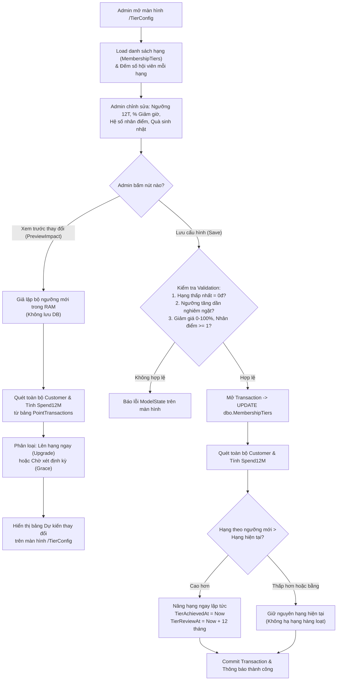
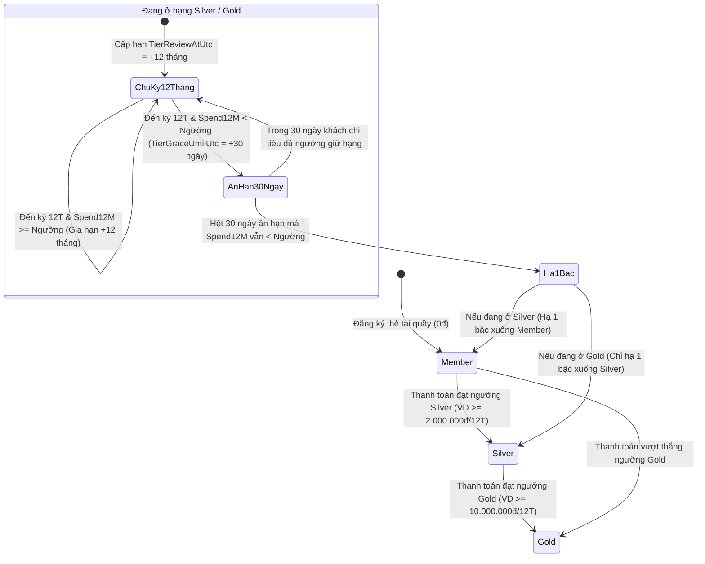

# TÀI LIỆU MÔ TẢ CHI TIẾT QUY TẮC & LUỒNG NGHIỆP VỤ: MÀN HÌNH HẠNG THÀNH VIÊN (`/TierConfig`)

> **Dự án:** Billiard Management System (BMS) — Phân hệ Quản lý Hội viên & Loyalty (TV2)  
> **Đường dẫn màn hình:** `/TierConfig` (`GET /TierConfig`, `POST /TierConfig/PreviewImpact`, `POST /TierConfig/Save`)  
> **Phân quyền truy cập:** Chỉ dành cho Quản trị viên (`[Authorize(Roles = "Admin")]`)

---

## 1. TỔNG QUAN CHỨC NĂNG MÀN HÌNH HẠNG THÀNH VIÊN

Màn hình **Hạng thành viên (`/TierConfig`)** là trung tâm cấu hình chính sách phân hạng hội viên (Membership Tier) và quyền lợi ưu đãi của CLB Bida. Thay vì xét hạng theo điểm tích lũy tĩnh, hệ thống vận hành theo mô hình **Chi tiêu lũy kế 12 tháng gần nhất (Rolling 12-Month Spend)** kết hợp với **Chu kỳ xét giữ hạng 12 tháng** và **Thời gian ân hạn 30 ngày (Grace Period)**.

Trên màn hình này, Admin thực hiện 3 tác vụ chính:
1. **Theo dõi phân bổ hội viên** theo từng hạng hiện có (`Member`, `Silver`, `Gold`).
2. **Cấu hình 4 thông số chính sách** cho từng hạng:
   - Mức chi tiêu 12 tháng (`SpendThreshold` - VNĐ)
   - Phần trăm giảm tiền giờ chơi (`DiscountPercent` - %)
   - Hệ số nhân điểm thưởng (`PointMultiplier` - $\times 1, \times 2, \dots$)
   - Giá trị quà tặng voucher sinh nhật (`BirthdayVoucherValue` - VNĐ)
3. **Xem trước ảnh hưởng (`PreviewImpact`) và Lưu áp dụng (`Save`)**: Mô phỏng danh sách hội viên sẽ được thăng hạng ngay hoặc vào diện xét giữ hạng trước khi chính thức ghi xuống cơ sở dữ liệu.

---

## 2. CẤU TRÚC BẢNG DỮ LIỆU LIÊN QUAN

### 2.1. Bảng chính: `dbo.MembershipTiers`
Model ánh xạ: [`MembershipTier.cs`](../src/Bms.Web/Data/MembershipTier.cs)

| Tên cột | Kiểu dữ liệu SQL | Ý nghĩa nghiệp vụ | Cấu hình mặc định (Seed) |
| :--- | :--- | :--- | :--- |
| `Id` | `INT IDENTITY PK` | Khóa chính của hạng thành viên | `1`, `2`, `3` |
| `TierName` | `NVARCHAR(50)` | Tên hạng thành viên | `Member`, `Silver`, `Gold` |
| `SpendThreshold` | `DECIMAL(18,2)` | Ngưỡng tổng chi tiêu 12 tháng gần nhất để đạt/giữ hạng | Member: `0 ₫`<br>Silver: `2.000.000 ₫`<br>Gold: `10.000.000 ₫` |
| `DiscountPercent` | `DECIMAL(5,2)` | % giảm giá trực tiếp trên **tiền giờ chơi** (`PlaytimeAmount`) | Member: `0%`<br>Silver: `5%`<br>Gold: `10%` |
| `PointMultiplier` | `INT` | Hệ số nhân điểm khi thanh toán hóa đơn | Member: `×1`<br>Silver: `×1`<br>Gold: `×2` |
| `BirthdayVoucherValue`| `DECIMAL(18,2)` | Giá trị Voucher giảm hóa đơn tặng tự động vào ngày sinh nhật | Member: `0 ₫`<br>Silver: `50.000 ₫`<br>Gold: `100.000 ₫` |
| `SortOrder` | `INT` | Thứ tự cấp bậc từ thấp lên cao | `1` (Member) $\rightarrow$ `2` (Silver) $\rightarrow$ `3` (Gold) |

### 2.2. Các cột trạng thái vòng đời hạng trên bảng `dbo.AspNetUsers`
Model ánh xạ: [`ApplicationUser.cs`](../src/Bms.Web/Data/ApplicationUser.cs)

| Tên cột | Kiểu dữ liệu | Ý nghĩa trong vòng đời xét hạng |
| :--- | :--- | :--- |
| `TierId` | `INT NULL (FK)` | Trỏ tới `dbo.MembershipTiers(Id)` — Hạng hiện tại của hội viên |
| `TierAchievedAtUtc` | `DATETIME2 NULL` | Thời điểm hội viên đạt được hạng hiện tại |
| `TierReviewAtUtc` | `DATETIME2 NULL` | Ngày đến kỳ xét duyệt giữ hạng định kỳ (`= TierAchievedAtUtc + 12 tháng`) |
| `TierGraceUntilUtc` | `DATETIME2 NULL` | Ngày kết thúc 30 ngày ân hạn nếu đến kỳ `TierReviewAtUtc` mà chưa đủ chi tiêu |

---

## 3. CHI TIẾT CÁC QUY TẮC NGHIỆP VỤ (BUSINESS RULES)

### Quy tắc 1: Ràng buộc hợp lệ khi cấu hình bảng hạng (`Validation Rules`)
Khi Admin chỉnh sửa thông số trên màn hình `/TierConfig` và bấm **Lưu cấu hình** ([`TierConfigController.Save`](../src/Bms.Web/Controllers/TierConfigController.cs)):
1. **Ngưỡng chi tiêu (`SpendThreshold`):** Phải là số $\ge 0$ và $\le 999.999.999.999\text{ ₫}$.
2. **Hạng cơ sở (Hạng đầu tiên - `Member`):** Bắt buộc phải có `SpendThreshold = 0` để đảm bảo mọi hội viên mới mở thẻ tại quầy (chi tiêu = $0\text{ ₫}$) đều luôn thuộc về hạng khởi đầu.
3. **Tính đơn điệu tăng nghiêm ngặt giữa các bậc hạng:** Ngưỡng chi tiêu của hạng đứng sau bắt buộc phải **lớn hơn hẳn (`>`)** ngưỡng của hạng đứng liền trước:
   $$\text{SpendThreshold}_{\text{Member}} (0) < \text{SpendThreshold}_{\text{Silver}} < \text{SpendThreshold}_{\text{Gold}}$$
   Nếu nhập trùng hoặc nhỏ hơn, hệ thống chặn lưu và báo lỗi: *"Ngưỡng của [Hạng sau] phải lớn hơn ngưỡng của [Hạng trước]"*.
4. **Phần trăm giảm giá giờ chơi (`DiscountPercent`):** Nằm trong khoảng $0\% \rightarrow 100\%$ (làm tròn tối đa 2 chữ số thập phân).
5. **Hệ số nhân điểm (`PointMultiplier`):** Số nguyên từ $1 \rightarrow 100$.
6. **Quà sinh nhật (`BirthdayVoucherValue`):** Số tiền từ $0\text{ ₫} \rightarrow 100.000.000\text{ ₫}$ (nếu $= 0\text{ ₫}$ thì hạng đó không được phát voucher sinh nhật).

---

### Quy tắc 2: Công thức tính "Chi tiêu 12 tháng gần nhất" (`Spend12Months`)
Hệ thống **không** dùng tổng chi tiêu trọn đời (`TotalSpend`) để xét hạng mà dùng tổng số tiền thực trả của các hóa đơn trong **365 ngày gần nhất** tính từ sổ cái điểm [`TierEvaluationService.GetSpendLast12MonthsAsync`](../src/Bms.Web/Services/TierEvaluationService.cs):
$$\text{Spend12Months} = \sum \text{SpendAmount} \quad \text{với } \begin{cases} \text{TransactionType} = \text{'Earn'} \\ \text{CreatedAt} \in [\text{Now} - 365\text{ ngày}, \text{Now}] \end{cases}$$

- **Câu lệnh SQL tương đương:**
  ```sql
  SELECT COALESCE(SUM(SpendAmount), 0)
  FROM dbo.PointTransactions
  WHERE CustomerId = @CustomerId
    AND TransactionType = 'Earn'
    AND CreatedAt >= DATEADD(DAY, -365, SYSUTCDATETIME())
    AND CreatedAt <= SYSUTCDATETIME();
  ```
- **Quy tắc phân giải hạng (`TierHelper.Resolve`):** Hạng đạt được tương ứng với mức chi tiêu $S$ là hạng cao nhất có `SpendThreshold <= S`:
  ```csharp
  tiers.Where(t => t.SpendThreshold <= spend12M)
       .OrderByDescending(t => t.SpendThreshold)
       .FirstOrDefault();
  ```

---

### Quy tắc 3: Cơ chế "Xem trước thay đổi" (`PreviewImpact`)
Trước khi lưu bộ ngưỡng chi tiêu mới, Admin có thể bấm nút **"Xem trước thay đổi"** (`POST /TierConfig/PreviewImpact`):
- Hệ thống tạo bản sao bộ ngưỡng mới trong bộ nhớ (`simulatedTiers`) mà **chưa ghi xuống DB**.
- Quét toàn bộ danh sách hội viên và tính `Spend12Months` của từng người:
  1. Nếu hạng mới theo ngưỡng đề xuất **cao hơn** hạng hiện tại (`resolved.SpendThreshold > curTier.SpendThreshold`) $\rightarrow$ Gắn nhãn **`Upgrade` ("Lên hạng ngay")**.
  2. Nếu chi tiêu 12 tháng của khách **thấp hơn** ngưỡng mới của hạng hiện tại (`spend12M < curTier.SpendThreshold`) $\rightarrow$ Gắn nhãn **`Grace` ("Giữ hạng đến kỳ xét định kỳ")**.
- Hiển thị bảng tổng hợp số người sẽ lên hạng ngay và danh sách tối đa 20 hội viên tiêu biểu bị ảnh hưởng ngay trên đầu màn hình `/TierConfig`.

---

### Quy tắc 4: Chính sách Bảo vệ Hạng khi Admin lưu ngưỡng mới (`No Mass Downgrade`)
Khi Admin bấm **"Lưu cấu hình"** (`POST /TierConfig/Save`):
1. Toàn bộ thao tác chạy trong **1 Database Transaction (`BeginTransactionAsync`)**.
2. Cập nhật `SpendThreshold`, `DiscountPercent`, `PointMultiplier`, `BirthdayVoucherValue`, `SortOrder` vào bảng `dbo.MembershipTiers`.
3. Quét toàn bộ hội viên hiện có:
   - **Trường hợp khách đủ điều kiện lên hạng cao hơn** (ví dụ Admin giảm ngưỡng lên Gold từ 10 triệu xuống 8 triệu, và khách đang ở Silver với chi tiêu 8,5 triệu):
     - Hệ thống **nâng hạng ngay lập tức** (`u.TierId = resolved.Id`).
     - Đặt lại ngày đạt hạng `TierAchievedAtUtc = Now`, ngày xét hạng tiếp theo `TierReviewAtUtc = Now + 12 tháng`, và xóa cờ ân hạn `TierGraceUntilUtc = null`.
   - **Trường hợp khách không đủ ngưỡng mới** (ví dụ Admin tăng ngưỡng Gold từ 10 triệu lên 15 triệu, khách đang ở Gold với chi tiêu 11 triệu):
     - Hệ thống **KHÔNG tự động hạ hạng hàng loạt ngay lúc lưu** để tránh gây bức xúc cho hội viên đang sở hữu thẻ VIP.
     - Hội viên được giữ nguyên hạng hiện tại cho đến đúng ngày xét hạng định kỳ (`TierReviewAtUtc`) của cá nhân đó.

---

### Quy tắc 5: Vòng đời Xét hạng Tự động (Thăng hạng tức thì — Ân hạn 30 ngày — Hạ tối đa 1 bậc)
Cấu hình ở màn hình `/TierConfig` trực tiếp điều khiển 2 luồng tự động trong hệ thống:

#### 5.1. Khi khách thanh toán hóa đơn tại quầy (`EvaluateUpgradeOnCheckoutAsync`)
Ngay khi thu ngân bấm xác nhận thanh toán:
1. Nếu khách đang trong thời gian **Ân hạn (`TierGraceUntilUtc != null`)** và sau hóa đơn này `Spend12Months >= CurrentTier.SpendThreshold`:
   - Xóa cờ ân hạn (`TierGraceUntilUtc = null`), gia hạn chu kỳ giữ hạng thêm 12 tháng (`TierReviewAtUtc = Now + 12 tháng`).
2. Nếu `Spend12Months` vượt ngưỡng của hạng cao hơn (`resolvedTier.SpendThreshold > currentTier.SpendThreshold`):
   - **Thăng hạng ngay lập tức** trong cùng giao dịch thanh toán.
   - Ghi nhận `TierAchievedAtUtc = Now`, `TierReviewAtUtc = Now + 12 tháng`, `TierGraceUntilUtc = null`.
   - Ghi log kiểm toán vào `dbo.CustomerAuditLogs` (`Action = 'TierChange'`, `reason = 'Upgrade12M'`).
   - Phát thông báo chúc mừng thăng hạng vào `dbo.Notifications`.

#### 5.2. Khi Job định kỳ hằng ngày quét xét giữ hạng (`ProcessDailyTierReviewsAsync`)
Chạy tự động qua `LoyaltyDailyJob` cho các hội viên thuộc hạng trên mức cơ sở (`Silver`, `Gold`):
1. **Khi đến hạn xét 12 tháng (`TierReviewAtUtc <= Now` và chưa vào ân hạn):**
   - **Nếu `Spend12Months >= CurrentTier.SpendThreshold`:** Đạt điều kiện duy trì $\rightarrow$ Gia hạn `TierReviewAtUtc = Now + 12 tháng`.
   - **Nếu `Spend12Months < CurrentTier.SpendThreshold`:** Chưa đủ chi tiêu duy trì $\rightarrow$ **Chưa hạ hạng ngay**, mở **Thời gian ân hạn 30 ngày** (`TierGraceUntilUtc = Now + 30 ngày`) và phát thông báo nhắc số tiền còn thiếu để giữ hạng.
2. **Khi đang trong thời gian ân hạn (`TierGraceUntilUtc != null`):**
   - Nếu khách chi tiêu bù đủ ngưỡng trước khi hết hạn $\rightarrow$ Xóa ân hạn, gia hạn `TierReviewAtUtc = Now + 12 tháng`.
   - Nếu **hết 30 ngày ân hạn (`TierGraceUntilUtc <= Now`)** mà vẫn chưa đủ ngưỡng $\rightarrow$ **Hạ đúng 1 bậc liền kề** (`newIdx = Math.Max(0, currentIdx - 1)`).
   - **Quy tắc hạ bậc an toàn (Soft Landing):** Khách hạng `Gold` dù trong 12 tháng qua chi tiêu $0\text{ ₫}$ thì khi hết ân hạn cũng chỉ hạ 1 bậc xuống `Silver` (cấp chu kỳ 12 tháng mới ở hạng `Silver`), tuyệt đối **không rơi thẳng 2 bậc** từ `Gold` về `Member`.

---

### Quy tắc 6: Cách quyền lợi Hạng Thành Viên áp dụng vào Vận hành
Các thông số Admin cấu hình tại `/TierConfig` sẽ lập tức có hiệu lực tại các phân hệ khác:
1. **Giảm tiền giờ chơi (`DiscountPercent`) tại màn Tính tiền ([`LoyaltyService.PreviewCheckoutAsync`](../src/Bms.Web/Services/LoyaltyService.cs)):**
   - Chỉ giảm trên **tiền giờ chơi bàn (`PlaytimeAmount`)**, không giảm trên đồ ăn/thức uống (`FandBAmount`):
     $$\text{TierDiscountAmount} = \text{Round}\left(\text{PlaytimeAmount} \times \frac{\text{DiscountPercent}}{100}, 0\right)$$
   - Được ưu tiên trừ ở **Bước 1** (trước khi trừ Voucher ở Bước 2 và trừ Điểm thưởng tối đa 50% ở Bước 3).
2. **Nhân điểm thưởng (`PointMultiplier`):**
   - Tính trên số tiền thực thu cuối cùng (`FinalAmount`):
     $$\text{PointsToEarn} = \left\lfloor \frac{\text{FinalAmount}}{20.000} \right\rfloor \times \text{PointMultiplier}$$
3. **Quà sinh nhật (`BirthdayVoucherValue`) trong [`CampaignService.IssueBirthdayVouchersAsync`](../src/Bms.Web/Services/CampaignService.cs):**
   - Hội viên có ngày/tháng sinh trùng với ngày hiện tại (giờ Việt Nam UTC+7) và thuộc hạng có `BirthdayVoucherValue > 0` sẽ được tự động cấp 1 mã Voucher giảm hóa đơn có giá trị bằng `BirthdayVoucherValue` (hạn dùng 30 ngày, tối đa 1 lần/năm theo khóa `BDAY-{Year}-{UserId}`).

---

## 4. SƠ ĐỒ LUỒNG NGHIỆP VỤ (MERMAID DIAGRAMS)

### 4.1. Luồng Admin cấu hình & Lưu chính sách hạng trên màn `/TierConfig`



### 4.2. Sơ đồ Trạng thái Vòng đời Hạng của 1 Hội viên (State Diagram)



---

## 5. BẢN ĐỒ ĐỐI CHIẾU DỮ LIỆU — TRUY VẤN — VỊ TRÍ CODE

| Chức năng chi tiết | Bảng CSDL tác động | File mã nguồn | Method xử lý & Dòng code | Câu truy vấn LINQ / SQL cốt lõi |
| :--- | :--- | :--- | :--- | :--- |
| **1. Hiển thị danh sách hạng & Số lượng hội viên** | `MembershipTiers` (Đọc)<br>`AspNetUsers` (Đếm) | [`TierConfigController.cs`](../src/Bms.Web/Controllers/TierConfigController.cs) | `Index()` (Dòng 24–28)<br>`LoadItemsAsync()` (Dòng 173–189)<br>`CountCustomersAsync()` (Dòng 191–198) | `_context.MembershipTiers.OrderBy(t => t.SpendThreshold)`<br>`_context.Users.Where(u => u.TierId != null).GroupBy(u => u.TierId)` |
| **2. Xem trước ảnh hưởng khi đổi ngưỡng** | `MembershipTiers` (Đọc)<br>`AspNetUsers` (Đọc)<br>`PointTransactions` (Tính tổng) | [`TierConfigController.cs`](../src/Bms.Web/Controllers/TierConfigController.cs)<br>[`TierEvaluationService.cs`](../src/Bms.Web/Services/TierEvaluationService.cs) | `PreviewImpact()` (Dòng 33–49)<br>`PreviewThresholdImpactAsync()` (Dòng 240–280) | Giả lập `simulatedTiers` trong RAM + gọi `GetSpendLast12MonthsAsync` cho từng hội viên |
| **3. Lưu cấu hình hạng & Nâng hạng cho khách đủ chuẩn** | `MembershipTiers` (`UPDATE`)<br>`AspNetUsers` (`UPDATE`) | [`TierConfigController.cs`](../src/Bms.Web/Controllers/TierConfigController.cs) | `Save()` (Dòng 54–171) | Kiểm tra `parsed[0].Threshold == 0` & `parsed[i].Threshold > parsed[i-1].Threshold` $\rightarrow$ `SaveChangesAsync()` |
| **4. Tính tổng chi tiêu 12 tháng gần nhất** | `PointTransactions` (Đọc) | [`TierEvaluationService.cs`](../src/Bms.Web/Services/TierEvaluationService.cs) | `GetSpendLast12MonthsAsync()` (Dòng 47–63) | `Where(t => t.CustomerId == id && t.TransactionType == "Earn" && t.CreatedAt >= now.AddDays(-365)).SumAsync(t => t.SpendAmount)` |
| **5. Xét thăng hạng tức thì khi thanh toán** | `AspNetUsers` (`UPDATE`)<br>`CustomerAuditLogs` (`INSERT`)<br>`Notifications` (`INSERT`) | [`TierEvaluationService.cs`](../src/Bms.Web/Services/TierEvaluationService.cs) | `EvaluateUpgradeOnCheckoutAsync()` (Dòng 65–133) | So sánh `resolvedTier.SpendThreshold > currentTier.SpendThreshold` $\rightarrow$ Cập nhật `TierId`, `TierReviewAtUtc = +12M` |
| **6. Xét giữ hạng định kỳ, ân hạn 30 ngày & hạ 1 bậc** | `AspNetUsers` (`UPDATE`)<br>`CustomerAuditLogs` (`INSERT`)<br>`Notifications` (`INSERT`) | [`TierEvaluationService.cs`](../src/Bms.Web/Services/TierEvaluationService.cs) | `ProcessDailyTierReviewsAsync()` (Dòng 135–238) | Kiểm tra `TierReviewAtUtc <= now` và `TierGraceUntilUtc <= now` $\rightarrow$ Hạ 1 bậc `Math.Max(0, currentIdx - 1)` |
| **7. Giao diện bảng cấu hình & Preview** | — | [`Views/TierConfig/Index.cshtml`](../src/Bms.Web/Views/TierConfig/Index.cshtml) | Toàn bộ file (Dòng 1–171) | Form binding `Tiers[i].SpendThreshold`, `DiscountPercent`, `PointMultiplier`, `BirthdayVoucherValue` |

