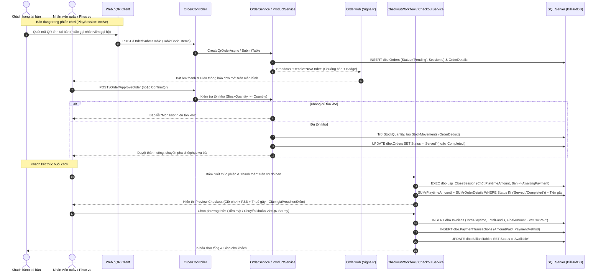
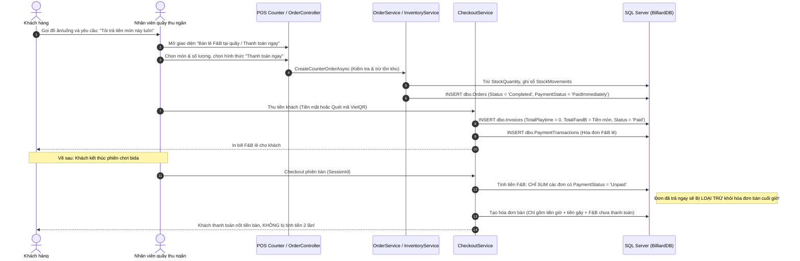
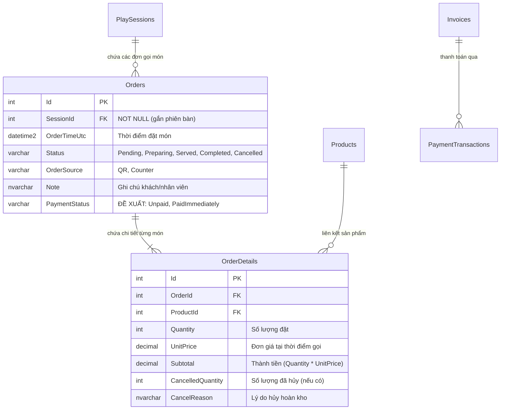

# Billiard Management System

## Software Design Specification (SDS) — Phân hệ F&B (Gọi món, Duyệt đơn & Thanh toán)

**Người phụ trách:** Hiệp (F&B Workflow)  
**Phiên bản:** 1.0  
**Ngày cập nhật:** 09/11/2026  
**Trạng thái mã nguồn:** Đã tích hợp trên nhánh `hiep` (commit `cba64d4`)

---

## I. Tổng quan nghiệp vụ Phân hệ F&B

Phân hệ F&B (Food & Beverage) chịu trách nhiệm toàn bộ vòng đời của việc đặt đồ ăn/uống, từ khâu khách gọi món, nhân viên tiếp nhận/duyệt món, trừ kho hàng hóa, cho đến khâu tính tiền thanh toán.

Hệ thống cần đáp ứng **hai kịch bản thanh toán chính**:
1. **Trường hợp 1 (Chuẩn - Gộp hóa đơn cuối phiên):** Khách đang chơi tại bàn, gọi đồ ăn/uống. Khi kết thúc phiên chơi, toàn bộ tiền F&B được tự động gom cùng tiền giờ bàn và tiền thuê gậy vào một hóa đơn tổng duy nhất để thanh toán tại quầy POS.
2. **Trường hợp 2 (Thanh toán lẻ tức thì tại quầy):** Khách đang chơi tại bàn muốn thanh toán ngay đồ ăn/uống khi vừa nhận món (hoặc khách vãng lai mua đồ mang đi), không gộp vào tiền bàn khi kết thúc phiên.

---

## II. Phân tích chi tiết Luồng nghiệp vụ & Sequence Diagrams

### 1. Trường hợp 1: Khách gọi món tại bàn — Thanh toán gộp cùng tiền bàn & tiền gậy



---

### 2. Trường hợp 2: Khách muốn thanh toán lẻ F&B ngay tại quầy (Không thanh toán chung với tiền bàn)



---

## III. Thiết kế Cấu trúc Dữ liệu & Bảng liên quan

### 1. Bảng `dbo.Orders` & `dbo.OrderDetails`



---

## IV. Đánh giá & Nhận xét Tính hợp lý của Logic hiện tại

Dưới đây là phần rà soát thực tế đối chiếu với mã nguồn hiện tại (`CheckoutService.cs`, `OrderController.cs`, `BilliardDB_Full.sql`):

### 1. Điểm TỐT và ĐÃ HOẠT ĐỘNG ỔN ĐỊNH:
- [x] **Trường hợp 1 (Gộp bill cuối phiên):** Logic chạy hoàn hảo. `OrderController.ApproveOrder` và `OrderService.ConfirmQrOrderAsync` kiểm tra kho rất chặt chẽ, trừ tồn kho `StockQuantity` ngay lập tức, ngăn ngừa bán âm kho.
- [x] **Chặn gian lận thanh toán khi còn đơn chờ:** `CheckoutService` có rule chặn: nếu bàn còn đơn ở trạng thái `Pending` hoặc `Preparing`, hệ thống kiên quyết không cho chốt bill tính tiền. Điều này ép nhân viên phải duyệt hoặc hủy dứt điểm mọi đơn gọi món của bàn trước khi tính tiền.
- [x] **Thông báo Realtime:** `OrderHub` kết nối thông suốt, nhân viên nghe chuông và thấy đơn nhảy ngay tức thì.

---

### 2. Những điểm CHƯA ỔN & RỦI RO CẦN SỬA ĐỔI (Đặc biệt cho Trường hợp 2):

> [!WARNING]
> #### Rủi ro 1: Lỗi tính tiền 2 lần (Double Billing) khi khách trả tiền món trước
> **Hiện trạng:**
> Trong [CheckoutService.cs](file:///d:/DATA/Document/FPTU/ki12/SWP391/billiard-management-system/src/Bms.Web/Services/CheckoutService.cs#L370-L372), câu lệnh tính tổng tiền F&B cuối phiên bàn là:
> ```sql
> SELECT ISNULL(SUM(od.Subtotal), 0)
> FROM dbo.Orders o INNER JOIN dbo.OrderDetails od ON od.OrderId = o.Id
> WHERE o.SessionId = s.Id AND o.Status IN ('Served', 'Completed')
> ```
> Bảng `Orders` hiện tại **không có cột đánh dấu đơn này đã thanh toán lẻ hay chưa**.  
> **Hậu quả:** Nếu khách ngồi bàn B01 mua 2 lon nước và đưa tiền mặt trả ngay tại quầy lúc 14:00, đến 17:00 khi khách trả bàn thì hệ thống **vẫn gom 2 lon nước đó vào hóa đơn bàn lần thứ hai**. Khách sẽ bị bắt trả tiền 2 lần cho cùng một món.

> [!CAUTION]
> #### Rủi ro 2: Ràng buộc CSDL `SessionId int NOT NULL` và `UQ_Invoice_Session UNIQUE`
> **Hiện trạng:**
> - Trong `dbo.Orders`: `SessionId` đang là `NOT NULL`. Nếu khách vãng lai chỉ vào quầy mua lon nước mang đi mà không mở bàn bida, hệ thống sẽ văng lỗi DB vì thiếu `SessionId`.
> - Trong `dbo.Invoices`: Khóa duy nhất `CONSTRAINT UQ_Invoice_Session UNIQUE (SessionId)` chỉ cho phép **tối đa 1 hóa đơn cho mỗi phiên chơi**.  
> **Hậu quả:** Nếu khách đang chơi tại bàn mà muốn thanh toán lẻ F&B (tức xuất 1 hóa đơn F&B riêng ngay lúc đó), hệ thống sẽ vi phạm `UQ_Invoice_Session` khi cuối giờ lại muốn xuất thêm 1 hóa đơn bàn cho chính phiên đó.

---

## V. Phương án Khắc phục & Kiến nghị Triển khai Code

Để hỗ trợ cả **Trường hợp 1** và **Trường hợp 2** một cách sạch sẽ, bạn nên áp dụng 2 bước điều chỉnh sau:

### Bước 1: Mở rộng trường dữ liệu (Database Migration)
Thêm cột trạng thái thanh toán vào bảng `dbo.Orders`:
```sql
ALTER TABLE dbo.Orders 
ADD PaymentStatus varchar(20) NOT NULL CONSTRAINT DF_Order_PaymentStatus DEFAULT 'Unpaid';
-- Các giá trị: 'Unpaid' (chờ gộp bill cuối phiên), 'PaidImmediately' (đã thanh toán lẻ tại quầy)
```

### Bước 2: Cập nhật câu truy vấn trong `CheckoutService.cs`
Sửa điều kiện tính F&B của hóa đơn bàn cuối phiên:
```csharp
// Chỉ gom những đơn F&B CHƯA thanh toán lẻ:
ISNULL((SELECT SUM(od.Subtotal) FROM dbo.Orders o
        INNER JOIN dbo.OrderDetails od ON od.OrderId = o.Id
        WHERE o.SessionId = s.Id 
          AND o.Status IN ('Served', 'Completed')
          AND (o.PaymentStatus IS NULL OR o.PaymentStatus = 'Unpaid')), 0) AS FandBAmount
```

### Bước 3: Thêm nút "Thanh toán ngay" trên giao diện gọi món tại quầy
Trên màn hình [Order/Counter](file:///d:/DATA/Document/FPTU/ki12/SWP391/billiard-management-system/src/Bms.Web/Views/Order/Counter.cshtml):
- Thêm checkbox: `[ ] Khách thanh toán ngay tại quầy`
- Nếu tick chọn: Hệ thống tạo Order với `PaymentStatus = 'PaidImmediately'`, chuyển sang popup thu tiền mặt/VietQR lẻ, in biên lai thu tiền món lẻ và KHÔNG cộng dồn vào hóa đơn bàn khi kết thúc giờ chơi.
