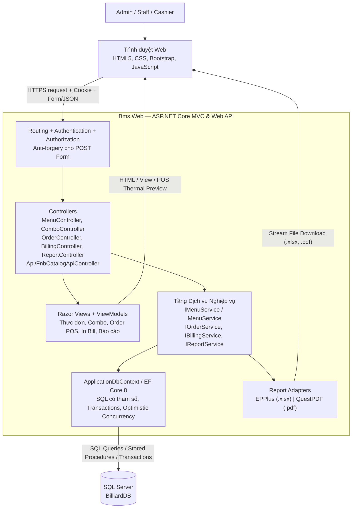
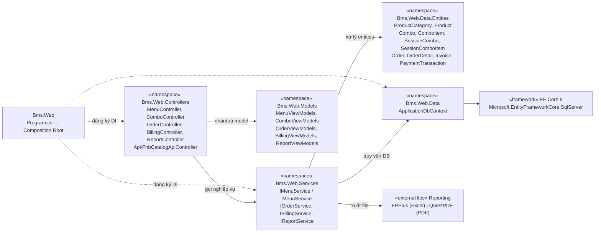
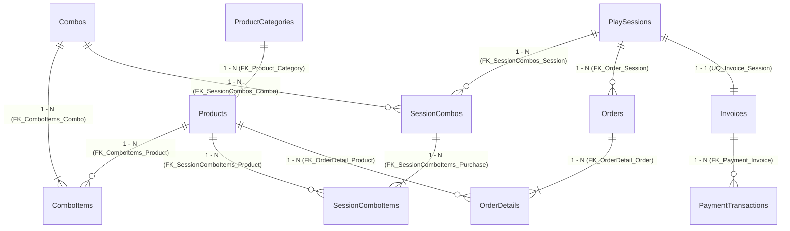
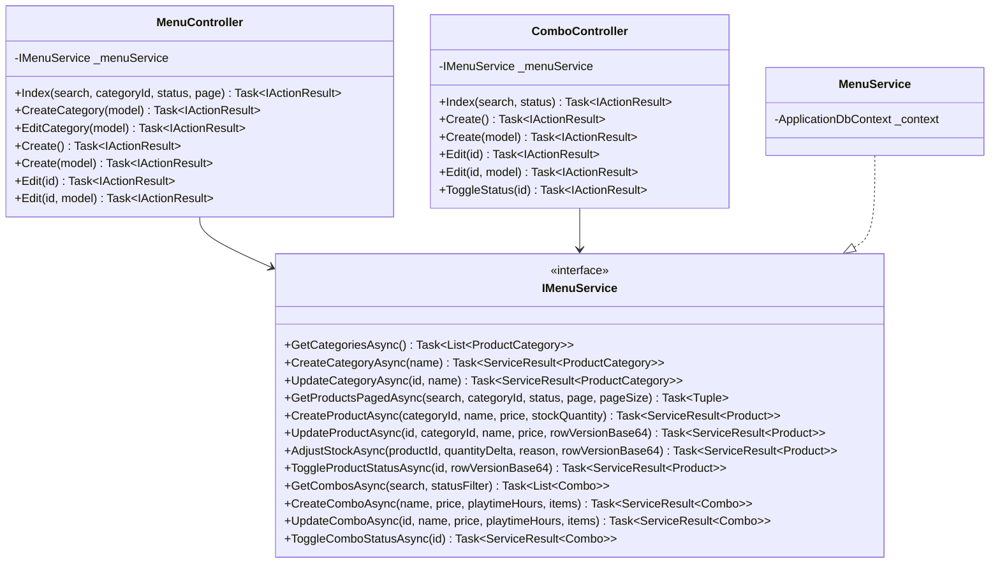
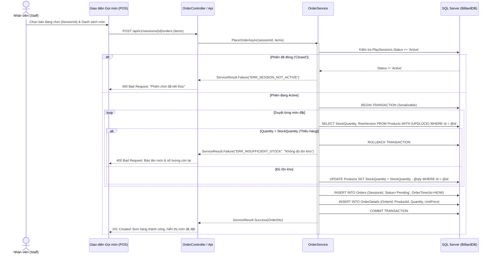
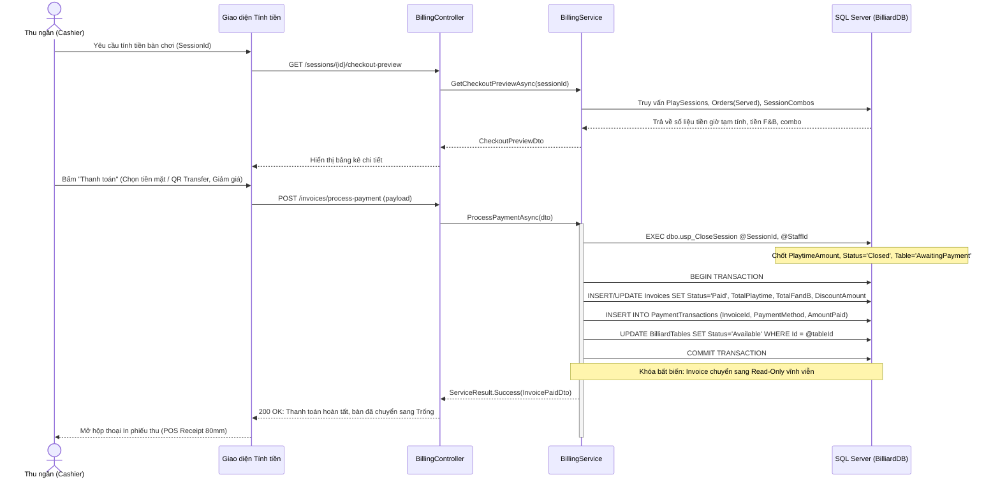
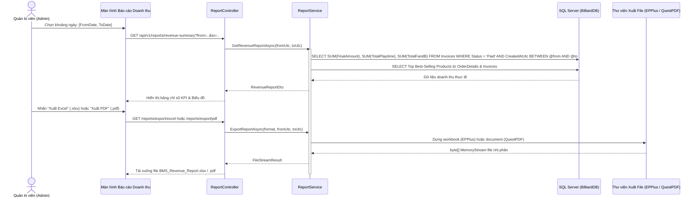

# Billiard Management System

## Software Design Specification — Phần của Tùng (F&B, Billing & Reporting)

**Ngày cập nhật:** 11/10/2026. **Phiên bản:** 1.0. **Người phụ trách theo phân công:** Tùng (Software Engineer — Thành viên 4).  
**Phạm vi nghiệp vụ:** Phân hệ Thực đơn, Kho hàng F&B, Gói Combo, Gọi món, Tính tiền / Thanh toán / In Bill và Báo cáo Doanh thu tài chính (UC41, UC42, UC30, UC27, UC28, UC29, UC47).

Tài liệu cung cấp thiết kế kiến trúc, cấu trúc package, chi tiết 10 bảng dữ liệu trong CSDL `BilliardDB` và thiết kế luồng xử lý chi tiết kèm Class Diagram và Sequence Diagram. Cấu trúc đánh số bám sát chuẩn SDS của nhóm và tương thích hoàn toàn với tài liệu phần Hùng (`docs/SDS_HUNG.md`).

---

### Change Log

| Date | A / M / D | In charge | Change Description |
|---|---|---|---|
| 11/10/2026 | A | Tùng | Khởi tạo SDS cho phân hệ Thực đơn, Kho hàng, Combo, Đặt món, Thanh toán & Báo cáo tài chính; đối chiếu với schema 24 bảng trong `BilliardDB` |

---

# I. High Level Design

## 1. Software Architecture

### 1.1 Kiến trúc tổng thể
Phân hệ Thực đơn, Gọi món, Thanh toán và Báo cáo của Tùng được tích hợp trực tiếp vào dự án ASP.NET Core MVC `src/Bms.Web` (nhắm .NET 8), kết nối trực tiếp vào cơ sở dữ liệu SQL Server `BilliardDB`:
- **Admin**: Sử dụng Razor Views kế thừa layout `_AdminLayout.cshtml` để quản lý Danh mục, Sản phẩm, Điều chỉnh tồn kho, Quản lý Combo và xem Báo cáo doanh thu.
- **Staff / Cashier**: Sử dụng giao diện Gọi món cho phiên chơi và Thu ngân (Checkout / Preview / In bill).
- **Web API Endpoints**: Cung cấp các REST API (`/api/v1/fnb/...`, `/api/v1/reports/...`) phục vụ tương tác bất đồng bộ (AJAX) trên màn hình POS và giao tiếp thời gian thực qua SignalR.
- **Nguồn dữ liệu duy nhất**: Toàn bộ dữ liệu được truy vấn và cập nhật vào SQL Server `BilliardDB` thật thông qua Entity Framework Core 8 (`ApplicationDbContext`) và Stored Procedures (`dbo.usp_CloseSession`). Tuyệt đối không sử dụng Mock Data.

**Hình I.1 — Kiến trúc logic phân hệ F&B, Billing & Reporting.**

### 1.2 Architecture component descriptions

| No | Component | Description |
|---|---|---|
| **C01** | Client Web Browser | Hiển thị giao diện quản lý thực đơn, modal nhập kho, giao diện POS gọi món và xem trước hóa đơn thanh toán nhiệt 80mm. |
| **A01** | Routing & Security Pipeline | Phân quyền nghiêm ngặt: `[Authorize(Roles = "Admin")]` cho quản lý Menu/Kho/Combo/Báo cáo; `[Authorize(Roles = "Admin,Staff")]` cho Gọi món và Thanh toán; kiểm tra Anti-Forgery Token trên toàn bộ request POST. |
| **A02** | Controllers | `MenuController` (CRUD món/kho), `ComboController` (gói combo), `OrderController` (gọi món), `BillingController` (tính tiền, chốt bill), `ReportController` (báo cáo), `FnbCatalogApiController` (REST API). |
| **A03** | Services Layer | `IMenuService`, `IOrderService`, `IBillingService`, `IReportService`. Đóng gói toàn bộ transaction, concurrency check (`RowVersion`), kiểm tra tồn kho và công thức tính tiền. |
| **A04** | Data Access | `ApplicationDbContext` (EF Core 8) ánh xạ trực tiếp vào 10 bảng của Tùng trong `BilliardDB`. Thực thi `dbo.usp_CloseSession` khi kết thúc phiên. |
| **A05** | Reporting Adapters | Sử dụng thư viện **EPPlus** xuất file Excel (.xlsx) định dạng chuẩn kế toán và **QuestPDF** xuất file PDF khổ in A4. |
| **D01** | SQL Server (`BilliardDB`) | Cơ sở dữ liệu duy nhất chứa 24 bảng nghiệp vụ, bảo vệ toàn vẹn bằng PK, FK, CHECK constraints, UNIQUE indexes và RowVersion concurrency tokens. |

### 1.3 Ranh giới trách nhiệm
- **Phạm vi của Tùng**: Quản lý Menu & Kho hàng (`ProductCategories`, `Products`), Combo (`Combos`, `ComboItems`), Gọi món cho phiên (`Orders`, `OrderDetails`), Mua combo (`SessionCombos`, `SessionComboItems`), Tính hóa đơn & Thanh toán (`Invoices`, `PaymentTransactions`), và Báo cáo tài chính (EPPlus, QuestPDF).
- **Ranh giới với Thành viên khác**:
  - Không quản lý danh sách tài khoản hay mật khẩu (do Hùng phụ trách).
  - Không tự mở phiên chơi hay đổi trạng thái bàn sang `InUse` (do Thành viên 1 phụ trách). Khi thanh toán hoàn tất, Tùng chuyển bàn từ `AwaitingPayment` về `Available`.
  - Không can thiệp vào quy trình đặt bàn (Booking do Thành viên 2 & 3 phụ trách).

---

## 2. Package Diagram

**Hình I.2 — Sơ đồ phụ thuộc Package phân hệ F&B, Billing & Reporting.**

---

## 3. Database Design — Mười bảng thuộc phạm vi của Tùng

Tất cả các bảng dưới đây đã được định nghĩa trong `BMS_Database_Starter/BilliardDB_Full.sql` và tồn tại trong `BilliardDB`:

### 3.1 Bảng `dbo.ProductCategories` (Danh mục F&B)
| Tên cột | Kiểu dữ liệu | Ràng buộc / Ý nghĩa |
|---|---|---|
| `Id` | `int IDENTITY` | Primary Key |
| `Name` | `nvarchar(60)` | NOT NULL, UNIQUE (`UQ_ProductCategories_Name`), `LEN(TRIM(Name)) > 0` |

### 3.2 Bảng `dbo.Products` (Sản phẩm F&B & Tồn kho)
| Tên cột | Kiểu dữ liệu | Ràng buộc / Ý nghĩa |
|---|---|---|
| `Id` | `int IDENTITY` | Primary Key |
| `CategoryId` | `int` | FK tới `ProductCategories(Id)` |
| `Name` | `nvarchar(100)` | NOT NULL, UNIQUE (`UQ_Products_Name`) |
| `Price` | `decimal(18,2)` | NOT NULL, `Price > 0` (`CK_Product_Price`) |
| `StockQuantity` | `int` | NOT NULL, `StockQuantity >= 0` (`CK_Product_Stock`), Default `0` |
| `IsActive` | `bit` | NOT NULL, Default `1` (Cờ Soft Delete) |
| `RowVersion` | `rowversion` | NOT NULL (Optimistic Concurrency Token) |

### 3.3 Bảng `dbo.Combos` (Gói Combo)
| Tên cột | Kiểu dữ liệu | Ràng buộc / Ý nghĩa |
|---|---|---|
| `Id` | `int IDENTITY` | Primary Key |
| `Name` | `nvarchar(100)` | NOT NULL, UNIQUE (`UQ_Combos_Name`) |
| `Price` | `decimal(18,2)` | NOT NULL, `Price >= 0` (`CK_Combo_Price`) |
| `PlaytimeHours` | `decimal(5,2)` | NOT NULL, `PlaytimeHours > 0` (`CK_Combo_Playtime`) |
| `IsActive` | `bit` | NOT NULL, Default `1` |

### 3.4 Bảng `dbo.ComboItems` (Định lượng món trong Combo)
| Tên cột | Kiểu dữ liệu | Ràng buộc / Ý nghĩa |
|---|---|---|
| `ComboId` | `int` | Composite PK, FK tới `Combos(Id)` |
| `ProductId` | `int` | Composite PK, FK tới `Products(Id)` |
| `Quantity` | `int` | NOT NULL, `Quantity > 0` (`CK_ComboItems_Quantity`) |

### 3.5 Bảng `dbo.SessionCombos` & `dbo.SessionComboItems` (Snapshot lượt mua Combo)
- `SessionCombos`: `Id`, `SessionId`, `ComboId`, `Quantity`, `ComboNameSnapshot`, `UnitPriceSnapshot`, `PlaytimeHoursSnapshot`, `PurchasedAtUtc`, `CreatedById`.
- `SessionComboItems`: `SessionComboId`, `ProductId`, `ProductNameSnapshot`, `QuantityPerCombo`.
- **Nguyên tắc bảo toàn**: Snapshot giá trị lúc mua; cập nhật catalog combo không làm biến động dữ liệu đã mua trong quá khứ.

### 3.6 Bảng `dbo.Orders` & `dbo.OrderDetails` (Đơn gọi món F&B)
- `Orders`: `Id`, `SessionId`, `OrderTimeUtc`, `Status` (`Pending`, `Preparing`, `Served`, `Cancelled`).
- `OrderDetails`: `Id`, `OrderId` (CASCADE), `ProductId`, `Quantity > 0`, `UnitPrice >= 0`, `Subtotal AS (Quantity * UnitPrice) PERSISTED`.

### 3.7 Bảng `dbo.Invoices` & `dbo.PaymentTransactions` (Hóa đơn & Giao dịch thanh toán)
- `Invoices`: `Id`, `SessionId` (UNIQUE), `CustomerId`, `TotalPlaytime`, `TotalFandB`, `DiscountAmount`, `FinalAmount AS (TotalPlaytime + TotalFandB - DiscountAmount) PERSISTED`, `Status` (`Unpaid`, `Paid`).
- `PaymentTransactions`: `Id`, `InvoiceId` (CASCADE), `PaymentMethod` (`Cash`, `VNPay`, `SePay`, `Transfer`), `AmountPaid > 0`, `GatewayRefCode`, `TransactionTimeUtc`.

---

# II. Detailed Code Design

## 1. Class Diagram phân hệ Thực đơn & Kho hàng

## 2. Sequence Diagrams

### 2.1 Sequence Diagram: Gọi món F&B và Trừ kho tức thời (UC30)

### 2.2 Sequence Diagram: Đóng phiên, Tính tiền & Thanh toán hóa đơn (UC27, UC28, UC29)

### 2.3 Sequence Diagram: Thống kê Doanh thu & Xuất file Excel / PDF (UC47)

---

# III. Other Design Specifications

## 1. Quy tắc Nghiệp vụ Bất biến (Business Invariants)

1. **Nguyên tắc Tuyệt đối không Mock Data (Hiến chương VI)**: Mọi thao tác truy vấn và cập nhật bắt buộc thực hiện trên SQL Server `BilliardDB`. Cấm mọi hành vi hardcode dữ liệu giả.
2. **Kiểm soát Tương tranh Lạc quan (Optimistic Concurrency)**: Bảng `dbo.Products` bắt buộc sử dụng `[Timestamp] byte[] RowVersion` để chống xung đột ghi đè tồn kho (Lost Update). Khi có xung đột, trả về mã `409 Conflict` yêu cầu tải lại dữ liệu.
3. **Quy tắc Bất biến của Hóa đơn đã thanh toán (Immutability Rule)**:
   - Khi `Invoices.Status == 'Paid'`, bản ghi hóa đơn và mọi chi tiết đơn hàng (`OrderDetails`), phiên chơi (`PlaySessions`), giao dịch thanh toán (`PaymentTransactions`) liên quan bị khóa chỉ đọc (Read-Only) vĩnh viễn. Cấm UPDATE/DELETE.
4. **Trừ kho tức thời & Hoàn tồn**:
   - Khi gọi món: Trừ kho ngay lập tức trong Database Transaction. Nếu không đủ hàng, rollback 100%.
   - Khi hủy đơn `Pending`: Hoàn trả số lượng vào kho ngay lập tức. Cấm hủy đơn đã chuyển trạng thái `Served`.

---

# Phụ lục Bàn giao & Đối chiếu

- **Khớp nối với Database**: 100% khớp với 24 bảng trong `BilliardDB_Full.sql`.
- **Khớp nối với Hùng**: Phân quyền dùng chung `AspNetUsers` và Identity; đăng nhập bằng `ApplicationUser`, kiểm tra vai trò bằng `[Authorize(Roles = "...")]`.
