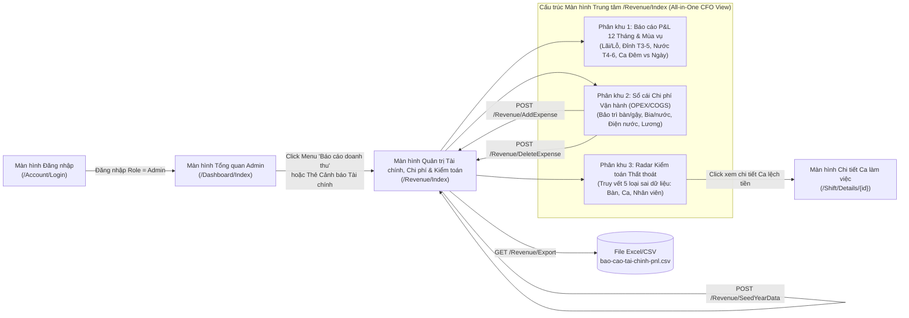
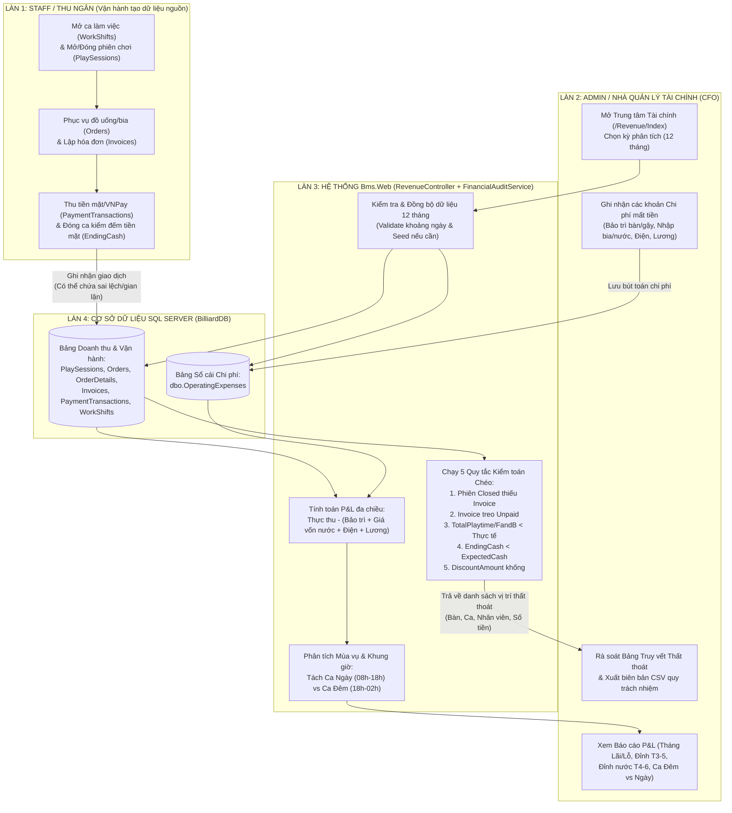
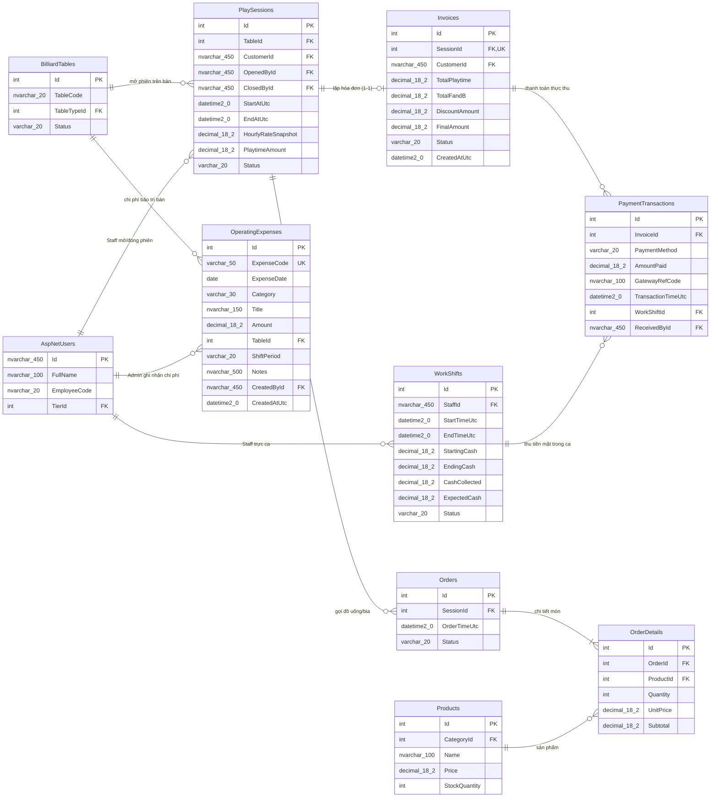
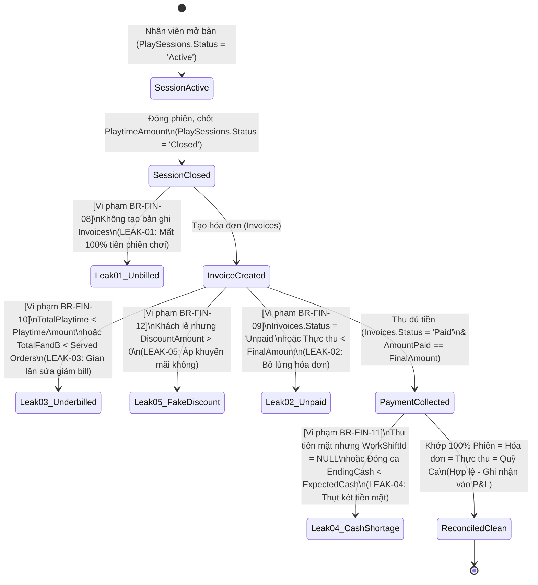
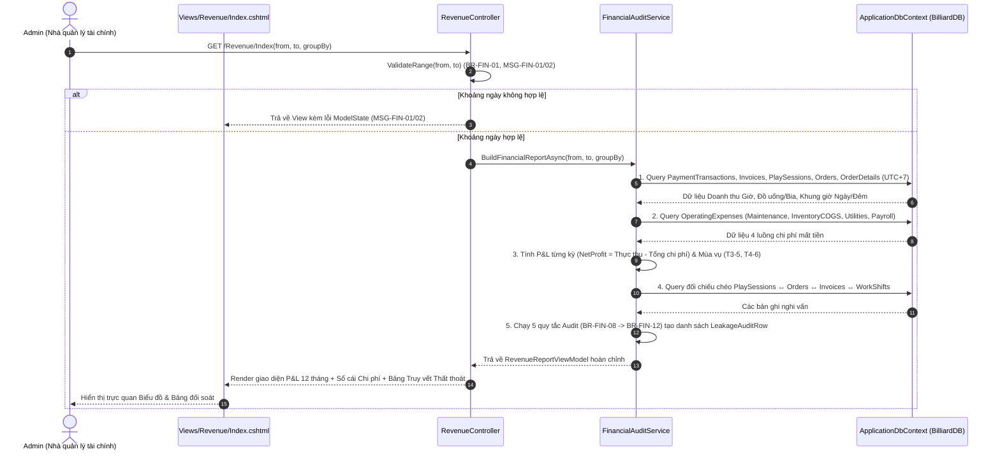
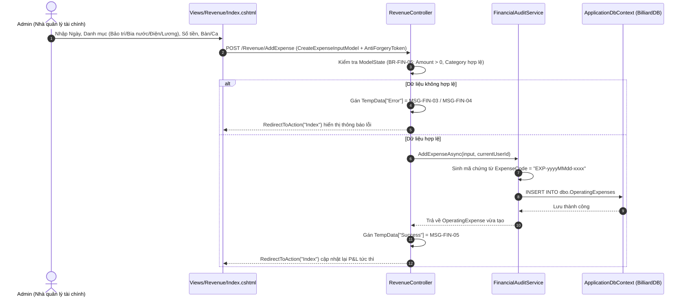

# Đặc Tả Yêu Cầu (SRS) & Thiết Kế Hệ Thống (SDS) — Phân Hệ Quản Trị Tài Chính, Chi Phí Vận Hành & Kiểm Toán Thất Thoát (BMS)

> [!IMPORTANT]
> **Nguyên tắc cốt lõi của tài liệu này:**
> 1. **Tập trung 100% vào 3 bài toán cốt lõi (In-Scope):**
>    - **Bài toán 1:** Bộ dữ liệu vận hành & tài chính thực tế đủ **12 tháng** (cả tháng Lãi, tháng Lỗ, đỉnh doanh thu T3–T5, đỉnh bán nước/bia T4–T6, phân hóa ca Đêm vs Ngày và 5 nhóm sai lệch dữ liệu) mà không phụ thuộc vào thao tác nhập liệu của thành viên khác.
>    - **Bài toán 2:** Báo cáo **Lãi/Lỗ Ròng (P&L)** & Quản lý **4 luồng chi phí mất tiền (`OperatingExpenses`)**: Bảo trì bàn/vải nỉ/gậy/bi, Giá vốn bia/nước, Điện điều hòa/nước, Lương nhân viên theo ca.
>    - **Bài toán 3:** Bộ máy **Kiểm toán & Truy vết Thất thoát Doanh thu (`Revenue Leakage Audit`)** — phát hiện tự động các khoản mất tiền do sai lệch dữ liệu giữa Phiên chơi, Đơn đồ uống, Hóa đơn, Thanh toán và Ca làm việc; chỉ rõ thất thoát ở bàn nào, ca nào, nhân viên nào.
> 2. **Mọi quy tắc và chỉ số đều trả lời câu hỏi:** *"Điều này nhằm giải quyết vấn đề gì?"*
> 3. **Out of Scope (Hướng phát triển tương lai):** Module *AI CFO Agent tự động sinh khuyến nghị* được tách ra khỏi phạm vi code hiện tại, ghi nhận vào mục **Future Enhancements** ở cuối tài liệu.

---

## PHẦN I — ĐẶC TẢ YÊU CẦU PHẦN MỀM (SRS)

### 1. Tổng Quan Use Case (Use Case Overview)

#### 1.1. Tác nhân (Actors)
* **`Admin` (Quản trị viên / Nhà quản lý tài chính - CFO):** Tác nhân chính thực hiện phân tích P&L 12 tháng, quản lý sổ cái chi phí vận hành, rà soát bảng truy vết thất thoát doanh thu và xuất báo cáo đối soát.
* **`Staff` (Nhân viên thu ngân / Phục vụ):** Tác nhân vận hành tạo ra dữ liệu nguồn (mở/đóng phiên chơi, gọi món, lập hóa đơn, thu tiền mặt/VNPay, mở/đóng ca làm việc) — là đối tượng được hệ thống đối soát.
* **`System` (Hệ thống BMS):** Thực thi tính toán tự động, kiểm tra chéo dữ liệu giữa các bảng và khởi tạo dữ liệu tài chính 12 tháng.

#### 1.2. Bảng Tổng Hợp Use Case Phân Hệ Tài Chính (`UC-FIN`)

| Mã UC | Tên Use Case | Actor | Giải quyết bài toán nào? | Mục đích cốt lõi (Nhằm giải quyết vấn đề gì?) |
| :--- | :--- | :--- | :--- | :--- |
| **`UC-FIN-01`** | Xem báo cáo Lãi/Lỗ (P&L) 12 tháng & Phân tích mùa vụ (Giờ chơi, Nước uống, Ca Ngày/Đêm) | `Admin` | Bài toán 1 & 2 | Giải quyết tình trạng "chỉ nhìn doanh thu gộp mà không biết lãi hay lỗ thật", đồng thời chỉ ra quy luật đỉnh doanh thu (T3–T5), đỉnh bán nước (T4–T6) và chênh lệch hiệu suất Ca Đêm vs Ca Ngày. |
| **`UC-FIN-02`** | Quản lý và ghi nhận Chi phí vận hành mất tiền (`OperatingExpenses`) | `Admin` | Bài toán 2 | Giải quyết việc bỏ sót 4 luồng mất tiền lớn nhất quán Bida: Bảo trì bàn/nỉ/gậy/bi, Giá vốn bia/nước, Điện điều hòa/nước, và Lương nhân viên theo ca. |
| **`UC-FIN-03`** | Kiểm toán & Truy vết Thất thoát Doanh thu (`Revenue Leakage Audit`) | `Admin` | Bài toán 3 | Giải quyết câu hỏi *"Có thất thoát doanh thu hay không và nó nằm ở đâu?"* bằng cách bắt tận tay 5 loại sai lệch dữ liệu kèm mã bàn, mã ca, tên nhân viên và số tiền mất. |
| **`UC-FIN-04`** | Xuất báo cáo P&L 12 tháng & Biên bản Đối soát Thất thoát ra CSV | `Admin` | Bài toán 2 & 3 | Giải quyết nhu cầu lưu trữ chứng từ kế toán, trình ký đối soát cuối tháng và quy trách nhiệm bồi hoàn bằng bảng tính Excel/CSV chuẩn tiếng Việt (UTF-8 BOM). |
| **`UC-FIN-05`** | Khởi tạo / Đồng bộ dữ liệu tài chính mẫu 12 tháng | `Admin`, `System` | Bài toán 1 | Giải quyết sự phụ thuộc vào luồng code của thành viên khác (đặt bàn, gọi món, checkout), đảm bảo DB luôn có sẵn 12 tháng dữ liệu chuẩn xác (cả lãi, lỗ, chi phí, sai lệch) để đánh giá. |

---

### 2. Đặc Tả Chi Tiết Use Case (Detailed Use Case Specifications)

#### 2.1. `UC-FIN-01`: Xem báo cáo Lãi/Lỗ (P&L) 12 tháng & Phân tích mùa vụ

| Thuộc tính | Nội dung chi tiết |
| :--- | :--- |
| **Use Case ID & Name** | `UC-FIN-01` — Xem báo cáo Lãi/Lỗ (P&L) 12 tháng & Phân tích mùa vụ |
| **Primary Actor** | `Admin` (Nhà quản lý tài chính) |
| **Trigger** | `Admin` truy cập menu **"Báo cáo doanh thu"** (`/Revenue/Index`) hoặc chọn khoảng ngày / năm tài chính trên bộ lọc và bấm **"Phân tích tài chính"**. |
| **Preconditions** | 1. Người dùng đã đăng nhập với vai trò `Admin`.<br/>2. Kết nối cơ sở dữ liệu `BilliardDB` hoạt động bình thường. |
| **Postconditions** | Hệ thống hiển thị đầy đủ: (1) 5 thẻ KPI Tài chính tổng hợp, (2) Bảng và biểu đồ P&L 12 tháng (Lãi/Lỗ), (3) Phân tích mùa vụ Giờ chơi (T3–T5) & Đồ uống (T4–T6), (4) Tỷ trọng doanh thu – chi phí lương giữa Ca Ngày (`08:00–18:00`) và Ca Đêm (`18:00–02:00`). |
| **Main Success Scenario (Normal Flow)** | 1. `Admin` mở màn hình `/Revenue/Index` với khoảng thời gian mặc định là 12 tháng của năm tài chính (`01/01/2026 – 31/12/2026`) hoặc khoảng tùy chọn.<br/>2. `System` kiểm tra tính hợp lệ của khoảng ngày (`From <= To`, tối đa 366 ngày).<br/>3. `System` truy vấn dữ liệu doanh thu thực thu từ `PaymentTransactions`, cơ cấu tiền giờ/nước từ `Invoices`, `PlaySessions`, `Orders`, `OrderDetails` (quy đổi về múi giờ Việt Nam `UTC+7`).<br/>4. `System` truy vấn toàn bộ chi phí vận hành trong cùng kỳ từ bảng `OperatingExpenses` theo 4 nhóm: `Maintenance`, `InventoryCOGS`, `Utilities`, `Payroll`.<br/>5. `System` tính toán chỉ số từng tháng:<br/>   - `GrossRevenue = PlaytimeRevenue + FnbRevenue`<br/>   - `NetCollectedRevenue = SUM(PaymentTransactions.AmountPaid)`<br/>   - `TotalOperatingCost = Maintenance + InventoryCOGS + Utilities + Payroll`<br/>   - `NetProfitOrLoss = NetCollectedRevenue - TotalOperatingCost`<br/>6. `System` phân tách doanh thu và chi phí lương theo khung giờ **Ca Ngày (`08:00–18:00`)** và **Ca Đêm (`18:00–02:00`)**, đồng thời thống kê Top mặt hàng đồ uống bán chạy nhất.<br/>7. `System` trả về View hiển thị trực quan các tháng **LÃI** (xanh lá) và các tháng **LỖ** (đỏ) kèm dòng chẩn đoán nguyên nhân cho từng tháng. |
| **Alternative Flows** | **2a. Cơ sở dữ liệu chưa có dữ liệu tài chính 12 tháng:**<br/>- `System` hiển thị thông báo `MSG-FIN-09` gợi ý `Admin` bấm nút **"Đồng bộ dữ liệu tài chính 12 tháng"** (`UC-FIN-05`) để nạp bộ dữ liệu chuẩn 1 năm. |
| **Exception Flows** | **2b. Khoảng ngày không hợp lệ (`From > To` hoặc vượt quá 366 ngày):**<br/>- `System` chặn truy vấn, giữ nguyên bộ lọc và hiển thị thông báo lỗi tiếng Việt `MSG-FIN-01` hoặc `MSG-FIN-02`. |

---

#### 2.2. `UC-FIN-02`: Quản lý và ghi nhận Chi phí vận hành mất tiền (`OperatingExpenses`)

| Thuộc tính | Nội dung chi tiết |
| :--- | :--- |
| **Use Case ID & Name** | `UC-FIN-02` — Quản lý và ghi nhận Chi phí vận hành mất tiền |
| **Primary Actor** | `Admin` (Nhà quản lý tài chính) |
| **Trigger** | `Admin` nhập thông tin khoản chi mới tại biểu mẫu **"Ghi nhận chi phí vận hành"** hoặc bấm xóa một khoản chi nhập sai trên màn hình `/Revenue/Index`. |
| **Preconditions** | `Admin` đã đăng nhập hợp lệ. |
| **Postconditions** | Khoản chi phí mới được lưu vào bảng `dbo.OperatingExpenses`; tổng chi phí OPEX/COGS và Lợi nhuận ròng (P&L) của tháng tương ứng được cập nhật tức thì. |
| **Main Success Scenario (Normal Flow)** | 1. Tại phân khu **Sổ cái Chi phí Vận hành**, `Admin` nhập:<br/>   - Ngày chi (`ExpenseDate`)<br/>   - Nhóm chi phí (`Category`: Bảo trì bàn/gậy/bi `Maintenance`, Giá vốn nước/bia `InventoryCOGS`, Điện nước `Utilities`, Lương nhân sự `Payroll`)<br/>   - Tên khoản chi (`Title`, ví dụ: *"Thay vải nỉ bàn B04 & 10 đầu cơ"*)<br/>   - Số tiền (`Amount > 0`)<br/>   - Bàn liên quan (`TableId` - tùy chọn) và Ca phân bổ (`ShiftPeriod`: `Day`, `Night`, `All`)<br/>   - Ghi chú (`Notes` - tùy chọn).<br/>2. `Admin` bấm **"Lưu bút toán chi phí"**.<br/>3. `System` kiểm tra Anti-Forgery Token và dữ liệu đầu vào theo quy tắc `BR-FIN-05`, `BR-FIN-06`.<br/>4. `System` sinh mã chứng từ duy nhất `ExpenseCode` (dạng `EXP-yyyyMMdd-xxxx`), gắn `CreatedById` là `Admin` hiện tại và lưu vào bảng `dbo.OperatingExpenses`.<br/>5. `System` chuyển hướng (`RedirectToAction`) về `/Revenue/Index` và hiển thị thông báo thành công `MSG-FIN-05`. |
| **Alternative Flows** | **Xóa khoản chi phí nhập nhầm (`DeleteExpense`):**<br/>1. `Admin` bấm nút xóa cạnh bút toán chi phí do mình nhập nhầm.<br/>2. `System` kiểm tra sự tồn tại của bản ghi, xóa khỏi `dbo.OperatingExpenses` và hiển thị thông báo `MSG-FIN-06`. |
| **Exception Flows** | **3a. Số tiền $\le 0$ hoặc thiếu tiêu đề / sai danh mục:**<br/>- `System` từ chối lưu và hiển thị thông báo lỗi tiếng Việt `MSG-FIN-03` hoặc `MSG-FIN-04`. |

---

#### 2.3. `UC-FIN-03`: Kiểm toán & Truy vết Thất thoát Doanh thu (`Revenue Leakage Audit`)

| Thuộc tính | Nội dung chi tiết |
| :--- | :--- |
| **Use Case ID & Name** | `UC-FIN-03` — Kiểm toán & Truy vết Thất thoát Doanh thu |
| **Primary Actor** | `Admin` (Nhà quản lý tài chính) |
| **Trigger** | Tự động thực thi khi `Admin` mở màn hình `/Revenue/Index` hoặc lọc theo loại thất thoát. |
| **Preconditions** | `Admin` đã đăng nhập hợp lệ. |
| **Postconditions** | Hệ thống liệt kê danh sách toàn bộ các vụ sai lệch dữ liệu / thất thoát doanh thu trong kỳ kèm vị trí (Mã bàn, Mã phiên, Mã hóa đơn, Mã ca), nhân viên chịu trách nhiệm, số tiền thất thoát và nguyên nhân. |
| **Main Success Scenario (Normal Flow)** | 1. `System` quét toàn bộ dữ liệu trong khoảng ngày được chọn và chạy **5 quy tắc kiểm toán chéo (`BR-FIN-09` đến `BR-FIN-13`)**:<br/>   - **Quy tắc 1 (`LEAK_UNBILLED_SESSION`):** Tìm các `PlaySessions` có `Status = 'Closed'` nhưng không tồn tại bản ghi `Invoices` tương ứng.<br/>   - **Quy tắc 2 (`LEAK_UNPAID_INVOICE`):** Tìm các `Invoices` có `Status = 'Unpaid'` hoặc tổng `PaymentTransactions.AmountPaid < Invoices.FinalAmount`.<br/>   - **Quy tắc 3 (`LEAK_UNDERBILLED_PLAYTIME_OR_FNB`):** Tìm các phiên có `Invoices.TotalPlaytime < PlaySessions.PlaytimeAmount` hoặc `Invoices.TotalFandB < SUM(OrderDetails.Subtotal)` của các đơn `Served`.<br/>   - **Quy tắc 4 (`LEAK_SHIFT_CASH_SHORTAGE`):** Tìm các ca làm `WorkShifts` có `Status = 'Closed'` và `EndingCash < ExpectedCash`, hoặc giao dịch `Cash` có `WorkShiftId IS NULL`.<br/>   - **Quy tắc 5 (`LEAK_UNAUTHORIZED_DISCOUNT`):** Tìm các `Invoices` có `DiscountAmount > 0` nhưng `CustomerId IS NULL` (khách vãng lai không có thẻ/voucher) hoặc vượt trần giảm giá hợp lệ.<br/>2. Với mỗi bản ghi vi phạm phát hiện được, `System` đóng gói thành một đối tượng `LeakageAuditRow` chứa: Mã lỗi, Thời gian phát sinh (UTC+7), Loại sai lệch, Đối tượng liên quan (Bàn / Ca / Hóa đơn), Nhân viên thao tác (`ClosedById` / `StaffId` / `ReceivedById`), Số tiền thất thoát (`LeakageAmount`) và Hướng xử lý.<br/>3. `System` tính tổng số vụ vi phạm, tổng số tiền thất thoát và hiển thị tại bảng **Radar Kiểm Toán & Truy Vết Thất Thoát**. |
| **Alternative Flows** | **3a. Không phát hiện bất kỳ sai lệch nào trong kỳ:**<br/>- `System` hiển thị trạng thái xanh an toàn với thông báo `MSG-FIN-08`: *"Đối soát hoàn tất: Không phát hiện chênh lệch hay thất thoát doanh thu trong kỳ đã chọn."* |

---

#### 2.4. `UC-FIN-04`: Xuất báo cáo P&L 12 tháng & Biên bản Đối soát Thất thoát ra CSV

| Thuộc tính | Nội dung chi tiết |
| :--- | :--- |
| **Use Case ID & Name** | `UC-FIN-04` — Xuất báo cáo P&L & Biên bản Đối soát Thất thoát ra CSV |
| **Primary Actor** | `Admin` |
| **Trigger** | `Admin` bấm nút **"Xuất CSV Đối soát & P&L"** (`/Revenue/Export`). |
| **Preconditions** | `Admin` đã đăng nhập; khoảng ngày hợp lệ. |
| **Postconditions** | Trình duyệt tải về tệp `.csv` mã hóa UTF-8 có BOM (mở trực tiếp bằng Microsoft Excel không lỗi font tiếng Việt) chứa đủ 4 phần: Tổng quan P&L, Chi tiết Lãi/Lỗ theo kỳ, Sổ cái chi phí vận hành, và Danh sách các vụ thất thoát phát hiện được. |
| **Main Success Scenario (Normal Flow)** | 1. `Admin` bấm nút **"Xuất CSV Đối soát & P&L"**.<br/>2. `System` kiểm tra khoảng ngày hợp lệ.<br/>3. `System` gọi dịch vụ tổng hợp dữ liệu P&L, Chi phí và Kiểm toán thất thoát.<br/>4. `System` kết xuất chuỗi CSV kèm byte-order mark (`Encoding.UTF8.GetPreamble()`) và trả về tệp `bao-cao-tai-chinh-pnl-{from}-{to}.csv`. |

---

#### 2.5. `UC-FIN-05`: Khởi tạo / Đồng bộ dữ liệu tài chính mẫu 12 tháng

| Thuộc tính | Nội dung chi tiết |
| :--- | :--- |
| **Use Case ID & Name** | `UC-FIN-05` — Khởi tạo / Đồng bộ dữ liệu tài chính mẫu 12 tháng |
| **Primary Actor** | `Admin` |
| **Trigger** | `Admin` bấm nút **"Đồng bộ dữ liệu mẫu 12 tháng"** trên giao diện `/Revenue/Index` (hoặc hệ thống tự động kiểm tra khi khởi động). |
| **Preconditions** | `Admin` đã đăng nhập hợp lệ. |
| **Postconditions** | Cơ sở dữ liệu có đầy đủ dữ liệu 12 tháng năm 2026 (bao gồm các tháng lãi, tháng lỗ, đỉnh T3–T5, đỉnh nước T4–T6, ca Ngày/Đêm, 4 nhóm chi phí `OperatingExpenses` và 5 kịch bản sai dữ liệu `LEAK-01`..`LEAK-05`) mà không bị trùng lặp nếu bấm nhiều lần. |
| **Main Success Scenario (Normal Flow)** | 1. `Admin` bấm nút **"Đồng bộ dữ liệu mẫu 12 tháng"**.<br/>2. `System` kiểm tra sự tồn tại của các bản ghi seed theo mã định danh (`FIN2026-M01..M12`, `LEAK2026-..`) trong một giao dịch (`Transaction`).<br/>3. `System` chèn các bản ghi còn thiếu vào `OperatingExpenses`, `WorkShifts`, `PlaySessions`, `Orders`, `OrderDetails`, `Invoices`, `PaymentTransactions`.<br/>4. `System` commit transaction và hiển thị thông báo `MSG-FIN-07`. |

---

### 3. Sơ Đồ Luồng Màn Hình (Screen Diagram)



---

### 4. Thiết Kế Giao Diện Người Dùng (UI Mockup & Wireframe)

> [!TIP]
> **Bản UI Mockup tương tác trực tiếp (HTML chuẩn `_AdminLayout`):**
> Bạn có thể mở xem và bấm chuyển đổi giữa 3 phân khu ngay tại file: [financial_srs_ui_mockup.html](file:///C:/Users/dungp/.gemini/antigravity/brain/aeab5ea3-a70d-4c62-b133-af80ea21e0c7/financial_srs_ui_mockup.html)

**Bố cục Wireframe chuẩn trên màn hình `/Revenue/Index`:**

```text
+---------------------------------------------------------------------------------------------------+
| [Sidebar _AdminLayout] | TOPBAR: Báo cáo Tài chính (P&L), Chi phí Vận hành & Kiểm toán Thất thoát |
|                        +--------------------------------------------------------------------------+
| - Tổng quan            | BỘ LỌC KỲ KẾ TOÁN: [Từ: 2026-01-01] [Đến: 2026-12-31] [Nhóm: Tháng v]    |
| - Báo cáo doanh thu *  | [Phân tích tài chính]  [↻ Đồng bộ dữ liệu 12T]  [⬇ Xuất CSV P&L & Audit] |
| - Quản lý ca           +--------------------------------------------------------------------------+
| - Nhân viên            | HÀNG 1: 5 THẺ CHỈ SỐ TÀI CHÍNH CỐT LÕI (KÈM MỤC ĐÍCH GIẢI QUYẾT VẤN ĐỀ)  |
| - Bảng giá             | +-----------------+ +-----------------+ +---------------+ +-------------+ |
|                        | | 1. Tổng Thực Thu| | 2. Tổng Chi Phí | | 3. Lãi/Lỗ Ròng| | 4. ThấtThoát| |
|                        | |   922.900.000 ₫ | |   732.000.000 ₫ | | +190.900.000 ₫| | -11.980.000₫| |
|                        | | Giờ 69%|F&B 31% | | Lương/Điện/BảoTrì| | 8 Lãi / 4 Lỗ  | | 6 vụ vi phạm| |
|                        | +-----------------+ +-----------------+ +---------------+ +-------------+ |
|                        +--------------------------------------------------------------------------+
|                        | HÀNG 2: BIỂU ĐỒ TRỰC QUAN (CHART.JS)                                     |
|                        | +-------------------------------------+ +------------------------------+ |
|                        | | Biểu đồ 1: P&L 12 Tháng (Cột/Đường) | | Biểu đồ 2: Cơ cấu Chi phí &  | |
|                        | | - Cột Xanh: Doanh thu Giờ + Nước    | | Hiệu suất Ca Đêm (74.3%) vs  | |
|                        | | - Cột Cam: Tổng Chi phí OPEX/COGS   | | Ca Ngày (25.7%) + Top Nước   | |
|                        | | - Đường Đỏ/Xanh: Lợi nhuận ròng P&L | | bán chạy mùa nóng (T4-T5-T6) | |
|                        | +-------------------------------------+ +------------------------------+ |
|                        +--------------------------------------------------------------------------+
|                        | HÀNG 3: BẢNG ĐỐI CHIẾU P&L & MÙA VỤ 12 THÁNG (CẢ LÃI, CẢ LỖ)            |
|                        | Kỳ | Thu Giờ (Ngày/Đêm) | Thu Nước (% Tổng) | Chi Phí | Lãi/Lỗ | Chẩn đoán|
|                        +--------------------------------------------------------------------------+
|                        | HÀNG 4: SỔ CÁI 4 LUỒNG CHI PHÍ MẤT TIỀN + FORM GHI NHẬN CHI PHÍ MỚI     |
|                        | [Form thêm Chi phí: Bảo trì bàn/gậy | Giá vốn bia/nước | Điện | Lương]   |
|                        +--------------------------------------------------------------------------+
|                        | HÀNG 5: RADAR KIỂM TOÁN & TRUY VẾT THẤT THOÁT DOANH THU (LEAKAGE AUDIT)  |
|                        | Mã Lỗi | Ngày | Loại Sai Lệch | Bàn/Ca/HĐ | Nhân Viên | Số Tiền Mất | LýDo|
+---------------------------------------------------------------------------------------------------+
```

---

### 5. Luồng Nghiệp Vụ Chính Dưới Dạng Swimlane (Main Workflow Swimlane)

Sơ đồ dưới đây biểu diễn sự phối hợp theo từng làn trách nhiệm (**Swimlane**) giữa `Nhân viên vận hành`, `Nhà quản lý tài chính (Admin/CFO)`, `Tầng Xử lý Nghiệp vụ (Controller & FinancialService)` và `SQL Server BilliardDB`:



---

### 6. Bảng Quy Tắc Nghiệp Vụ (Business Rules — `BR-FIN`)

Mỗi quy tắc nghiệp vụ dưới đây đều gắn chặt với công thức toán học và trả lời rõ câu hỏi **"Điều này nhằm giải quyết vấn đề gì?"**:

| Mã BR | Tên Quy Tắc | Mô Tả Chi Tiết & Công Thức Tính Toán | Trả Lời Câu Hỏi: Điều Này Nhằm Giải Quyết Vấn Đề Gì? |
| :--- | :--- | :--- | :--- |
| **`BR-FIN-01`** | Quy tắc quy đổi múi giờ kế toán (`UTC+7`) | Toàn bộ mốc thời gian (`StartAtUtc`, `TransactionTimeUtc`, `StartTimeUtc`) lưu trong DB ở dạng UTC phải được cộng `+7 giờ` (`VnTime`) trước khi nhóm theo ngày, tháng hoặc phân loại Ca Ngày/Ca Đêm. | Giải quyết lỗi **lệch ngày kế toán của các phiên chơi đêm** (từ `19:00` đến `23:59` giờ VN tương ứng `12:00`–`16:59` UTC, hoặc sau `00:00` sáng). |
| **`BR-FIN-02`** | Công thức tính Doanh thu Thực thu & Cơ cấu Nguồn thu | - **Doanh thu thực thu (`CollectedRevenue`):** $\sum \text{PaymentTransactions.AmountPaid}$ trong kỳ.<br/>- **Doanh thu tiền giờ (`PlaytimeRevenue`):** $\sum \text{Invoices.TotalPlaytime}$ (của HĐ `Paid`).<br/>- **Doanh thu đồ uống & F&B (`FnbRevenue`):** $\sum \text{Invoices.TotalFandB}$ (của HĐ `Paid`). | Giải quyết việc **nhầm lẫn giữa doanh thu trên giấy (`Unpaid`) và tiền thực vào túi**, đồng thời bóc tách tỷ trọng đóng góp giữa Tiền bàn và Tiền nước uống. |
| **`BR-FIN-03`** | Phân loại 4 nhóm Chi phí vận hành mất tiền (`OPEX & COGS`) | Mọi khoản chi trong `OperatingExpenses` bắt buộc thuộc 1 trong 4 nhóm:<br/>1. `Maintenance`: Bảo trì bàn, vải nỉ, gậy, đầu cơ, lơ, bóng, máy lạnh.<br/>2. `InventoryCOGS`: Giá vốn nhập bia, nước tăng lực, nước ngọt, đồ ăn.<br/>3. `Utilities`: Tiền điện 3 pha, nước sinh hoạt, internet.<br/>4. `Payroll`: Lương nhân viên ca ngày, ca đêm, phụ cấp. | Giải quyết bài toán **nhận diện đầy đủ các luồng làm mất tiền của quán**, giúp nhà quản lý biết nhóm chi phí nào đang phình to bất thường. |
| **`BR-FIN-04`** | Công thức tính Lợi nhuận ròng (P&L) & Biên lợi nhuận | $$\text{NetProfit} = \text{CollectedRevenue} - \sum \text{OperatingExpenses.Amount}$$<br/>$$\text{NetMargin (\%)} = \frac{\text{NetProfit}}{\text{CollectedRevenue}} \times 100\%$$<br/>Nếu $\text{NetProfit} \ge 0 \Rightarrow \text{LÃI}$; nếu $\text{NetProfit} < 0 \Rightarrow \text{LỖ}$. | Giải quyết câu hỏi sống còn của CFO: **"Tháng này quán thực sự lãi hay lỗ bao nhiêu tiền sau khi trừ hết điện, nước, lương và hao mòn bàn gậy?"** |
| **`BR-FIN-05`** | Kiểm tra tính hợp lệ của Bút toán Chi phí | Khi thêm bản ghi `OperatingExpenses`: `Amount > 0` và `Amount <= 1.000.000.000`, `Title` không được để trống (tối đa 150 ký tự), `Category` phải thuộc danh mục cho phép. | Giải quyết việc **nhập số âm hoặc nhập sai danh mục làm méo mó báo cáo Lãi/Lỗ**. |
| **`BR-FIN-06`** | Phân tách Khung giờ Chơi Ngày vs Đêm | Dựa trên giờ bắt đầu phiên chơi theo giờ Việt Nam (`StartAtUtc.AddHours(7).Hour`):<br/>- **Ca Ban Ngày (`Day`):** Từ `08:00` đến trước `18:00`.<br/>- **Ca Ban Đêm (`Night`):** Từ `18:00` tối đến `07:59` sáng hôm sau. | Giải quyết bài toán **đánh giá hiệu suất sử dụng nhân sự và điện năng giữa ban ngày và ban đêm** (khi khách chơi đêm nhiều gấp 3 lần ban ngày). |
| **`BR-FIN-07`** | Xác định Tháng Cao điểm Doanh thu & Cao điểm Bán nước | - **Tháng cao điểm doanh thu:** Các tháng có `CollectedRevenue` vượt $\ge 20\%$ mức trung bình 12 tháng (điển hình Tháng 3, 4, 5).<br/>- **Tháng cao điểm đồ uống:** Các tháng có tỷ trọng `FnbShare = FnbRevenue / GrossRevenue >= 33%` (điển hình Tháng 4, 5, 6). | Giải quyết nhu cầu **nhận diện chu kỳ mùa vụ** để chủ quán chủ động kế hoạch nhập bia/nước giải khát và lịch bảo trì bàn trước mùa cao điểm. |
| **`BR-FIN-08`** | Quy tắc Kiểm toán #1: Phát hiện Phiên đóng không lập Hóa đơn (`LEAK-01`) | Nếu tồn tại `PlaySessions` có `Status == 'Closed'` nhưng không có bản ghi `Invoices` nào có `SessionId` tương ứng $\Rightarrow$ Ghi nhận thất thoát bằng đúng `PlaySessions.PlaytimeAmount`. | Giải quyết hành vi **"mở bàn chui / thu tiền mặt bỏ túi riêng"** của nhân viên khi đóng bàn cho khách vãng lai mà không tạo hóa đơn. |
| **`BR-FIN-09`** | Quy tắc Kiểm toán #2: Phát hiện Hóa đơn treo `Unpaid` hoặc Thu thiếu (`LEAK-02`) | Nếu `Invoices.Status == 'Unpaid'` hoặc $\sum \text{PaymentTransactions.AmountPaid} < \text{Invoices.FinalAmount}$ đối với phiên đã đóng $\Rightarrow$ Ghi nhận thất thoát bằng phần chênh lệch chưa thu. | Giải quyết tình trạng **khách rời quán chưa trả tiền hoặc thu ngân đã cầm tiền mặt của khách nhưng không bấm xác nhận thanh toán vào hệ thống**. |
| **`BR-FIN-10`** | Quy tắc Kiểm toán #3: Phát hiện Sửa giảm Tiền giờ hoặc Xóa món F&B (`LEAK-03`) | Nếu `Invoices.TotalPlaytime < PlaySessions.PlaytimeAmount` HOẶC `Invoices.TotalFandB < SUM(OrderDetails.Subtotal)` (của các đơn `Orders.Status == 'Served'` thuộc phiên đó) $\Rightarrow$ Ghi nhận thất thoát bằng tổng phần chênh lệch thiếu. | Giải quyết gian lận **thu ngân tự ý bớt tiền giờ cho người quen hoặc xuất bia/bò húc từ tủ lạnh thu tiền riêng mà không đưa vào hóa đơn tổng**. |
| **`BR-FIN-11`** | Quy tắc Kiểm toán #4: Phát hiện Thụt két Tiền mặt Kết ca (`LEAK-04`) | Nếu `WorkShifts.Status == 'Closed'` và `EndingCash < ExpectedCash` $\Rightarrow$ Ghi nhận thất thoát tiền mặt bằng `ExpectedCash - EndingCash` gắn với `StaffId` của ca đó. Đồng thời cảnh báo mọi giao dịch `Cash` có `WorkShiftId == NULL`. | Giải quyết việc **thất thoát tiền mặt trong ngăn kéo thu ngân cuối ca** và chặn kẽ hở thu tiền mặt khi chưa mở ca. |
| **`BR-FIN-12`** | Quy tắc Kiểm toán #5: Phát hiện Giảm giá khống không chứng từ (`LEAK-05`) | Nếu `Invoices.DiscountAmount > 0` nhưng `Invoices.CustomerId == NULL` (khách lẻ không có hạng thành viên và không có Voucher hợp lệ) $\Rightarrow$ Ghi nhận thất thoát bằng `Invoices.DiscountAmount`. | Giải quyết thủ đoạn **nhân viên tự áp mức giảm giá ảo trên hóa đơn để ăn chặn phần tiền chênh lệch khách đưa**. |
| **`BR-FIN-13`** | Quy tắc Idempotent khi Đồng bộ Dữ liệu 12 Tháng | Khi chạy script hoặc hàm seed dữ liệu 12 tháng, hệ thống kiểm tra theo khóa nghiệp vụ (`ExpenseCode`, `GatewayRefCode`, `StartAtUtc + TableId`). Chỉ chèn bản ghi chưa tồn tại, tuyệt đối không xóa hay ghi đè dữ liệu thật đang có. | Giải quyết yêu cầu **an toàn dữ liệu tuyệt đối** khi chạy thử nghiệm nhiều lần trên cùng một cơ sở dữ liệu. |

---

### 7. Bảng Mã Thông Báo & Lỗi Hiển Thị Tiếng Việt (`MSG-FIN`)

Tất cả thông báo trả về trên giao diện (`TempData["Success"]`, `TempData["Warning"]`, `TempData["Error"]`, `ModelState`) tuân thủ chuẩn tiếng Việt có dấu:

| Mã MSG | Loại (Level) | Nội dung hiển thị trên Giao diện (Tiếng Việt) | Ngữ cảnh kích hoạt (Trigger Condition) |
| :--- | :--- | :--- | :--- |
| **`MSG-FIN-01`** | `Error` | `"Ngày bắt đầu không được lớn hơn ngày kết thúc. Vui lòng chọn lại khoảng thời gian."` | Khi người dùng lọc báo cáo với `From > To`. |
| **`MSG-FIN-02`** | `Error` | `"Khoảng thời gian phân tích tối đa là 367 ngày (1 năm tài chính). Vui lòng thu hẹp khoảng ngày."` | Khi `To.DayNumber - From.DayNumber > 367`. |
| **`MSG-FIN-03`** | `Error` | `"Vui lòng nhập tên khoản chi phí vận hành (tối đa 150 ký tự) và chọn đúng danh mục chi phí."` | Khi submit form thêm chi phí nhưng để trống `Title` hoặc sai `Category`. |
| **`MSG-FIN-04`** | `Error` | `"Số tiền chi phí phải lớn hơn 0 ₫ và không vượt quá 1.000.000.000 ₫."` | Khi nhập `Amount <= 0` hoặc `Amount > 1_000_000_000`. |
| **`MSG-FIN-05`** | `Success` | `"Đã ghi nhận bút toán chi phí [{ExpenseCode}] ({Amount} ₫) vào sổ cái vận hành và cập nhật lại báo cáo Lãi/Lỗ."` | Khi lưu thành công một khoản chi mới trong `UC-FIN-02`. |
| **`MSG-FIN-06`** | `Success` | `"Đã xóa bút toán chi phí [{ExpenseCode}] và tính toán lại số liệu Lãi/Lỗ."` | Khi Admin xóa một bút toán chi phí nhập nhầm. |
| **`MSG-FIN-07`** | `Success` | `"Đã đồng bộ thành công bộ dữ liệu tài chính 12 tháng (bao gồm doanh thu, 4 nhóm chi phí vận hành và các kịch bản kiểm toán thất thoát)."` | Khi chạy xong `UC-FIN-05` (`SeedYearData`). |
| **`MSG-FIN-08`** | `Info` | `"Đối soát hoàn tất: Không phát hiện chênh lệch hay thất thoát doanh thu nào trong khoảng thời gian đã chọn."` | Khi bộ máy `UC-FIN-03` trả về `0` bản ghi sai lệch. |
| **`MSG-FIN-09`** | `Warning` | `"Cảnh báo Kiểm toán: Phát hiện {Count} vụ sai lệch dữ liệu với tổng nguy cơ thất thoát {TotalLoss} ₫. Vui lòng kiểm tra bảng Truy vết bên dưới!"` | Khi `UC-FIN-03` phát hiện $\ge 1$ vụ thất thoát doanh thu trong kỳ. |
| **`MSG-FIN-10`** | `Warning` | `"Chưa có đủ dữ liệu vận hành 12 tháng trong kỳ này. Bạn có thể bấm nút 'Đồng bộ dữ liệu mẫu 12 tháng' để nạp bộ dữ liệu phân tích chuẩn."` | Khi tổng giao dịch hoặc chi phí trong kỳ bằng `0`. |
| **`MSG-FIN-11`** | `Error` | `"Không tìm thấy bút toán chi phí cần xóa hoặc bút toán đã bị xóa trước đó."` | Khi gọi `DeleteExpense` với `Id` không tồn tại. |
| **`MSG-FIN-12`** | `Info` | `"Đang hiển thị Báo cáo Quản trị Tài chính (P&L) và Đối soát Thất thoát theo múi giờ Việt Nam (UTC+7)."` | Thông báo chú thích cố định trên đầu trang báo cáo. |

---

## PHẦN II — THIẾT KẾ HỆ THỐNG & CƠ SỞ DỮ LIỆU (SDS)

### 8. Sơ Đồ Thực Thể Mức Cao (High-Level Entity Relationship Diagram)

Sơ đồ dưới đây thể hiện chính xác các bảng trong `BilliardDB` tham gia vào luồng Tài chính & Kiểm toán thất thoát, đảm bảo **khớp 100% tên bảng, khóa chính (PK), khóa ngoại (FK) và kiểu dữ liệu SQL Server**:



---

### 9. Thiết Kế Bảng Database & Script Dữ Liệu Đủ 12 Tháng

#### 9.1. Đặc tả bảng mới `dbo.OperatingExpenses` (Sổ cái Chi phí Vận hành)

Bảng `dbo.OperatingExpenses` được tự động kiểm tra và khởi tạo an toàn thông qua `SchemaUpgrader.cs` (và trong script SQL) mà không làm ảnh hưởng đến 24 bảng hiện có:

| Cột (Column) | Kiểu dữ liệu SQL | Nullable | Ràng buộc (Constraints) | Ý nghĩa nghiệp vụ |
| :--- | :--- | :--- | :--- | :--- |
| `Id` | `int IDENTITY(1,1)` | `NOT NULL` | `PK_OperatingExpenses` | Khóa chính tự tăng. |
| `ExpenseCode` | `varchar(50)` | `NOT NULL` | `UQ_OperatingExpenses_Code UNIQUE` | Mã bút toán chi phí (VD: `FIN2026-M08-MAINT`). |
| `ExpenseDate` | `date` | `NOT NULL` | — | Ngày phát sinh chi phí (theo lịch Việt Nam). |
| `Category` | `varchar(30)` | `NOT NULL` | `CHECK (Category IN ('Maintenance', 'InventoryCOGS', 'Utilities', 'Payroll'))` | 4 luồng mất tiền: Bảo trì bàn/gậy, Giá vốn bia/nước, Điện nước, Lương. |
| `Title` | `nvarchar(150)` | `NOT NULL` | — | Nội dung chi tiết khoản chi. |
| `Amount` | `decimal(18,2)` | `NOT NULL` | `CHECK (Amount > 0)` | Số tiền chi ra (VNĐ). |
| `TableId` | `int` | `NULL` | `FK -> dbo.BilliardTables(Id)` | Bàn bida được bảo trì (nếu là chi phí bảo trì bàn). |
| `ShiftPeriod` | `varchar(20)` | `NOT NULL` | `DEFAULT 'All'`, `CHECK (ShiftPeriod IN ('Day', 'Night', 'All'))` | Phân bổ chi phí cho Ca Ngày (`Day`), Ca Đêm (`Night`) hoặc Cả hai (`All`). |
| `Notes` | `nvarchar(500)` | `NULL` | — | Ghi chú chứng từ / nhà cung cấp. |
| `CreatedById` | `nvarchar(450)` | `NULL` | `FK -> dbo.AspNetUsers(Id)` | Người lập bút toán chi phí. |
| `CreatedAtUtc` | `datetime2(0)` | `NOT NULL` | `DEFAULT SYSUTCDATETIME()` | Thời điểm ghi sổ (UTC). |

#### 9.2. Script SQL Dữ liệu đủ 12 tháng (`11_Financial_12Months_Seed.sql`)

Toàn bộ script tạo bảng `dbo.OperatingExpenses` và nạp dữ liệu 12 tháng năm 2026 (đầy đủ 8 tháng Lãi, 4 tháng Lỗ, đỉnh doanh thu T3–T5, đỉnh bán nước T4–T6, phân hóa Ca Đêm vs Ngày, và 5 kịch bản sai dữ liệu `LEAK-01` $\rightarrow$ `LEAK-05`) đã được soạn thảo sẵn, khớp 100% các ràng buộc `CHECK` và `FOREIGN KEY` của `BilliardDB` tại:
👉 **[BMS_Database_Starter/11_Financial_12Months_Seed.sql](file:///c:/Users/dungp/billiard-management-system-tv2/BMS_Database_Starter/11_Financial_12Months_Seed.sql)**

---

### 10. Sơ Đồ Trạng Thái (State Diagram)

Sơ đồ trạng thái dưới đây mô tả **Vòng đời Đối soát Tài chính của một Phiên chơi & Hóa đơn**, chỉ rõ điểm rẽ nhánh giữa luồng **Chuẩn (Khớp dữ liệu)** và 5 trạng thái **Sai lệch / Thất thoát (`Leakage States`)** mà hệ thống kiểm toán bắt giữ:



---

### 11. Kiến Trúc Code Chuẩn (Clean Layered MVC Architecture)

Để đảm bảo code sạch, dễ đọc cho người mới, dễ bảo trì và tuân thủ đúng chuẩn của dự án `Bms.Web`, chúng ta áp dụng kiến trúc phân tầng rõ ràng:

```mermaid
flowchart TB
    subgraph Presentation["1. Presentation Layer (Views & Controllers)"]
        V_Rev["Views/Revenue/Index.cshtml<br/>(Giao diện P&L 12T, Sổ cái Chi phí, Bảng Kiểm toán)"]
        V_Dash["Views/Dashboard/Index.cshtml<br/>(Thẻ cảnh báo nhanh Thất thoát & Lợi nhuận)"]
        C_Rev["Controllers/RevenueController.cs<br/>(Index, AddExpense, DeleteExpense, SeedYearData, Export)"]
    end

    subgraph ViewModelLayer["2. ViewModel & DTO Layer (Models)"]
        VM_Rep["Models/ReportViewModels.cs<br/>(RevenueReportViewModel, MonthlyPnlRow, ExpenseSummaryRow,<br/>LeakageAuditRow, CreateExpenseInputModel)"]
    end

    subgraph ServiceLayer["3. Business & Audit Service Layer (Services)"]
        IFin["Services/IFinancialAuditService.cs"]
        SFin["Services/FinancialAuditService.cs<br/>• BuildFinancialReportAsync() (Tính P&L, Mùa vụ, Ca Ngày/Đêm)<br/>• AuditRevenueLeakageAsync() (Quét 5 quy tắc thất thoát)<br/>• AddExpenseAsync() / DeleteExpenseAsync()<br/>• EnsureYearFinancialDataSeededAsync()"]
    end

    subgraph DataLayer["4. Data Access & Persistence Layer (Data)"]
        Ent["Data/Entities/OperatingExpense.cs<br/>+ Các Entity đọc đối soát (PlaySessionRecord, InvoiceRecord, OrderRecord)"]
        DbCtx["Data/ApplicationDbContext.cs"]
        Upgr["Data/SchemaUpgrader.cs<br/>(Tự động tạo bảng OperatingExpenses khi khởi động)"]
        SqlDb[("SQL Server: BilliardDB")]
    end

    V_Rev --> C_Rev
    V_Dash --> C_Rev
    C_Rev --> VM_Rep
    C_Rev --> IFin
    IFin <|.. SFin
    SFin --> DbCtx
    DbCtx --> Ent
    Upgr --> SqlDb
    DbCtx --> SqlDb
```

---

### 12. Sơ Đồ Tuần Tự (Sequence Diagrams)

#### 12.1. Sequence Diagram — `UC-FIN-01` & `UC-FIN-03`: Xem Báo cáo P&L 12 Tháng & Kiểm toán Thất thoát Doanh thu



#### 12.2. Sequence Diagram — `UC-FIN-02`: Ghi nhận Bút toán Chi phí Vận hành mới (`AddExpense`)



---

### 13. Quy Trình Phát Triển Iterative & Incremental (3 Iterations) & Kế Hoạch Kiểm Thử

Để đảm bảo chuẩn mực của một kỹ sư phần mềm chuyên nghiệp (**khớp dữ liệu trước $\rightarrow$ code theo từng phần tăng trưởng $\rightarrow$ luôn kiểm thử tự động và thực tế trước khi bàn giao**), quá trình thực thi được chia làm **3 Iteration rõ ràng**:

| Iteration | Mục tiêu bàn giao (Increment) | Các file tạo mới / cập nhật | Tiêu chí Kiểm thử (Verification Criteria) |
| :--- | :--- | :--- | :--- |
| **Iteration 1**<br/>*(Data & 12-Month Seed Layer)* | Đồng bộ Schema DB (`OperatingExpenses`) và nạp thành công bộ dữ liệu chuẩn 12 tháng năm 2026 (cả Lãi, Lỗ, Chi phí, Sai lệch). | • `BMS_Database_Starter/11_Financial_12Months_Seed.sql`<br/>• `src/Bms.Web/Data/SchemaUpgrader.cs`<br/>• `src/Bms.Web/Data/Entities/OperatingExpense.cs`<br/>• `src/Bms.Web/Data/ApplicationDbContext.cs` | 1. Chạy script SQL 2 lần liên tiếp trên `BilliardDB` không báo lỗi (idempotent).<br/>2. Kiểm tra bảng `OperatingExpenses` có đủ 60 bút toán (12 tháng × 5 khoản chi) và các bản ghi `LEAK-01`..`LEAK-05`. |
| **Iteration 2**<br/>*(Core Financial P&L & Leakage Audit Service)* | Xây dựng toàn bộ logic tính toán P&L 12 tháng, phân tích mùa vụ (T3–T5, T4–T6, Ngày/Đêm), quản lý Chi phí và 5 quy tắc Kiểm toán thất thoát. | • `src/Bms.Web/Models/ReportViewModels.cs`<br/>• `src/Bms.Web/Services/IFinancialAuditService.cs`<br/>• `src/Bms.Web/Services/FinancialAuditService.cs`<br/>• `src/Bms.Web/Program.cs` (Đăng ký DI) | 1. `dotnet build` thành công 0 lỗi.<br/>2. Kiểm tra kết quả tính P&L khớp đúng 8 tháng Lãi, 4 tháng Lỗ.<br/>3. Kiểm tra hàm `AuditRevenueLeakageAsync` bắt trúng cả 5 nhóm lỗi (`LEAK-01` đến `LEAK-05`). |
| **Iteration 3**<br/>*(UI Integration, CSV Export & End-to-End Testing)* | Hoàn thiện giao diện `/Revenue/Index`, liên kết cảnh báo trên `/Dashboard/Index`, xuất CSV tiếng Việt và chạy bộ test toàn diện. | • `src/Bms.Web/Controllers/RevenueController.cs`<br/>• `src/Bms.Web/Views/Revenue/Index.cshtml`<br/>• `src/Bms.Web/Controllers/DashboardController.cs`<br/>• `src/Bms.Web/Views/Dashboard/Index.cshtml`<br/>• `tests/Bms.Smoke/Program.cs` | 1. Chạy `dotnet test` / `Bms.Smoke` pass 100%.<br/>2. Khởi chạy web thực tế, kiểm tra giao diện `/Revenue/Index`, thử thêm/xóa chi phí, lọc 12 tháng và tải file CSV kiểm tra không lỗi font. |

---

### 14. Out of Scope (Đề Xuất Mở Rộng Trong Tương Lai)

* **Trợ lý AI CFO Tự động Đề xuất Chiến lược (`AI CFO Advisor Agent`):**
  * *Mô tả:* Sử dụng mô hình ngôn ngữ lớn (LLM) hoặc tập luật nâng cao để tự động sinh kịch bản tối ưu giá động (Dynamic Pricing), tự động đề xuất cắt giảm ca làm việc trực tiếp sang phân hệ Nhân sự, và tự động tạo gói Combo khuyến mãi sang phân hệ F&B.
  * *Trạng thái:* **Out of Scope** trong phiên bản hiện tại (chỉ tập trung giải quyết triệt để 3 bài toán nền tảng: Dữ liệu 12 tháng, Báo cáo Lãi/Lỗ & Chi phí mất tiền, và Kiểm toán truy vết thất thoát doanh thu).
