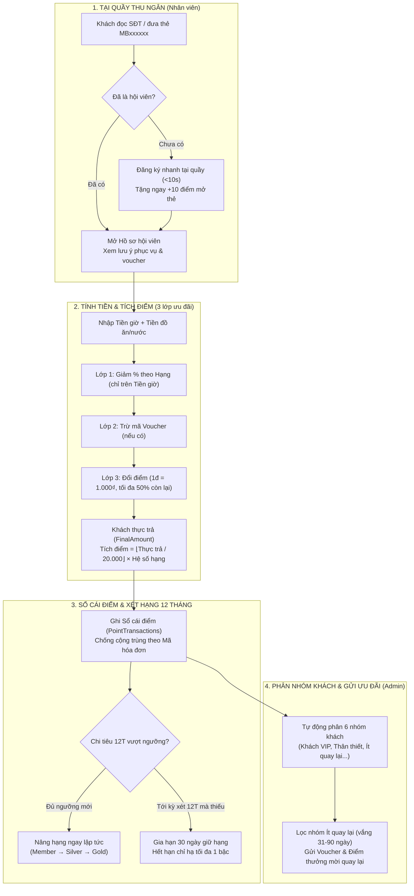
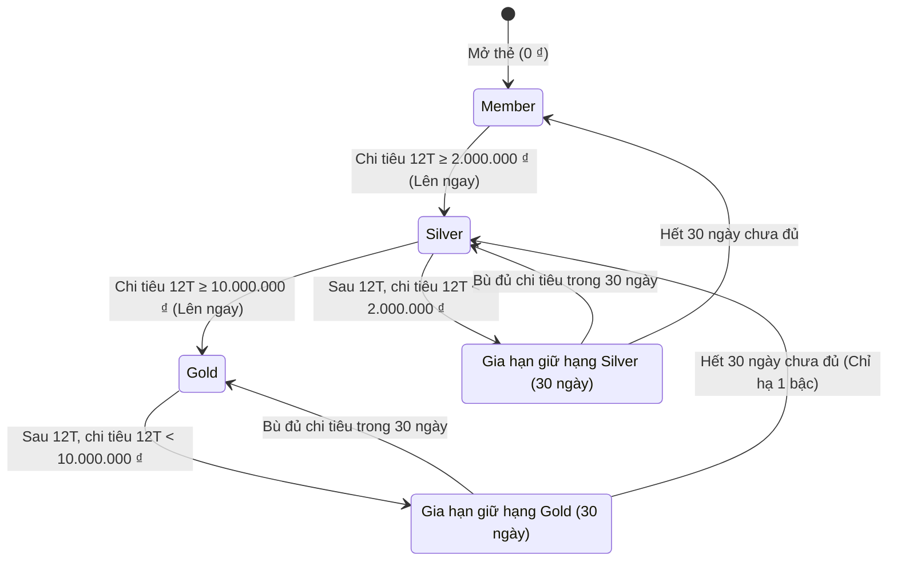
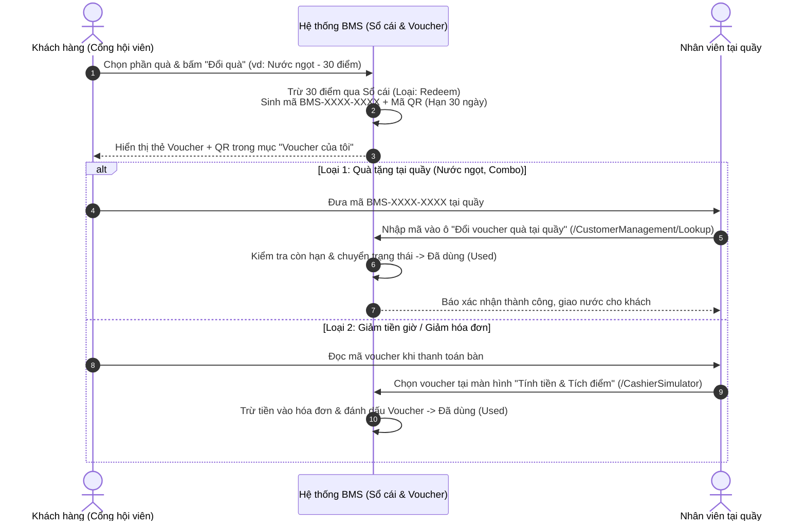

# Kịch bản Luồng Nghiệp vụ & Sơ đồ Trực quan — Phân hệ TV2 (Hội viên & Ưu đãi)

Tài liệu này tóm tắt toàn bộ bức tranh nghiệp vụ của phân hệ **TV2 — Quản lý Hội viên & Chăm sóc Khách hàng thân thiết** kèm sơ đồ trực quan và kịch bản trình diễn từng bước trên hệ thống đang chạy tại `http://localhost:5000`.

---

## 1. Bức tranh tổng thể 4 luồng nghiệp vụ cốt lõi

---

## 2. Sơ đồ vòng đời Hạng thành viên (Chu kỳ 12 tháng)

Khác với cách cộng dồn trọn đời dễ gây "lạm phát hạng VIP", hệ thống xét hạng dựa trên **Tổng chi tiêu thực trả trong 12 tháng gần nhất**:

---

## 3. Sơ đồ trình tự: Đổi điểm lấy Voucher & Sử dụng tại quán

---

## 4. Kịch bản trải nghiệm thực tế từng bước (5 phút)

> [!TIP]
> Bạn có thể thực hiện lần lượt 5 cảnh dưới đây ngay trên trình duyệt tại `http://localhost:5000` để nắm trọn vẹn luồng chạy của hệ thống.

### Cảnh 1: Nhân viên tra cứu & đăng ký hội viên mới tại quầy
1. Vào menu **Tra cứu tại quầy** (`/CustomerManagement/Lookup`).
2. **Tìm khách quen:** Gõ `0101` hoặc `Minh Tuấn` vào ô tìm kiếm → Hệ thống hiển thị ngay hội viên **Nguyễn Minh Tuấn** (Hạng Gold, SĐT che giữa `091****101`, mã thẻ `MB900101`).
3. **Đăng ký khách mới:** Bấm nút **Đăng ký hội viên mới** → Nhập SĐT `0988112233` và tên `Lê Minh Khang` → Bấm **Tạo thẻ hội viên**.
4. **Kết quả:** Hệ thống tự động cấp mã thẻ `MBxxxxxx`, cộng **+10 điểm** mở thẻ trong Sổ cái và mở ngay trang **Hồ sơ hội viên**.

### Cảnh 2: Ghi chú phục vụ & Tính tiền 3 lớp ưu đãi
1. Tại trang **Hồ sơ hội viên**, chuyển sang tab **Ghi chú phục vụ** → Nhập *"Khách thích bàn VIP gần cửa sổ, uống Bò húc ít đá"*, tích chọn **Ghim lên đầu hồ sơ** rồi bấm **Thêm ghi chú** → Khung lưu ý màu vàng xuất hiện ngay dưới tên khách.
2. Bấm nút **Tính tiền cho khách** ở góc phải trên cùng (hoặc vào menu **Tính tiền & Tích điểm** `/CashierSimulator`).
3. Chọn khách hàng hạng **Gold** (ví dụ: **Nguyễn Minh Tuấn**), nhập thử:
   - **Tiền giờ chơi:** `200000` (200.000 ₫)
   - **Tiền đồ ăn & nước uống:** `100000` (100.000 ₫)
   - **Đổi điểm trừ tiền:** Bấm **Tối đa**
4. **Quan sát Phiếu tạm tính bên phải:**
   - Ưu đãi hạng Gold (-10% chỉ tính trên tiền giờ): `-20.000 ₫` (còn 280.000 ₫).
   - Đổi điểm tối đa (50% của phần còn lại): `-140.000 ₫` (140 điểm).
   - **Tổng thanh toán:** `140.000 ₫` → Điểm tích lũy mới: `⌊140.000 / 20.000⌋ × 2 = +14 điểm`.
5. Bấm **Xác nhận thanh toán**. Nếu giữ nguyên **Mã hóa đơn** và bấm thanh toán lần 2, hệ thống tự động chặn cộng trùng điểm!

### Cảnh 3: Kiểm soát chéo khi Điều chỉnh điểm thưởng
1. Vào menu **Điều chỉnh điểm** (`/PointAdjustment`).
2. Nếu điều chỉnh nhỏ (`≤ 50 điểm`) bởi Quản trị viên: Điểm được ghi vào Sổ cái ngay lập tức.
3. Nếu điều chỉnh lớn (`> 50 điểm`, ví dụ `+150 điểm` bù sự cố mất điện) hoặc do Nhân viên lập: Phiếu chuyển vào danh sách **Phiếu đang chờ duyệt** và người lập không thể tự bấm duyệt phiếu của chính mình (bắt buộc Quản trị viên khác xác nhận).

### Cảnh 4: Thống kê hội viên & Gửi chương trình ưu đãi (Dành cho Admin)
1. Vào menu **Thống kê hội viên** (`/CrmDashboard`).
2. Quan sát biểu đồ tròn **Nhóm hội viên theo tần suất ghé** (6 nhóm tự động tính từ lịch sử giao dịch thực tế) và bảng **Khách quen vắng mặt trên 30 ngày** ở góc dưới bên phải.
3. Bấm nút **Gửi ưu đãi khách vắng mặt** → Hệ thống chuyển sang màn hình **Gửi ưu đãi** (`/Campaign`) và chọn sẵn nhóm **Ít quay lại**.
4. Chọn tặng kèm 1 Voucher hoặc tặng thêm `20 điểm`, bấm **Xem danh sách nhận** để kiểm tra những hội viên đủ điều kiện, sau đó bấm **Phát hành & gửi ngay**.

### Cảnh 5: Trải nghiệm dưới góc nhìn Khách hàng (Thẻ QR & Đổi quà)
1. Đăng xuất tài khoản Admin, đăng nhập bằng tài khoản Khách hàng (hoặc tự đăng ký tài khoản mới tại `/Account/Register` với cùng SĐT đã tạo ở Cảnh 1 để kiểm tra tính năng **tự động liên kết thẻ tại quầy**).
2. Tại mục **Tổng quan & Thẻ thành viên** (`/CustomerPortal/Profile`), khách nhìn thấy **Thẻ hội viên kèm mã QR**, số điểm quy đổi ra tiền VNĐ và thanh tiến trình xét hạng 12 tháng.
3. Chuyển sang mục **Voucher của tôi & Đổi điểm** (`/CustomerPortal/Promotions`), bấm **Đổi quà** ở một phần quà khả dụng → Nhận ngay mã voucher `BMS-XXXX-XXXX` kèm mã QR để đưa nhân viên quét tại quầy.

