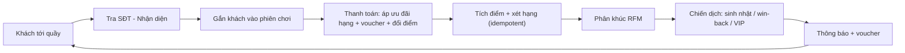

# TV2 — BẢN ĐẠI CHỈNH SỬA: CRM & LOYALTY CHO QUÁN BIDA
> Vai trò người viết: Senior BA. Đối tượng đọc: AI coding agent sẽ code. Đọc HẾT trước khi code.
> Phạm vi: Module Quản lý khách hàng + Hạng thành viên + Điểm thưởng (TV2). Không đụng code TV khác ngoài các "điểm tích hợp" được nêu rõ.

---

## 0. CHẨN ĐOÁN: VÌ SAO MODULE HIỆN TẠI "VÔ NGHĨA"

Module hiện tại chỉ là **CRUD bảng AspNetUsers**. Không màn hình nào trả lời được câu hỏi kinh doanh nào. Cụ thể:

| # | Vấn đề hiện tại | Hậu quả nghiệp vụ |
|---|---|---|
| G1 | Nhân viên "thêm khách" nhưng không gắn khách vào phiên chơi/hóa đơn nào | Tạo khách xong chẳng để làm gì |
| G2 | `ProcessPaymentLoyaltyAsync` không nhận `InvoiceId` | Gọi 2 lần = cộng điểm 2 lần (gian lận / lỗi mạng) |
| G3 | `PointTransactions` không có `BalanceAfter`, `Reason`, `CreatedById`, tham chiếu hóa đơn | Không đối soát được, không biết ai cộng/trừ điểm |
| G4 | `RedeemPointsForBillAsync` đọc-rồi-ghi, không atomic (khác với `RedeemRewardAsync`) | Race condition: bấm 2 lần trừ âm điểm |
| G5 | Đổi quà chỉ bắn Notification "đưa cho nhân viên xem" | Không có mã, không có trạng thái "đã giao quà" → khách chụp màn hình nhận quà nhiều lần |
| G6 | Hạng dựa trên `TotalSpend` trọn đời, không bao giờ xuống hạng | Sau 1 năm ai cũng Gold → hạng mất giá trị, quán lỗ discount |
| G7 | Discount theo hạng không được áp vào đâu cả | Hạng thành viên chỉ là cái nhãn |
| G8 | Không có phân khúc khách (VIP / sắp rời bỏ / đã mất) | Chủ quán không biết nên chăm ai, gửi ưu đãi cho ai |
| G9 | Trùng lặp: `CustomerController` (Hùng) vs `CustomerManagementController` (TV2); `MemberTierController` vs `TierConfigController` | Người chấm thấy 2 màn hình làm cùng 1 việc |
| G10 | Hết hạn điểm: reset toàn bộ về 0 sau 180 ngày | Quá thô; nhưng giữ được nếu có thông báo trước 14 ngày |

**Kết luận BA:** Quản lý khách hàng chỉ có giá trị khi nó là **cái móc nhận diện** trong vòng doanh thu:



Mọi tính năng mới bên dưới đều phải phục vụ 1 mắt xích trong vòng này. Tính năng nào không nằm trong vòng → bỏ.

---

## 1. TRẢ LỜI CÁC CÂU HỎI "TẠI SAO"

| Câu hỏi | Câu trả lời nghiệp vụ (đưa vào slide thuyết trình) |
|---|---|
| Tại sao nhân viên tạo tài khoản cho khách? | 80% khách bida là walk-in, không ai chịu tải app đăng ký. Nhân viên **ghi danh nhanh tại quầy** (Tên + SĐT, < 10 giây) để khách được tích điểm ngay hóa đơn đầu tiên. Đó là **tài khoản tại quầy** (chưa có mật khẩu). Sau này khách tự đăng ký bằng đúng SĐT đó → **nhận lại tài khoản** (claim), giữ nguyên điểm. |
| Tại sao nhân viên sửa thông tin khách? | Chỉ được sửa thông tin **liên lạc** (tên, SĐT sai, ngày sinh, ghi chú). **Không** được sửa điểm/hạng/chi tiêu — điểm chỉ thay đổi qua sổ cái (ledger), điều chỉnh tay phải có lý do và Admin duyệt nếu lớn. Mọi lần sửa ghi audit log. |
| Xem thông tin khách để làm gì? | Để nhân viên quầy **phục vụ có cá nhân hóa** trong 5 giây: "Anh Nam hạng Gold, còn 1 voucher sinh nhật, lần trước chơi bàn VIP 3, ghi chú: thích bàn gần cửa sổ, từng no-show 2 lần". Và để chủ quán **ra quyết định**: ai sắp rời bỏ, chiến dịch nào hiệu quả. |
| Hạng thành viên để làm gì? | Đòn bẩy giữ chân: giảm % tiền giờ, nhân hệ số điểm, voucher sinh nhật theo hạng. Hạng **được xét lại theo chi tiêu 12 tháng gần nhất** → khách phải tiếp tục quay lại mới giữ hạng. |

---

## 2. PHẠM VI & ƯU TIÊN

| Ưu tiên | Mã | Tính năng | Lý do |
|---|---|---|---|
| **P0** | F1 | Tra cứu khách tại quầy + Customer 360 + ghi danh nhanh | Trả lời G1, là màn hình "wow" khi demo |
| **P0** | F2 | Sổ cái điểm (Point Ledger) chuẩn kế toán + điều chỉnh có duyệt | Trả lời G2, G3, G4 |
| **P0** | F3 | Checkout Loyalty: Preview → Commit (idempotent) + trang Mô phỏng quầy thu ngân | Trả lời G7; là hợp đồng tích hợp cho TV3 |
| **P0** | F4 | Đổi quà có mã voucher + nhân viên xác nhận giao quà | Trả lời G5 |
| **P1** | F5 | Vòng đời hạng: xét theo 12 tháng, lên hạng ngay, xuống hạng có ân hạn | Trả lời G6 |
| **P1** | F6 | Phân khúc RFM + Dashboard CRM | Trả lời G8 |
| **P1** | F7 | Chiến dịch tự động: sinh nhật, win-back, cảnh báo điểm sắp hết hạn | Khép vòng |
| **P2** | F8 | Claim tài khoản tại quầy + gộp trùng + audit log | Quản trị dữ liệu |
| **P0** | F9 | Dọn dẹp trùng lặp controller/menu | Trả lời G9 |

Nếu thiếu thời gian: làm hết P0, rồi F6, rồi F5. F7, F8 làm sau cùng.

---

## 3. THAY ĐỔI DATABASE — SCRIPT `09_TV2_CrmLoyaltyV2.sql`

**Quy tắc bắt buộc:**
- KHÔNG dùng EF Migrations. Viết script SQL idempotent đặt ở `BMS_Database_Starter/09_TV2_CrmLoyaltyV2.sql`, theo đúng phong cách file `08_AddWorkShiftReconciliation.sql` (`IF COL_LENGTH(...) IS NULL`, `IF OBJECT_ID(...) IS NULL`).
- Mỗi batch sau `GO` phải có `SET ANSI_NULLS ON; SET QUOTED_IDENTIFIER ON;` (filtered index sẽ lỗi nếu thiếu — đã gặp lỗi này ở script 08).
- Bổ sung logic tương ứng vào `Data/SchemaUpgrader.cs` để app tự nâng cấp khi khởi động (giống cách script 08 đang làm).
- Chạy bằng: `sqlcmd -S "localhost\SQLEXPRESS" -d BilliardDB -E -C -i BMS_Database_Starter\09_TV2_CrmLoyaltyV2.sql`

### 3.1. `AspNetUsers` — thêm cột
| Cột | Kiểu | Ý nghĩa |
|---|---|---|
| `DateOfBirth` | `date NULL` | Phục vụ voucher sinh nhật |
| `MarketingOptIn` | `bit NOT NULL DEFAULT 1` | Khách đồng ý nhận ưu đãi (chiến dịch chỉ gửi người =1) |
| `AccountSource` | `varchar(20) NOT NULL DEFAULT 'Self'` | `'Counter'` (NV ghi danh) / `'Self'` (tự đăng ký). CHECK IN ('Counter','Self') |
| `ClaimedAtUtc` | `datetime2(0) NULL` | Thời điểm khách nhận lại tài khoản tại quầy |
| `TierAchievedAtUtc` | `datetime2(0) NULL` | Ngày đạt hạng hiện tại |
| `TierReviewAtUtc` | `datetime2(0) NULL` | Ngày xét lại hạng (= TierAchievedAtUtc + 12 tháng) |
| `TierGraceUntilUtc` | `datetime2(0) NULL` | Nếu không đủ điều kiện giữ hạng: hạn ân hạn 30 ngày trước khi hạ |

> Tài khoản tại quầy hiện đã có email giả `@noemail.bms.local` trong `CustomerManagementController` — giữ nguyên cơ chế đó, chỉ set thêm `AccountSource='Counter'`.

### 3.2. `MembershipTiers` — thêm cột quyền lợi
| Cột | Kiểu | Ví dụ Member / Silver / Gold |
|---|---|---|
| `BirthdayVoucherValue` | `decimal(18,2) NOT NULL DEFAULT 0` | 0 / 30.000 / 60.000 |
| `SortOrder` | `int NOT NULL DEFAULT 0` | 1 / 2 / 3 |

`SpendThreshold` từ nay hiểu là **chi tiêu 12 tháng gần nhất để đạt/giữ hạng** (cập nhật mô tả ở màn hình cấu hình hạng).

### 3.3. `PointTransactions` — nâng cấp thành sổ cái
| Cột thêm | Kiểu | Ý nghĩa |
|---|---|---|
| `BalanceAfter` | `int NOT NULL DEFAULT 0` | Số dư sau giao dịch → đối soát được |
| `InvoiceId` | `int NULL` FK → `Invoices(Id)` | Tham chiếu hóa đơn (null với Expire/Adjust) |
| `ReferenceCode` | `varchar(50) NULL` | Mã tham chiếu thay thế khi chưa có Invoice thật (mô phỏng: `SIM-yyyyMMddHHmmss-xxxx`) |
| `Reason` | `nvarchar(300) NULL` | Bắt buộc với `Adjust` |
| `CreatedById` | `nvarchar(450) NULL` FK → `AspNetUsers(Id)` | NV/Admin thao tác; null = hệ thống |
| `SpendAmount` | `decimal(18,2) NULL` | Chỉ có ở bút toán `Earn` = FinalAmount của hóa đơn. Là nguồn tính chi tiêu 12 tháng (F5) và RFM (F6) |

- Mở rộng `TransactionType` cho phép: `'Earn','Redeem','Expire','Adjust','Reverse','Bonus'`. Script phải **tìm và DROP check constraint cũ trên cột TransactionType** bằng truy vấn `sys.check_constraints` (tên constraint không cố định), rồi tạo `CK_PointTxn_Type` mới.
- **Idempotency:** `CREATE UNIQUE INDEX UX_PointTxn_Earn_Ref ON dbo.PointTransactions(ReferenceCode, TransactionType) WHERE ReferenceCode IS NOT NULL;` → cùng 1 hóa đơn không thể Earn 2 lần ở mức DB. Khi có `InvoiceId` thật, `ReferenceCode = 'INV-' + InvoiceId`.
- Backfill: `UPDATE` tính `BalanceAfter` cho dữ liệu cũ bằng `SUM(Amount) OVER (PARTITION BY CustomerId ORDER BY CreatedAt, Id)`.

### 3.4. Bảng mới
```sql
-- Danh mục quà (thay RewardCatalog.cs đang hard-code)
RewardItems(
  Id int IDENTITY PK, Code varchar(30) UNIQUE NOT NULL, Name nvarchar(100) NOT NULL,
  Description nvarchar(300) NULL, PointCost int NOT NULL CHECK (PointCost > 0),
  RewardType varchar(20) NOT NULL CHECK (RewardType IN ('Gift','FreeHour','BillDiscount')),
  DiscountValue decimal(18,2) NULL, ValidDays int NOT NULL DEFAULT 30,
  MinTierId int NULL FK MembershipTiers, IsActive bit NOT NULL DEFAULT 1)
-- Seed: DRINK 20đ, SNACK 50đ, FREEHOUR 80đ (khớp spec cũ), VIP_TABLE 150đ (MinTier=Gold)

-- Voucher đã phát cho khách (từ đổi điểm, sinh nhật, chiến dịch)
CustomerVouchers(
  Id int IDENTITY PK, Code varchar(20) UNIQUE NOT NULL,       -- vd: BMS-7KQ2-9XHD
  CustomerId nvarchar(450) NOT NULL FK, RewardItemId int NULL FK, CampaignId int NULL FK,
  Title nvarchar(150) NOT NULL, VoucherType varchar(20) NOT NULL
      CHECK (VoucherType IN ('Gift','FreeHour','BillDiscount')),
  DiscountValue decimal(18,2) NULL,
  Status varchar(20) NOT NULL DEFAULT 'Active'
      CHECK (Status IN ('Active','Used','Expired','Cancelled')),
  IssuedAtUtc datetime2(0) NOT NULL, ExpiresAtUtc datetime2(0) NOT NULL,
  UsedAtUtc datetime2(0) NULL, UsedById nvarchar(450) NULL FK, UsedReferenceCode varchar(50) NULL,
  PointTransactionId int NULL FK)
  INDEX IX_Voucher_Customer_Status (CustomerId, Status)

-- Yêu cầu điều chỉnh điểm thủ công (maker-checker)
PointAdjustmentRequests(
  Id int IDENTITY PK, CustomerId nvarchar(450) NOT NULL FK, Points int NOT NULL CHECK (Points <> 0),
  Reason nvarchar(300) NOT NULL, Status varchar(20) NOT NULL DEFAULT 'Pending'
      CHECK (Status IN ('Pending','Approved','Rejected')),
  RequestedById nvarchar(450) NOT NULL FK, RequestedAtUtc datetime2(0) NOT NULL,
  ReviewedById nvarchar(450) NULL FK, ReviewedAtUtc datetime2(0) NULL, ReviewNote nvarchar(300) NULL,
  PointTransactionId int NULL FK)

-- Ghi chú / timeline chăm sóc khách
CustomerNotes(
  Id int IDENTITY PK, CustomerId nvarchar(450) NOT NULL FK, Content nvarchar(500) NOT NULL,
  IsPinned bit NOT NULL DEFAULT 0, CreatedById nvarchar(450) NOT NULL FK, CreatedAtUtc datetime2(0) NOT NULL)

-- Chiến dịch marketing
Campaigns(
  Id int IDENTITY PK, Name nvarchar(150) NOT NULL,
  CampaignType varchar(20) NOT NULL CHECK (CampaignType IN ('Manual','Birthday','WinBack')),
  TargetSegment varchar(20) NULL,                -- Champion/Loyal/AtRisk/Lost/New/All
  TargetTierId int NULL FK, RewardItemId int NULL FK, BonusPoints int NOT NULL DEFAULT 0,
  MessageTitle nvarchar(200) NOT NULL, MessageContent nvarchar(1000) NOT NULL,
  Status varchar(20) NOT NULL DEFAULT 'Draft' CHECK (Status IN ('Draft','Sent','Cancelled')),
  CreatedById nvarchar(450) NOT NULL FK, CreatedAtUtc datetime2(0) NOT NULL,
  SentAtUtc datetime2(0) NULL, RecipientCount int NOT NULL DEFAULT 0)

-- Nhật ký thay đổi hồ sơ khách
CustomerAuditLogs(
  Id bigint IDENTITY PK, CustomerId nvarchar(450) NOT NULL FK, Action varchar(30) NOT NULL,
  -- Create, UpdateProfile, Lock, Unlock, Claim, Merge, TierChange, PointAdjust
  Detail nvarchar(1000) NULL,                    -- JSON {field: [old, new]}
  ActorId nvarchar(450) NULL FK, CreatedAtUtc datetime2(0) NOT NULL)
```

Mọi FK tới `AspNetUsers` dùng `ON DELETE NO ACTION` (Restrict). Thêm entity C# tương ứng trong `Data/` và cấu hình Fluent API trong `ApplicationDbContext.OnModelCreating` theo đúng phong cách hiện có.

---

## 4. ĐẶC TẢ TÍNH NĂNG

### F1 — Tra cứu tại quầy & Customer 360 (P0)
**Actor:** Staff, Admin. **Route:** `/CustomerManagement/Lookup` (màn hình mặc định khi Staff bấm menu "Khách hàng").

**Luồng chính:**
1. Ô tìm kiếm lớn ở giữa, autofocus, placeholder "Nhập SĐT hoặc mã thẻ (MBxxxx)". Gõ ≥ 4 số → gọi AJAX `GET /CustomerManagement/Search?q=` trả JSON tối đa 8 kết quả (tên, SĐT che giữa `090****567`, hạng, điểm).
2. Chọn khách → mở **Customer 360** `/CustomerManagement/Profile/{id}` gồm:
   - **Header card:** Tên, mã thẻ, badge hạng (màu theo hạng), badge phân khúc RFM (F6), SĐT, tuổi/sinh nhật (icon 🎂 nếu sinh nhật trong 7 ngày tới), trạng thái tài khoản, nguồn (`Tại quầy`/`Tự đăng ký`).
   - **4 stat-card:** Điểm khả dụng | Chi tiêu 12 tháng | Số lần ghé (12 tháng) | Lần ghé cuối (x ngày trước).
   - **Thanh tiến trình hạng:** "Còn 850.000đ chi tiêu để lên Gold" HOẶC "Cần chi thêm 400.000đ trước 15/12/2026 để giữ hạng Silver" (nếu đang trong ân hạn → banner vàng).
   - **Tab Voucher khả dụng:** danh sách `CustomerVouchers` Active + nút "Xác nhận đã dùng" (F4).
   - **Tab Lịch sử điểm:** từ ledger, có cột BalanceAfter, Lý do, Người thực hiện.
   - **Tab Lịch sử ghé quán:** từ `Invoices` + `PlaySessions` có `CustomerId` (nếu rỗng → hiển thị empty-state "Chưa có hóa đơn", KHÔNG mock).
   - **Tab Ghi chú:** thêm ghi chú, ghim ghi chú (ghi chú ghim hiển thị ngay dưới header, nền vàng nhạt).
   - **Tab Nhật ký:** `CustomerAuditLogs` (chỉ Admin thấy).
   - **Nút hành động:** "Mở phiên chơi cho khách này" (link sang màn hình của TV khác với `?customerId=`; nếu chưa có thì link tới trang Mô phỏng thu ngân F3), "Điều chỉnh điểm" (F2), "Sửa thông tin", "Khóa/Mở khóa" (chỉ Admin).
3. Không tìm thấy → hiện nút **"Ghi danh nhanh"** mở modal: Họ tên (bắt buộc), SĐT (bắt buộc, prefill từ ô tìm kiếm, regex `^0\d{9}$`, unique), Ngày sinh (tùy chọn), checkbox "Đồng ý nhận ưu đãi". Submit → tạo user role `Customer`, `AccountSource='Counter'`, hạng mặc định = tier có SpendThreshold nhỏ nhất, sinh mã thẻ `MB` + 6 số, ghi audit `Create`, **tặng 10 điểm chào mừng** (ledger type `Bonus`, ReferenceCode `WELCOME-{userId}`) → redirect sang Customer 360.

**Business rules:**
- BR-F1-1: Staff thấy SĐT đầy đủ trong trang 360 (cần để liên lạc) nhưng danh sách tìm kiếm che giữa.
- BR-F1-2: Staff KHÔNG được sửa: điểm, hạng, chi tiêu, trạng thái khóa. Chỉ Admin được khóa.
- BR-F1-3: Sửa SĐT phải kiểm tra unique; mỗi lần sửa ghi audit `UpdateProfile` với diff JSON.
- BR-F1-4: Màn hình danh sách cũ (`/CustomerManagement/Index` 2 cột) giữ lại cho Admin với tên "Danh sách khách hàng", thêm cột Phân khúc + lọc theo phân khúc + xuất CSV.

### F2 — Sổ cái điểm & điều chỉnh có duyệt (P0)
**Tạo service mới** `Services/PointLedgerService.cs` + `IPointLedgerService`. **Mọi** thay đổi `RewardPoints` trong toàn hệ thống phải đi qua service này (refactor `LoyaltyService`, `PointExpirationBackgroundService` dùng nó). Cấm `user.RewardPoints += x` ở bất cứ đâu khác.

```csharp
public interface IPointLedgerService {
    // Ghi 1 bút toán. Atomic: UPDATE ... SET RewardPoints = RewardPoints + @delta
    // WHERE Id=@id AND IsActive=1 AND RewardPoints + @delta >= 0 ; kiểm tra rows affected.
    // Rồi INSERT PointTransactions với BalanceAfter = giá trị mới. Trong cùng transaction (tự mở nếu CurrentTransaction == null).
    // Nếu vi phạm UX_PointTxn_Earn_Ref -> trả về kết quả DuplicateIgnored (không throw).
    Task<LedgerResult> PostAsync(string customerId, int delta, string type,
        string? referenceCode, int? invoiceId, string? reason, string? actorId,
        decimal? spendAmount = null, CancellationToken ct = default);
}
public record LedgerResult(bool Success, bool Duplicate, int BalanceAfter, int? TransactionId, string Message);
```

**Điều chỉnh thủ công** (`/PointAdjustment`):
- Staff/Admin tạo yêu cầu: số điểm (±), lý do (bắt buộc, chọn từ dropdown: "Bù điểm hóa đơn lỗi", "Khiếu nại dịch vụ", "Thu hồi điểm sai", "Khác" + text).
- BR-F2-1: |điểm| ≤ 50 và người tạo là Admin → tự duyệt, ghi ledger ngay.
- BR-F2-2: Còn lại → `Pending`, Admin duyệt/từ chối ở `/PointAdjustment/Pending` (badge số lượng pending trên sidebar Admin).
- BR-F2-3: Người tạo không được tự duyệt yêu cầu của mình (maker ≠ checker), trừ trường hợp BR-F2-1.
- BR-F2-4: Duyệt → ledger type `Adjust`, Notification cho khách, audit `PointAdjust`.

### F3 — Checkout Loyalty: Preview → Commit (P0) — HỢP ĐỒNG TÍCH HỢP VỚI TV3
Bổ sung vào `ILoyaltyService` (giữ hàm cũ nhưng đánh dấu `[Obsolete]` và cho gọi sang hàm mới):

```csharp
public record CheckoutLoyaltyRequest(
    string CustomerId, string ReferenceCode, int? InvoiceId,
    decimal PlaytimeAmount, decimal FandBAmount,
    int PointsToRedeem, string? VoucherCode, string? CashierId);

public record CheckoutLoyaltyPreview(
    bool IsValid, IReadOnlyList<string> Errors,
    string TierName, decimal TierDiscountPercent,
    decimal TierDiscountAmount,      // = PlaytimeAmount * % (chỉ tiền giờ, KHÔNG áp F&B)
    decimal VoucherDiscountAmount,   // BillDiscount: số tiền; FreeHour: = min(1 giờ, PlaytimeAmount) theo HourlyRate snapshot truyền vào hoặc = DiscountValue
    decimal PointsDiscountAmount,    // = PointsToRedeem * 1000
    int MaxRedeemablePoints,         // floor(50% * (Subtotal - TierDiscount - Voucher) / 1000), không vượt RewardPoints
    decimal FinalAmount,
    int PointsToEarn,                // floor(FinalAmount / 20000) * PointMultiplier
    bool WillUpgradeTier, string? NextTierName);

Task<CheckoutLoyaltyPreview> PreviewCheckoutAsync(CheckoutLoyaltyRequest req, CancellationToken ct = default);
Task<CheckoutLoyaltyResult>  CommitCheckoutAsync(CheckoutLoyaltyRequest req, CancellationToken ct = default);
```

**Thứ tự áp giảm giá (BR-F3-1, bắt buộc, ghi rõ trên UI):**
1. Giảm theo hạng — chỉ trên tiền giờ.
2. Voucher (tối đa 1 voucher/hóa đơn).
3. Đổi điểm — tối đa 50% số tiền còn lại sau bước 1-2.
4. `FinalAmount` = phần còn lại. Điểm tích lũy tính trên `FinalAmount` (tiền thực trả).

**Commit (1 transaction):** validate lại toàn bộ như Preview → nếu `ReferenceCode` đã Earn rồi trả kết quả cũ (idempotent, không lỗi) → trừ điểm Redeem qua ledger (ref `ReferenceCode`) → đánh dấu voucher `Used` (UsedReferenceCode) → cộng `TotalSpend`, `LastPaidDate` → Earn qua ledger → xét hạng (F5) → Notification tổng hợp 1 cái ("Hóa đơn 350.000đ: giảm hạng 17.500đ, voucher 30.000đ, dùng 50 điểm, +15 điểm. Số dư: 120 điểm") → commit.

**Trả về cho TV3:** `TotalDiscount` để TV3 ghi vào `Invoices.DiscountAmount`. Ghi chú `// INTEGRATION: TV3 gọi CommitCheckoutAsync khi Invoice chuyển Paid` ngay trong code.

**Trang "Mô phỏng quầy thu ngân"** — sửa `LoyaltyTestController` thành `/CashierSimulator` (đổi tên menu, Admin + Staff):
- Chọn khách (ô tìm SĐT dùng lại API F1), nhập tiền giờ, tiền F&B, chọn voucher khả dụng của khách (dropdown), nhập điểm muốn dùng (có nút "Dùng tối đa").
- Mỗi lần thay đổi input → AJAX gọi Preview, render **hóa đơn dạng receipt** (từng dòng giảm giá, tổng, điểm sẽ nhận, cảnh báo "Sắp lên Gold!").
- Bấm "Thanh toán" → Commit với `ReferenceCode = SIM-...`. Bấm lần 2 cùng ref → hiển thị "Hóa đơn này đã được ghi nhận" (chứng minh idempotent khi demo).
- Giữ lại form "Giả lập khách gửi đánh giá" hiện có nhưng chuyển xuống tab riêng.

### F4 — Đổi quà có mã voucher (P0)
- Customer Portal → trang Đổi điểm đọc từ `RewardItems` (ẩn item có `MinTierId` cao hơn hạng khách, hoặc hiển thị mờ + "Dành cho Gold").
- Đổi → ledger `Redeem` → tạo `CustomerVouchers` với `Code` ngẫu nhiên 8 ký tự (bỏ ký tự dễ nhầm 0/O/1/I), `ExpiresAtUtc = now + ValidDays` → hiển thị mã to + **QR code** (dùng thư viện JS `qrcodejs` qua CDN, encode chính mã voucher).
- Trang "Voucher của tôi" cho khách: tab Còn hiệu lực / Đã dùng / Hết hạn.
- Nhân viên: trong Customer 360 tab Voucher, hoặc ô "Nhập mã voucher" trên trang Lookup → hiện chi tiết → nút **"Xác nhận giao quà"** → `Status=Used`, `UsedById`, audit. Voucher loại `BillDiscount`/`FreeHour` chỉ dùng được qua Checkout (F3), không xác nhận tay được.
- BR-F4-1: Hủy voucher chưa dùng (chỉ Admin) → hoàn điểm qua ledger type `Reverse`.
- BR-F4-2: Job hằng ngày chuyển voucher quá hạn → `Expired` (không hoàn điểm).
- Xóa `RewardCatalog.cs` sau khi chuyển sang bảng `RewardItems`.

### F5 — Vòng đời hạng (P1)
Tạo `Services/TierEvaluationService.cs`.
- **Chi tiêu xét hạng** = `SUM(SpendAmount)` của các bút toán `Earn` trong `PointTransactions` của khách trong 365 ngày gần nhất. Đây là **nguồn duy nhất** (không đọc `Invoices`), nên chạy được cả với hóa đơn mô phỏng lẫn hóa đơn thật của TV3.
- BR-F5-1 **Lên hạng:** ngay khi Commit checkout nếu chi tiêu 12 tháng ≥ ngưỡng hạng cao hơn. Set `TierAchievedAtUtc=now`, `TierReviewAtUtc=now+12 tháng`, xóa `TierGraceUntilUtc`. Notification + audit `TierChange`.
- BR-F5-2 **Xét giữ hạng:** job hằng ngày, với khách có `TierReviewAtUtc <= now`: nếu chi tiêu 12 tháng vẫn ≥ ngưỡng → gia hạn review thêm 12 tháng; nếu không → set `TierGraceUntilUtc = now + 30 ngày` và gửi Notification "Chi thêm Xđ trước dd/MM để giữ hạng".
- BR-F5-3 **Hạ hạng:** hết ân hạn mà vẫn chưa đủ → hạ **1 bậc** (không rơi thẳng về Member), set review mới +12 tháng, Notification, audit.
- BR-F5-4 `TotalSpend` (trọn đời) vẫn giữ để thống kê, nhưng **không** dùng để xét hạng nữa.
- Màn hình cấu hình hạng (`TierConfigController`): thêm cột Voucher sinh nhật, mô tả "Ngưỡng chi tiêu 12 tháng"; nút "Xem trước ảnh hưởng" → bảng "Nếu áp ngưỡng mới: 12 khách lên hạng, 5 khách vào diện ân hạn" trước khi lưu. **Không** tự hạ hạng hàng loạt khi đổi ngưỡng (chỉ nâng ngay; hạ thì theo chu kỳ review) — giải thích trên UI.

### F6 — Phân khúc RFM & Dashboard CRM (P1)
Tạo `Services/CustomerSegmentService.cs`, tính **on-the-fly** (không lưu DB), cache `IMemoryCache` 10 phút.
- R = số ngày từ lần ghé cuối (`LastPaidDate`), F = số hóa đơn 365 ngày (đếm bút toán Earn có ReferenceCode), M = chi tiêu 365 ngày.
- Quy tắc phân khúc (cố định, dễ giải thích khi bảo vệ):

| Phân khúc | Điều kiện (xét theo thứ tự) | Màu badge | Hành động gợi ý |
|---|---|---|---|
| `New` | Tạo tài khoản ≤ 30 ngày và F ≤ 1 | xanh dương | Gửi voucher lần 2 |
| `Champion` | R ≤ 14 và F ≥ 8 | tím | Mời sự kiện, ưu tiên đặt bàn |
| `Loyal` | R ≤ 30 và F ≥ 3 | xanh lá | Duy trì |
| `AtRisk` | 30 < R ≤ 90 và F ≥ 2 | cam | **Win-back** |
| `Lost` | R > 90 hoặc chưa từng thanh toán | xám | Win-back mạnh hoặc bỏ qua |
| `Regular` | còn lại | xám nhạt | — |

- **Dashboard CRM** `/CrmDashboard` (Admin): 
  - stat-card: Tổng thành viên | Thành viên mới tháng này | Tỷ lệ quay lại 30 ngày (= khách có ≥2 hóa đơn trong 30 ngày / khách có ≥1) | Điểm đang lưu hành (tổng RewardPoints = **nợ phải trả** quy ra tiền ×1.000đ — chủ quán rất quan tâm con số này).
  - Doughnut chart phân khúc (click vào lát → mở danh sách khách phân khúc đó).
  - Bar chart phân bố hạng; Line chart điểm Earn vs Redeem 6 tháng.
  - Bảng "Top 10 khách chi tiêu 12 tháng" và "10 khách AtRisk giá trị cao nhất" (nút "Gửi ưu đãi win-back" → tạo Campaign nháp với danh sách này).
  - Không dùng mock data. Nếu rỗng → empty-state + gợi ý "Dùng Mô phỏng thu ngân để tạo dữ liệu".

### F7 — Chiến dịch (P1)
- `/Campaign` (Admin): tạo chiến dịch Manual: chọn phân khúc và/hoặc hạng, chọn quà (RewardItem → phát voucher miễn phí) và/hoặc điểm thưởng, tiêu đề + nội dung (hỗ trợ placeholder `{FullName}`, `{TierName}`, `{Points}`).
- Nút "Xem trước" → số người nhận (chỉ `MarketingOptIn=1`, `IsActive=1`, role Customer) + 5 người mẫu. "Gửi" → trong 1 transaction: phát voucher (`CampaignId`), ledger `Bonus` (ref `CMP-{campaignId}-{userId}` → không phát trùng), Notification; `Status=Sent`, `RecipientCount`.
- **Tự động** — mở rộng `PointExpirationBackgroundService` thành `LoyaltyDailyJob` (đổi tên class, giữ đăng ký HostedService), chạy 1 lần/ngày lúc 02:00 giờ VN (dùng `VnTime`), mỗi tác vụ try/catch riêng và log:
  1. Sinh nhật: khách có sinh nhật hôm nay, hạng có `BirthdayVoucherValue > 0`, chưa nhận voucher sinh nhật năm nay → phát voucher BillDiscount hạn 30 ngày (ref `BDAY-{year}-{userId}`).
  2. Cảnh báo điểm sắp hết hạn: `LastPaidDate` cách đây đúng 166 ngày (còn 14 ngày) → Notification.
  3. Hết hạn điểm (logic cũ 180 ngày, chuyển qua ledger).
  4. Voucher quá hạn → Expired.
  5. Xét giữ/hạ hạng (F5).
- Thêm nút Admin "Chạy job ngay" trên Dashboard CRM (để demo không phải chờ đến 2h sáng).

### F8 — Claim tài khoản & gộp trùng (P2)
- Đăng ký (`AccountController.Register`): nếu SĐT trùng tài khoản `AccountSource='Counter'` chưa claim → không báo lỗi trùng mà chuyển sang bước xác minh: sinh OTP 6 số (lưu bằng `UserManager.GenerateUserTokenAsync` với provider mặc định, hạn 5 phút), **demo:** hiển thị OTP trong log console + TempData (ghi rõ "Môi trường demo, sản xuất sẽ gửi SMS"). Nhập đúng → set email thật, mật khẩu, `ClaimedAtUtc`, giữ nguyên điểm/hạng, audit `Claim`.
- Gộp trùng (Admin, trong 360): chọn tài khoản nguồn → chuyển toàn bộ PointTransactions/Vouchers/Reviews/Notifications/Invoices sang tài khoản đích, cộng điểm (ledger `Adjust` lý do "Gộp tài khoản"), khóa tài khoản nguồn, audit `Merge` ở cả 2.

### F9 — Dọn dẹp (P0, làm trước tiên)
- Xác định controller nào đang được menu `_AdminLayout.cshtml` trỏ tới. Giữ **`CustomerManagementController`** (TV2) làm nơi duy nhất quản lý khách; `CustomerController` (Hùng) chỉ giữ các action mà test `Bms.Smoke` / `http-smoke.ps1` đang gọi (`/Customer`, `/Customer/ToggleLock`, `/Customer/Portal`) — **không xóa** để không vỡ test của Hùng, nhưng ẩn khỏi menu và để `/Customer/Index` redirect sang `/CustomerManagement` **chỉ khi** test vẫn pass (nếu test kiểm tra HTML của `/Customer`, giữ nguyên).
- Gộp `MemberTierController` và `TierConfigController`: kiểm tra test `Bms.Smoke` đang dùng cái nào (`Tier create`, `Tier update`...) → giữ cái đó làm chuẩn, cái kia ẩn khỏi menu.
- Sidebar mới cho TV2:
  - Staff: **Tra cứu khách** (Lookup) · Thu ngân mô phỏng · Xác nhận voucher.
  - Admin: thêm **CRM Dashboard** · Danh sách khách · Chiến dịch · Duyệt điều chỉnh điểm (badge) · Cấu hình hạng · Danh mục quà · Đánh giá.
  - Customer: Tổng quan · Voucher của tôi · Đổi điểm · Lịch sử · Thông báo.

---

## 5. CUSTOMER PORTAL — NÂNG CẤP (đi kèm F4, F5)
- Thẻ thành viên ảo (card gradient theo màu hạng: Member bạc xám, Silver bạc ánh xanh, Gold vàng ánh kim) hiển thị tên, mã thẻ, **QR mã thẻ** → khách đưa NV quét/nhập thay vì đọc SĐT.
- Progress giữ hạng/lên hạng (dùng chung logic F5).
- "Điểm của bạn tương đương 120.000đ — hết hạn nếu không ghé quán trước dd/MM/yyyy".
- Badge số thông báo chưa đọc trên header.

---

## 6. QUY TẮC KỸ THUẬT CHO AGENT CODE
1. Tuân thủ `spec_Billard .md` mục 1 (layout `_AdminLayout`, class CSS `data-card`, `stat-card`, `btn-primary-bms`, ...). Chart dùng Chart.js CDN như Dashboard hiện có.
2. Thời gian lưu UTC, hiển thị qua `VnTime`. Tiền hiển thị qua `VnFormat.Money`.
3. Mọi POST có `[ValidateAntiForgeryToken]`. Mọi controller có `[Authorize(Roles=...)]` đúng bảng phân quyền mục 7.
4. Mọi thao tác nhiều bảng dùng `BeginTransactionAsync`. Mọi cộng/trừ điểm qua `IPointLedgerService`.
5. Đăng ký DI mới trong `Program.cs`: `IPointLedgerService`, `ITierEvaluationService`, `ICustomerSegmentService`, `ICampaignService`, `IVoucherService`; `AddMemoryCache()`.
6. **Không mock data** ở màn hình mới (khác spec cũ). Dữ liệu demo tạo qua trang Mô phỏng thu ngân hoặc script seed `10_TV2_DemoSeed.sql` (tạo ~30 khách với `LastPaidDate`, ledger Earn có `SpendAmount` rải trong 12 tháng để mọi phân khúc RFM đều có người; tạo 2 khách có sinh nhật hôm nay/ngày mai; 1 khách Gold sắp hết review).
7. Không sửa/commit `appsettings.Development.json`, `bin/`, `obj/`.
8. Sau mỗi nhóm tính năng: chạy `powershell -ExecutionPolicy Bypass -File tests/run-all-tests.ps1` — phải 0 warning, 0 error, toàn bộ test PASS (quy tắc `.agents/rules/testing-standards.md`).

---

## 7. MA TRẬN PHÂN QUYỀN

| Chức năng | Customer | Staff | Admin |
|---|:-:|:-:|:-:|
| Tra cứu khách / Customer 360 | – | ✔ | ✔ |
| Ghi danh nhanh | – | ✔ | ✔ |
| Sửa thông tin liên lạc | chính mình | ✔ | ✔ |
| Khóa / mở khóa, gộp trùng | – | – | ✔ |
| Xem tab Nhật ký | – | – | ✔ |
| Tạo yêu cầu điều chỉnh điểm | – | ✔ | ✔ |
| Duyệt điều chỉnh điểm | – | – | ✔ (≠ người tạo) |
| Thu ngân mô phỏng | – | ✔ | ✔ |
| Xác nhận giao quà | – | ✔ | ✔ |
| Hủy voucher (hoàn điểm) | – | – | ✔ |
| Đổi điểm lấy quà | ✔ | – | – |
| Cấu hình hạng / danh mục quà | – | – | ✔ |
| CRM Dashboard / Chiến dịch | – | – | ✔ |

---

## 8. TIÊU CHÍ NGHIỆM THU & TEST BẮT BUỘC
Thêm vào `tests/Bms.Smoke/Program.cs` (cùng phong cách `Check(cond, label)`, chạy trong transaction rollback):

| # | Kịch bản | Kỳ vọng |
|---|---|---|
| T1 | Commit checkout 2 lần cùng ReferenceCode | Lần 2 trả Duplicate, điểm chỉ cộng 1 lần, chỉ 1 bút toán Earn |
| T2 | Ledger trừ quá số dư | Thất bại, RewardPoints không đổi, không có bút toán |
| T3 | BalanceAfter | Sau chuỗi Earn/Redeem/Adjust, BalanceAfter của bút toán cuối = RewardPoints |
| T4 | Preview: đổi điểm vượt 50% | IsValid=false, MaxRedeemablePoints đúng công thức |
| T5 | Thứ tự giảm giá | Hạng 10% chỉ áp tiền giờ; voucher; điểm ≤ 50% phần còn lại; FinalAmount đúng |
| T6 | Earn tính trên FinalAmount × multiplier | Đúng `floor(Final/20000)*mult` |
| T7 | Lên hạng khi vượt ngưỡng 12 tháng | TierId đổi, TierReviewAtUtc = +12 tháng, có Notification |
| T8 | Hết review, chưa đủ chi tiêu | Vào ân hạn 30 ngày, chưa hạ |
| T9 | Hết ân hạn | Hạ đúng 1 bậc |
| T10 | Đổi quà → voucher Active; xác nhận → Used; xác nhận lần 2 | Lần 2 bị từ chối |
| T11 | Admin hủy voucher | Hoàn điểm bằng bút toán Reverse |
| T12 | Điều chỉnh 200 điểm bởi Staff | Pending; Staff đó không duyệt được; Admin duyệt → có bút toán Adjust |
| T13 | Phân khúc RFM | Mỗi fixture rơi đúng 1 phân khúc theo bảng F6 |
| T14 | Chiến dịch gửi 2 lần cho cùng người | Không phát trùng voucher/điểm |
| T15 | Voucher sinh nhật | Phát 1 lần/năm, chỉ hạng có BirthdayVoucherValue > 0 |
| T16 | Staff truy cập `/CrmDashboard`, `/Campaign`, duyệt điều chỉnh | Bị chặn (Forbid/AccessDenied) |

Bổ sung `tests/http-smoke.ps1`: các route mới render 200 với Admin; Staff bị chặn route Admin; Customer bị chặn route Staff.

---

## 9. KỊCH BẢN DEMO 5 PHÚT (để lấy điểm)
1. **Staff** đăng nhập → Tra cứu SĐT mới → không thấy → Ghi danh nhanh 10 giây → Customer 360 hiện +10 điểm chào mừng.
2. **Thu ngân mô phỏng:** khách chơi 300.000đ giờ + 80.000đ nước → receipt hiện giảm hạng, điểm sẽ nhận, "còn 1,6 triệu để lên Silver" → Thanh toán → bấm lại → "Đã ghi nhận" (idempotent).
3. Thanh toán thêm vài hóa đơn lớn → **thông báo lên Silver** realtime trong Customer Portal.
4. **Customer** đăng nhập → thẻ thành viên ảo + QR → đổi 20 điểm lấy nước → mã voucher + QR.
5. **Staff** nhập mã voucher → Xác nhận giao quà → thử lại → bị chặn.
6. **Staff** yêu cầu bù 200 điểm → **Admin** thấy badge pending → duyệt → ledger có người duyệt + lý do.
7. **Admin** mở CRM Dashboard → lát "AtRisk" → Top khách sắp rời bỏ → "Gửi ưu đãi win-back" → Chiến dịch → Gửi → khách nhận voucher + thông báo.
8. Bấm "Chạy job ngay" → khách sinh nhật hôm nay nhận voucher theo hạng.
9. Kết: chạy `tests/run-all-tests.ps1` trước mặt hội đồng → toàn bộ PASS.

---

## 10. THỨ TỰ CODE ĐỀ XUẤT (giao cho agent theo từng lượt)
1. **Lượt 1:** F9 dọn dẹp + script 09 + entity + DbContext + SchemaUpgrader + `PointLedgerService` (refactor mọi chỗ cộng/trừ điểm) + T1–T3. Chạy test.
2. **Lượt 2:** F3 Preview/Commit + CashierSimulator + T4–T6. Chạy test.
3. **Lượt 3:** F1 Lookup + Customer 360 + Ghi danh nhanh + Notes + Audit. Chạy test.
4. **Lượt 4:** F4 RewardItems + Vouchers + QR + xác nhận giao quà + F2 điều chỉnh có duyệt + T10–T12. Chạy test.
5. **Lượt 5:** F5 TierEvaluation + F6 RFM + CRM Dashboard + T7–T9, T13. Chạy test.
6. **Lượt 6:** F7 Campaign + LoyaltyDailyJob + Portal nâng cấp + seed 10 + T14–T16 + http-smoke. Chạy test.
7. **Lượt 7 (nếu còn thời gian):** F8 Claim + Merge.

Mỗi lượt, prompt cho agent: *"Đọc `docs/TV2_CRM_LOYALTY_REDESIGN.md`, thực hiện Lượt N ở mục 10. Không làm lượt khác. Kết thúc bằng chạy `tests/run-all-tests.ps1` và báo cáo kết quả."*
