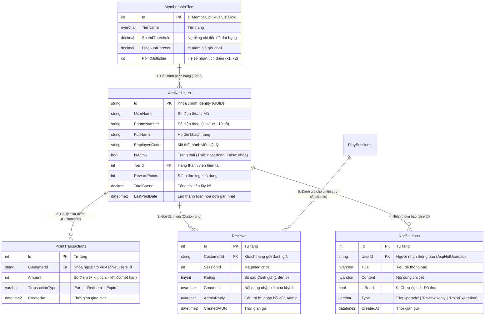
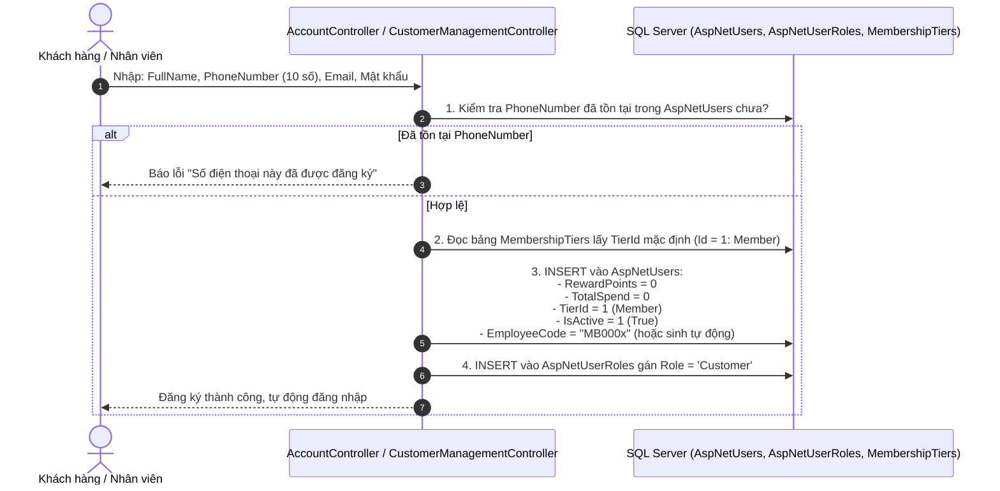
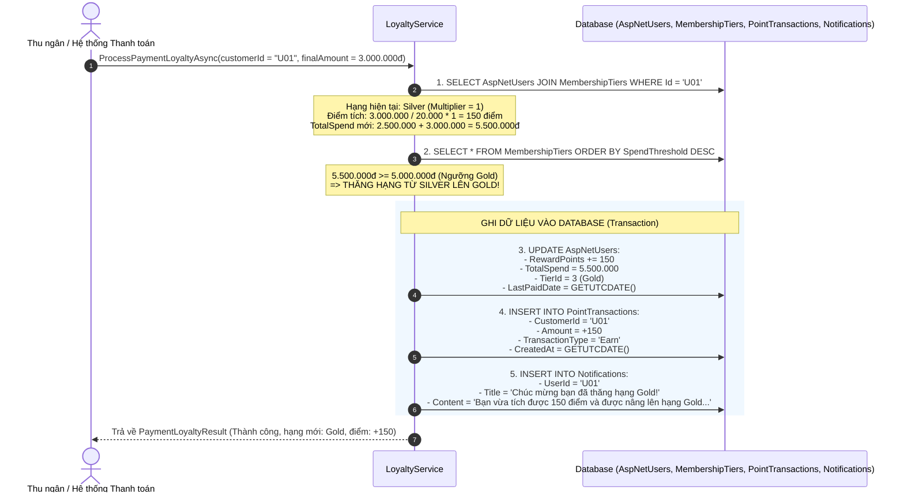
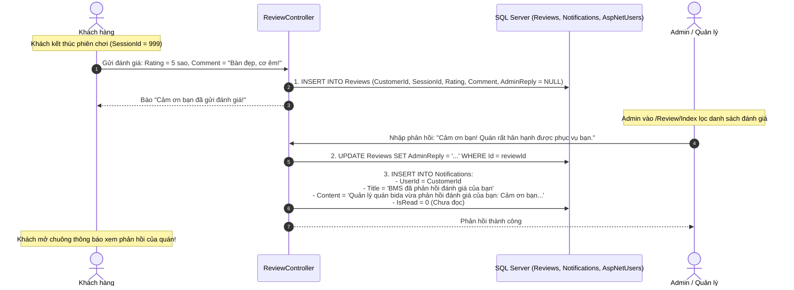
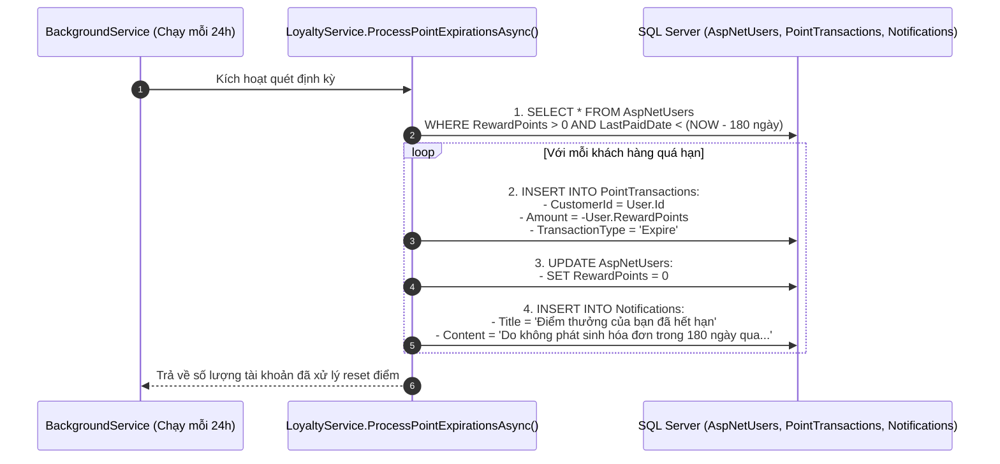

# HƯỚNG DẪN WORKFLOW THÀNH VIÊN 2 (TV2) VÀ CÁC BẢNG DATABASE SỬ DỤNG
## DỰ ÁN: BILLIARD MANAGEMENT SYSTEM (BMS)

> **Mục tiêu tài liệu:** Giúp bạn nắm rõ toàn bộ quy trình công việc (Workflow) của **Thành viên 2 (TV2)**, phân hệ đảm nhiệm sử dụng những bảng Database nào, quan hệ giữa các bảng ra sao, và cách từng bảng được Đọc/Ghi/Cập nhật trong từng bước thực tế.

---

## PHẦN 1: TỔNG QUAN PHÂN HỆ VÀ DANH SÁCH BẢNG DATABASE CỦA TV2

### 1.1. Phạm vi trách nhiệm của TV2
TV2 phụ trách phân hệ **Khách hàng thân thiết & Đánh giá dịch vụ (Customer Loyalty & Experience)** bao gồm:
1. Quản lý hồ sơ khách hàng & Thẻ thành viên (Customer Management).
2. Tích điểm và nâng hạng tự động khi thanh toán hóa đơn (Loyalty & Tiering).
3. Đổi điểm thưởng (trừ trực tiếp vào hóa đơn hoặc đổi quà/dịch vụ).
4. Đánh giá chất lượng sau phiên chơi và Admin phản hồi (Reviews & Feedback).
5. Hộp thư thông báo tự động (Notifications).
6. Tự động quét và xử lý hết hạn điểm thưởng sau 180 ngày (Background Service).
7. Bảng điều khiển thống kê tổng quan (Admin Dashboard).

---

### 1.2. Danh sách các bảng Database TV2 sử dụng

TV2 tương tác với **5 bảng cốt lõi (Core Tables)** và **2 bảng tham chiếu từ thành viên khác (Referenced Tables)**:

| STT | Tên bảng SQL | Entity C# tương ứng | Vai trò trong phân hệ TV2 |
|---|---|---|---|
| **1** | `AspNetUsers` | [ApplicationUser.cs](file:///c:/Users/dungp/billiard-management-system-tv2/src/Bms.Web/Data/ApplicationUser.cs) | Lưu tài khoản khách hàng, điểm thưởng (`RewardPoints`), tổng chi tiêu (`TotalSpend`), hạng hiện tại (`TierId`), lần thanh toán cuối (`LastPaidDate`), mã thẻ (`EmployeeCode`). |
| **2** | `MembershipTiers` | [MembershipTier.cs](file:///c:/Users/dungp/billiard-management-system-tv2/src/Bms.Web/Data/MembershipTier.cs) | Cấu hình 3 hạng thẻ: `Member`, `Silver`, `Gold` (ngưỡng chi tiêu, % giảm giá giờ chơi, hệ số nhân tích điểm). |
| **3** | `PointTransactions` | [PointTransaction.cs](file:///c:/Users/dungp/billiard-management-system-tv2/src/Bms.Web/Data/PointTransaction.cs) | Sổ cái lưu lịch sử biến động điểm: Tích điểm (`Earn`), Đổi điểm (`Redeem`), Hết hạn điểm (`Expire`). |
| **4** | `Reviews` | [Review.cs](file:///c:/Users/dungp/billiard-management-system-tv2/src/Bms.Web/Data/Review.cs) | Lưu đánh giá 1-5 sao, bình luận của khách hàng và câu trả lời phản hồi của Admin. |
| **5** | `Notifications` | [Notification.cs](file:///c:/Users/dungp/billiard-management-system-tv2/src/Bms.Web/Data/Notification.cs) | Lưu các thông báo hệ thống tự động bắn cho khách hàng (thăng hạng, đổi quà, phản hồi đánh giá, hết hạn điểm). |
| **6** | `AspNetUserRoles` / `AspNetRoles` | Identity Framework | Quản lý vai trò (Role): gán role `Customer` cho khách hàng, `Staff` cho nhân viên, `Admin` cho quản lý. |
| **7** | `PlaySessions` *(TV khác)* | Tham chiếu / Mock | Lấy thông tin phiên chơi để khách gửi đánh giá và hiển thị trong Lịch sử chơi. |
| **8** | `Invoices` *(TV khác)* | Tham chiếu / Mock | Hóa đơn thanh toán kích hoạt luồng tích điểm, thăng hạng và thống kê doanh thu Dashboard. |

---

## PHẦN 2: SƠ ĐỒ QUAN HỆ BẢNG DỮ LIỆU CỦA TV2 (ERD)



---

## PHẦN 3: GIẢI THÍCH CHI TIẾT TỪNG BƯỚC WORKFLOW VÀ CÁCH SỬ DỤNG DATABASE

---

### WORKFLOW 1: Khách hàng Đăng ký / Nhân viên Tạo mới Khách hàng
* **Giao diện:** `/Account/Register` (Khách tự đăng ký) hoặc `/CustomerManagement/Index` (Admin/Staff tạo).
* **Mục tiêu:** Tạo tài khoản thành viên mới trong hệ thống.



* **Các bảng sử dụng:**
  * `AspNetUsers`: **INSERT** 1 bản ghi mới với `TierId = 1`, `RewardPoints = 0`, `TotalSpend = 0`.
  * `MembershipTiers`: **SELECT** lấy thông tin hạng khởi đầu (Member).
  * `AspNetUserRoles`: **INSERT** gán quyền `Customer`.

---

### WORKFLOW 2: Tích điểm & Nâng hạng Thành viên khi Thanh toán Hóa đơn
* **Service thực thi:** `ILoyaltyService.ProcessPaymentLoyaltyAsync(customerId, finalAmount)`.
* **Kích hoạt khi:** Khách kết thúc phiên chơi và thanh toán tiền hóa đơn.
* **Quy tắc:**
  * Điểm tích: $\lfloor \frac{\text{Số tiền thực trả}}{20.000} \rfloor \times \text{PointMultiplier của Hạng hiện tại}$.
  * Cộng dồn `TotalSpend += finalAmount`.
  * So sánh `TotalSpend` với `SpendThreshold` của các hạng trong `MembershipTiers`. Nếu vượt ngưỡng mới $\rightarrow$ Thăng hạng!



* **Các bảng sử dụng:**
  * `AspNetUsers`: **SELECT** lấy thông tin $\rightarrow$ **UPDATE** `RewardPoints`, `TotalSpend`, `TierId`, `LastPaidDate`.
  * `MembershipTiers`: **SELECT** đọc ngưỡng `SpendThreshold` và hệ số `PointMultiplier`.
  * `PointTransactions`: **INSERT** 1 bản ghi mới loại `'Earn'`.
  * `Notifications`: **INSERT** 1 bản ghi thông báo thăng hạng gửi cho khách.

---

### WORKFLOW 3: Đổi điểm thưởng (Trừ tiền hóa đơn hoặc Đổi quà)
* **Service thực thi:** `RedeemPointsForBillAsync()` hoặc `RedeemRewardAsync()`.
* **Giao diện:** Thu ngân áp dụng trừ bill, hoặc Khách hàng bấm đổi quà tại `/CustomerPortal/Promotions`.

#### Trường hợp A: Trừ tiền trực tiếp vào Hóa đơn
* **Quy tắc:** $1 \text{ Điểm} = 1.000 \text{ VNĐ}$. Giảm tối đa không quá $50\%$ giá trị hóa đơn.
* **Thao tác Database:**
  1. **SELECT** `AspNetUsers` kiểm tra: `RewardPoints >= pointsToRedeem` và `pointsToRedeem * 1000 <= billAmount * 0.5`.
  2. **UPDATE** `AspNetUsers`: Trừ `RewardPoints -= pointsToRedeem`.
  3. **INSERT** `PointTransactions`: `Amount = -pointsToRedeem`, `TransactionType = 'Redeem'`.

#### Trường hợp B: Đổi quà / Đồ uống / Giờ chơi
* Khách đổi quà (20 điểm = Nước ngọt, 50 điểm = Đồ ăn, 80 điểm = Free 1h chơi).
* **Thao tác Database:**
  1. **UPDATE** `AspNetUsers`: `RewardPoints -= cost`.
  2. **INSERT** `PointTransactions`: `Amount = -cost`, `TransactionType = 'Redeem'`.
  3. **INSERT** `Notifications`: Gửi mã voucher / thông báo đổi quà thành công cho khách.

---

### WORKFLOW 4: Đánh giá Dịch vụ & Admin Phản hồi & Bắn thông báo
* **Giao diện:** Khách gửi tại `/Review/Create` hoặc trên trang cá nhân; Admin xem và phản hồi tại `/Review/Index`.



* **Các bảng sử dụng:**
  * `Reviews`: **INSERT** khi khách gửi đánh giá $\rightarrow$ **UPDATE** `AdminReply` khi Admin trả lời.
  * `Notifications`: **INSERT** tự động ngay khi có `AdminReply` để báo cho khách hàng biết.
  * `AspNetUsers`: **SELECT** JOIN để lấy Họ tên (`FullName`) và SĐT hiển thị trên màn hình Admin.

---

### WORKFLOW 5: Quản lý Khách hàng & Gắn Thẻ Thành viên (Admin / Staff)
* **Giao diện:** `/CustomerManagement/Index` (Layout 2 cột chuẩn SRS).
* **Thao tác:**
  * **Xem danh sách & Lọc:**
    * **SELECT** `AspNetUsers` JOIN `MembershipTiers` với điều kiện tìm kiếm:
      ```sql
      WHERE (FullName LIKE @search OR PhoneNumber LIKE @search)
        AND (@tierId IS NULL OR TierId = @tierId)
        AND (@status IS NULL OR IsActive = @status)
      ```
  * **Xem chi tiết 1 khách:**
    * **SELECT** bản ghi theo `Id` $\rightarrow$ nạp lên panel bên phải: Họ tên, SĐT, Email, Hạng thẻ, Điểm hiện có, Tổng chi tiêu, Trạng thái tài khoản.
  * **Khóa / Mở khóa tài khoản:**
    * **UPDATE** `AspNetUsers SET IsActive = ~IsActive WHERE Id = @id`.
  * **Gắn thẻ thành viên vật lý (Assign Card):**
    * Thu ngân quẹt thẻ hoặc nhập mã thẻ vào ô `cardCode` (nếu để trống tự sinh mã dạng `MB0001`...).
    * **UPDATE** `AspNetUsers SET EmployeeCode = @cardCode WHERE Id = @id`.

---

### WORKFLOW 6: Cấu hình Hạng thẻ & Đồng bộ lại Hạng toàn hệ thống
* **Giao diện:** `/TierConfig/Index` (Chỉ dành cho Admin).
* **Thao tác:**
  1. Admin điều chỉnh ngưỡng tiền hoặc quyền lợi (ví dụ: đổi ngưỡng Gold từ 5 triệu lên 6 triệu, tăng giảm giá giờ chơi từ 10% lên 15%).
  2. **UPDATE** `MembershipTiers SET SpendThreshold = @threshold, DiscountPercent = @discount, PointMultiplier = @multiplier WHERE Id = @id`.
  3. **Hàm RecalculateAllTiers:** Quét toàn bộ khách hàng trong `AspNetUsers`, so sánh `TotalSpend` hiện có với ngưỡng mới của `MembershipTiers` để **UPDATE** lại `TierId` chính xác cho từng khách hàng.

---

### WORKFLOW 7: Tự động Hết hạn Điểm sau 180 ngày (Background Job)
* **Thực thi:** `PointExpirationBackgroundService` (kế thừa `BackgroundService`).
* **Thời điểm:** Chạy ngầm mỗi ngày một lần (hoặc kích hoạt thử nghiệm tức thì tại trang `/LoyaltyTest`).
* **Quy tắc nghiệp vụ:** Nếu khách hàng không phát sinh thanh toán hóa đơn trong vòng **180 ngày** (`LastPaidDate < Ngày hiện tại - 180 ngày`), toàn bộ điểm thưởng khả dụng sẽ bị reset về 0. Hạng thành viên và Tổng chi tiêu vẫn được giữ vĩnh viễn.



---

### WORKFLOW 8: Thống kê Bảng điều khiển Quản trị (Admin Dashboard)
* **Giao diện:** `/Dashboard/Index` (Chỉ dành cho Admin).
* **Mục tiêu:** Cung cấp bức tranh toàn cảnh về doanh thu, giờ chơi, thành viên và độ hài lòng của khách hàng.
* **Các bảng được truy vấn:**
  1. `AspNetUsers`: Đếm tổng số khách hàng thành viên (`COUNT(*) WHERE Role = 'Customer'`).
  2. `MembershipTiers` JOIN `AspNetUsers`: Thống kê số lượng và tỷ lệ % từng hạng (Member, Silver, Gold) để vẽ **Biểu đồ tròn (Pie Chart)**.
  3. `Reviews`: Tính điểm đánh giá trung bình cộng (`AVG(CAST(Rating AS float))`) và đếm tổng lượt đánh giá.
  4. `Invoices` & `PlaySessions`: Thống kê doanh thu tháng và số giờ chơi, vẽ **Biểu đồ cột 7 ngày gần nhất (Bar Chart)** *(kèm cơ chế Mock Data tự động nếu database chưa có hóa đơn từ thành viên khác)*.

---

## PHẦN 4: BẢNG MA TRẬN CRUD CỦA TV2 TRÊN CÁC BẢNG DATABASE

Bảng ma trận thể hiện chi tiết TV2 thực hiện quyền gì (**C**: Create / Thêm mới, **R**: Read / Đọc, **U**: Update / Cập nhật, **D**: Delete / Xóa) trên từng bảng:

| Tên bảng SQL | Create (Thêm mới) | Read (Đọc / Lọc) | Update (Cập nhật) | Delete (Xóa) | Mô tả hành động cụ thể |
|---|:---:|:---:|:---:|:---:|---|
| `AspNetUsers` | **C** | **R** | **U** | — | Tạo khách mới (C), tìm kiếm & hiển thị hồ sơ (R), cộng điểm / trừ điểm / cập nhật hạng / cập nhật LastPaidDate / khóa tài khoản / gắn mã thẻ (U). *Không xóa tài khoản để bảo toàn toàn vẹn dữ liệu.* |
| `MembershipTiers` | — | **R** | **U** | — | Đọc cấu hình khi tích điểm & phân hạng (R), Admin chỉnh sửa ngưỡng chi tiêu & quyền lợi của 3 hạng (U). |
| `PointTransactions` | **C** | **R** | — | — | Ghi log khi tích điểm Earn, đổi điểm Redeem, hết hạn Expire (C), hiển thị lịch sử biến động điểm cho khách xem (R). *Tuyệt đối không sửa hay xóa sổ cái.* |
| `Reviews` | **C** | **R** | **U** | — | Khách gửi đánh giá 1-5 sao (C), Admin lọc danh sách theo số sao (R), Admin nhập phản hồi AdminReply (U). |
| `Notifications` | **C** | **R** | **U** | — | Tự động tạo khi thăng hạng, đổi quà, admin phản hồi review (C), hiển thị danh sách cho user xem (R), đánh dấu đã đọc IsRead (U). |
| `PlaySessions` | — | **R** | — | — | Tham chiếu để hiển thị lịch sử chơi của khách và gắn SessionId vào Review. |
| `Invoices` | — | **R** | — | — | Tham chiếu số tiền FinalAmount để tích điểm và tính doanh thu Dashboard. |

---

## PHẦN 5: TỔNG KẾT BỎ TÚI KHI THUYẾT TRÌNH BẢO VỆ ĐỒ ÁN

Khi thầy cô hoặc người nghe hỏi: **"Phân hệ của em sử dụng những bảng nào và quan hệ dữ liệu ra sao?"**, bạn có thể trả lời ngắn gọn, tự tin theo 3 ý chính:

1. **Về Bảng dữ liệu chính:**
   > *"Phân hệ của em (TV2) trực tiếp quản lý và thao tác trên **5 bảng cốt lõi**: `AspNetUsers` (thông tin khách hàng, điểm, hạng), `MembershipTiers` (3 hạng thẻ Member/Silver/Gold), `PointTransactions` (sổ cái lịch sử điểm), `Reviews` (đánh giá sao và phản hồi), và `Notifications` (thông báo tự động)."*

2. **Về Luồng dữ liệu tự động (Automation):**
   > *"Điểm nổi bật trong phân hệ của em là các luồng dữ liệu chạy hoàn toàn tự động:*
   > * Khi thanh toán: Hệ thống tự tính điểm nhân theo hệ số hạng, cộng dồn tổng chi tiêu, tự so khớp ngưỡng để thăng hạng và tự bắn thông báo chúc mừng.
   > * Khi Admin phản hồi đánh giá: Hệ thống tự động đẩy thông báo xuống cho khách hàng đó.
   > * Có một `BackgroundService` chạy ngầm định kỳ quét mốc 180 ngày không phát sinh chi tiêu để tự động hết hạn điểm."*

3. **Về Tính toàn vẹn dữ liệu (Integrity & Security):**
   > *"Tất cả các giao dịch biến động điểm đều được lưu bất biến vào bảng `PointTransactions` để minh bạch và chống gian lận. Tổng chi tiêu `TotalSpend` được bảo lưu vĩnh viễn không bị trừ khi đổi quà, đảm bảo quyền lợi hạng thẻ trọn đời cho khách hàng."*
