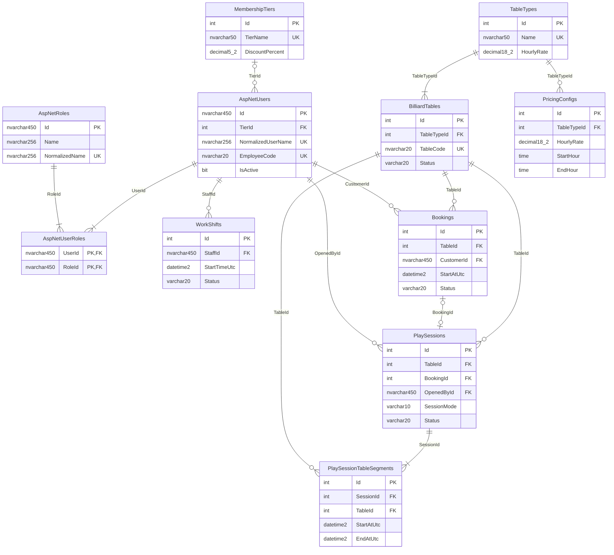
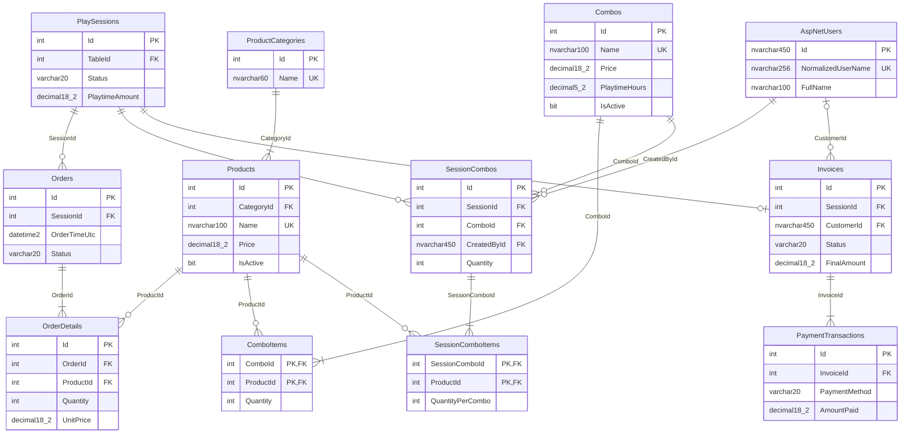
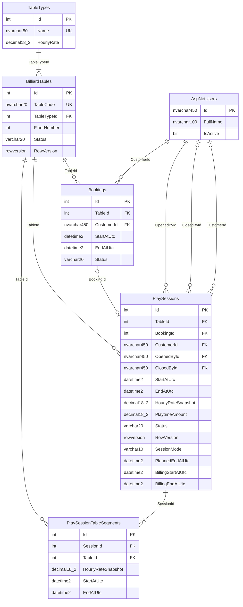

# I. High Level Design

## 3. Database Design — Thiết kế Cơ sở dữ liệu và Phân hệ Quản lý Bàn & Phiên chơi

### 3.0 Mô tả kiến trúc và Nguồn sự thật (Source of Truth)

Cơ sở dữ liệu của hệ thống Quản lý quán bida (Billiard Management System — BMS) được thiết kế theo định hướng **SQL-first** trên nền tảng Microsoft SQL Server (tương thích từ bản 2019 trở lên). Toàn bộ cấu trúc bảng, khóa chính, khóa ngoại, ràng buộc toàn vẹn, chỉ mục và thủ tục lưu trữ (Stored Procedure) được quản lý trực tiếp bằng các file kịch bản SQL trong thư mục `BMS_Database_Starter/`, không phụ thuộc vào migration tự sinh của Entity Framework Core.

**Quy tắc ưu tiên nguồn sự thật (Source of Truth):**
Hệ thống trải qua các giai đoạn nâng cấp chức năng, trong đó phiên bản script có số thứ tự lớn hơn sẽ ghi đè và có hiệu lực cao nhất theo thứ tự:
$$\text{06\_PlaySessionEnhancements.sql (V2, mới nhất)} > \text{05\_AddComboRelations.sql} > \text{BilliardDB\_Full.sql (Khởi tạo V1)}$$

1. **`BilliardDB_Full.sql`**: Chứa toàn bộ 24 bảng khởi tạo ban đầu, bao gồm nhóm bảo mật Identity (8 bảng), nhóm danh mục và bàn vật lý, đặt bàn, phiên chơi, sản phẩm F&B, hóa đơn và ca làm việc; cùng dữ liệu mẫu ban đầu.
2. **`05_AddComboRelations.sql`**: Bổ sung và chuẩn hóa cấu trúc quan hệ Combo nhiều–nhiều và snapshot đợt mua (`ComboItems`, `SessionCombos`, `SessionComboItems`).
3. **`06_PlaySessionEnhancements.sql` (Bản V2)**: Nguồn chân lý tối cao cho phân hệ Quản lý Bàn & Phiên chơi của Đoan. Script này bổ sung 4 cột mới cho `PlaySessions` (`SessionMode`, `PlannedEndAtUtc`, `BillingStartAtUtc`, `BillingEndAtUtc`), bổ sung 3 ràng buộc kiểm tra (`CK_Session_Mode`, `CK_Session_Planned`, `CK_Session_Billing`), tạo mới bảng lưu vết đoạn bàn `PlaySessionTableSegments`, cung cấp 2 hàm tính toán block 15 phút (`fn_CeilTo15Min`, `fn_CalcPlaytimeAmount`), nâng cấp 2 thủ tục `usp_OpenSession`, `usp_CloseSession` và bổ sung 2 thủ tục nghiệp vụ mới `usp_ExtendSession`, `usp_TransferSession`.

Tổng cộng toàn hệ thống có **25 bảng CSDL vật lý**. Trong đó, 4 bảng thuộc phân hệ Quản lý Bàn & Phiên chơi do Đoan trực tiếp phụ trách (`TableTypes`, `BilliardTables`, `PlaySessions`, `PlaySessionTableSegments`), 21 bảng còn lại do các thành viên khác phụ trách hoặc là bảng hệ thống của ASP.NET Core Identity.

---

### 3.1 Sơ đồ ERD Tổng quan Toàn hệ thống (Rút gọn)

Nhằm đảm bảo tính trực quan, độ rõ nét và kích thước chữ tiêu chuẩn khi chèn vào tài liệu báo cáo trên khổ giấy A4, sơ đồ ERD tổng quan 21 bảng nghiệp vụ cốt lõi (đã lược bớt 4 bảng kỹ thuật nội bộ của ASP.NET Core Identity gồm Claims, Logins, Tokens) được chia tách thành 2 phân hệ trực giao:
- **Hình 1a**: Phân hệ Quản trị, Bàn vật lý, Phiên chơi và Đặt bàn.
- **Hình 1b**: Phân hệ Dịch vụ F&B, Combo và Hóa đơn thanh toán.

#### Hình 1a — ERD Phân hệ Quản trị, Bàn và Phiên chơi (Rút gọn)

*Chú thích Hình 1a:* Mỗi tài khoản người dùng gắn với vai trò qua bảng nối `AspNetUserRoles` và có thể có 0 hoặc 1 hạng thành viên `MembershipTiers`. Mỗi bàn bida vật lý `BilliardTables` thuộc một loại bàn `TableTypes`. Bàn tiếp nhận các lượt đặt trước `Bookings` và các phiên chơi thực tế `PlaySessions`. Ở V2, mỗi phiên chơi `PlaySessions` sở hữu một hoặc nhiều đoạn bàn liên tiếp `PlaySessionTableSegments` khi chuyển bàn.

---

#### Hình 1b — ERD Phân hệ Giao dịch F&B, Combo và Hóa đơn (Rút gọn)

*Chú thích Hình 1b:* `PlaySessions` đóng vai trò trung tâm nghiệp vụ kết nối F&B và thanh toán. Trong suốt thời gian chơi, khách hàng có thể gọi món (`Orders` $\rightarrow$ `OrderDetails`) hoặc mua các gói ưu đãi (`SessionCombos` $\rightarrow$ `SessionComboItems`). Khi đóng phiên, toàn bộ tiền giờ chơi và tiền dịch vụ được tổng hợp thành một hóa đơn duy nhất `Invoices` (quan hệ 1–1 với `PlaySessions`), sau đó được thanh toán thông qua một hoặc nhiều giao dịch `PaymentTransactions`.

---

### 3.2 Sơ đồ ERD Chi tiết Phân hệ Bàn & Phiên chơi (Hình 2)

Sơ đồ thể hiện đầy đủ 100% các cột, kiểu dữ liệu chuẩn của Mermaid, các chỉ định khóa chính (PK), khóa ngoại (FK) và khóa duy nhất (UK) cho 4 bảng do Đoan phụ trách (`TableTypes`, `BilliardTables`, `PlaySessions`, `PlaySessionTableSegments`), đồng thời biểu diễn 2 bảng liên kết ranh giới (`AspNetUsers`, `Bookings`) với các cột đóng vai trò điểm nối.

*Chú thích Hình 2:* Khóa ngoại `PlaySessions.BookingId` là tùy chọn (nullable) nhưng được bảo vệ bởi Filtered Unique Index, đảm bảo mỗi lượt đặt bàn chỉ liên kết tối đa với một phiên chơi duy nhất. Mỗi phiên chơi luôn có ít nhất một đoạn bàn `PlaySessionTableSegments`, và tại mọi thời điểm chỉ có tối đa một đoạn bàn đang mở (`EndAtUtc IS NULL`). Khi chuyển bàn, đoạn bàn cũ đóng lại và đoạn bàn mới được tạo ngay lập tức với đơn giá của bàn đích.

---

### 3.3 Chi tiết Cấu trúc 4 Bảng Phân hệ Bàn & Phiên chơi

#### 3.3.1 `TableTypes` (Danh mục loại bàn)

**Mục đích:** Lưu trữ danh mục các loại bàn bida trong quán (ví dụ: Pool, Carom) và đơn giá thuê theo giờ cố định áp dụng cho từng loại bàn.  
**PK:** `Id`.

| Column | Constraints | Notes |
|---|---|---|
| `Id` | `int`, NOT NULL, PK `PK_TableTypes`, IDENTITY(1,1) | Khóa chính tự tăng, mã định danh duy nhất của loại bàn |
| `Name` | `nvarchar(50)`, NOT NULL, UNIQUE `UQ_TableTypes_Name`, CHECK `LEN(LTRIM(RTRIM(Name))) > 0` | Tên loại bàn (vd: Pool, Carom); không được trùng và không được chỉ chứa khoảng trắng |
| `HourlyRate` | `decimal(18,2)`, NOT NULL, CHECK `HourlyRate > 0` | Đơn giá thuê bàn theo giờ (VND); snapshot vào phiên và đoạn bàn khi bắt đầu chơi |

---

#### 3.3.2 `BilliardTables` (Bàn bida vật lý)

**Mục đích:** Danh sách các bàn bida vật lý trong quán, thông tin vị trí tầng, trạng thái sẵn sàng phục vụ và token kiểm soát cập nhật đồng thời.  
**PK:** `Id`. **FK:** `TableTypeId` $\rightarrow$ `TableTypes(Id)`.

| Column | Constraints | Notes |
|---|---|---|
| `Id` | `int`, NOT NULL, PK `PK_BilliardTables`, IDENTITY(1,1) | Khóa chính tự tăng của bàn vật lý |
| `TableCode` | `nvarchar(20)`, NOT NULL, UNIQUE `UQ_BilliardTables_Code`, CHECK `LEN(LTRIM(RTRIM(TableCode))) > 0` | Mã hiển thị của bàn trên giao diện POS (vd: B01, B02); không được trùng hoặc rỗng |
| `TableTypeId` | `int`, NOT NULL, FK $\rightarrow$ `TableTypes(Id)` (`FK_Table_Type`) | Liên kết phân loại bàn để xác định đơn giá giờ cơ bản |
| `FloorNumber` | `int`, NOT NULL, DEFAULT `1`, CHECK `FloorNumber >= 0` | Số tầng đặt bàn vật lý, hỗ trợ lọc danh sách bàn theo khu vực/tầng |
| `Status` | `varchar(20)`, NOT NULL, DEFAULT `'Available'`, CHECK `Status IN ('Available','InUse','AwaitingPayment','Maintenance','Inactive')` | Trạng thái vật lý của bàn. POS tự động chuyển `'InUse'` khi mở phiên, `'AwaitingPayment'` khi đóng phiên, và trả lại `'Available'` sau khi chuyển bàn hoặc thanh toán |
| `RowVersion` | `rowversion`, NOT NULL | Token kiểm soát đồng thời do SQL Server tự động cập nhật khi có thay đổi dữ liệu dòng, ngăn ngừa xung đột giữa các Staff |

---

#### 3.3.3 `PlaySessions` (Phiên chơi)

**Mục đích:** Quản lý toàn bộ vòng đời của một lượt chơi bida từ lúc mở bàn đến khi kết thúc tính tiền; liên kết với nhân viên phục vụ, khách hàng, bàn hiện tại, và lưu vết tổng tiền giờ.  
**PK:** `Id`. **FK:** `TableId` $\rightarrow$ `BilliardTables(Id)`, `BookingId` $\rightarrow$ `Bookings(Id)`, `CustomerId` $\rightarrow$ `AspNetUsers(Id)`, `OpenedById` $\rightarrow$ `AspNetUsers(Id)`, `ClosedById` $\rightarrow$ `AspNetUsers(Id)`.

| Column | Constraints | Notes |
|---|---|---|
| `Id` | `int`, NOT NULL, PK `PK_PlaySessions`, IDENTITY(1,1) | Khóa chính tự tăng của phiên chơi |
| `TableId` | `int`, NOT NULL, FK $\rightarrow$ `BilliardTables(Id)` (`FK_Session_Table`) | Mã bàn bida hiện tại phiên đang sử dụng; được cập nhật sang bàn mới khi chuyển bàn |
| `BookingId` | `int`, NULL, FK $\rightarrow$ `Bookings(Id)` (`FK_Session_Booking`), UNIQUE filtered `UX_PlaySessions_Booking` khi NOT NULL | Mã đặt bàn nếu mở từ lượt đặt trước; mỗi booking chỉ được gắn tối đa 1 phiên |
| `CustomerId` | `nvarchar(450)`, NULL, FK $\rightarrow$ `AspNetUsers(Id)` (`FK_Session_Customer`) | Tài khoản khách hàng nếu có định danh thành viên; NULL đối với khách vãng lai |
| `OpenedById` | `nvarchar(450)`, NOT NULL, FK $\rightarrow$ `AspNetUsers(Id)` (`FK_Session_OpenedBy`) | Tài khoản nhân viên thực hiện mở bàn, lấy từ context phiên đăng nhập |
| `ClosedById` | `nvarchar(450)`, NULL, FK $\rightarrow$ `AspNetUsers(Id)` (`FK_Session_ClosedBy`) | Tài khoản nhân viên thực hiện đóng bàn; bắt buộc có giá trị khi Status = `'Closed'` |
| `StartAtUtc` | `datetime2(0)`, NOT NULL | Thời điểm bắt đầu chơi thực tế theo giờ UTC (`SYSUTCDATETIME()`) |
| `EndAtUtc` | `datetime2(0)`, NULL | Thời điểm kết thúc chơi thực tế theo giờ UTC; bắt buộc có khi đóng bàn và $\ge$ StartAtUtc |
| `HourlyRateSnapshot` | `decimal(18,2)`, NOT NULL, CHECK `HourlyRateSnapshot > 0` | Đơn giá giờ tại thời điểm MỞ phiên. **Ghi chú V2:** Khi phiên có chuyển bàn, cột này giữ nguyên đơn giá lúc mở; đơn giá thực tế theo từng bàn được lưu trong `PlaySessionTableSegments` |
| `PlaytimeAmount` | `decimal(18,2)`, NULL, CHECK `PlaytimeAmount >= 0` khi Closed | Tổng tiền giờ chơi (VND). **Ghi chú V2:** Được tính qua hàm `fn_CalcPlaytimeAmount` theo các block 15 phút của từng đoạn bàn; tối thiểu 1 block |
| `Status` | `varchar(20)`, NOT NULL, DEFAULT `'Active'`, CHECK `Status IN ('Active','Closed')` | Trạng thái phiên chơi. Tuân thủ `CK_Session_Lifecycle`: Active thì EndAtUtc/ClosedById/PlaytimeAmount phải NULL; Closed thì bắt buộc có giá trị |
| `RowVersion` | `rowversion`, NOT NULL | Token kiểm soát đồng thời do SQL Server quản lý |
| `SessionMode` | `varchar(10)`, NOT NULL, DEFAULT `'Open'`, CHECK `SessionMode IN ('Open','Timed')` | **Thêm ở V2:** Hình thức phiên chơi gồm `'Open'` (không giới hạn) hoặc `'Timed'` (đăng ký số phút) |
| `PlannedEndAtUtc` | `datetime2(0)`, NULL | **Thêm ở V2:** Mốc kết thúc dự kiến (UTC). Bắt buộc NULL nếu SessionMode = `'Open'`; bắt buộc NOT NULL và > StartAtUtc nếu SessionMode = `'Timed'` |
| `BillingStartAtUtc` | `datetime2(0)`, NOT NULL | **Thêm ở V2:** Mốc bắt đầu tính tiền làm tròn tiến lên block 15 phút (`fn_CeilTo15Min(StartAtUtc)`). Không có DEFAULT |
| `BillingEndAtUtc` | `datetime2(0)`, NULL | **Thêm ở V2:** Mốc kết thúc tính tiền làm tròn tiến 15 phút. Bắt buộc NULL khi Active; bắt buộc NOT NULL và $\ge$ BillingStartAtUtc khi Closed |

---

#### 3.3.4 `PlaySessionTableSegments` (Đoạn bàn theo phiên — Mới ở V2)

**Mục đích:** Lưu vết chi tiết từng bàn vật lý mà phiên chơi đã sử dụng cùng đơn giá và khoảng thời gian tương ứng. Bảng này là nền tảng để tính đúng tiền giờ khi khách chuyển giữa các bàn có đơn giá khác nhau và hiển thị lịch sử bàn trên màn hình POS.  
**PK:** `Id`. **FK:** `SessionId` $\rightarrow$ `PlaySessions(Id)`, `TableId` $\rightarrow$ `BilliardTables(Id)`.

| Column | Constraints | Notes |
|---|---|---|
| `Id` | `int`, NOT NULL, PK `PK_PlaySessionTableSegments`, IDENTITY(1,1) | **Thêm ở V2:** Khóa chính tự tăng của đoạn bàn |
| `SessionId` | `int`, NOT NULL, FK $\rightarrow$ `PlaySessions(Id)` (`FK_SessionSegment_Session`) | **Thêm ở V2:** Mã phiên chơi chứa đoạn bàn này |
| `TableId` | `int`, NOT NULL, FK $\rightarrow$ `BilliardTables(Id)` (`FK_SessionSegment_Table`) | **Thêm ở V2:** Mã bàn vật lý được sử dụng trong đoạn thời gian này |
| `HourlyRateSnapshot` | `decimal(18,2)`, NOT NULL, CHECK `HourlyRateSnapshot > 0` | **Thêm ở V2:** Đơn giá giờ áp dụng riêng cho đoạn bàn này tại thời điểm mở hoặc chuyển đến |
| `StartAtUtc` | `datetime2(0)`, NOT NULL | **Thêm ở V2:** Thời điểm bắt đầu sử dụng bàn này (UTC) |
| `EndAtUtc` | `datetime2(0)`, NULL, CHECK `EndAtUtc IS NULL OR EndAtUtc >= StartAtUtc` | **Thêm ở V2:** Thời điểm kết thúc sử dụng bàn này (UTC); mang giá trị NULL khi đoạn bàn đang mở |

---

### 3.4 Index và Ràng buộc Đặc biệt

Hệ thống thiết lập các chỉ mục (Index) và ràng buộc toàn vẹn (Check Constraints) đặc thù nhằm đảm bảo tính toàn vẹn dữ liệu ở mức CSDL và tối ưu hóa hiệu năng truy vấn cho màn hình POS:

#### 1. Filtered Unique Indexes (Ràng buộc duy nhất có điều kiện)

- **`UX_PlaySessions_ActiveTable`** (Khai báo: `BilliardDB_Full.sql:205`):  
  `CREATE UNIQUE INDEX UX_PlaySessions_ActiveTable ON dbo.PlaySessions(TableId) WHERE Status = 'Active';`  
  *Ý nghĩa:* Đảm bảo mỗi bàn vật lý tại một thời điểm chỉ có tối đa **MỘT** phiên chơi ở trạng thái `'Active'`. Ngăn chặn hoàn toàn tình trạng mở trùng phiên cho cùng một bàn ở mức tầng cơ sở dữ liệu.

- **`UX_PlaySessions_Booking`** (Khai báo: `BilliardDB_Full.sql:206`):  
  `CREATE UNIQUE INDEX UX_PlaySessions_Booking ON dbo.PlaySessions(BookingId) WHERE BookingId IS NOT NULL;`  
  *Ý nghĩa:* Đảm bảo mỗi lượt đặt bàn (`Bookings`) chỉ được liên kết với tối đa **MỘT** phiên chơi duy nhất, ngăn ngừa lỗi check-in hoặc mở phiên lặp lại nhiều lần từ cùng một đơn đặt bàn.

- **`UX_SessionSegments_OpenPerSession`** (Khai báo: `06_PlaySessionEnhancements.sql:258-259`):  
  `CREATE UNIQUE INDEX UX_SessionSegments_OpenPerSession ON dbo.PlaySessionTableSegments(SessionId) WHERE EndAtUtc IS NULL;`  
  *Ý nghĩa:* Đảm bảo mỗi phiên chơi tại một thời điểm chỉ có tối đa **MỘT** đoạn bàn đang mở (`EndAtUtc IS NULL`). Khi thực hiện chuyển bàn (`usp_TransferSession`), đoạn bàn cũ bắt buộc phải được đóng (`EndAtUtc = Now`) trước khi chèn đoạn bàn mới.

#### 2. Performance Indexes (Chỉ mục tối ưu hiệu năng)

- **`IX_BilliardTables_Type_Status`** (`BilliardDB_Full.sql:147`): Đặt trên `(TableTypeId, Status)`, tối ưu hóa truy vấn lọc danh sách bàn theo loại bàn và trạng thái phục vụ hiển thị sơ đồ bàn trên POS.
- **`IX_PlaySessions_Table_Start`** (`BilliardDB_Full.sql:207`): Đặt trên `(TableId, StartAtUtc)`, hỗ trợ tra cứu lịch sử các phiên chơi của một bàn theo mốc thời gian.
- **`IX_SessionSegments_Session_Start`** (`06_PlaySessionEnhancements.sql:270-271`): Đặt trên `(SessionId, StartAtUtc)`, tối ưu hóa việc đọc danh sách các đoạn bàn theo thứ tự thời gian cho chức năng Lịch sử bàn và hàm tính tiền.
- **`IX_SessionSegments_Table`** (`06_PlaySessionEnhancements.sql:282`): Đặt trên `(TableId)`, tối ưu hóa các thao tác kiểm tra ràng buộc khóa ngoại tới bảng `BilliardTables`.

#### 3. Ràng buộc kiểm tra liên hoàn trên `PlaySessions`

- **`CK_Session_Lifecycle`** (`Full:200-203`): Ràng buộc toàn vẹn vòng đời phiên: Phiên `Active` bắt buộc `EndAtUtc`, `ClosedById`, `PlaytimeAmount` đều NULL; Phiên `Closed` bắt buộc các trường này đều NOT NULL, `EndAtUtc >= StartAtUtc` và `PlaytimeAmount >= 0`.
- **`CK_Session_Mode`** (`06:199-201`): Giới hạn giá trị `SessionMode IN ('Open', 'Timed')`.
- **`CK_Session_Planned`** (`06:210-214`): Phiên `'Open'` bắt buộc `PlannedEndAtUtc IS NULL`; Phiên `'Timed'` bắt buộc `PlannedEndAtUtc IS NOT NULL` và `PlannedEndAtUtc > StartAtUtc`.
- **`CK_Session_Billing`** (`06:223-227`): Phiên `Active` bắt buộc `BillingEndAtUtc IS NULL`; Phiên `Closed` bắt buộc `BillingEndAtUtc IS NOT NULL` và `BillingEndAtUtc >= BillingStartAtUtc`.

---

### 3.5 Hàm và Stored Procedure Liên quan

Toàn bộ logic tính toán tiền giờ và chuyển đổi trạng thái phiên chơi được đóng gói thành các hàm và thủ tục lưu trữ trên SQL Server nhằm đảm bảo tính nhất quán (Single Source of Truth), chống gian lận thời gian từ phía máy khách và xử lý tương tranh an toàn:

| Tên Hàm / Procedure | Loại | Vai trò và Quy tắc nghiệp vụ |
|---|---|---|
| `dbo.fn_CeilTo15Min` | Scalar Function | Làm tròn tiến (UP) một mốc thời gian UTC lên mốc 15 phút kế tiếp gần nhất dựa trên mốc epoch cố định `2000-01-01 00:00:00`. Công thức: `DATEADD(minute, ((seconds + 899) / 900) * 15, Epoch)`. Trả về `datetime2(0)`. |
| `dbo.fn_CalcPlaytimeAmount` | Scalar Function | Nguồn chân lý duy nhất tính tổng tiền giờ chơi cho một phiên. Tính toán từng đoạn bàn (`PlaySessionTableSegments`) theo khoảng `[ceil15(StartAtUtc), ceil15(EndAtUtc)]` nhân đơn giá riêng của bàn đó và làm tròn đến đồng (`ROUND(..., 0)`). Nếu tổng thời gian tính tiền bằng 0, tính tối thiểu 1 block (15 phút = 900s) theo đơn giá của đoạn bàn cuối cùng. Dùng chung cho cả hiển thị tiền tạm tính và khi đóng bàn. |
| `dbo.usp_OpenSession` | Stored Procedure | Mở phiên chơi mới (`Active`). Kiểm tra quyền Staff/Admin (51401), kiểm tra bàn Available (51402) và chưa có phiên Active (51403), kiểm tra booking hợp lệ (51404-51407), kiểm tra tham số hình thức chơi và số phút dự kiến (51409, 51410). Thực hiện khóa bàn (`UPDLOCK, HOLDLOCK`), chèn bản ghi `PlaySessions`, chèn đoạn bàn ban đầu vào `PlaySessionTableSegments`, và đổi trạng thái bàn sang `InUse`. |
| `dbo.usp_CloseSession` | Stored Procedure | Đóng phiên chơi (`Closed`). Khóa dòng phiên trước (`UPDLOCK, HOLDLOCK`), sau đó khóa bàn; đóng đoạn bàn đang mở (`EndAtUtc = Now`); gọi hàm `fn_CalcPlaytimeAmount` chốt `PlaytimeAmount`; cập nhật `BillingStartAtUtc`, `BillingEndAtUtc`; đổi trạng thái bàn sang `AwaitingPayment`; cập nhật booking sang `Completed` (nếu có). |
| `dbo.usp_ExtendSession` | Stored Procedure | Gia hạn thời gian kết thúc dự kiến cho phiên `'Timed'` đang `'Active'`. Kiểm tra quyền Staff/Admin (51601), kiểm tra trạng thái phiên (51602), kiểm tra `@AddMinutes` là bội số của 15 trong khoảng từ 15 đến 240 phút (51603). Cập nhật `PlannedEndAtUtc += @AddMinutes`. Không tác động đến cách tính tiền giờ (tiền giờ luôn theo thời gian chơi thực tế). |
| `dbo.usp_TransferSession` | Stored Procedure | Chuyển phiên chơi `'Active'` sang bàn đích (`Available`) mà không làm gián đoạn giờ chơi. Khóa dòng phiên và khóa cả hai bàn theo thứ tự ID tăng dần tránh deadlock; kiểm tra bàn đích hợp lệ và không bị trùng booking (51613, 51615); từ chối nếu phiên mở từ booking (51616); đóng đoạn bàn cũ tại mốc UTC hiện tại, chèn đoạn bàn mới với đơn giá của bàn đích; cập nhật `PlaySessions.TableId = NewTableId`; đổi bàn cũ về `'Available'` và bàn mới sang `'InUse'`. |

---

### 3.6 Bảng Phân công Các Bảng Còn lại trong Hệ thống

Bảng tổng hợp 21 bảng còn lại trong tổng số 25 bảng của cơ sở dữ liệu BMS:

| Bảng | Phụ trách | Ghi chú và Ranh giới kết nối |
|---|---|---|
| `MembershipTiers` | TV5 (Hùng) | Danh mục hạng thành viên và % giảm giá; liên kết tới `AspNetUsers.TierId` |
| `AspNetRoles` | TV5 (Hùng) | Danh mục vai trò tài khoản (Admin, Staff, Customer) |
| `AspNetUsers` | TV5 (Hùng) | Bảng tài khoản chung của toàn hệ thống, cung cấp định danh Staff/Admin mở/đóng bàn và khách hàng |
| `AspNetUserRoles` | TV5 (Hùng) | Bảng nối tài khoản và vai trò |
| `AspNetUserClaims` | TV5 (Hùng) | Bảng kỹ thuật lưu Claims người dùng (Identity) |
| `AspNetRoleClaims` | TV5 (Hùng) | Bảng kỹ thuật lưu Claims vai trò (Identity) |
| `AspNetUserLogins` | TV5 (Hùng) | Bảng kỹ thuật lưu thông tin đăng nhập từ bên thứ ba (Identity) |
| `AspNetUserTokens` | TV5 (Hùng) | Bảng kỹ thuật lưu Token xác thực (Identity) |
| `WorkShifts` | TV5 / Vận hành | Quản lý ca làm việc của nhân viên, số tiền mặt đầu ca và kết ca |
| `Bookings` | TV2 | Quản lý lịch đặt bàn trước của khách, check-in và hủy đặt. Ranh giới: Bàn có booking CheckedIn chỉ được mở qua luồng đặt bàn |
| `ProductCategories` | TV4 | Danh mục nhóm sản phẩm F&B (Đồ ăn, Đồ uống...) |
| `Products` | TV4 | Danh mục sản phẩm, đơn giá bán, số lượng tồn kho và trạng thái kinh doanh |
| `PricingConfigs` | TV4 / Bàn | Cấu hình giá theo khung giờ trong ngày (hiện tại SP phiên chơi lấy giá trực tiếp từ `TableTypes`) |
| `Orders` | TV4 | Đơn gọi món F&B phát sinh trong phiên chơi (`SessionId`) |
| `OrderDetails` | TV4 | Chi tiết từng món trong đơn gọi món (số lượng, đơn giá snapshot) |
| `Combos` | TV4 | Danh mục các gói combo khuyến mãi (kết hợp giờ chơi và món ăn/uống) |
| `ComboItems` | TV4 | Định nghĩa định lượng các món thuộc một đơn vị combo (từ script 05) |
| `SessionCombos` | TV4 / TV1 | Ghi nhận gói combo được mua trong phiên chơi (`SessionId`) (từ script 05) |
| `SessionComboItems` | TV4 | Snapshot các món của combo tại thời điểm mua (từ script 05) |
| `Invoices` | TV3 | Hóa đơn thanh toán tổng hợp (tiền giờ + tiền F&B - giảm giá) gắn với `PlaySessions` qua quan hệ 1–1 |
| `PaymentTransactions` | TV3 | Lịch sử các giao dịch thanh toán của hóa đơn (Tiền mặt, Chuyển khoản, VNPay...) |

---

### PHỤ LỤC: Bảng Đối chiếu Nguồn Dữ liệu (DB Trace)

> **LƯU Ý:** Phụ lục này được lập chỉ nhằm mục đích kiểm chứng tính chính xác của tài liệu đối chiếu trực tiếp với mã nguồn các file SQL (`BilliardDB_Full.sql`, `05_AddComboRelations.sql`, `06_PlaySessionEnhancements.sql`). **Hãy xóa mục phụ lục này trước khi nộp sản phẩm chính thức.**

#### 1. Đối chiếu 100% Thuộc tính 4 Bảng của Đoan và Bảng Ranh giới

| Đối tượng (Bảng.Cột) | File SQL Nguồn | Dòng khai báo | Kiểu dữ liệu & Ghi chú |
|---|---|---|---|
| **TableTypes** | | | |
| `TableTypes.Id` | `BilliardDB_Full.sql` | 129 | `int IDENTITY NOT NULL CONSTRAINT PK_TableTypes PRIMARY KEY` |
| `TableTypes.Name` | `BilliardDB_Full.sql` | 130 | `nvarchar(50) NOT NULL CONSTRAINT UQ_TableTypes_Name UNIQUE` |
| `TableTypes.HourlyRate` | `BilliardDB_Full.sql` | 131 | `decimal(18,2) NOT NULL` |
| **BilliardTables** | | | |
| `BilliardTables.Id` | `BilliardDB_Full.sql` | 136 | `int IDENTITY NOT NULL CONSTRAINT PK_BilliardTables PRIMARY KEY` |
| `BilliardTables.TableCode` | `BilliardDB_Full.sql` | 137 | `nvarchar(20) NOT NULL CONSTRAINT UQ_BilliardTables_Code UNIQUE` |
| `BilliardTables.TableTypeId` | `BilliardDB_Full.sql` | 138 | `int NOT NULL` (FK $\rightarrow$ TableTypes) |
| `BilliardTables.FloorNumber` | `BilliardDB_Full.sql` | 139 | `int NOT NULL CONSTRAINT DF_Table_Floor DEFAULT 1` |
| `BilliardTables.Status` | `BilliardDB_Full.sql` | 140 | `varchar(20) NOT NULL CONSTRAINT DF_Table_Status DEFAULT 'Available'` |
| `BilliardTables.RowVersion` | `BilliardDB_Full.sql` | 141 | `rowversion NOT NULL` |
| **PlaySessions** | | | |
| `PlaySessions.Id` | `BilliardDB_Full.sql` | 181 | `int IDENTITY NOT NULL CONSTRAINT PK_PlaySessions PRIMARY KEY` |
| `PlaySessions.TableId` | `BilliardDB_Full.sql` | 182 | `int NOT NULL` (FK $\rightarrow$ BilliardTables) |
| `PlaySessions.BookingId` | `BilliardDB_Full.sql` | 183 | `int NULL` (FK $\rightarrow$ Bookings) |
| `PlaySessions.CustomerId` | `BilliardDB_Full.sql` | 184 | `nvarchar(450) NULL` (FK $\rightarrow$ AspNetUsers) |
| `PlaySessions.OpenedById` | `BilliardDB_Full.sql` | 185 | `nvarchar(450) NOT NULL` (FK $\rightarrow$ AspNetUsers) |
| `PlaySessions.ClosedById` | `BilliardDB_Full.sql` | 186 | `nvarchar(450) NULL` (FK $\rightarrow$ AspNetUsers) |
| `PlaySessions.StartAtUtc` | `BilliardDB_Full.sql` | 187 | `datetime2(0) NOT NULL` |
| `PlaySessions.EndAtUtc` | `BilliardDB_Full.sql` | 188 | `datetime2(0) NULL` |
| `PlaySessions.HourlyRateSnapshot` | `BilliardDB_Full.sql` | 189 | `decimal(18,2) NOT NULL` (Quy ước đơn giá lúc mở: `06:20-25`) |
| `PlaySessions.PlaytimeAmount` | `BilliardDB_Full.sql` | 190 | `decimal(18,2) NULL` (Tính theo block 15 phút: `06:324-349`) |
| `PlaySessions.Status` | `BilliardDB_Full.sql` | 191 | `varchar(20) NOT NULL CONSTRAINT DF_Session_Status DEFAULT 'Active'` |
| `PlaySessions.RowVersion` | `BilliardDB_Full.sql` | 192 | `rowversion NOT NULL` |
| `PlaySessions.SessionMode` | `06_PlaySessionEnhancements.sql` | 84–85 | `varchar(10) NOT NULL CONSTRAINT DF_Session_Mode DEFAULT 'Open'` |
| `PlaySessions.PlannedEndAtUtc` | `06_PlaySessionEnhancements.sql` | 94 | `datetime2(0) NULL` |
| `PlaySessions.BillingStartAtUtc` | `06_PlaySessionEnhancements.sql` | 103, 189 | `datetime2(0) NOT NULL` (sau backfill) |
| `PlaySessions.BillingEndAtUtc` | `06_PlaySessionEnhancements.sql` | 112 | `datetime2(0) NULL` |
| **PlaySessionTableSegments** | | | |
| `PlaySessionTableSegments.Id` | `06_PlaySessionEnhancements.sql` | 237 | `int IDENTITY NOT NULL CONSTRAINT PK_PlaySessionTableSegments PRIMARY KEY` |
| `PlaySessionTableSegments.SessionId` | `06_PlaySessionEnhancements.sql` | 238 | `int NOT NULL` (FK $\rightarrow$ PlaySessions) |
| `PlaySessionTableSegments.TableId` | `06_PlaySessionEnhancements.sql` | 239 | `int NOT NULL` (FK $\rightarrow$ BilliardTables) |
| `PlaySessionTableSegments.HourlyRateSnapshot` | `06_PlaySessionEnhancements.sql` | 240 | `decimal(18,2) NOT NULL` |
| `PlaySessionTableSegments.StartAtUtc` | `06_PlaySessionEnhancements.sql` | 241 | `datetime2(0) NOT NULL` |
| `PlaySessionTableSegments.EndAtUtc` | `06_PlaySessionEnhancements.sql` | 242 | `datetime2(0) NULL` |
| **Điểm nối ranh giới** | | | |
| `AspNetUsers.Id` | `BilliardDB_Full.sql` | 48 | `nvarchar(450) NOT NULL CONSTRAINT PK_AspNetUsers PRIMARY KEY` |
| `AspNetUsers.FullName` | `BilliardDB_Full.sql` | 63 | `nvarchar(100) NOT NULL` |
| `AspNetUsers.IsActive` | `BilliardDB_Full.sql` | 64 | `bit NOT NULL CONSTRAINT DF_User_IsActive DEFAULT 1` |
| `Bookings.Id` | `BilliardDB_Full.sql` | 150 | `int IDENTITY NOT NULL CONSTRAINT PK_Bookings PRIMARY KEY` |
| `Bookings.CustomerId` | `BilliardDB_Full.sql` | 151 | `nvarchar(450) NOT NULL` (FK $\rightarrow$ AspNetUsers) |
| `Bookings.TableId` | `BilliardDB_Full.sql` | 152 | `int NOT NULL` (FK $\rightarrow$ BilliardTables) |
| `Bookings.StartAtUtc` | `BilliardDB_Full.sql` | 153 | `datetime2(0) NOT NULL` |
| `Bookings.EndAtUtc` | `BilliardDB_Full.sql` | 154 | `datetime2(0) NOT NULL` |
| `Bookings.Status` | `BilliardDB_Full.sql` | 155 | `varchar(20) NOT NULL CONSTRAINT DF_Booking_Status DEFAULT 'Confirmed'` |

---

#### 2. Đối chiếu Ràng buộc, Index và Thủ tục Lưu trữ

| Tên Ràng buộc / Index / Hàm / SP | File SQL Nguồn | Dòng khai báo | Nội dung tóm tắt |
|---|---|---|---|
| `UQ_TableTypes_Name` | `BilliardDB_Full.sql` | 130 | Tên loại bàn là duy nhất |
| `CK_TableTypes_Name` | `BilliardDB_Full.sql` | 132 | `CHECK (LEN(LTRIM(RTRIM(Name))) > 0)` |
| `CK_TableTypes_Rate` | `BilliardDB_Full.sql` | 133 | `CHECK (HourlyRate > 0)` |
| `UQ_BilliardTables_Code` | `BilliardDB_Full.sql` | 137 | Mã bàn là duy nhất |
| `FK_Table_Type` | `BilliardDB_Full.sql` | 142 | `FOREIGN KEY (TableTypeId) REFERENCES dbo.TableTypes(Id)` |
| `CK_Table_Code` | `BilliardDB_Full.sql` | 143 | `CHECK (LEN(LTRIM(RTRIM(TableCode))) > 0)` |
| `CK_Table_Floor` | `BilliardDB_Full.sql` | 144 | `CHECK (FloorNumber >= 0)` |
| `CK_Table_Status` | `BilliardDB_Full.sql` | 145 | `CHECK (Status IN ('Available','InUse','AwaitingPayment','Maintenance','Inactive'))` |
| `IX_BilliardTables_Type_Status` | `BilliardDB_Full.sql` | 147 | `INDEX (TableTypeId, Status)` |
| `FK_Session_Table` | `BilliardDB_Full.sql` | 193 | `FOREIGN KEY (TableId) REFERENCES dbo.BilliardTables(Id)` |
| `FK_Session_Booking` | `BilliardDB_Full.sql` | 194 | `FOREIGN KEY (BookingId) REFERENCES dbo.Bookings(Id)` |
| `FK_Session_Customer` | `BilliardDB_Full.sql` | 195 | `FOREIGN KEY (CustomerId) REFERENCES dbo.AspNetUsers(Id)` |
| `FK_Session_OpenedBy` | `BilliardDB_Full.sql` | 196 | `FOREIGN KEY (OpenedById) REFERENCES dbo.AspNetUsers(Id)` |
| `FK_Session_ClosedBy` | `BilliardDB_Full.sql` | 197 | `FOREIGN KEY (ClosedById) REFERENCES dbo.AspNetUsers(Id)` |
| `CK_Session_Status` | `BilliardDB_Full.sql` | 198 | `CHECK (Status IN ('Active','Closed'))` |
| `CK_Session_Rate` | `BilliardDB_Full.sql` | 199 | `CHECK (HourlyRateSnapshot > 0)` |
| `CK_Session_Lifecycle` | `BilliardDB_Full.sql` | 200–203 | Ràng buộc toàn vẹn vòng đời phiên chơi |
| `UX_PlaySessions_ActiveTable` | `BilliardDB_Full.sql` | 205 | `UNIQUE INDEX (TableId) WHERE Status = 'Active'` |
| `UX_PlaySessions_Booking` | `BilliardDB_Full.sql` | 206 | `UNIQUE INDEX (BookingId) WHERE BookingId IS NOT NULL` |
| `IX_PlaySessions_Table_Start` | `BilliardDB_Full.sql` | 207 | `INDEX (TableId, StartAtUtc)` |
| `CK_Session_Mode` | `06_PlaySessionEnhancements.sql` | 199–201 | `CHECK (SessionMode IN ('Open','Timed'))` |
| `CK_Session_Planned` | `06_PlaySessionEnhancements.sql` | 210–214 | Ràng buộc thời gian kết thúc dự kiến theo hình thức |
| `CK_Session_Billing` | `06_PlaySessionEnhancements.sql` | 223–227 | Ràng buộc mốc tính tiền kết thúc theo trạng thái phiên |
| `FK_SessionSegment_Session` | `06_PlaySessionEnhancements.sql` | 243 | `FOREIGN KEY (SessionId) REFERENCES dbo.PlaySessions(Id)` |
| `FK_SessionSegment_Table` | `06_PlaySessionEnhancements.sql` | 244 | `FOREIGN KEY (TableId) REFERENCES dbo.BilliardTables(Id)` |
| `CK_SessionSegment_Rate` | `06_PlaySessionEnhancements.sql` | 245 | `CHECK (HourlyRateSnapshot > 0)` |
| `CK_SessionSegment_Times` | `06_PlaySessionEnhancements.sql` | 246 | `CHECK (EndAtUtc IS NULL OR EndAtUtc >= StartAtUtc)` |
| `UX_SessionSegments_OpenPerSession` | `06_PlaySessionEnhancements.sql` | 258–259 | `UNIQUE INDEX (SessionId) WHERE EndAtUtc IS NULL` |
| `IX_SessionSegments_Session_Start` | `06_PlaySessionEnhancements.sql` | 270–271 | `INDEX (SessionId, StartAtUtc)` |
| `IX_SessionSegments_Table` | `06_PlaySessionEnhancements.sql` | 282 | `INDEX (TableId)` |
| `fn_CeilTo15Min` | `06_PlaySessionEnhancements.sql` | 126–136 | Hàm làm tròn tiến lên block 15 phút |
| `fn_CalcPlaytimeAmount` | `06_PlaySessionEnhancements.sql` | 324–349 | Hàm tính tổng tiền giờ phiên theo các đoạn bàn |
| `usp_OpenSession` | `06_PlaySessionEnhancements.sql` | 369–438 | Thủ tục mở phiên chơi (V2) |
| `usp_CloseSession` | `06_PlaySessionEnhancements.sql` | 453–494 | Thủ tục đóng phiên chơi (V2) |
| `usp_ExtendSession` | `06_PlaySessionEnhancements.sql` | 506–533 | Thủ tục gia hạn phiên Timed (Mới V2) |
| `usp_TransferSession` | `06_PlaySessionEnhancements.sql` | 553–611 | Thủ tục chuyển bàn (Mới V2) |

---

#### 3. Đối chiếu Toàn bộ 35 Khóa ngoại (Foreign Keys) Toàn hệ thống

| # | Khóa ngoại | Bảng nguồn | Cột nguồn | Bảng đích(Cột) | File SQL : Dòng |
|---|---|---|---|---|---|
| 1 | `FK_User_MembershipTier` | `AspNetUsers` | `TierId` | `MembershipTiers(Id)` | `BilliardDB_Full.sql:69` |
| 2 | `FK_UserRoles_User` | `AspNetUserRoles` | `UserId` | `AspNetUsers(Id)` | `BilliardDB_Full.sql:90` |
| 3 | `FK_UserRoles_Role` | `AspNetUserRoles` | `RoleId` | `AspNetRoles(Id)` | `BilliardDB_Full.sql:91` |
| 4 | `FK_UserClaims_User` | `AspNetUserClaims` | `UserId` | `AspNetUsers(Id)` | `BilliardDB_Full.sql:99` |
| 5 | `FK_RoleClaims_Role` | `AspNetRoleClaims` | `RoleId` | `AspNetRoles(Id)` | `BilliardDB_Full.sql:107` |
| 6 | `FK_UserLogins_User` | `AspNetUserLogins` | `UserId` | `AspNetUsers(Id)` | `BilliardDB_Full.sql:116` |
| 7 | `FK_UserTokens_User` | `AspNetUserTokens` | `UserId` | `AspNetUsers(Id)` | `BilliardDB_Full.sql:125` |
| 8 | `FK_Table_Type` | `BilliardTables` | `TableTypeId` | `TableTypes(Id)` | `BilliardDB_Full.sql:142` |
| 9 | `FK_Booking_Customer` | `Bookings` | `CustomerId` | `AspNetUsers(Id)` | `BilliardDB_Full.sql:164` |
| 10 | `FK_Booking_Table` | `Bookings` | `TableId` | `BilliardTables(Id)` | `BilliardDB_Full.sql:165` |
| 11 | `FK_Booking_CheckinStaff` | `Bookings` | `CheckedInById` | `AspNetUsers(Id)` | `BilliardDB_Full.sql:166` |
| 12 | `FK_Booking_CancelledBy` | `Bookings` | `CancelledById` | `AspNetUsers(Id)` | `BilliardDB_Full.sql:167` |
| 13 | `FK_Session_Table` | `PlaySessions` | `TableId` | `BilliardTables(Id)` | `BilliardDB_Full.sql:193` |
| 14 | `FK_Session_Booking` | `PlaySessions` | `BookingId` | `Bookings(Id)` | `BilliardDB_Full.sql:194` |
| 15 | `FK_Session_Customer` | `PlaySessions` | `CustomerId` | `AspNetUsers(Id)` | `BilliardDB_Full.sql:195` |
| 16 | `FK_Session_OpenedBy` | `PlaySessions` | `OpenedById` | `AspNetUsers(Id)` | `BilliardDB_Full.sql:196` |
| 17 | `FK_Session_ClosedBy` | `PlaySessions` | `ClosedById` | `AspNetUsers(Id)` | `BilliardDB_Full.sql:197` |
| 18 | `FK_Product_Category` | `Products` | `CategoryId` | `ProductCategories(Id)` | `BilliardDB_Full.sql:222` |
| 19 | `FK_PricingConfig_TableType` | `PricingConfigs` | `TableTypeId` | `TableTypes(Id)` | `BilliardDB_Full.sql:235` |
| 20 | `FK_Order_Session` | `Orders` | `SessionId` | `PlaySessions(Id)` | `BilliardDB_Full.sql:245` |
| 21 | `FK_OrderDetail_Order` | `OrderDetails` | `OrderId` | `Orders(Id)` | `BilliardDB_Full.sql:257` |
| 22 | `FK_OrderDetail_Product` | `OrderDetails` | `ProductId` | `Products(Id)` | `BilliardDB_Full.sql:258` |
| 23 | `FK_Invoice_Session` | `Invoices` | `SessionId` | `PlaySessions(Id)` | `BilliardDB_Full.sql:273` |
| 24 | `FK_Invoice_Customer` | `Invoices` | `CustomerId` | `AspNetUsers(Id)` | `BilliardDB_Full.sql:274` |
| 25 | `FK_Payment_Invoice` | `PaymentTransactions` | `InvoiceId` | `Invoices(Id)` | `BilliardDB_Full.sql:285` |
| 26 | `FK_ComboItems_Combo` | `ComboItems` | `ComboId` | `Combos(Id)` | `05:38` / `Full:308` |
| 27 | `FK_ComboItems_Product` | `ComboItems` | `ProductId` | `Products(Id)` | `05:39` / `Full:309` |
| 28 | `FK_SessionCombos_Session` | `SessionCombos` | `SessionId` | `PlaySessions(Id)` | `05:56` / `Full:326` |
| 29 | `FK_SessionCombos_Combo` | `SessionCombos` | `ComboId` | `Combos(Id)` | `05:57` / `Full:327` |
| 30 | `FK_SessionCombos_CreatedBy` | `SessionCombos` | `CreatedById` | `AspNetUsers(Id)` | `05:58` / `Full:328` |
| 31 | `FK_SessionComboItems_Purchase` | `SessionComboItems` | `SessionComboId` | `SessionCombos(Id)` | `05:76` / `Full:346` |
| 32 | `FK_SessionComboItems_Product` | `SessionComboItems` | `ProductId` | `Products(Id)` | `05:77` / `Full:347` |
| 33 | `FK_Shift_Staff` | `WorkShifts` | `StaffId` | `AspNetUsers(Id)` | `BilliardDB_Full.sql:363` |
| 34 | `FK_SessionSegment_Session` | `PlaySessionTableSegments` | `SessionId` | `PlaySessions(Id)` | `06_PlaySessionEnhancements.sql:243` |
| 35 | `FK_SessionSegment_Table` | `PlaySessionTableSegments` | `TableId` | `BilliardTables(Id)` | `06_PlaySessionEnhancements.sql:244` |
