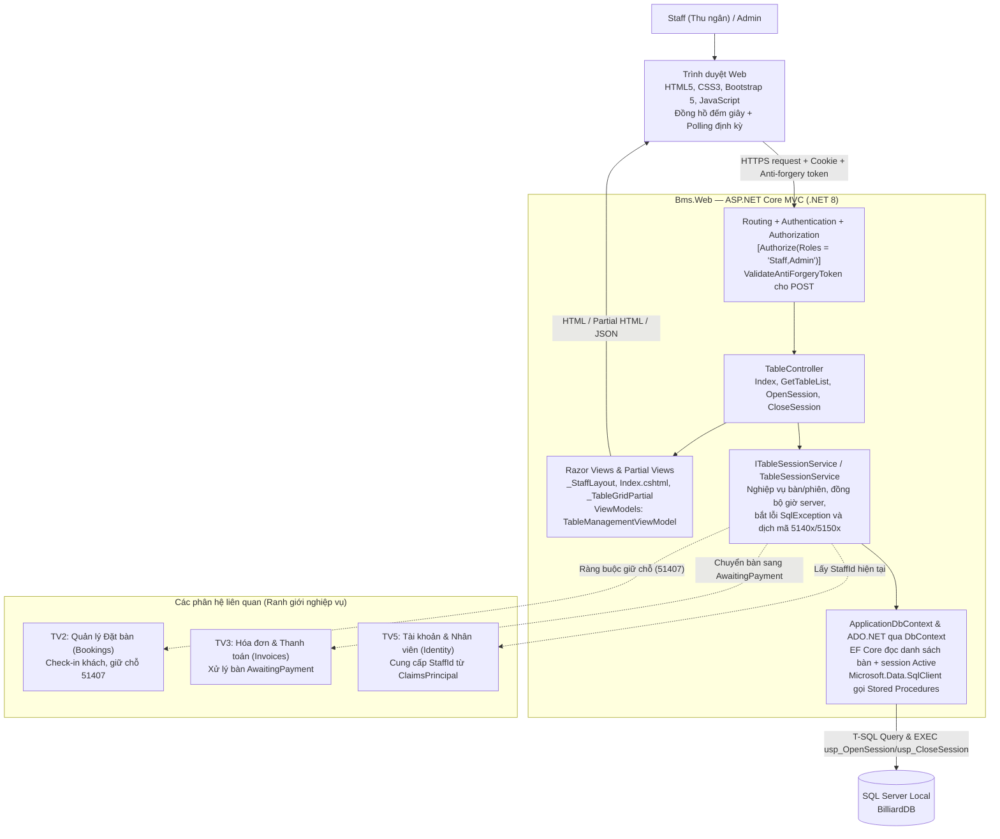
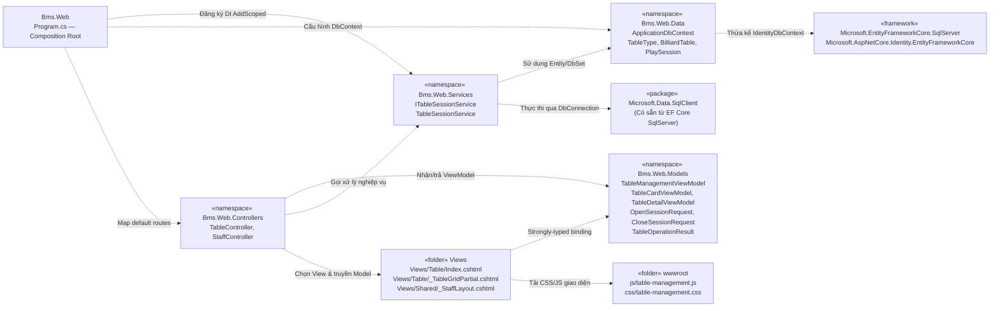
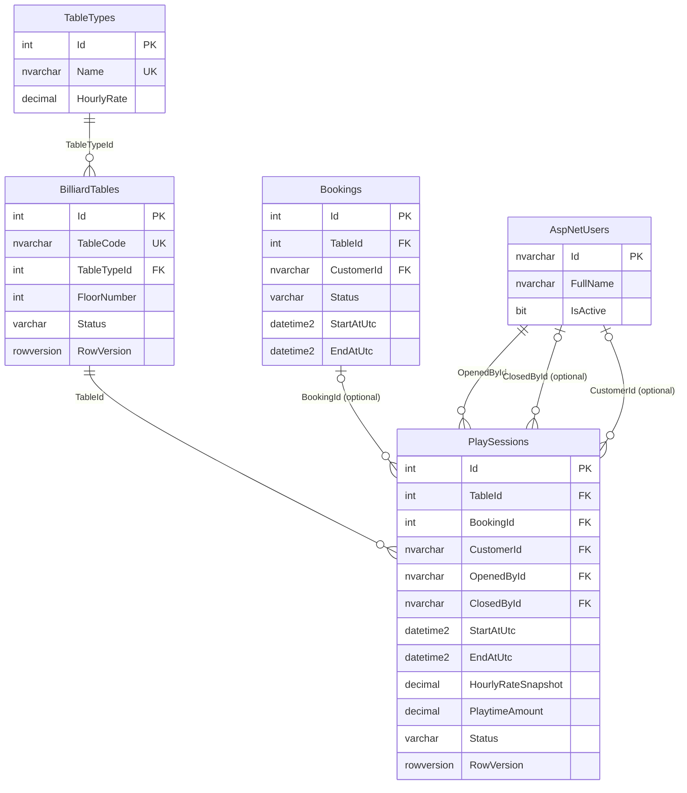
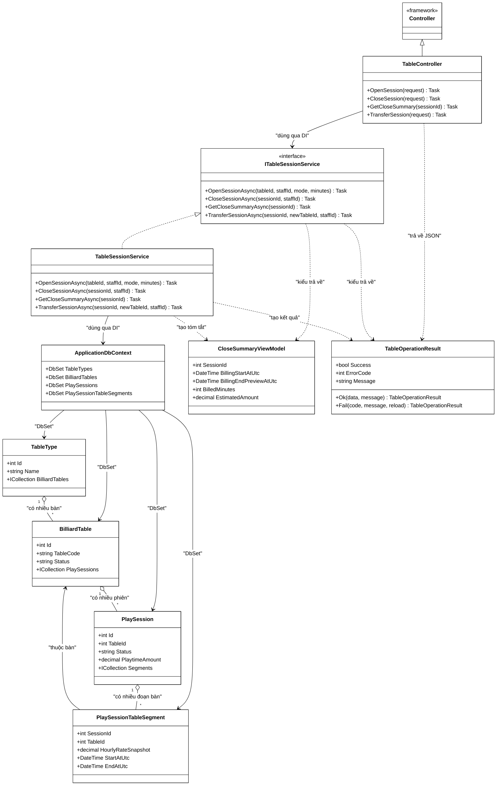
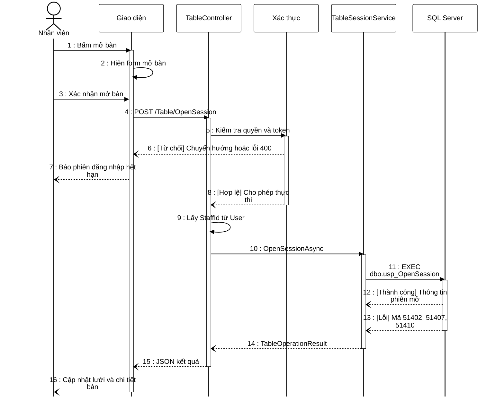
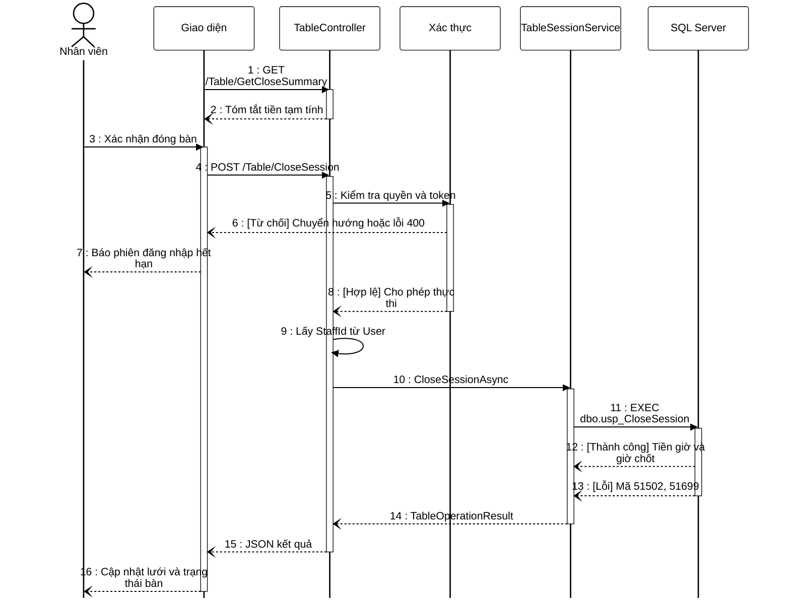
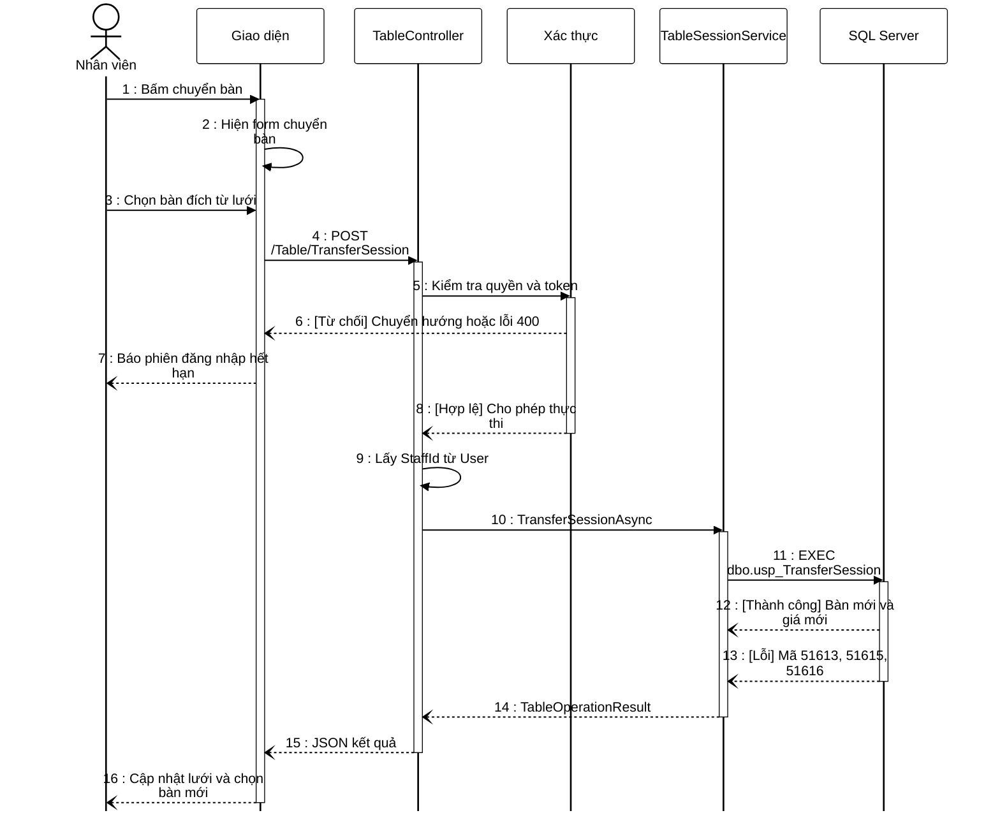

# Billiard Management System

## Software Design Specification — Phân hệ Quản lý Bàn & Phiên chơi

**Ngày cập nhật:** 04/10/2026. **Phiên bản:** 1.2. **Người phụ trách theo phân công:** Đoan (Thành viên 1).

Tài liệu cung cấp thiết kế kiến trúc, package, ba bảng dữ liệu và thiết kế chi tiết cho màn hình Quản lý bàn, luồng mở bàn (khách vãng lai) và đóng phiên chơi. Cấu trúc đánh số tương ứng mẫu SDS của nhóm; các mục I, II và III có thể ghép vào báo cáo chung. Nội dung giải thích bằng tiếng Việt; tên lớp, bảng, phương thức và stored procedure giữ nguyên tiếng Anh theo C# và SQL Server.

**Cách đọc trạng thái:** "Thiết kế" nghĩa là định hướng triển khai; "Hiện có" nghĩa là đã thấy trong mã nguồn hoặc script. "CẦN XÁC NHẬN" là điểm phụ thuộc thành viên khác hoặc chưa có quyết định cuối. "Disabled v1" là tính năng hiển thị trên giao diện nhưng chưa có logic.

Nguồn đối chiếu: `BMS_Database_Starter/BilliardDB_Full.sql` (dòng 128–148, 180–208, 491–578), `docs/sds-doan/DB_NOTES.md`, `src/Bms.Web/Program.cs`, `Data/ApplicationDbContext.cs`, `Controllers/StaffController.cs`, `Views/Shared/_AdminLayout.cshtml`. Repo nhắm **.NET 8**, dùng **ASP.NET Core MVC, Razor, Bootstrap, Identity và EF Core SQL Server 8.x**. Tên database: **BilliardDB**.

### Change Log

| Date | A / M / D | In charge | Change Description |
|---|---|---|---|
| 04/10/2026 | A | Đoan | Khởi tạo SDS phân hệ Quản lý Bàn & Phiên chơi theo khung SDS_HUNG.md, 9 điểm thiết kế và 7 sơ đồ Mermaid |
| 04/10/2026 | M | Đoan | Cập nhật v1.1: Đổi TableOperationResult sang Ok/Fail; bỏ BookingId ở v1 (chỉ mở vãng lai); chuẩn hóa 2 khóa UPDLOCK và hàm SYSUTCDATETIME() từ SQL thật; bổ sung 4 trường cho TableDetailViewModel; xóa mục OnModelCreating trong phụ lục; chuẩn hóa test D05/D06/D07; xác minh link tham khảo |
| 04/10/2026 | M | Đoan | Chốt Phương án A cho đường vào màn hình: sửa StaffController.Index() chuyển hướng sang TableController.Index(); cập nhật mục III.1.7 và phụ lục A1 |

---

# I. High Level Design

## 1. Software Architecture

### 1.1 Kiến trúc tổng thể

BMS sử dụng kiến trúc ASP.NET Core MVC trong một ứng dụng web duy nhất. Màn hình Quản lý bàn là giao diện POS (Point of Sale) của thu ngân/nhân viên: bên trái là lưới bàn trực quan, bên phải là panel chi tiết phiên đang chọn. Trình duyệt gửi yêu cầu HTTP đến `TableController`. Controller lấy định danh nhân viên từ cookie Identity (không nhận từ client), điều phối qua `TableSessionService`, kết quả trả về dưới dạng HTML đầy đủ (GET) hoặc JSON (POST và Partial Polling).

Gọi stored procedure thực hiện qua `Microsoft.Data.SqlClient` — package **đã có sẵn** từ dependency của `Microsoft.EntityFrameworkCore.SqlServer`, không cần cài thêm NuGet.



**Hình I.1 — Kiến trúc logic Phân hệ Quản lý Bàn & Phiên chơi.** Nét đứt biểu thị ranh giới nghiệp vụ với thành viên khác. `usp_CloseSession` chuyển bàn sang `AwaitingPayment`; việc giải phóng bàn về `Available` thuộc TV3 (thanh toán).

### 1.2 Architecture component descriptions

| No | Component | Description |
|---|---|---|
| C01 | Client tier — Web browser | Hiển thị lưới bàn POS và panel phiên. Không tự quyết trạng thái hay staffId; mọi logic nghiệp vụ do server xác nhận |
| A01 | Routing và security pipeline | Chọn action, xác thực cookie Identity, kiểm tra role `Staff` hoặc `Admin`; kiểm tra anti-forgery ở POST mở/đóng bàn |
| A05_Table | TableController | Tiếp nhận request xem bàn, mở phiên, đóng phiên. Lấy `StaffId` từ `ClaimsPrincipal`, không nhận từ form |
| A05_Svc | TableSessionService | Gọi stored procedure qua ADO.NET, dịch `SqlException.Number` sang thông báo tiếng Việt, map kết quả sang ViewModel. Đây là lớp duy nhất biết về `usp_OpenSession` và `usp_CloseSession` |
| A03 | Razor Views & ViewModels | `_StaffLayout.cshtml` theo wireframe POS; `Index.cshtml` layout 2 cột; `_TableGridPartial.cshtml` phục vụ Polling; `TableDetailViewModel` mang `ServerTimeUtc` để đồng hồ browser tự hiệu chỉnh |
| A06 | ApplicationDbContext / EF Core | `DbSet<TableType>`, `DbSet<BilliardTable>`, `DbSet<PlaySession>` phục vụ đọc danh sách. Stored procedure gọi qua `_context.Database.GetDbConnection()` — dùng chung connection pool |
| D01 | SQL Server — BilliardDB | Lưu trạng thái bàn và phiên, kiểm soát toàn vẹn qua PK, FK, CHECK, filtered unique index `UX_PlaySessions_ActiveTable`. Khóa đồng thời: `usp_OpenSession` dùng `WITH (UPDLOCK, HOLDLOCK)` trên `BilliardTables`; `usp_CloseSession` khóa `BilliardTables` bằng `WITH (UPDLOCK, HOLDLOCK)` VÀ khóa `PlaySessions` bằng `WITH (UPDLOCK)`. Procedure dùng `SYSUTCDATETIME()` để lấy thời gian UTC chuẩn xác |

### 1.3 Ranh giới trách nhiệm

Đoan phụ trách: xem danh sách bàn, mở phiên vãng lai (`usp_OpenSession`), theo dõi thời gian thực (đồng hồ browser), đóng phiên (`usp_CloseSession`), hiển thị tên khách hàng từ `PlaySession.CustomerId`. **Không** tự xây dựng: nghiệp vụ booking/check-in (TV2), hóa đơn/thanh toán (TV3), quản lý tài khoản (TV5). Nút `CONFIRM BOOKING`, `TRANSFER`, `SPLIT/MERGE` hiển thị trên giao diện (theo wireframe) nhưng ở trạng thái `disabled` — không có logic xử lý trong phiên bản v1.

Ứng dụng dùng cookie Identity; không có JWT. Schema do SQL scripts quản lý; không gọi `EnsureCreated`, `Migrate` hoặc áp migration lên BilliardDB đang có dữ liệu.

---

## 2. Package Diagram

### 2.1 Sơ đồ package



**Hình I.2 — Package Diagram.** Mũi tên nét đứt biểu thị dependency. Không có dependency ngược từ `Data` về `Controllers` hoặc `Services`. `Microsoft.Data.SqlClient` có sẵn theo transitive dependency của EF Core SQL Server — không cần khai báo thêm trong `.csproj`.

### 2.2 Package descriptions và quy ước đặt tên

| Package / thư mục | Trách nhiệm | Quy ước và ví dụ |
|---|---|---|
| `Bms.Web.Controllers` | Tiếp nhận HTTP, kiểm tra quyền, điều phối service, trả View hoặc JSON | PascalCase + hậu tố `Controller`: `TableController`; action: `Index`, `OpenSession`, `CloseSession` |
| `Bms.Web.Services` | Toàn bộ logic nghiệp vụ phiên chơi, gọi SP, dịch lỗi | PascalCase: `TableSessionService`; interface `ITableSessionService`; phương thức `Async` |
| `Bms.Web.Models` | ViewModel đầu vào/đầu ra, không bind entity trực tiếp từ form | Hậu tố `ViewModel` / `Request` / `Result`: `TableCardViewModel`, `OpenSessionRequest` |
| `Bms.Web.Data` (Entity) | Entity ánh xạ bảng SQL, data annotation thay Fluent API | PascalCase khớp tên bảng SQL: `TableType`, `BilliardTable`, `PlaySession` |
| `Views/Table` | Giao diện Razor theo action | `Index.cshtml`, `_TableGridPartial.cshtml` |
| `Views/Shared` | Layout và thành phần dùng chung | `_StaffLayout.cshtml` — layout POS riêng, không sửa `_AdminLayout.cshtml` |
| `wwwroot/js` | Script client: đồng hồ, polling, AJAX mở/đóng | `table-management.js` |
| `wwwroot/css` | Style bố cục POS và màu trạng thái | `table-management.css` |

Kiểu và public member dùng PascalCase; tham số/biến cục bộ dùng camelCase; dependency private dùng tiền tố `_`: `_service`, `_context`. Phương thức bất đồng bộ có hậu tố `Async`. Tên bảng và cột giữ đúng PascalCase của SQL script. Không nhận `StaffId`, `Role` hay `IsActive` từ form.

---

## 3. Database Design — Ba bảng của Đoan

### 3.0 Mô tả file và quan hệ

`BMS_Database_Starter/BilliardDB_Full.sql` khai báo ba bảng liên quan đến phân hệ này: `TableTypes` (dòng 128–134), `BilliardTables` (dòng 135–148), `PlaySessions` (dòng 180–208), và hai stored procedure `usp_OpenSession` (dòng 491–543), `usp_CloseSession` (dòng 545–578). ERD dưới đây chỉ thể hiện các bảng thuộc phạm vi phân hệ này và bảng `Bookings` như ranh giới nghiệp vụ.



**Hình I.3 — ERD rút gọn phân hệ Quản lý Bàn & Phiên chơi.** `Bookings` thuộc TV2; Đoan chỉ nhận ràng buộc gián tiếp qua lỗi `51407` do `usp_OpenSession` kiểm tra. `AspNetUsers` rút gọn chỉ liệt kê cột dùng trong phân hệ này.

### 3.1 TableTypes (Loại bàn)

**Mục đích:** danh mục loại bàn và đơn giá giờ cố định. **PK:** `Id`.

| Column | Kiểu dữ liệu | Nullable | Mặc định | Ràng buộc | Diễn giải |
|---|---|:---:|---|---|---|
| `Id` | `int` IDENTITY | NOT NULL | Tự tăng | **PK** `PK_TableTypes` | Mã loại bàn |
| `Name` | `nvarchar(50)` | NOT NULL | — | **UQ** `UQ_TableTypes_Name`; **CHECK** `LEN(LTRIM(RTRIM(Name))) > 0` | Tên loại: Pool, Carom |
| `HourlyRate` | `decimal(18,2)` | NOT NULL | — | **CHECK** `HourlyRate > 0` | Đơn giá giờ (VND), snapshot vào `PlaySessions.HourlyRateSnapshot` khi mở phiên |

**Dữ liệu seed:** Pool — 100.000 VND/h; Carom — 120.000 VND/h.

**Entity C# (`Data/Entities/TableType.cs`):**

```csharp
using System.ComponentModel.DataAnnotations;
using System.ComponentModel.DataAnnotations.Schema;

namespace Bms.Web.Data.Entities;

[Table("TableTypes")]
public class TableType
{
    public int Id { get; set; }

    [Required, MaxLength(50)]
    public string Name { get; set; } = string.Empty;

    [Column(TypeName = "decimal(18,2)")]
    public decimal HourlyRate { get; set; }

    public ICollection<BilliardTable> BilliardTables { get; set; } = [];
}
```

### 3.2 BilliardTables (Bàn bida)

**Mục đích:** danh sách bàn vật lý, trạng thái hoạt động hiện tại và token chống cập nhật đồng thời. **PK:** `Id`.

| Column | Kiểu dữ liệu | Nullable | Mặc định | Ràng buộc | Diễn giải |
|---|---|:---:|---|---|---|
| `Id` | `int` IDENTITY | NOT NULL | Tự tăng | **PK** `PK_BilliardTables` | Khóa chính bàn |
| `TableCode` | `nvarchar(20)` | NOT NULL | — | **UQ** `UQ_BilliardTables_Code`; **CHECK** không trắng | Mã hiển thị: B01, B02... |
| `TableTypeId` | `int` | NOT NULL | — | **FK** → `TableTypes(Id)` | Liên kết loại bàn |
| `FloorNumber` | `int` | NOT NULL | `1` | **CHECK** `>= 0` | Số tầng |
| `Status` | `varchar(20)` | NOT NULL | `'Available'` | **CHECK** `IN ('Available','InUse','AwaitingPayment','Maintenance','Inactive')` | Trạng thái bàn — xem Bảng 5 trạng thái mục III.1.6 |
| `RowVersion` | `rowversion` | NOT NULL | Hệ thống | — | Token chống cập nhật đồng thời — SQL Server tự quản lý |

**Index:** `IX_BilliardTables_Type_Status` trên `(TableTypeId, Status)`.

**Entity C# (`Data/Entities/BilliardTable.cs`):**

```csharp
using System.ComponentModel.DataAnnotations;
using System.ComponentModel.DataAnnotations.Schema;

namespace Bms.Web.Data.Entities;

[Table("BilliardTables")]
public class BilliardTable
{
    public int Id { get; set; }

    [Required, MaxLength(20)]
    public string TableCode { get; set; } = string.Empty;

    public int TableTypeId { get; set; }
    public TableType TableType { get; set; } = null!;

    public int FloorNumber { get; set; } = 1;

    [Required, MaxLength(20)]
    public string Status { get; set; } = "Available";

    [Timestamp]
    public byte[] RowVersion { get; set; } = [];

    public ICollection<PlaySession> PlaySessions { get; set; } = [];
}
```

### 3.3 PlaySessions (Phiên chơi bida)

**Mục đích:** ghi nhận một lượt chơi từ khi mở bàn đến khi đóng phiên; lưu giá giờ tại thời điểm mở. **PK:** `Id`.

| Column | Kiểu dữ liệu | Nullable | Mặc định | Ràng buộc | Diễn giải |
|---|---|:---:|---|---|---|
| `Id` | `int` IDENTITY | NOT NULL | Tự tăng | **PK** | Khóa chính phiên |
| `TableId` | `int` | NOT NULL | — | **FK** → `BilliardTables(Id)` | Bàn diễn ra phiên |
| `BookingId` | `int` | NULL | — | **FK** → `Bookings(Id)` | Lượt đặt trước, nếu có |
| `CustomerId` | `nvarchar(450)` | NULL | — | **FK** → `AspNetUsers(Id)` | Hội viên, nếu có |
| `OpenedById` | `nvarchar(450)` | NOT NULL | — | **FK** → `AspNetUsers(Id)` | Nhân viên mở bàn |
| `ClosedById` | `nvarchar(450)` | NULL | — | **FK** → `AspNetUsers(Id)` | Nhân viên đóng phiên |
| `StartAtUtc` | `datetime2(0)` | NOT NULL | — | — | Thời điểm mở, **UTC** — ghi bởi hàm `SYSUTCDATETIME()` trong `usp_OpenSession` |
| `EndAtUtc` | `datetime2(0)` | NULL | — | — | Thời điểm đóng, **UTC** — ghi bởi hàm `SYSUTCDATETIME()` trong `usp_CloseSession` |
| `HourlyRateSnapshot` | `decimal(18,2)` | NOT NULL | — | **CHECK** `> 0` | Giá giờ chốt tại thời điểm mở |
| `PlaytimeAmount` | `decimal(18,2)` | NULL | — | — | Tiền giờ chơi (tính và ghi khi đóng) |
| `Status` | `varchar(20)` | NOT NULL | `'Active'` | **CHECK** `IN ('Active','Closed')` | Trạng thái phiên |
| `RowVersion` | `rowversion` | NOT NULL | Hệ thống | — | Token chống cập nhật đồng thời |

**Ràng buộc vòng đời `CK_Session_Lifecycle`:** Khi `Status='Active'`: `EndAtUtc IS NULL`, `ClosedById IS NULL`, `PlaytimeAmount IS NULL`. Khi `Status='Closed'`: `EndAtUtc IS NOT NULL AND >= StartAtUtc`, `ClosedById IS NOT NULL`, `PlaytimeAmount IS NOT NULL AND >= 0`.

**Filtered Unique Indexes:**
- `UX_PlaySessions_ActiveTable` trên `(TableId) WHERE Status='Active'` — đảm bảo mỗi bàn tối đa 1 phiên Active.
- `UX_PlaySessions_Booking` trên `(BookingId) WHERE BookingId IS NOT NULL` — mỗi booking chỉ mở 1 phiên.

**Entity C# (`Data/Entities/PlaySession.cs`):**

```csharp
using System.ComponentModel.DataAnnotations;
using System.ComponentModel.DataAnnotations.Schema;

namespace Bms.Web.Data.Entities;

[Table("PlaySessions")]
public class PlaySession
{
    public int Id { get; set; }
    public int TableId { get; set; }
    public BilliardTable BilliardTable { get; set; } = null!;

    public int? BookingId { get; set; }

    [MaxLength(450)]
    public string? CustomerId { get; set; }

    [Required, MaxLength(450)]
    public string OpenedById { get; set; } = string.Empty;

    [MaxLength(450)]
    public string? ClosedById { get; set; }

    public DateTime StartAtUtc { get; set; }    // Đọc từ DB luôn SpecifyKind → Utc trước khi dùng
    public DateTime? EndAtUtc { get; set; }

    [Column(TypeName = "decimal(18,2)")]
    public decimal HourlyRateSnapshot { get; set; }

    [Column(TypeName = "decimal(18,2)")]
    public decimal? PlaytimeAmount { get; set; }

    [Required, MaxLength(20)]
    public string Status { get; set; } = "Active";

    [Timestamp]
    public byte[] RowVersion { get; set; } = [];
}
```

> [!NOTE]
> **Về `DateTime.Kind` khi đọc từ `datetime2(0)`:** EF Core ánh xạ `datetime2` sang `DateTime` với `Kind = DateTimeKind.Unspecified`. Trước khi xuất ra ViewModel hoặc JSON, service phải gọi `DateTime.SpecifyKind(session.StartAtUtc, DateTimeKind.Utc)` để tránh sai giờ khi browser xử lý. Xem chi tiết tại mục III.1.4.

### 3.4 Stored Procedures và Quy tắc tính tiền

#### usp_OpenSession

**Nguồn:** `BilliardDB_Full.sql` dòng 491–543.

| Tham số | Kiểu | Bắt buộc | Mô tả |
|---|---|:---:|---|
| `@TableId` | `int` | Có | ID bàn cần mở |
| `@StaffId` | `nvarchar(450)` | Có | ID nhân viên/admin từ Identity (do controller lấy từ `ClaimsPrincipal`) |
| `@BookingId` | `int` | Không (NULL) | ID lượt đặt trước nếu mở cho khách đã check-in (v1 truyền NULL) |
| `@CustomerId` | `nvarchar(450)` | Không (NULL) | ID hội viên (v1 truyền NULL) |

**Giá trị trả về:** Result set 1 dòng, 1 cột: `SessionId (int)` — ID phiên vừa tạo.

**Hàm lấy giờ trong procedure:** `SYSUTCDATETIME()` — trả `datetime2(0)` theo giờ UTC chuẩn của SQL Server.

**Cơ chế khóa trong procedure:** Khóa bản ghi bàn bằng `SELECT ... FROM dbo.BilliardTables t WITH (UPDLOCK, HOLDLOCK) WHERE t.Id = @TableId` nhằm ngăn chặn các giao dịch mở bàn hoặc sửa trạng thái đồng thời trên cùng bàn.

#### usp_CloseSession

**Nguồn:** `BilliardDB_Full.sql` dòng 545–578.

| Tham số | Kiểu | Bắt buộc | Mô tả |
|---|---|:---:|---|
| `@SessionId` | `int` | Có | ID phiên Active cần đóng |
| `@StaffId` | `nvarchar(450)` | Có | ID nhân viên/admin thực hiện đóng |

**Giá trị trả về:** Result set 1 dòng: `Id, StartAtUtc, EndAtUtc, HourlyRateSnapshot, PlaytimeAmount, Status`.

**Hàm lấy giờ trong procedure:** `SYSUTCDATETIME()` — đồng nhất với usp_OpenSession.

**Cơ chế khóa trong procedure:**
1. Khóa bản ghi bàn liên quan bằng `SELECT @LockedId = Id FROM dbo.BilliardTables WITH (UPDLOCK, HOLDLOCK) WHERE Id = @TableId;`
2. Khóa bản ghi phiên chơi bằng `SELECT @Status = Status, @Start = StartAtUtc, @Rate = HourlyRateSnapshot, @BookingId = BookingId FROM dbo.PlaySessions WITH (UPDLOCK) WHERE Id = @SessionId;`

#### Quy tắc tính tiền và làm tròn

$$\text{PlaytimeAmount} = \text{ROUND}\!\left(\frac{\text{DATEDIFF\_BIG(second, StartAtUtc, EndAtUtc)} \times \text{HourlyRateSnapshot}}{3600.0},\; 0\right)$$

- **Đơn vị thời gian:** từng giây thực tế (`DATEDIFF_BIG(second, ...)`), không làm tròn theo phút.
- **Làm tròn:** đến đồng nguyên (0 chữ số thập phân, làm tròn thương mại `ROUND(..., 0)`).
- **Phí tối thiểu:** không áp dụng trong v1.
- **Đơn giá áp dụng:** `HourlyRateSnapshot` — giá chốt tại thời điểm mở, độc lập với thay đổi sau này trong `TableTypes.HourlyRate`.

---

# II. Detailed Code Design

## 1. Quản lý bàn và phiên chơi

Phần này mô tả ba chức năng của màn hình Quản lý bàn: **Mở bàn**, **Đóng bàn** và **Chuyển bàn**. Các sơ đồ bám theo code thật: `TableController`, `TableSessionService`, `table-management.js` và các stored procedure trong `BMS_Database_Starter/06_PlaySessionEnhancements.sql`. Tiền giờ chỉ tính trên SQL Server, giao diện và C# không tính tiền.

### 1.1 Class Diagram



**Hình II.1 — Class Diagram cho ba chức năng Mở bàn, Đóng bàn, Chuyển bàn.** Sơ đồ gồm 11 hộp được rút gọn theo quy tắc: mỗi hộp tối đa 5 thành viên; `TableController` và `TableSessionService` chỉ giữ 4 phương thức công khai phục vụ trực tiếp ba chức năng; các phương thức private (`HandleSqlException`, `MapErrorCode`), dependency `ILogger` và các lớp Request nhỏ được chuyển xuống bảng giải thích để đảm bảo sơ đồ trực quan, không bị bè ngang. Kiểu dữ liệu được viết đơn giản (bỏ generic `Task<...>`, `DbSet<...>`) để biểu diễn rõ ràng.

**Quan hệ trong sơ đồ:**

- **IS-A (kế thừa hoặc hiện thực):** `TableController` kế thừa `Controller` của ASP.NET Core MVC. `TableSessionService` hiện thực giao diện `ITableSessionService`.
- **HAS-A (kết tập, hình thoi rỗng):** `TableType` có nhiều `BilliardTable`, `BilliardTable` có nhiều `PlaySession`, `PlaySession` có nhiều `PlaySessionTableSegment` (thể hiện qua các navigation property `BilliardTables`, `PlaySessions`, `Segments`).
- **Liên kết (association, đường liền mũi tên):** `TableController` tham chiếu `ITableSessionService` qua cơ chế DI của ASP.NET Core; `TableSessionService` tham chiếu `ApplicationDbContext` qua DI; `ApplicationDbContext` khai báo các `DbSet` của bốn entity; `PlaySessionTableSegment` trỏ về `BilliardTable`.
- **Phụ thuộc (dependency, đường đứt mũi tên hở):** `TableController` trả về kết quả JSON dạng `TableOperationResult`. `ITableSessionService` và `TableSessionService` dùng `TableOperationResult` và `CloseSummaryViewModel` làm kiểu dữ liệu trả về cho các tác vụ nghiệp vụ.

Trong ba chức năng này, `ApplicationDbContext` chỉ được dùng để lấy đối tượng kết nối `SqlConnection` (`Database.GetDbConnection()`), toàn bộ thao tác cập nhật dữ liệu do các stored procedure trong SQL Server đảm nhiệm.

| Class | Trách nhiệm |
|---|---|
| Controller | Lớp cơ sở MVC của framework ASP.NET Core, cung cấp `User`, `Json`, `View`, `ModelState` cho controller con |
| TableController | Tiếp nhận yêu cầu HTTP cho màn hình Quản lý bàn. Yêu cầu quyền role `Staff` hoặc `Admin`, bảo vệ CSRF bằng `[ValidateAntiForgeryToken]` cho các action POST. Lấy `StaffId` trực tiếp từ `User` (`ClaimsPrincipal`), gọi service và trả kết quả JSON dạng `TableOperationResult` |
| ITableSessionService | Giao diện dịch vụ phiên chơi, khai báo 4 phương thức công khai: `OpenSessionAsync`, `CloseSessionAsync`, `GetCloseSummaryAsync`, `TransferSessionAsync` (cùng các phương thức mở rộng khác) |
| TableSessionService | Cài đặt nghiệp vụ phiên chơi: thực thi stored procedure qua ADO.NET `SqlConnection` lấy từ DbContext; gọi hàm `GetCloseSummaryAsync` tính tiền tạm tính; bắt `SqlException` qua phương thức private `HandleSqlException`, dịch mã lỗi nghiệp vụ sang tiếng Việt qua `MapErrorCode`, ghi log qua `ILogger` |
| ILogger | Ghi log hệ thống cho `TableSessionService`: `LogWarning` cho các trường hợp nghiệp vụ bị từ chối, `LogError` cho các lỗi hệ thống hoặc dữ liệu bất thường (được rút khỏi hình để đơn giản hóa quan hệ) |
| ApplicationDbContext | Ngữ cảnh EF Core, quản lý các `DbSet` thực thể. Trong ba chức năng phiên chơi, lớp này cung cấp kết nối `Database.GetDbConnection()` dùng chung connection pool với EF Core |
| PlaySession | Entity bảng `PlaySessions`: đại diện cho một phiên chơi bida, lưu hình thức (`SessionMode`: Open/Timed), thời gian bắt đầu, kết thúc, mốc tính tiền (`BillingStartAtUtc`, `BillingEndAtUtc`), giờ dự kiến kết thúc (`PlannedEndAtUtc`), tiền giờ chơi (`PlaytimeAmount`) và danh sách các đoạn bàn (`Segments`) |
| PlaySessionTableSegment | Entity bảng `PlaySessionTableSegments`: một đoạn chơi trên một bàn cụ thể, lưu đơn giá chốt tại thời điểm chơi của bàn đó (`HourlyRateSnapshot`), thời điểm bắt đầu (`StartAtUtc`) và kết thúc (`EndAtUtc`). Khi chuyển bàn, đoạn cũ được đóng và đoạn mới được mở |
| BilliardTable | Entity bảng `BilliardTables`: đại diện cho bàn bida vật lý, mã bàn (`TableCode`), trạng thái (`Status`: Available, InUse, AwaitingPayment, Maintenance, Inactive) và tập hợp các phiên chơi |
| TableType | Entity bảng `TableTypes`: danh mục loại bàn (Pool, Carom) và đơn giá theo giờ (`HourlyRate`) |
| OpenSessionRequest | DTO nhận dữ liệu form mở bàn: `TableId`, `SessionMode`, `PlannedMinutes` (được rút khỏi hình để giữ giới hạn 11 hộp) |
| CloseSessionRequest | DTO nhận dữ liệu form đóng bàn: `SessionId` (được rút khỏi hình) |
| TransferSessionRequest | DTO nhận dữ liệu form chuyển bàn: `SessionId`, `NewTableId` (được rút khỏi hình) |
| CloseSummaryViewModel | ViewModel chứa dữ liệu tóm tắt tạm tính trước khi đóng bàn: `SessionId`, `BillingStartAtUtc`, `BillingEndPreviewAtUtc`, `BilledMinutes`, `MinimumChargeApplied`, `EstimatedAmount` |
| TableOperationResult | Đối tượng chuẩn hóa kết quả thao tác trả về cho client: `Success`, `ErrorCode`, `Message`, `AutoReload`, `Data`; khởi tạo nhanh qua hai phương thức tĩnh `Ok` và `Fail` |

---

### 1.2 Sequence Diagram: Mở bàn



**Hình II.2 — Sequence Diagram: Mở bàn.** Sơ đồ gồm 16 thông điệp, điều phối giữa 6 thành phần chính. Các lời gọi nội bộ của Giao diện được gộp thành "Hiện form", các nhánh từ chối xác thực được gom thành một luồng phản hồi báo hết hạn phiên, và các bước truy cập kết nối ADO.NET được mô tả chi tiết trong Bảng II.1.

- **Actor:** Nhân viên thu ngân hoặc Quản trị viên (`Staff`, `Admin`) thao tác trên giao diện POS.
- **Route:** `POST /Table/OpenSession`. Dữ liệu gửi lên dạng form urlencoded gồm `TableId`, `SessionMode` ("Open" hoặc "Timed"), `PlannedMinutes` và token CSRF `__RequestVerificationToken`.
- **Điều kiện trước:** Người dùng đã đăng nhập với vai trò hợp lệ, đã chọn một bàn đang ở trạng thái Trống (`Available`).
- **Kết quả:** Phiên chơi mới được tạo ở trạng thái `Active`, bàn chuyển sang `InUse`, giao diện hiển thị thông báo thành công (kèm mốc giờ tính tiền và giờ dự kiến nếu có), lưới bàn và thông tin chi tiết bàn được cập nhật tự động.

**Bảng II.1: Giải thích các bước trong quy trình Mở bàn**

| Bước | Giải thích |
|---|---|
| 1 đến 3 | Nhân viên bấm nút mở bàn trên thẻ bàn hoặc bảng chi tiết (`handleOpenTable` trong `table-management.js`). Giao diện gọi hàm nội bộ `showOpenForm` để hiển thị modal/panel mở bàn, tính toán xem trước mốc giờ tính tiền (`updateOpenFormPreview`). Nhân viên chọn hình thức mở bàn: không giới hạn thời gian (`Open`) hoặc đăng ký thời gian (`Timed` kèm số phút là bội số của 15 từ 15 đến 720 phút), sau đó bấm xác nhận (`handleConfirmOpenSession`) |
| 4 | Trình duyệt gửi yêu cầu `POST /Table/OpenSession` mang theo `TableId`, `SessionMode`, `PlannedMinutes` và `__RequestVerificationToken`. Cờ `isProcessing` được bật để chống gửi trùng lặp yêu cầu |
| 5 đến 8 | Pipeline của ASP.NET Core kiểm tra cookie xác thực, vai trò người dùng (`[Authorize(Roles = "Staff,Admin")]`) và token chống giả mạo (`[ValidateAntiForgeryToken]`). Nếu chưa đăng nhập hoặc cookie hết hạn, hệ thống trả mã 302 chuyển hướng về `/Account/Login`; nếu sai vai trò, trả 302 về `/Account/AccessDenied` (trình duyệt tự theo chuyển hướng khiến JS nhận phản hồi là trang HTML với thuộc tính `response.redirected = true`); nếu thiếu hoặc sai token CSRF, trả mã lỗi HTTP 400. Khi rơi vào một trong ba trường hợp này (bước 6), Giao diện nhận biết và hiển thị toast báo phiên đăng nhập đã hết hạn, đồng thời dừng tiến trình làm mới tự động (`stopPolling`) ở bước 7. Nếu hợp lệ (bước 8), yêu cầu được chuyển tiếp vào action `OpenSession` của `TableController` |
| 9 | `TableController` kiểm tra `ModelState.IsValid`. Tiếp đó, controller tự gọi nội bộ phương thức `User.FindFirstValue(ClaimTypes.NameIdentifier)` để lấy mã định danh nhân viên (`StaffId`) từ token định danh an toàn trên server, tuyệt đối không nhận `StaffId` từ client |
| 10 | Controller gọi phương thức `_tableSessionService.OpenSessionAsync(request.TableId, staffId, sessionMode, request.PlannedMinutes)` |
| 11 | `TableSessionService` lấy kết nối `SqlConnection` qua `_context.Database.GetDbConnection()` và mở kết nối nếu đang đóng. Dịch vụ tạo `SqlCommand` kiểu `StoredProcedure` gọi `dbo.usp_OpenSession` với các tham số: `@TableId`, `@StaffId`, `@BookingId = NULL`, `@CustomerId = NULL`, `@SessionMode`, `@PlannedMinutes`. Trong thủ tục: khóa bản ghi bàn bằng cú pháp `SELECT ... WITH (UPDLOCK, HOLDLOCK)` để chống tranh chấp; kiểm tra bàn phải đang `Available` (lỗi 51402); kiểm tra không trùng phiên `Active` (lỗi 51403); kiểm tra bàn không nằm trong khung giờ giữ chỗ đặt bàn (lỗi 51407); kiểm tra số phút hợp lệ (lỗi 51410). Sau đó, thủ tục chèn bản ghi vào `PlaySessions` với giờ bắt đầu `SYSUTCDATETIME()`, giờ tính tiền làm tròn LÊN mốc 15 phút kế tiếp bằng hàm `fn_CeilTo15Min`, chèn đoạn bàn ban đầu vào `PlaySessionTableSegments` và cập nhật bàn sang `InUse` |
| 12 đến 13 | Nếu thành công (bước 12), thủ tục trả về tập kết quả gồm `SessionId`, `BillingStartAtUtc`, `PlannedEndAtUtc`, `SessionMode`. Nếu vi phạm quy tắc nghiệp vụ (bước 13), thủ tục thực thi lệnh `THROW` với các mã lỗi tiêu biểu: 51402 (bàn không trống), 51407 (bàn đang giữ chỗ), 51410 (thời gian đăng ký không hợp lệ); các lỗi khác như 51401 (sai quyền tài khoản), 51409 (sai hình thức mở) hoặc lỗi mất kết nối cơ sở dữ liệu được xử lý tương tự |
| 14 | Trong trường hợp lỗi, service gọi phương thức private `HandleSqlException`, ghi log cảnh báo nghiệp vụ (`_logger.LogWarning`) hoặc log lỗi hệ thống (`_logger.LogError`), gọi `MapErrorCode` dịch mã lỗi thành thông báo tiếng Việt có dấu, và đóng gói kết quả thành đối tượng `TableOperationResult.Fail(errorCode, message, autoReload)`. Khi thành công, trả về `TableOperationResult.Ok(...)` mang theo dữ liệu phiên mở |
| 15 | `TableController` tuần tự hóa đối tượng `TableOperationResult` thành JSON gửi về cho Giao diện |
| 16 | JavaScript xử lý kết quả: nếu thất bại, hiển thị toast lỗi (nếu `autoReload = true` thì tải lại lưới bàn). Nếu thành công, hiển thị toast thông báo mở bàn kèm mốc giờ tính tiền, gọi `reloadTableGrid` (`GET /Table/GetTableCardsPartial`) để cập nhật lại lưới thẻ bàn và gọi `handleTableSelect` (`GET /Table/GetTableDetail`) để nạp chi tiết phiên chơi mới lên giao diện cho nhân viên theo dõi |

---

### 1.3 Sequence Diagram: Đóng bàn



**Hình II.3 — Sequence Diagram: Đóng bàn.** Sơ đồ gồm 16 thông điệp. Phần lấy dữ liệu tóm tắt tiền tạm tính (`GetCloseSummary`) được gộp thành đúng 2 thông điệp (bước 1 và 2) ngay đầu sơ đồ; sau đó là thao tác xác nhận và gửi yêu cầu đóng phiên `POST /Table/CloseSession` theo chuẩn bảo mật.

- **Actor:** Nhân viên thu ngân hoặc Quản trị viên (`Staff`, `Admin`).
- **Route:** `GET /Table/GetCloseSummary?sessionId=...` (lấy tóm tắt tạm tính) và `POST /Table/CloseSession` (thực hiện đóng phiên chính thức, dữ liệu gồm `SessionId` và `__RequestVerificationToken`).
- **Điều kiện trước:** Bàn đang ở trạng thái `InUse` và sở hữu một phiên chơi `Active`.
- **Kết quả:** Phiên chơi chuyển sang `Closed`, chốt mốc giờ tính tiền kết thúc và tổng tiền giờ; bàn chuyển sang trạng thái chờ thanh toán (`AwaitingPayment`); hiển thị toast tiền giờ; lưới bàn được cập nhật.

**Bảng II.2: Giải thích các bước trong quy trình Đóng bàn**

| Bước | Giải thích |
|---|---|
| 1 đến 2 | Khi nhân viên bấm nút đóng bàn (`handleCloseTable`), giao diện gọi hàm `showCloseForm` và gửi yêu cầu `GET /Table/GetCloseSummary?sessionId=...` qua hàm `loadCloseSummary`. Yêu cầu GET áp dụng cùng cơ chế xác thực cookie và vai trò (`Staff,Admin`), nhưng không yêu cầu anti-forgery token. Dịch vụ `TableSessionService.GetCloseSummaryAsync` thực thi câu truy vấn `SELECT` trực tiếp trong SQL Server gọi hai hàm `dbo.fn_CeilTo15Min` và `dbo.fn_CalcPlaytimeAmount` để tính toán chính xác số phút và tiền giờ tạm tính tại thời điểm hiện tại. Nếu phiên không còn `Active` (đã được đóng bởi nhân viên khác), server trả mã lỗi 51502; nếu hợp lệ, trả về đối tượng `CloseSummaryViewModel` (bước 2) để giao diện hiển thị bảng xác nhận đóng bàn kèm số tiền tạm tính |
| 3 | Nhân viên kiểm tra thông tin tiền tạm tính và bấm xác nhận đóng phiên trên modal (`handleConfirmCloseSession`) |
| 4 | Trình duyệt gửi yêu cầu `POST /Table/CloseSession` mang theo `SessionId` và `__RequestVerificationToken` |
| 5 đến 8 | Cơ chế bảo mật kiểm tra cookie xác thực, vai trò `Staff`/`Admin` và token chống CSRF. Nếu không hợp lệ (hết phiên đăng nhập, sai vai trò hoặc token không hợp lệ), pipeline trả về chuyển hướng 302 hoặc lỗi 400 (bước 6); Giao diện nhận biết qua phản hồi HTML và hiển thị toast báo phiên hết hạn, đồng thời dừng polling ở bước 7. Nếu hợp lệ (bước 8), cho phép thực thi action `CloseSession` |
| 9 | `TableController` tự lấy mã nhân viên `StaffId` từ định danh người dùng đăng nhập (`User.FindFirstValue`) |
| 10 | Controller gọi phương thức `_tableSessionService.CloseSessionAsync(request.SessionId, staffId)` |
| 11 | `TableSessionService` lấy kết nối qua `_context.Database.GetDbConnection()` và gọi stored procedure `dbo.usp_CloseSession` với `@SessionId` và `@StaffId`. Trong thủ tục: khóa dòng phiên chơi bằng `WITH (UPDLOCK, HOLDLOCK)`, sau đó khóa dòng bàn tương ứng; kiểm tra phiên phải đang `Active` (nếu không THROW 51502); đóng đoạn bàn đang mở trong `PlaySessionTableSegments` bằng cách gán `EndAtUtc = SYSUTCDATETIME()`. Nếu không tìm thấy đoạn bàn mở, THROW lỗi toàn vẹn 51699. Tiếp tục tính tiền giờ bằng hàm `dbo.fn_CalcPlaytimeAmount` (làm tròn lên theo từng block 15 phút, tối thiểu 1 block 15 phút); cập nhật `PlaySessions` sang `Closed` kèm `PlaytimeAmount`, `BillingEndAtUtc`; và chuyển trạng thái bàn trong `BilliardTables` sang `AwaitingPayment` |
| 12 đến 13 | Nếu thành công (bước 12), thủ tục trả về các trường `Id`, `StartAtUtc`, `EndAtUtc`, `HourlyRateSnapshot`, `PlaytimeAmount`, `Status`, `BillingStartAtUtc`, `BillingEndAtUtc`, `SessionMode`. Nếu thất bại (bước 13), thủ tục ném lỗi: 51502 (phiên không còn Active), 51699 (dữ liệu đoạn bàn không nhất quán); các lỗi quyền hạn (51501) hoặc lỗi hệ thống được xử lý tương tự |
| 14 | Service chuyển đổi kết quả thành `TableOperationResult`: khi có ngoại lệ SQL thì ghi log qua `ILogger` và dịch mã qua `MapErrorCode`; khi thành công thì trả về kết quả `Ok` kèm số tiền giờ chính thức và các mốc thời gian chốt |
| 15 | `TableController` trả dữ liệu JSON `TableOperationResult` cho Giao diện |
| 16 | Giao diện đóng modal xác nhận; nếu lỗi 51502 thì báo lỗi và tải lại lưới; nếu thành công thì hiển thị toast thông báo hoàn tất đóng bàn kèm tiền giờ chơi, gọi `reloadTableGrid` để chuyển màu bàn sang trạng thái Chờ thanh toán (`AwaitingPayment`) và gọi `handleTableSelect` để cập nhật bảng chi tiết bàn |

---

### 1.4 Sequence Diagram: Chuyển bàn



**Hình II.4 — Sequence Diagram: Chuyển bàn.** Sơ đồ gồm 16 thông điệp. Bước chuẩn bị danh sách bàn đích được thực hiện hoàn toàn tại client thông qua lưới dữ liệu đang hiển thị, không gửi thêm yêu cầu tải dữ liệu tới máy chủ.

- **Actor:** Nhân viên thu ngân hoặc Quản trị viên (`Staff`, `Admin`).
- **Route:** `POST /Table/TransferSession`. Dữ liệu form gồm `SessionId`, `NewTableId` và `__RequestVerificationToken`.
- **Điều kiện trước:** Bàn đang chơi (`InUse`) có phiên `Active` không gắn với lịch đặt trước (`BookingId IS NULL`), và trên giao diện có ít nhất một bàn khác đang ở trạng thái Trống (`Available`).
- **Kết quả:** Phiên chơi giữ nguyên thời gian bắt đầu và được chuyển sang bàn đích; bàn cũ quay về `Available`; bàn mới chuyển sang `InUse`; đoạn bàn cũ được đóng và đoạn bàn mới được mở theo đơn giá bàn đích; giao diện tự động chọn bàn mới.

**Bảng II.3: Giải thích các bước trong quy trình Chuyển bàn**

| Bước | Giải thích |
|---|---|
| 1 đến 3 | Nhân viên bấm nút chuyển bàn trên panel chi tiết (`handleTransferTable`). Giao diện gọi hàm `showTransferForm`, đồng thời kích hoạt hàm `buildAvailableTableOptions` để trích xuất các bàn đang có trạng thái Trống (`Available`) trực tiếp từ cây DOM của lưới bàn đang hiển thị (thông qua hàm trợ giúp `getAvailableTablesFromGrid`), hoàn toàn không tạo thêm request tải danh sách về máy chủ. Nhân viên chọn bàn đích muốn chuyển đến từ danh sách chọn (bước 3) và bấm xác nhận chuyển bàn (`handleConfirmTransferSession`) |
| 4 | Trình duyệt gửi yêu cầu `POST /Table/TransferSession` với dữ liệu form mang theo `SessionId`, `NewTableId` và `__RequestVerificationToken`. Cờ `isProcessing` và `isTransferring` được thiết lập |
| 5 đến 8 | Pipeline xác thực cookie, vai trò `Staff`/`Admin` và anti-forgery token. Nếu phát hiện vi phạm bảo mật, pipeline trả về chuyển hướng 302 hoặc mã 400 (bước 6); Giao diện bắt phản hồi HTML và hiển thị toast báo hết phiên đăng nhập, dừng polling ở bước 7. Nếu hợp lệ (bước 8), cho phép action `TransferSession` thực thi |
| 9 | `TableController` xác thực `ModelState.IsValid` và tự lấy `StaffId` từ `User.FindFirstValue(ClaimTypes.NameIdentifier)` |
| 10 | Controller gọi phương thức `_tableSessionService.TransferSessionAsync(request.SessionId, request.NewTableId, staffId)` |
| 11 | `TableSessionService` lấy kết nối qua `_context.Database.GetDbConnection()` và thực thi stored procedure `dbo.usp_TransferSession` với các tham số: `@SessionId`, `@NewTableId`, `@StaffId`. Trong thủ tục: khóa dòng phiên chơi trong `PlaySessions` bằng `WITH (UPDLOCK, HOLDLOCK)`; kiểm tra phiên phải đang `Active` (nếu không THROW 51612); kiểm tra phiên không gắn với đặt trước (nếu có `BookingId` THROW 51616 vì phiên đặt trước chưa hỗ trợ đổi bàn); kiểm tra bàn đích không trùng bàn cũ (nếu trùng THROW 51614). Kế tiếp, thủ tục thực hiện cơ chế khóa tài nguyên chống deadlock: khóa đồng thời cả hai bàn (bàn hiện tại và bàn đích) theo thứ tự `Id` tăng dần (`@FirstId`, `@SecondId`) với tùy chọn `WITH (UPDLOCK, HOLDLOCK)`. Sau khi giữ khóa, kiểm tra bàn đích phải tồn tại và đang `Available` (nếu không THROW 51613) và không bị giữ chỗ cho đặt bàn trong khung giờ hiện tại (nếu có THROW 51615). Sau đó, thủ tục đóng đoạn bàn cũ (`EndAtUtc = SYSUTCDATETIME()`), mở đoạn bàn mới trong `PlaySessionTableSegments` với đơn giá snapshot lấy từ loại bàn đích, cập nhật `PlaySessions.TableId = @NewTableId`, chuyển bàn cũ về `Available` và bàn mới sang `InUse` |
| 12 đến 13 | Nếu thành công (bước 12), thủ tục trả về tập kết quả gồm `SessionId`, `OldTableId`, `NewTableId`, `NewTableCode`, `NewHourlyRate`, `TransferAtUtc`. Nếu thất bại (bước 13), thủ tục ném lỗi: 51613 (bàn đích không còn Trống), 51615 (bàn đích vướng lịch đặt), 51616 (phiên theo booking không cho phép chuyển); các lỗi 51611 (quyền hạn), 51612 (phiên không Active), 51614 (trùng bàn cũ), 51699 (lỗi đoạn bàn) hoặc lỗi kết nối SQL được xử lý tương tự |
| 14 | Service bắt ngoại lệ, ghi log (`LogWarning` cho lỗi nghiệp vụ, `LogError` cho lỗi hệ thống), dịch mã lỗi qua `MapErrorCode` và trả về `TableOperationResult` |
| 15 | `TableController` gửi JSON `TableOperationResult` về cho client |
| 16 | Giao diện đóng form chuyển bàn: nếu lỗi, hiển thị toast tiếng Việt tương ứng (nếu lỗi liên quan đến trạng thái bàn như 51613, 51615 thì tự động tải lại lưới bàn). Nếu thành công, hiển thị toast thông báo đã chuyển sang bàn mới kèm đơn giá mới áp dụng, gọi `reloadTableGrid` để cập nhật trạng thái hai bàn và tự động gọi `handleTableSelect(newTableId)` để chọn và hiển thị chi tiết của bàn đích mới |

---

# III. Other Design Specifications

## 1. Cơ chế phân quyền và bảo mật

### 1.1 Xác thực, quản lý phiên và bảo vệ CSRF

BMS dùng ASP.NET Core Identity với cookie authentication — đồng nhất với cấu hình của Hùng (`Program.cs`). `TableController` yêu cầu `[Authorize(Roles = "Staff,Admin")]`; mọi action thay đổi dữ liệu dùng thêm `[ValidateAntiForgeryToken]`.

**Lấy `StaffId` an toàn tại server — không nhận từ client:**

```csharp
// Trong TableController.OpenSession và CloseSession:
var staffId = User.FindFirstValue(ClaimTypes.NameIdentifier);
if (string.IsNullOrEmpty(staffId))
    return Unauthorized();
```

**Gửi anti-forgery token từ JavaScript (AJAX mở bàn vãng lai v1):**

```javascript
// table-management.js
const token = document.querySelector('input[name="__RequestVerificationToken"]').value;
const response = await fetch('/Table/OpenSession', {
    method: 'POST',
    headers: {
        'Content-Type': 'application/json',
        'RequestVerificationToken': token
    },
    body: JSON.stringify({ tableId: selectedTableId })
});
```

### 1.2 Ma trận quyền cho phân hệ Quản lý bàn

| Chức năng | Chưa đăng nhập | Admin | Staff | Customer |
|---|---|---|---|---|
| Xem lưới bàn (`GET /Table`) | Không | Có | Có | Không |
| Xem chi tiết phiên (`GET /Table/GetTableDetail`) | Không | Có | Có | Không |
| Mở bàn vãng lai (`POST /Table/OpenSession`) | Không | Có | Có | Không |
| Đóng phiên (`POST /Table/CloseSession`) | Không | Có | Có | Không |
| Nút CONFIRM BOOKING | — | Hiển thị (disabled v1) | Hiển thị (disabled v1) | — |
| Nút TRANSFER | — | Hiển thị (disabled v1) | Hiển thị (disabled v1) | — |
| Nút SPLIT/MERGE | — | Hiển thị (disabled v1) | Hiển thị (disabled v1) | — |

Server luôn kiểm tra cookie và role trước khi xử lý; không dựa vào hidden input hay tham số từ client để quyết định quyền.

### 1.3 Kỹ thuật gọi Stored Procedure và Xử lý lỗi

#### Phương án lựa chọn: ADO.NET qua `DbContext.Database.GetDbConnection()`

Hai phương án khả thi không cần cài thêm NuGet package và không tạo migration:

| # | Phương án | Ưu điểm | Hạn chế |
|---|---|---|---|
| **1** | EF Core 8 `Database.SqlQueryRaw<T>` | Code ngắn gọn, trả về DTO strongly-typed | Tùy ngữ cảnh thực thi, EF Core có thể wrap câu lệnh thành subquery `SELECT ... FROM (EXEC usp_...) AS t` gây lỗi cú pháp trên SQL Server. Không trực tiếp bắt được `SqlException.Number` một cách tường minh |
| **2** | `DbContext.Database.GetDbConnection()` + `SqlCommand` | Gọi trực tiếp SP theo `CommandType.StoredProcedure`, không sinh subquery, bắt chính xác `SqlException.Number`, dùng chung connection pool | Cần map kết quả thủ công (~15 dòng code) |

**Đề xuất:** Chọn **Phương án 2** trong `TableSessionService`. Không cần cài thêm NuGet vì `Microsoft.Data.SqlClient` đã có sẵn qua transitive dependency của `Microsoft.EntityFrameworkCore.SqlServer`.

**Cách mở và đóng kết nối an toàn:**

```csharp
// TableSessionService.cs — mở / đóng connection an toàn
public async Task<TableOperationResult> OpenSessionAsync(int tableId, string staffId)
{
    var conn = (SqlConnection)_context.Database.GetDbConnection();
    var shouldClose = conn.State == ConnectionState.Closed;
    try
    {
        if (shouldClose) await conn.OpenAsync();

        using var cmd = conn.CreateCommand();
        cmd.CommandText = "dbo.usp_OpenSession";
        cmd.CommandType = CommandType.StoredProcedure;
        cmd.Parameters.Add(new SqlParameter("@TableId",   SqlDbType.Int)           { Value = tableId });
        cmd.Parameters.Add(new SqlParameter("@StaffId",   SqlDbType.NVarChar, 450) { Value = staffId });
        cmd.Parameters.Add(new SqlParameter("@BookingId", SqlDbType.Int)           { Value = DBNull.Value });
        cmd.Parameters.Add(new SqlParameter("@CustomerId",SqlDbType.NVarChar, 450) { Value = DBNull.Value });

        using var reader = await cmd.ExecuteReaderAsync();
        if (await reader.ReadAsync())
        {
            int sessionId = reader.GetInt32(0);
            return TableOperationResult.Ok(new { SessionId = sessionId });
        }
        return TableOperationResult.Fail(0, "Stored procedure không trả về kết quả.", false);
    }
    catch (SqlException ex)
    {
        return TableOperationResult.Fail(ex.Number, MapErrorCode(ex.Number), autoReload: true);
    }
    finally
    {
        if (shouldClose && conn.State == ConnectionState.Open)
            await conn.CloseAsync();
    }
}
```

#### Bảng dịch mã lỗi sang thông báo tiếng Việt

```csharp
private static string MapErrorCode(int errorNumber) => errorNumber switch
{
    51401 => "Thao tác yêu cầu tài khoản Nhân viên hoặc Quản trị viên đang hoạt động.",
    51402 => "Bàn hiện không ở trạng thái Trống để có thể mở phiên.",
    51403 => "Bàn này đã có một phiên chơi đang hoạt động.",
    51404 => "Lượt đặt bàn không hợp lệ (chưa check-in, sai bàn hoặc đã hết hạn giữ chỗ).",
    51405 => "Khách hàng không khớp với thông tin người đặt trước.",
    51406 => "Lượt đặt bàn này đã được mở phiên chơi trước đó.",
    51407 => "Bàn đang được giữ chỗ cho khách đặt trước trong khung giờ này.",
    51408 => "Tài khoản hội viên của khách hàng không tồn tại hoặc đang bị khóa.",
    51501 => "Thao tác đóng phiên yêu cầu quyền Nhân viên hoặc Quản trị viên đang hoạt động.",
    51502 => "Phiên chơi không còn ở trạng thái Hoạt động (có thể đã được nhân viên khác đóng).",
    _     => $"Lỗi hệ thống (mã {errorNumber}). Vui lòng thử lại hoặc liên hệ quản trị viên."
};
```

### 1.4 Xử lý thời gian: UTC, UTC+7 và Clock Skew

#### Quy ước lưu trữ và hiển thị

- **Lưu DB:** 100% cột thời gian dùng `datetime2(0)` lưu UTC, ghi bởi hàm `SYSUTCDATETIME()` trong stored procedure — không phụ thuộc múi giờ instance SQL Server.
- **Hiển thị:** Mọi mốc thời gian hiển thị cho thu ngân đều chuyển sang **Giờ Việt Nam (UTC+7 / Asia/Ho_Chi_Minh)**.

#### Vấn đề `DateTime.Kind = Unspecified`

EF Core đọc `datetime2(0)` lên C# thành `DateTime` với `Kind = DateTimeKind.Unspecified`. Nếu serialize thẳng sang JSON, không có đuôi `Z`, browser sẽ hiểu là giờ local của server — sai múi giờ.

**Khắc phục trong service trước khi đưa vào ViewModel:**

```csharp
// Luôn gọi sau khi đọc từ EF hoặc SqlDataReader:
var startUtc = DateTime.SpecifyKind(session.StartAtUtc, DateTimeKind.Utc);
// Serialize JSON → "2026-10-04T13:23:00Z" — browser tự đọc đúng UTC
```

#### Khắc phục lệch giờ máy trạm (Clock Skew Compensation)

Đồng hồ đếm giây trong browser phải đồng bộ với server để tránh hiển thị sai (do đồng hồ máy thu ngân bị sai giờ).

**Server:** Mỗi lần trả `TableCardViewModel`, gắn thêm:

```csharp
ServerTimeUtc = DateTime.UtcNow  // serialize → "2026-10-04T13:23:05Z"
```

**Client JavaScript — khởi tạo và hiệu chỉnh:**

```javascript
// Khi tải trang lần đầu hoặc sau mỗi lần poll:
const serverTimeUtc = new Date(data.serverTimeUtc);  // ISO-8601 UTC
const deltaOffset = Date.now() - serverTimeUtc.getTime(); // ms lệch giữa browser và server

// Trong setInterval mỗi 1s:
function tick() {
    const correctedNow = Date.now() - deltaOffset;
    tables.forEach(table => {
        if (!table.sessionStartUtc) return;
        const startMs = new Date(table.sessionStartUtc).getTime();
        const seconds = Math.max(0, Math.floor((correctedNow - startMs) / 1000));
        const hh = String(Math.floor(seconds / 3600)).padStart(2, '0');
        const mm = String(Math.floor((seconds % 3600) / 60)).padStart(2, '0');
        const ss = String(seconds % 60).padStart(2, '0');
        document.getElementById(`clock-${table.id}`).textContent = `${hh}:${mm}:${ss}`;
    });
}
```

### 1.5 Cơ chế làm mới danh sách (Polling v1 / SignalR v2)

#### Phiên bản v1: Polling định kỳ

```javascript
// table-management.js
const POLL_INTERVAL = 10_000; // 10 giây

function startPolling() {
    setInterval(async () => {
        if (document.hidden) return; // Page Visibility API — tiết kiệm tài nguyên
        const resp = await fetch('/Table/GetTableCardsPartial');
        if (!resp.ok) return;
        const html = await resp.text();
        const selectedId = getSelectedTableId(); // giữ lại bàn đang chọn
        document.getElementById('table-grid').innerHTML = html;
        reAttachClickListeners();
        restoreSelectedTable(selectedId);
        recalculateDeltaOffset(); // tái tính từ ServerTimeUtc mới trong partial
    }, POLL_INTERVAL);
}
```

#### Phiên bản v2 (nâng cấp sau): ASP.NET Core SignalR

- Thêm `builder.Services.AddSignalR()` và `TableHub : Hub`.
- Server gọi `_hubContext.Clients.All.SendAsync("ReceiveTableUpdated")` sau mỗi lần mở/đóng bàn thành công.
- Client lắng nghe và gọi `reloadTableGrid()` ngay lập tức — không polling.

### 1.6 Thiết kế giao diện và Layout

#### Bảng 5 trạng thái bàn (phiên bản v1)

| `BilliardTables.Status` | Nhãn hiển thị | Màu Badge | Hành vi "OPEN TABLE" | Hành vi "CLOSE TABLE" |
|---|---|---|---|---|
| `Available` | **Trống** | Xanh lá (`#10b981`) | **Bật** | Tắt (`disabled`) |
| `InUse` | **Đang chơi** | Đỏ (`#e94560`) | Tắt (`disabled`) | **Bật** |
| `AwaitingPayment` | **Chờ thanh toán** | Vàng (`#f59e0b`) | Tắt (`disabled`) | Tắt (`disabled`) |
| `Maintenance` | **Bảo trì** | Xám (`#94a3b8`) | Tắt (`disabled`) | Tắt (`disabled`) |
| `Inactive` | **Ngừng hoạt động** | Xám đậm (`#475569`) | Tắt (`disabled`) | Tắt (`disabled`) |

> [!NOTE]
> Nếu bàn ở trạng thái `Available` nhưng có booking đang giữ chỗ (`51407`), procedure tự chặn và ném lỗi; giao diện chỉ hiển thị thông báo tiếng Việt tương ứng (`"Bàn đang được giữ chỗ cho khách đặt trước..."`), không có logic riêng phía client.

#### Bố cục màn hình (theo Wireframe `wireframe-table-management.png`)

- **Cột trái:** Lưới thẻ bàn (`_TableGridPartial.cshtml`). Mỗi thẻ hiển thị `TableCode`, `DisplayStatus` và đồng hồ (chỉ bàn `InUse`).
- **Cột phải:** Panel chi tiết phiên chọn: Table Name, Status, Customer (FullName từ `AspNetUsers` hoặc `--`), Booking Time (`--` ở v1). Nút `CONFIRM BOOKING`, `TRANSFER`, `SPLIT/MERGE` hiển thị theo wireframe nhưng `disabled`.

#### Layout: `_StaffLayout.cshtml` riêng (không dùng `_AdminLayout.cshtml`)

**Lý do kỹ thuật:**
1. `_AdminLayout.cshtml` hardcode `user-role: Administrator` trong sidebar footer và sidebar nav chứa các link Admin (`/Employee`) — sai ngữ cảnh với màn hình thu ngân.
2. Màn hình POS cần layout full-width không sidebar để tối đa diện tích lưới bàn.
3. Tách layout tránh xung đột khi merge code với Hùng (TV5).

### 1.7 Đường vào màn hình — Đã chốt

> [!NOTE]
> **Quyết định thiết kế (Đã chốt):** Chọn **Phương án A — StaffController chuyển hướng**.
>
> **Chi tiết triển khai:**
> - Sau khi nhân viên (role `Staff`) đăng nhập thành công, luồng điều hướng mặc định của hệ thống Identity chuyển về route `/Staff` (tương ứng `StaffController.Index()`).
> - Action `StaffController.Index()` thực hiện chuyển hướng (`RedirectToAction("Index", "Table")`) sang màn hình Quản lý bàn (`TableController.Index()`).
> - **Tập tin cần sửa:** `Controllers/StaffController.cs` (sửa 1 dòng trong action `Index()`).
> - **Lý do lựa chọn:** Giữ nguyên vẹn logic đăng nhập trong `AccountController.cs` của TV5 (Hùng), không can thiệp vào mã điều phối tài khoản chung, loại bỏ hoàn toàn rủi ro xung đột mã nguồn khi tích hợp giữa các thành viên.

---

## 2. Tiêu chí kiểm tra phần Đoan

| ID | Tình huống | Cách thực hiện kiểm thử | Kết quả mong đợi |
|---|---|---|---|
| D01 | Staff truy cập `/Table` khi chưa đăng nhập | Trình duyệt ẩn danh truy cập trực tiếp `GET /Table` | Redirect `/Account/Login` |
| D02 | Customer truy cập `/Table` | Đăng nhập tài khoản Customer rồi truy cập `GET /Table` | HTTP 403 hoặc redirect AccessDenied |
| D03 | Staff đăng nhập hợp lệ xem danh sách bàn | Đăng nhập Staff vào `/Table` | Hiển thị 6 bàn đúng trạng thái theo seed data |
| D04 | Mở bàn `Available` (B02 hoặc B03) | Bấm chọn B02, bấm "OPEN TABLE" | Phiên Active tạo, bàn chuyển `InUse`, đồng hồ chạy |
| D05 | Mở bàn đang `InUse` (B01) | Nút trên UI đã disabled; kiểm thử bằng cách mở 2 tab cùng bấm mở một bàn trống đồng thời, hoặc gửi POST thủ công qua DevTools fetch | Nhận lỗi 51402 hoặc 51403, toast đỏ "Bàn này đã có phiên chơi đang hoạt động", lưới tự tải lại |
| D06 | Mở bàn `Maintenance` (B05) | Nút trên UI đã disabled; kiểm thử bằng cách gửi POST thủ công với `tableId` của B05 qua DevTools fetch | Nhận lỗi 51402, toast đỏ "Bàn hiện không ở trạng thái Trống...", lưới tự tải lại |
| D07 | Mở bàn khi booking giữ chỗ (dùng bàn B06) | Bàn B06 đang `Available` nhưng có booking check-in trước 10 phút. Nút "OPEN TABLE" bật; bấm mở vãng lai | Nhận lỗi 51407, toast đỏ "Bàn đang được giữ chỗ cho khách đặt trước trong khung giờ này.", lưới tự tải lại |
| D08 | Đóng phiên hợp lệ | Bấm chọn bàn B01 (`InUse`), bấm "CLOSE TABLE", xác nhận | Phiên `Closed`, `PlaytimeAmount` ghi đúng, bàn `AwaitingPayment`, toast hiện tổng tiền |
| D09 | Hai nhân viên cùng bấm "Mở bàn" | Mở 2 tab/trình duyệt, bấm mở cùng 1 bàn cách nhau <1 giây | Nhân viên thứ hai nhận lỗi tiếng Việt, lưới tự động tải lại trạng thái mới |
| D10 | Hai nhân viên cùng bấm "Đóng phiên" | Mở 2 tab, cùng bấm đóng phiên của bàn B01 | Nhân viên thứ hai nhận lỗi 51502 tiếng Việt, lưới tự động tải lại |
| D11 | POST thiếu anti-forgery token | Gửi request qua Postman hoặc bỏ header token | Framework từ chối 400 Bad Request trước khi vào action |
| D12 | Form gửi kèm `staffId` giả mạo | Thêm `staffId: "hacker"` vào body | `staffId` bị bỏ qua; server dùng `ClaimsPrincipal` |
| D13 | Đồng hồ máy thu ngân bị sai ±30 phút | Đổi giờ máy client lệch 30 phút | Đồng hồ hiển thị trên browser vẫn đếm đúng nhờ `deltaOffset` |
| D14 | Polling 10s khi tab ẩn | Chuyển sang tab khác trong trình duyệt | Không gửi request (`document.hidden = true`) |
| D15 | Tổng tiền tính đúng: 90 phút × 100.000 VND/h | Kiểm tra dữ liệu phiên B01 khi đóng | `PlaytimeAmount = 150.000` VND (làm tròn ROUND) |

---

# Phụ lục bàn giao cho nhóm

## A. Chênh lệch cần xử lý và Các điểm CẦN XÁC NHẬN

| # | Mức độ | Vấn đề | Hành động cần thực hiện |
|---|---|---|---|
| **A1** | **Đã chốt** | **Đường vào màn hình** (`/Table`): Chọn **Phương án A** | Sửa `StaffController.Index()` chuyển hướng sang `TableController.Index()`. File sửa: `Controllers/StaffController.cs` (không sửa `AccountController.cs` của TV5) |
| **A2** | **CẦN XÁC NHẬN** | **Hiển thị trạng thái "Đã đặt"** (bàn `Available` có booking giữ chỗ) và **luồng mở bàn theo booking** (`@BookingId != null`): Cần TV2 cung cấp API hoặc thống nhất luồng check-in | Thống nhất với TV2 trước khi bổ sung. Ở v1: chỉ mở vãng lai (`@BookingId = NULL, @CustomerId = NULL`), bàn giữ chỗ ném 51407 và hiện thông báo tiếng Việt |
| **A3** | **CẦN XÁC NHẬN** | **`Booking Time` trên panel chi tiết:** Hiện hiển thị `--` ở v1. Khi TV2 sẵn sàng, cần bổ sung query `Bookings` để hiển thị giờ booking cho khách | Bổ sung sau khi TV2 hoàn thành `Bookings` logic |
| **A4** | Thiết kế cần bổ sung | `CloseSession` trả `PlaytimeAmount` cho browser nhưng chưa có màn hình hóa đơn | Thuộc TV3; Đoan chỉ hiển thị số tiền trong toast và không tự tạo `Invoice` |
| **A5** | Thiết kế cần bổ sung | Kiểm tra `IsActive` cho Staff sau mỗi request chưa được cấu hình ở `Program.cs` | Hùng phụ trách thiết kế cookie validation event; Đoan không tự thêm để tránh xung đột |

## B. Cách ghép vào báo cáo nhóm

Đưa mục I.1 và I.2 vào phần High Level Design chung. Đưa ba bảng ở I.3 vào Database Design, đánh lại số thứ tự cùng bảng của các thành viên. Đưa mục II.1 và bốn tiểu mục vào Section phân hệ Quản lý bàn. Đưa phần III vào Other Design Specifications. Giữ ma trận quyền và tiêu chí nghiệm thu. Phụ lục A phục vụ rà soát nội bộ.

Các khối Mermaid là file nguồn `.mmd` trong `docs/sds-doan/`. Khi ghép Word/Google Docs, xuất thành SVG/PNG bằng Mermaid Live Editor hoặc `node build-preview.cjs`, chèn ảnh kèm caption; không dán nguyên mã Mermaid vào báo cáo nộp.

## C. Nguồn tham khảo

- Mẫu SDS của nhóm: https://docs.google.com/document/d/1ejRL6IrQYX4LTo6PDh2O4T5BMTfdGo2p/edit
- Schema: `BMS_Database_Starter/BilliardDB_Full.sql` (dòng 128–208, 491–578).
- Source C#: `src/Bms.Web/Program.cs`, `Data/ApplicationDbContext.cs`, `Controllers/StaffController.cs`, `Views/Shared/_AdminLayout.cshtml`.
- Tài liệu thiết kế tham khảo Hùng: `docs/SDS_HUNG.md`.
- Microsoft Learn — SQL Queries trong EF Core: https://learn.microsoft.com/en-us/ef/core/querying/raw-sql
- Microsoft Learn — Dates, times, and time zones trong .NET: https://learn.microsoft.com/en-us/dotnet/standard/datetime/
- Microsoft Learn — Prevent Cross-Site Request Forgery (XSRF/CSRF) trong ASP.NET Core: https://learn.microsoft.com/en-us/aspnet/core/security/anti-request-forgery?view=aspnetcore-8.0
- MDN Web Docs — Page Visibility API: https://developer.mozilla.org/en-US/docs/Web/API/Page_Visibility_API
- Mermaid Docs — Sequence Diagrams: https://mermaid.js.org/syntax/sequenceDiagram.html
