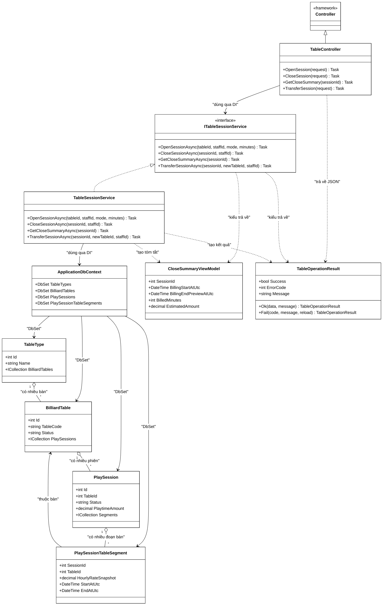
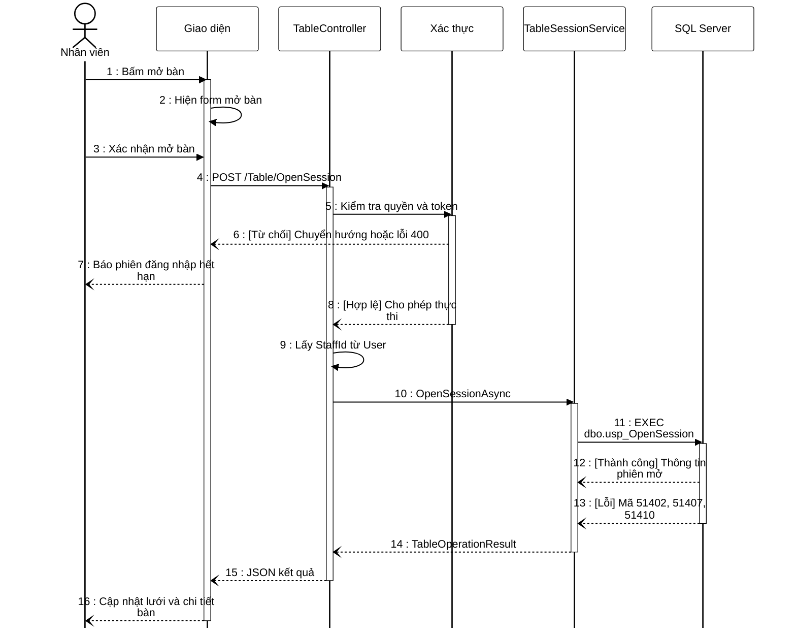
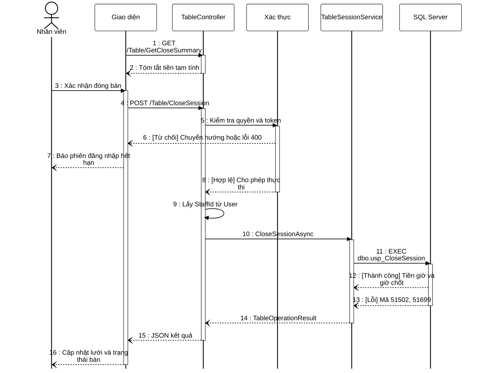
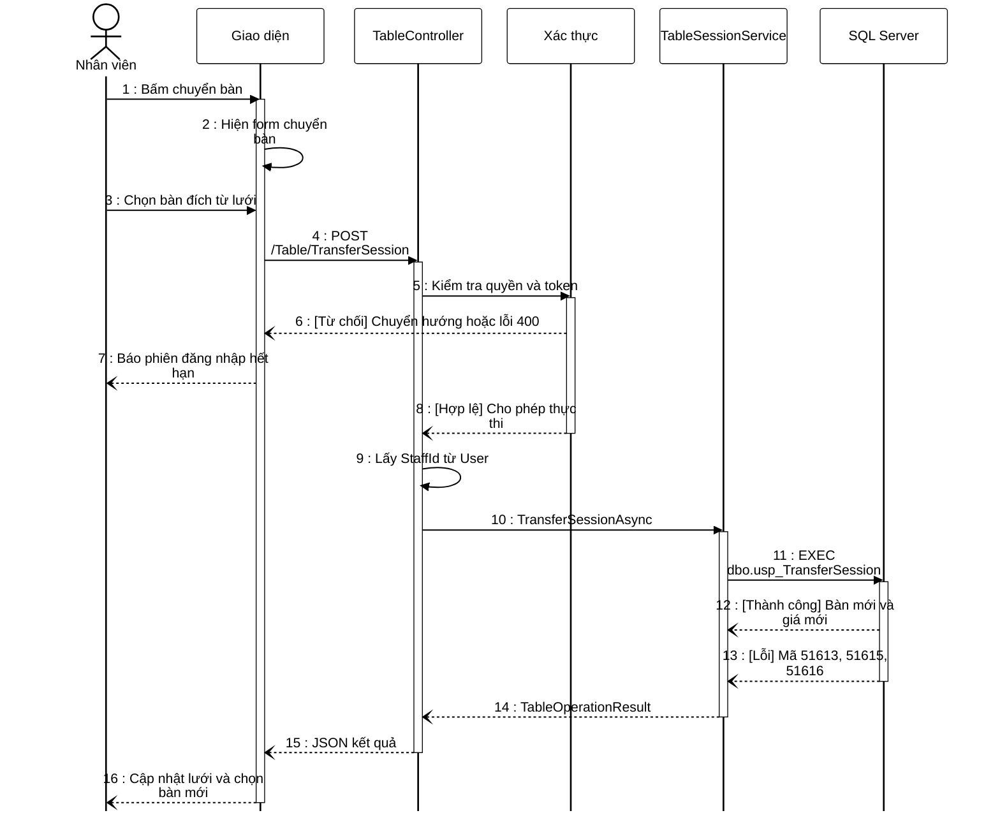

# II. Detailed Code Design

## 1. Quản lý bàn và phiên chơi

Phần này mô tả ba chức năng của màn hình Quản lý bàn: **Mở bàn**, **Đóng bàn** và **Chuyển bàn**. Các sơ đồ bám theo code thật: `TableController`, `TableSessionService`, `table-management.js` và các stored procedure trong `BMS_Database_Starter/06_PlaySessionEnhancements.sql`. Tiền giờ chỉ tính trên SQL Server, giao diện và C# không tính tiền.

### 1.1 Class Diagram

**Hình II.1 — Class Diagram cho ba chức năng Mở bàn, Đóng bàn, Chuyển bàn.** Sơ đồ gồm 11 hộp được rút gọn theo quy tắc: mỗi hộp tối đa 5 thành viên; `TableController` và `TableSessionService` chỉ giữ 4 phương thức công khai phục vụ trực tiếp ba chức năng; các phương thức private (`HandleSqlException`, `MapErrorCode`), dependency `ILogger` và các lớp Request nhỏ được chuyển xuống bảng giải thích để đảm bảo sơ đồ trực quan, không bị bè ngang. Kiểu dữ liệu được viết đơn giản (bỏ generic `Task<...>`, `DbSet<...>`) để biểu diễn rõ ràng.

**Quan hệ trong sơ đồ:**

- **IS-A (kế thừa hoặc hiện thực):** `TableController` kế thừa `Controller` của ASP.NET Core MVC. `TableSessionService` hiện thực giao diện `ITableSessionService`.
- **HAS-A (kết tập, hình thoi rỗng):** `TableType` có nhiều `BilliardTable`, `BilliardTable` có nhiều `PlaySession`, `PlaySession` có nhiều `PlaySessionTableSegment` (thể hiện qua các navigation property `BilliardTables`, `PlaySessions`, `Segments`).
- **Liên kết (association, đường liền mũi tên):** `TableController` tham chiếu `ITableSessionService` qua cơ chế DI của ASP.NET Core; `TableSessionService` tham chiếu `ApplicationDbContext` qua DI; `ApplicationDbContext` khai báo các `DbSet` của bốn entity; `PlaySessionTableSegment` trỏ về `BilliardTable`.
- **Phụ thuộc (dependency, đường đứt mũi tên hở):** `TableController` trả về kết quả JSON dạng `TableOperationResult`. `ITableSessionService` và `TableSessionService` dùng `TableOperationResult` và `CloseSummaryViewModel` làm kiểu dữ liệu trả về cho các tác vụ nghiệp vụ.

Trong ba chức năng này, `ApplicationDbContext` chỉ được dùng để lấy đối tượng kết nối `SqlConnection` (`Database.GetDbConnection()`), toàn bộ thao tác cập nhật dữ liệu do các stored procedure trong SQL Server đảm nhiệm.

| Class | Trách nhiệm |
|---|---|
| Controller | Lớp cơ sở MVC của framework ASP.NET Core, cung cấp `User`, `Json`, `View`, `ModelState` cho controller con |
| TableController | Tiếp nhận yêu cầu HTTP cho màn hình Quản lý bàn. Yêu cầu quyền role `Staff` hoặc `Admin`, bảo vệ CSRF bằng `[ValidateAntiForgeryToken]` cho các action POST. Lấy `StaffId` trực tiếp từ `User` (`ClaimsPrincipal`), gọi service và trả kết quả JSON dạng `TableOperationResult` |
| ITableSessionService | Giao diện dịch vụ phiên chơi, khai báo 4 phương thức công khai: `OpenSessionAsync`, `CloseSessionAsync`, `GetCloseSummaryAsync`, `TransferSessionAsync` (cùng các phương thức mở rộng khác) |
| TableSessionService | Cài đặt nghiệp vụ phiên chơi: thực thi stored procedure qua ADO.NET `SqlConnection` lấy từ DbContext; gọi hàm `GetCloseSummaryAsync` tính tiền tạm tính; bắt `SqlException` qua phương thức private `HandleSqlException`, dịch mã lỗi nghiệp vụ sang tiếng Việt qua `MapErrorCode`, ghi log qua `ILogger` |
| ILogger | Ghi log hệ thống cho `TableSessionService`: `LogWarning` cho các trường hợp nghiệp vụ bị từ chối, `LogError` cho các lỗi hệ thống hoặc dữ liệu bất thường (được rút khỏi hình để đơn giản hóa quan hệ) |
| ApplicationDbContext | Ngữ cảnh EF Core, quản lý các `DbSet` thực thể. Trong ba chức năng phiên chơi, lớp này cung cấp kết nối `Database.GetDbConnection()` dùng chung connection pool với EF Core |
| PlaySession | Entity bảng `PlaySessions`: đại diện cho một phiên chơi bida, lưu hình thức (`SessionMode`: Open/Timed), thời gian bắt đầu, kết thúc, mốc tính tiền (`BillingStartAtUtc`, `BillingEndAtUtc`), giờ dự kiến kết thúc (`PlannedEndAtUtc`), tiền giờ chơi (`PlaytimeAmount`) và danh sách các đoạn bàn (`Segments`) |
| PlaySessionTableSegment | Entity bảng `PlaySessionTableSegments`: một đoạn chơi trên một bàn cụ thể, lưu đơn giá chốt tại thời điểm chơi của bàn đó (`HourlyRateSnapshot`), thời điểm bắt đầu (`StartAtUtc`) và kết thúc (`EndAtUtc`). Khi chuyển bàn, đoạn cũ được đóng và đoạn mới được mở |
| BilliardTable | Entity bảng `BilliardTables`: đại diện cho bàn bida vật lý, mã bàn (`TableCode`), trạng thái (`Status`: Available, InUse, AwaitingPayment, Maintenance, Inactive) và tập hợp các phiên chơi |
| TableType | Entity bảng `TableTypes`: danh mục loại bàn (Pool, Carom) và đơn giá theo giờ (`HourlyRate`) |
| OpenSessionRequest | DTO nhận dữ liệu form mở bàn: `TableId`, `SessionMode`, `PlannedMinutes` (được rút khỏi hình để giữ giới hạn 11 hộp) |
| CloseSessionRequest | DTO nhận dữ liệu form đóng bàn: `SessionId` (được rút khỏi hình) |
| TransferSessionRequest | DTO nhận dữ liệu form chuyển bàn: `SessionId`, `NewTableId` (được rút khỏi hình) |
| CloseSummaryViewModel | ViewModel chứa dữ liệu tóm tắt tạm tính trước khi đóng bàn: `SessionId`, `BillingStartAtUtc`, `BillingEndPreviewAtUtc`, `BilledMinutes`, `MinimumChargeApplied`, `EstimatedAmount` |
| TableOperationResult | Đối tượng chuẩn hóa kết quả thao tác trả về cho client: `Success`, `ErrorCode`, `Message`, `AutoReload`, `Data`; khởi tạo nhanh qua hai phương thức tĩnh `Ok` và `Fail` |

---

### 1.2 Sequence Diagram: Mở bàn

**Hình II.2 — Sequence Diagram: Mở bàn.** Sơ đồ gồm 16 thông điệp, điều phối giữa 6 thành phần chính. Các lời gọi nội bộ của Giao diện được gộp thành "Hiện form", các nhánh từ chối xác thực được gom thành một luồng phản hồi báo hết hạn phiên, và các bước truy cập kết nối ADO.NET được mô tả chi tiết trong Bảng II.1.

- **Actor:** Nhân viên thu ngân hoặc Quản trị viên (`Staff`, `Admin`) thao tác trên giao diện POS.
- **Route:** `POST /Table/OpenSession`. Dữ liệu gửi lên dạng form urlencoded gồm `TableId`, `SessionMode` ("Open" hoặc "Timed"), `PlannedMinutes` và token CSRF `__RequestVerificationToken`.
- **Điều kiện trước:** Người dùng đã đăng nhập với vai trò hợp lệ, đã chọn một bàn đang ở trạng thái Trống (`Available`).
- **Kết quả:** Phiên chơi mới được tạo ở trạng thái `Active`, bàn chuyển sang `InUse`, giao diện hiển thị thông báo thành công (kèm mốc giờ tính tiền và giờ dự kiến nếu có), lưới bàn và thông tin chi tiết bàn được cập nhật tự động.

**Bảng II.1: Giải thích các bước trong quy trình Mở bàn**

| Bước | Giải thích |
|---|---|
| 1 đến 3 | Nhân viên bấm nút mở bàn trên thẻ bàn hoặc bảng chi tiết (`handleOpenTable` trong `table-management.js`). Giao diện gọi hàm nội bộ `showOpenForm` để hiển thị modal/panel mở bàn, tính toán xem trước mốc giờ tính tiền (`updateOpenFormPreview`). Nhân viên chọn hình thức mở bàn: không giới hạn thời gian (`Open`) hoặc đăng ký thời gian (`Timed` kèm số phút là bội số của 15 từ 15 đến 720 phút), sau đó bấm xác nhận (`handleConfirmOpenSession`) |
| 4 | Trình duyệt gửi yêu cầu `POST /Table/OpenSession` mang theo `TableId`, `SessionMode`, `PlannedMinutes` và `__RequestVerificationToken`. Cờ `isProcessing` được bật để chống gửi trùng lặp yêu cầu |
| 5 đến 8 | Pipeline của ASP.NET Core kiểm tra cookie xác thực, vai trò người dùng (`[Authorize(Roles = "Staff,Admin")]`) và token chống giả mạo (`[ValidateAntiForgeryToken]`). Nếu chưa đăng nhập hoặc cookie hết hạn, hệ thống trả mã 302 chuyển hướng về `/Account/Login`; nếu sai vai trò, trả 302 về `/Account/AccessDenied` (trình duyệt tự theo chuyển hướng khiến JS nhận phản hồi là trang HTML với thuộc tính `response.redirected = true`); nếu thiếu hoặc sai token CSRF, trả mã lỗi HTTP 400. Khi rơi vào một trong ba trường hợp này (bước 6), Giao diện nhận biết và hiển thị toast báo phiên đăng nhập đã hết hạn, đồng thời dừng tiến trình làm mới tự động (`stopPolling`) ở bước 7. Nếu hợp lệ (bước 8), yêu cầu được chuyển tiếp vào action `OpenSession` của `TableController` |
| 9 | `TableController` kiểm tra `ModelState.IsValid`. Tiếp đó, controller tự gọi nội bộ phương thức `User.FindFirstValue(ClaimTypes.NameIdentifier)` để lấy mã định danh nhân viên (`StaffId`) từ token định danh an toàn trên server, tuyệt đối không nhận `StaffId` từ client |
| 10 | Controller gọi phương thức `_tableSessionService.OpenSessionAsync(request.TableId, staffId, sessionMode, request.PlannedMinutes)` |
| 11 | `TableSessionService` lấy kết nối `SqlConnection` qua `_context.Database.GetDbConnection()` và mở kết nối nếu đang đóng. Dịch vụ tạo `SqlCommand` kiểu `StoredProcedure` gọi `dbo.usp_OpenSession` với các tham số: `@TableId`, `@StaffId`, `@BookingId = NULL`, `@CustomerId = NULL`, `@SessionMode`, `@PlannedMinutes`. Trong thủ tục: khóa bản ghi bàn bằng cú pháp `SELECT ... WITH (UPDLOCK, HOLDLOCK)` để chống tranh chấp; kiểm tra bàn phải đang `Available` (lỗi 51402); kiểm tra không trùng phiên `Active` (lỗi 51403); kiểm tra bàn không nằm trong khung giờ giữ chỗ đặt bàn (lỗi 51407); kiểm tra số phút hợp lệ (lỗi 51410). Sau đó, thủ tục chèn bản ghi vào `PlaySessions` với giờ bắt đầu `SYSUTCDATETIME()`, giờ tính tiền làm tròn LÊN mốc 15 phút kế tiếp bằng hàm `fn_CeilTo15Min`, chèn đoạn bàn ban đầu vào `PlaySessionTableSegments` và cập nhật bàn sang `InUse` |
| 12 đến 13 | Nếu thành công (bước 12), thủ tục trả về tập kết quả gồm `SessionId`, `BillingStartAtUtc`, `PlannedEndAtUtc`, `SessionMode`. Nếu vi phạm quy tắc nghiệp vụ (bước 13), thủ tục thực thi lệnh `THROW` với các mã lỗi tiêu biểu: 51402 (bàn không trống), 51407 (bàn đang giữ chỗ), 51410 (thời gian đăng ký không hợp lệ); các lỗi khác như 51401 (sai quyền tài khoản), 51409 (sai hình thức mở) hoặc lỗi mất kết nối cơ sở dữ liệu được xử lý tương tự |
| 14 | Trong trường hợp lỗi, service gọi phương thức private `HandleSqlException`, ghi log cảnh báo nghiệp vụ (`_logger.LogWarning`) hoặc log lỗi hệ thống (`_logger.LogError`), gọi `MapErrorCode` dịch mã lỗi thành thông báo tiếng Việt có dấu, và đóng gói kết quả thành đối tượng `TableOperationResult.Fail(errorCode, message, autoReload)`. Khi thành công, trả về `TableOperationResult.Ok(...)` mang theo dữ liệu phiên mở |
| 15 | `TableController` tuần tự hóa đối tượng `TableOperationResult` thành JSON gửi về cho Giao diện |
| 16 | JavaScript xử lý kết quả: nếu thất bại, hiển thị toast lỗi (nếu `autoReload = true` thì tải lại lưới bàn). Nếu thành công, hiển thị toast thông báo mở bàn kèm mốc giờ tính tiền, gọi `reloadTableGrid` (`GET /Table/GetTableCardsPartial`) để cập nhật lại lưới thẻ bàn và gọi `handleTableSelect` (`GET /Table/GetTableDetail`) để nạp chi tiết phiên chơi mới lên giao diện cho nhân viên theo dõi |

---

### 1.3 Sequence Diagram: Đóng bàn

**Hình II.3 — Sequence Diagram: Đóng bàn.** Sơ đồ gồm 16 thông điệp. Phần lấy dữ liệu tóm tắt tiền tạm tính (`GetCloseSummary`) được gộp thành đúng 2 thông điệp (bước 1 và 2) ngay đầu sơ đồ; sau đó là thao tác xác nhận và gửi yêu cầu đóng phiên `POST /Table/CloseSession` theo chuẩn bảo mật.

- **Actor:** Nhân viên thu ngân hoặc Quản trị viên (`Staff`, `Admin`).
- **Route:** `GET /Table/GetCloseSummary?sessionId=...` (lấy tóm tắt tạm tính) và `POST /Table/CloseSession` (thực hiện đóng phiên chính thức, dữ liệu gồm `SessionId` và `__RequestVerificationToken`).
- **Điều kiện trước:** Bàn đang ở trạng thái `InUse` và sở hữu một phiên chơi `Active`.
- **Kết quả:** Phiên chơi chuyển sang `Closed`, chốt mốc giờ tính tiền kết thúc và tổng tiền giờ; bàn chuyển sang trạng thái chờ thanh toán (`AwaitingPayment`); hiển thị toast tiền giờ; lưới bàn được cập nhật.

**Bảng II.2: Giải thích các bước trong quy trình Đóng bàn**

| Bước | Giải thích |
|---|---|
| 1 đến 2 | Khi nhân viên bấm nút đóng bàn (`handleCloseTable`), giao diện gọi hàm `showCloseForm` và gửi yêu cầu `GET /Table/GetCloseSummary?sessionId=...` qua hàm `loadCloseSummary`. Yêu cầu GET áp dụng cùng cơ chế xác thực cookie và vai trò (`Staff,Admin`), nhưng không yêu cầu anti-forgery token. Dịch vụ `TableSessionService.GetCloseSummaryAsync` thực thi câu truy vấn `SELECT` trực tiếp trong SQL Server gọi hai hàm `dbo.fn_CeilTo15Min` và `dbo.fn_CalcPlaytimeAmount` để tính toán chính xác số phút và tiền giờ tạm tính tại thời điểm hiện tại. Nếu phiên không còn `Active` (đã được đóng bởi nhân viên khác), server trả mã lỗi 51502; nếu hợp lệ, trả về đối tượng `CloseSummaryViewModel` (bước 2) để giao diện hiển thị bảng xác nhận đóng bàn kèm số tiền tạm tính |
| 3 | Nhân viên kiểm tra thông tin tiền tạm tính và bấm xác nhận đóng phiên trên modal (`handleConfirmCloseSession`) |
| 4 | Trình duyệt gửi yêu cầu `POST /Table/CloseSession` mang theo `SessionId` và `__RequestVerificationToken` |
| 5 đến 8 | Cơ chế bảo mật kiểm tra cookie xác thực, vai trò `Staff`/`Admin` và token chống CSRF. Nếu không hợp lệ (hết phiên đăng nhập, sai vai trò hoặc token không hợp lệ), pipeline trả về chuyển hướng 302 hoặc lỗi 400 (bước 6); Giao diện nhận biết qua phản hồi HTML và hiển thị toast báo phiên hết hạn, đồng thời dừng polling ở bước 7. Nếu hợp lệ (bước 8), cho phép thực thi action `CloseSession` |
| 9 | `TableController` tự lấy mã nhân viên `StaffId` từ định danh người dùng đăng nhập (`User.FindFirstValue`) |
| 10 | Controller gọi phương thức `_tableSessionService.CloseSessionAsync(request.SessionId, staffId)` |
| 11 | `TableSessionService` lấy kết nối qua `_context.Database.GetDbConnection()` và gọi stored procedure `dbo.usp_CloseSession` với `@SessionId` và `@StaffId`. Trong thủ tục: khóa dòng phiên chơi bằng `WITH (UPDLOCK, HOLDLOCK)`, sau đó khóa dòng bàn tương ứng; kiểm tra phiên phải đang `Active` (nếu không THROW 51502); đóng đoạn bàn đang mở trong `PlaySessionTableSegments` bằng cách gán `EndAtUtc = SYSUTCDATETIME()`. Nếu không tìm thấy đoạn bàn mở, THROW lỗi toàn vẹn 51699. Tiếp tục tính tiền giờ bằng hàm `dbo.fn_CalcPlaytimeAmount` (làm tròn lên theo từng block 15 phút, tối thiểu 1 block 15 phút); cập nhật `PlaySessions` sang `Closed` kèm `PlaytimeAmount`, `BillingEndAtUtc`; và chuyển trạng thái bàn trong `BilliardTables` sang `AwaitingPayment` |
| 12 đến 13 | Nếu thành công (bước 12), thủ tục trả về các trường `Id`, `StartAtUtc`, `EndAtUtc`, `HourlyRateSnapshot`, `PlaytimeAmount`, `Status`, `BillingStartAtUtc`, `BillingEndAtUtc`, `SessionMode`. Nếu thất bại (bước 13), thủ tục ném lỗi: 51502 (phiên không còn Active), 51699 (dữ liệu đoạn bàn không nhất quán); các lỗi quyền hạn (51501) hoặc lỗi hệ thống được xử lý tương tự |
| 14 | Service chuyển đổi kết quả thành `TableOperationResult`: khi có ngoại lệ SQL thì ghi log qua `ILogger` và dịch mã qua `MapErrorCode`; khi thành công thì trả về kết quả `Ok` kèm số tiền giờ chính thức và các mốc thời gian chốt |
| 15 | `TableController` trả dữ liệu JSON `TableOperationResult` cho Giao diện |
| 16 | Giao diện đóng modal xác nhận; nếu lỗi 51502 thì báo lỗi và tải lại lưới; nếu thành công thì hiển thị toast thông báo hoàn tất đóng bàn kèm tiền giờ chơi, gọi `reloadTableGrid` để chuyển màu bàn sang trạng thái Chờ thanh toán (`AwaitingPayment`) và gọi `handleTableSelect` để cập nhật bảng chi tiết bàn |

---

### 1.4 Sequence Diagram: Chuyển bàn

**Hình II.4 — Sequence Diagram: Chuyển bàn.** Sơ đồ gồm 16 thông điệp. Bước chuẩn bị danh sách bàn đích được thực hiện hoàn toàn tại client thông qua lưới dữ liệu đang hiển thị, không gửi thêm yêu cầu tải dữ liệu tới máy chủ.

- **Actor:** Nhân viên thu ngân hoặc Quản trị viên (`Staff`, `Admin`).
- **Route:** `POST /Table/TransferSession`. Dữ liệu form gồm `SessionId`, `NewTableId` và `__RequestVerificationToken`.
- **Điều kiện trước:** Bàn đang chơi (`InUse`) có phiên `Active` không gắn với lịch đặt trước (`BookingId IS NULL`), và trên giao diện có ít nhất một bàn khác đang ở trạng thái Trống (`Available`).
- **Kết quả:** Phiên chơi giữ nguyên thời gian bắt đầu và được chuyển sang bàn đích; bàn cũ quay về `Available`; bàn mới chuyển sang `InUse`; đoạn bàn cũ được đóng và đoạn bàn mới được mở theo đơn giá bàn đích; giao diện tự động chọn bàn mới.

**Bảng II.3: Giải thích các bước trong quy trình Chuyển bàn**

| Bước | Giải thích |
|---|---|
| 1 đến 3 | Nhân viên bấm nút chuyển bàn trên panel chi tiết (`handleTransferTable`). Giao diện gọi hàm `showTransferForm`, đồng thời kích hoạt hàm `buildAvailableTableOptions` để trích xuất các bàn đang có trạng thái Trống (`Available`) trực tiếp từ cây DOM của lưới bàn đang hiển thị (thông qua hàm trợ giúp `getAvailableTablesFromGrid`), hoàn toàn không tạo thêm request tải danh sách về máy chủ. Nhân viên chọn bàn đích muốn chuyển đến từ danh sách chọn (bước 3) và bấm xác nhận chuyển bàn (`handleConfirmTransferSession`) |
| 4 | Trình duyệt gửi yêu cầu `POST /Table/TransferSession` với dữ liệu form mang theo `SessionId`, `NewTableId` và `__RequestVerificationToken`. Cờ `isProcessing` và `isTransferring` được thiết lập |
| 5 đến 8 | Pipeline xác thực cookie, vai trò `Staff`/`Admin` và anti-forgery token. Nếu phát hiện vi phạm bảo mật, pipeline trả về chuyển hướng 302 hoặc mã 400 (bước 6); Giao diện bắt phản hồi HTML và hiển thị toast báo hết phiên đăng nhập, dừng polling ở bước 7. Nếu hợp lệ (bước 8), cho phép action `TransferSession` thực thi |
| 9 | `TableController` xác thực `ModelState.IsValid` và tự lấy `StaffId` từ `User.FindFirstValue(ClaimTypes.NameIdentifier)` |
| 10 | Controller gọi phương thức `_tableSessionService.TransferSessionAsync(request.SessionId, request.NewTableId, staffId)` |
| 11 | `TableSessionService` lấy kết nối qua `_context.Database.GetDbConnection()` và thực thi stored procedure `dbo.usp_TransferSession` với các tham số: `@SessionId`, `@NewTableId`, `@StaffId`. Trong thủ tục: khóa dòng phiên chơi trong `PlaySessions` bằng `WITH (UPDLOCK, HOLDLOCK)`; kiểm tra phiên phải đang `Active` (nếu không THROW 51612); kiểm tra phiên không gắn với đặt trước (nếu có `BookingId` THROW 51616 vì phiên đặt trước chưa hỗ trợ đổi bàn); kiểm tra bàn đích không trùng bàn cũ (nếu trùng THROW 51614). Kế tiếp, thủ tục thực hiện cơ chế khóa tài nguyên chống deadlock: khóa đồng thời cả hai bàn (bàn hiện tại và bàn đích) theo thứ tự `Id` tăng dần (`@FirstId`, `@SecondId`) với tùy chọn `WITH (UPDLOCK, HOLDLOCK)`. Sau khi giữ khóa, kiểm tra bàn đích phải tồn tại và đang `Available` (nếu không THROW 51613) và không bị giữ chỗ cho đặt bàn trong khung giờ hiện tại (nếu có THROW 51615). Sau đó, thủ tục đóng đoạn bàn cũ (`EndAtUtc = SYSUTCDATETIME()`), mở đoạn bàn mới trong `PlaySessionTableSegments` với đơn giá snapshot lấy từ loại bàn đích, cập nhật `PlaySessions.TableId = @NewTableId`, chuyển bàn cũ về `Available` và bàn mới sang `InUse` |
| 12 đến 13 | Nếu thành công (bước 12), thủ tục trả về tập kết quả gồm `SessionId`, `OldTableId`, `NewTableId`, `NewTableCode`, `NewHourlyRate`, `TransferAtUtc`. Nếu thất bại (bước 13), thủ tục ném lỗi: 51613 (bàn đích không còn Trống), 51615 (bàn đích vướng lịch đặt), 51616 (phiên theo booking không cho phép chuyển); các lỗi 51611 (quyền hạn), 51612 (phiên không Active), 51614 (trùng bàn cũ), 51699 (lỗi đoạn bàn) hoặc lỗi kết nối SQL được xử lý tương tự |
| 14 | Service bắt ngoại lệ, ghi log (`LogWarning` cho lỗi nghiệp vụ, `LogError` cho lỗi hệ thống), dịch mã lỗi qua `MapErrorCode` và trả về `TableOperationResult` |
| 15 | `TableController` gửi JSON `TableOperationResult` về cho client |
| 16 | Giao diện đóng form chuyển bàn: nếu lỗi, hiển thị toast tiếng Việt tương ứng (nếu lỗi liên quan đến trạng thái bàn như 51613, 51615 thì tự động tải lại lưới bàn). Nếu thành công, hiển thị toast thông báo đã chuyển sang bàn mới kèm đơn giá mới áp dụng, gọi `reloadTableGrid` để cập nhật trạng thái hai bàn và tự động gọi `handleTableSelect(newTableId)` để chọn và hiển thị chi tiết của bàn đích mới |
