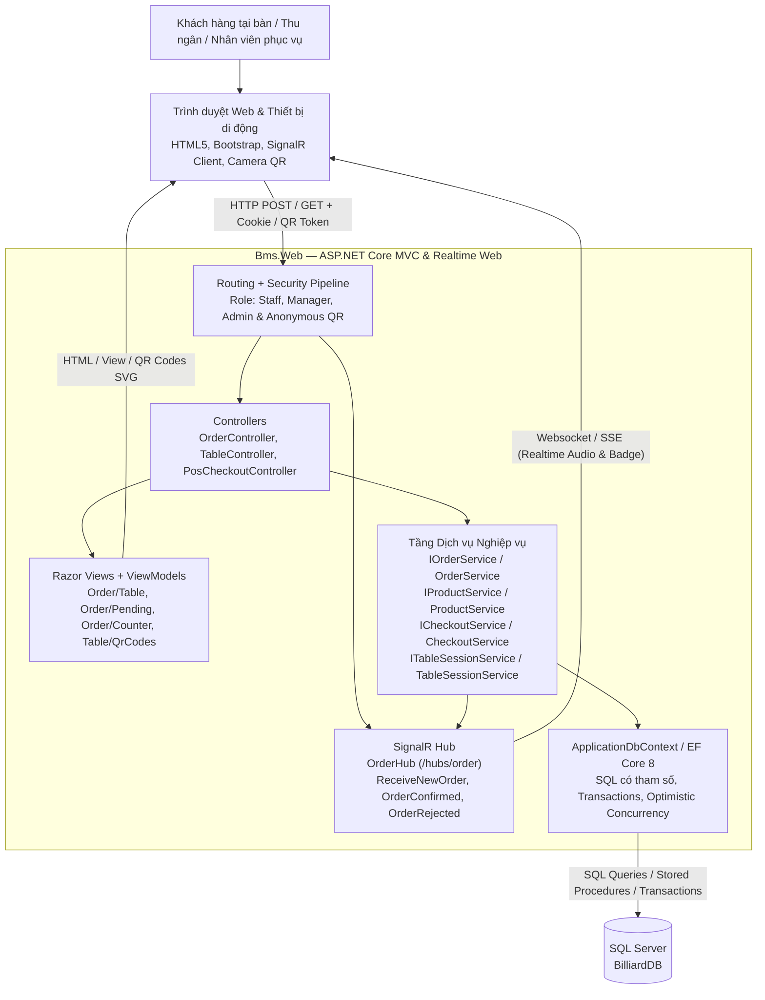
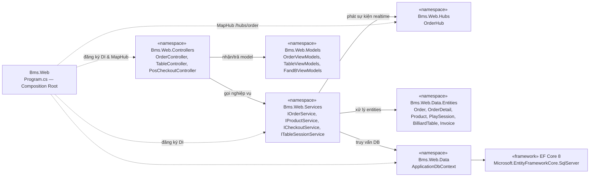
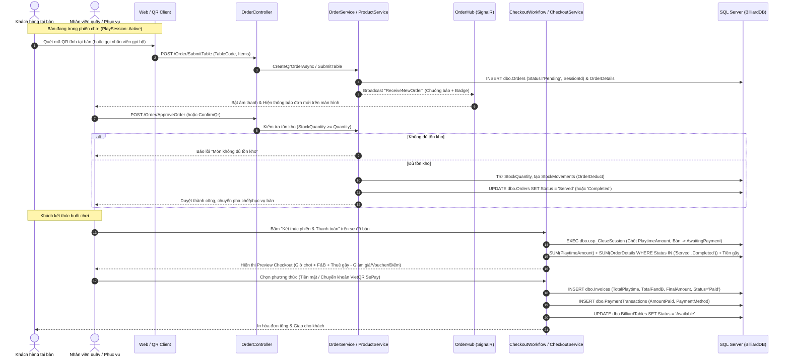
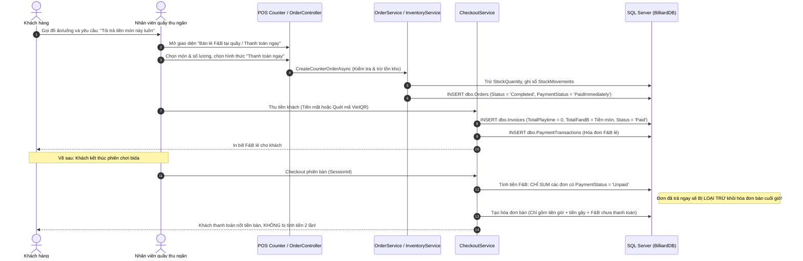

# Billiard Management System

## Software Design Specification (SDS) — Phân hệ F&B (Hiệp)

**Ngày cập nhật:** 09/11/2026. **Phiên bản:** 1.0.  
**Người phụ trách theo phân công:** Hiệp (Software Engineer — Phân hệ Gọi món F&B & Quản lý bàn).  
**Phạm vi nghiệp vụ:** Mã QR bàn, Gọi món tại bàn, Gọi món tại quầy, Duyệt/Từ chối món realtime, Hủy hoàn kho và Tích hợp luồng thanh toán F&B (Trường hợp 1 & Trường hợp 2).

---

### Change Log

| Date | A / M / D | In charge | Change Description |
|---|---|---|---|
| 09/11/2026 | A | Hiệp | Khởi tạo SDS cho Phân hệ F&B trong thư mục chuyên biệt `docs/sds-hiep/`, đối chiếu CSDL `BilliardDB` và phân tích sâu 2 kịch bản thanh toán F&B |

---

# I. High Level Design

## 1. Software Architecture

Phân hệ F&B được xây dựng trên nền tảng **ASP.NET Core 8 MVC**, tích hợp kết nối thời gian thực qua **SignalR (`OrderHub`)** và bảo đảm tính toàn vẹn dữ liệu chặt chẽ trên **SQL Server (`BilliardDB`)**.

* Sơ đồ kiến trúc Mermaid: [01-architecture.mmd](01-architecture.mmd)



## 2. Package Diagram

* Sơ đồ phân rã package: [02-packages.mmd](02-packages.mmd)



---

# II. Chi tiết 2 Kịch bản Nghiệp vụ F&B

### 1. Trường hợp 1: Khách gọi món tại bàn — Thanh toán gộp cùng tiền bàn & tiền gậy cuối phiên

* Sơ đồ tuần tự: [05-order-fnb-table-case1.mmd](05-order-fnb-table-case1.mmd)



### 2. Trường hợp 2: Khách muốn thanh toán lẻ F&B ngay tại quầy (Không thanh toán chung với tiền bàn)

* Sơ đồ tuần tự: [06-order-fnb-counter-case2.mmd](06-order-fnb-counter-case2.mmd)



---

# III. Đánh giá Logic Hiện tại & Nhận xét Chi tiết

### 1. Đánh giá tính khả thi và độ ổn định của mã nguồn hiện tại
* **Trường hợp 1 (RẤT TỐT):** 
  - Quy trình gọi món qua QR code, trừ kho khi duyệt đơn (`ApproveOrder` / `ConfirmQrOrderAsync`), kiểm tra tồn kho tức thời và gộp tiền F&B vào hóa đơn bàn cuối giờ đã được hoàn thiện 100%.
  - Cơ chế khóa thanh toán khi còn đơn chờ: `CheckoutService` chủ động từ chối tính tiền nếu bàn còn đơn `Pending`/`Preparing`, ngăn chặn việc nhân viên vô tình bỏ sót đơn của khách.
  - Toàn bộ 108 ca kiểm thử tích hợp (smoke tests) đã kiểm chứng thành công luồng này.

### 2. Nhận xét các lỗ hổng cần khắc phục cho Trường hợp 2:

> [!WARNING]
> #### Nhận xét 1: Nguy cơ tính tiền 2 lần (Double Billing) khi khách thanh toán lẻ
> Trong `src/Bms.Web/Services/CheckoutService.cs`, câu lệnh SQL chốt tiền F&B cuối phiên bàn hiện tại là:
> ```sql
> SELECT ISNULL(SUM(od.Subtotal), 0)
> FROM dbo.Orders o
> INNER JOIN dbo.OrderDetails od ON od.OrderId = o.Id
> WHERE o.SessionId = s.Id AND o.Status IN ('Served', 'Completed')
> ```
> Vì bảng `dbo.Orders` chưa có cột trạng thái thanh toán (đơn này đã thu tiền hay chưa), nên nếu khách đã trả tiền lẻ ngay tại quầy cho một đơn nào đó, thì đến cuối giờ khi tính tiền bàn, **hệ thống vẫn SUM đơn đó vào bill bàn lần thứ hai**. Khách hàng sẽ bị tính tiền 2 lần.

> [!CAUTION]
> #### Nhận xét 2: Ràng buộc cơ sở dữ liệu `SessionId NOT NULL` và `UQ_Invoice_Session`
> 1. Trong bảng `dbo.Orders`, cột `SessionId` hiện tại là `NOT NULL`. Điều này khiến hệ thống không thể tạo đơn cho khách vãng lai (Takeaway) nếu họ không mở bàn chơi bida.
> 2. Trong bảng `dbo.Invoices`, ràng buộc duy nhất `UQ_Invoice_Session UNIQUE (SessionId)` chỉ cho phép 1 hóa đơn duy nhất trên 1 phiên bàn. Nếu xuất hóa đơn thanh toán lẻ F&B cho bàn thì cuối phiên sẽ không thể xuất tiếp hóa đơn tiền giờ cho bàn đó.

---

# IV. Đề xuất Kiến trúc Cải tiến (Actionable Fixes)

Để giải quyết triệt để 2 nhận xét trên, Hiệp đề xuất 3 bước cải tiến:

1. **Bổ sung cột `PaymentStatus` vào bảng `dbo.Orders`:**
   ```sql
   ALTER TABLE dbo.Orders 
   ADD PaymentStatus varchar(20) NOT NULL CONSTRAINT DF_Order_PaymentStatus DEFAULT 'Unpaid';
   -- 'Unpaid': Món chưa trả tiền, gom vào hóa đơn bàn cuối phiên (Trường hợp 1)
   -- 'PaidImmediately': Món đã thanh toán lẻ tại quầy ngay khi nhận (Trường hợp 2)
   ```

2. **Cập nhật công thức tính tiền trong `CheckoutService.cs`:**
   ```csharp
   ISNULL((SELECT SUM(od.Subtotal) FROM dbo.Orders o
           INNER JOIN dbo.OrderDetails od ON od.OrderId = o.Id
           WHERE o.SessionId = s.Id 
             AND o.Status IN ('Served', 'Completed')
             AND (o.PaymentStatus IS NULL OR o.PaymentStatus = 'Unpaid')), 0) AS FandBAmount
   ```

3. **Cung cấp nút chuyển đổi trên giao diện gọi món quầy (`Order/Counter`):**
   - Bổ sung tùy chọn `[ ] Khách thanh toán lẻ ngay tại quầy`.
   - Nếu được chọn: Sau khi nhân viên bấm "Xác nhận", hệ thống tạo đơn với `PaymentStatus = 'PaidImmediately'`, mở popup thu tiền mặt/VietQR lẻ và loại trừ đơn này khỏi hóa đơn bàn khi kết thúc giờ chơi.
